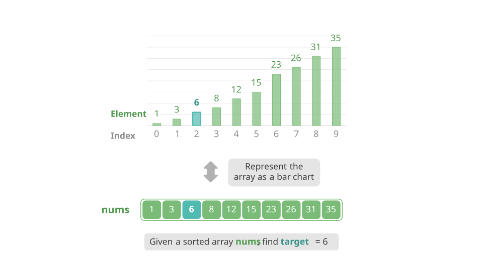
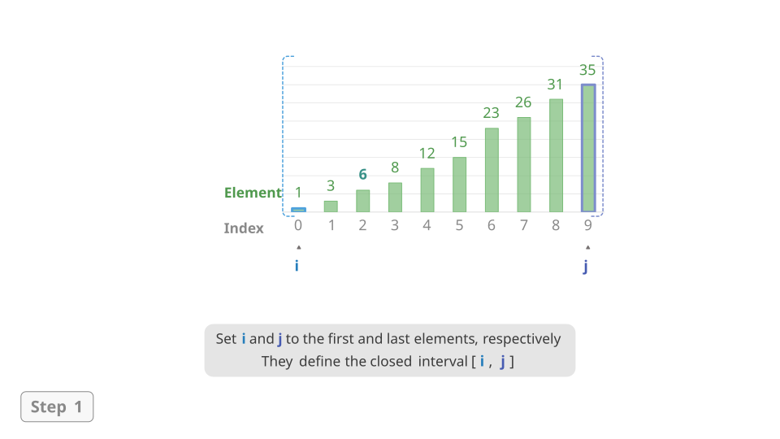
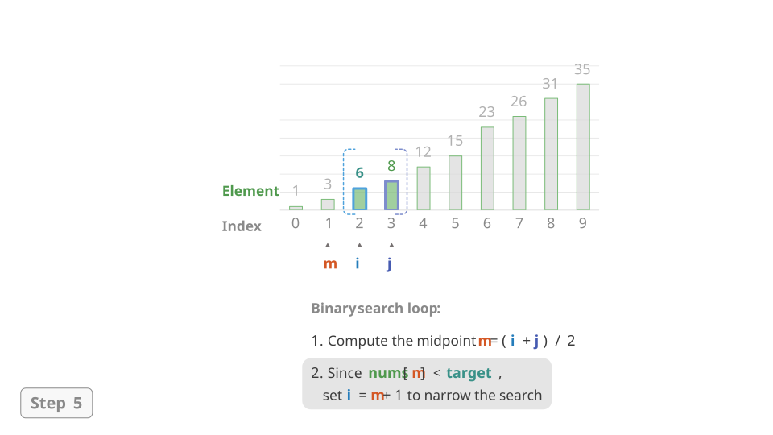

# Binary search

<u>Binary search</u> is an efficient search algorithm based on divide and conquer. It uses the sorted order of the data to halve the search range at each iteration until it finds the target or the interval is empty.

!!! question

    Given an array `nums` of length $n$ with distinct elements in ascending order, find and return the index of `target`. If the array does not contain the target, return $-1$. The figure below shows an example.



As the figure below shows, initialize pointers $i = 0$ and $j = n - 1$ at the first and last elements of the array. They define the search interval $[0, n - 1]$. The square brackets denote a closed interval, which includes both endpoints.

Repeat the following two steps.

1. Compute the midpoint index $m = \lfloor {(i + j) / 2} \rfloor$, where $\lfloor \: \rfloor$ means rounding down.
2. Compare `nums[m]` with `target`. There are three cases.
    1. If `nums[m] < target`, any match for `target` must be in $[m + 1, j]$, so set $i = m + 1$.
    2. If `nums[m] > target`, any match for `target` must be in $[i, m - 1]$, so set $j = m - 1$.
    3. If `nums[m] = target`, we have found `target`. Return index $m$.

If the array does not contain the target, the search interval eventually becomes empty. Return $-1$.

=== "<1>"
    

=== "<2>"
    

=== "<3>"
    

=== "<4>"
    

=== "<5>"
    

=== "<6>"
    

=== "<7>"
    

Since $i$ and $j$ both have type `int`, **their sum $i + j$ may exceed the range of `int`**. To avoid integer overflow, we usually compute the midpoint as $m = \lfloor {i + (j - i) / 2} \rfloor$.

The following code implements the search:

```src
[file]{binary_search}-[class]{}-[func]{binary_search}
```

**Time complexity: $O(\log n)$**. Each iteration halves the interval, so the loop takes $\log_2 n$ iterations.

**Space complexity: $O(1)$**. The pointers $i$ and $j$ take up a constant amount of space.

## Representing the search interval

Another common convention is a left-closed, right-open interval such as $[0, n)$. It includes its left endpoint and excludes its right endpoint. With this convention, $[i, j)$ is empty when $i = j$.

We can use this convention to implement binary search with the same behavior:

```src
[file]{binary_search}-[class]{}-[func]{binary_search_lcro}
```

As the figure below shows, the choice of interval changes how we initialize binary search, test the loop condition, and narrow the interval.

A closed interval includes both endpoints, so the updates that narrow the interval using $i$ and $j$ are symmetric. This makes mistakes less likely, which is why **we generally recommend the closed-interval convention**.


## Advantages and limitations

Binary search is efficient in both time and space.

- Binary search is fast. Its logarithmic time complexity gives it a substantial advantage on large datasets. For example, with $n = 2^{20}$ elements, linear search takes $2^{20} = 1048576$ iterations, while binary search needs only $\log_2 2^{20} = 20$.
- Binary search needs no additional storage for the data. It uses less space than methods that require an auxiliary structure, such as hash lookup.

Binary search has several limitations to consider.

- Binary search requires sorted data. If the input is unsorted, sorting it just to run a search costs more than it saves. Sorting algorithms typically take $O(n \log n)$ time, more than either linear or binary search. Frequent insertions are also expensive: keeping the array sorted requires inserting each element at a particular position, which takes $O(n)$ time.
- Binary search applies only to arrays. It needs to jump between nonconsecutive elements. Those jumps are inefficient in a linked list, making binary search a poor fit for linked lists and structures built on them.
- Linear search performs better on small inputs. Each iteration of linear search requires just one test. An iteration of binary search requires one addition, one division, one to three tests, and one more addition or subtraction, for a total of four to six basic operations. When $n$ is small, linear search is therefore faster.
