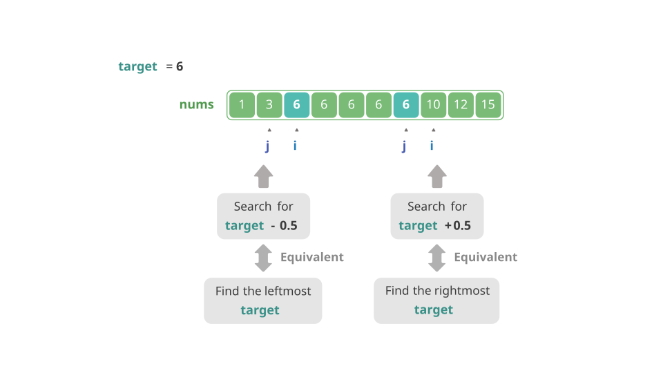

# Finding boundaries with binary search

## Finding the left boundary

!!! question

    Given a sorted array `nums` of length $n$ that may contain duplicates, return the index of the leftmost occurrence of `target`. If the value is absent, return $-1$.

Recall how binary search finds an insertion point. When the search ends, $i$ points to the leftmost occurrence of `target`. Thus, **finding the insertion point is essentially finding the index of the leftmost occurrence of `target`**.

We can use the insertion-point function to find the left boundary. If the array does not contain `target`, one of two things will happen.

- The insertion index $i$ is out of bounds.
- The element `nums[i]` differs from `target`.

In either case, return $-1$, as shown below:

```src
[file]{binary_search_edge}-[class]{}-[func]{binary_search_left_edge}
```

## Finding the right boundary

How can we find the rightmost occurrence of `target`? The most direct approach is to change how the pointers narrow the interval when `nums[m] == target`. Try implementing this version yourself.

Here are two shortcuts.

### Reusing the left-boundary search

We can use the function that finds the leftmost occurrence to find the rightmost one: **to locate the rightmost `target`, search for the leftmost `target + 1`**.

As the figure below shows, when the search ends, $i$ points to the leftmost `target + 1` (if present), and $j$ points to the rightmost `target`. **Return $j$ to get the right boundary**.


The insertion-point function returns $i$. Subtract $1$ from it to obtain $j$:

```src
[file]{binary_search_edge}-[class]{}-[func]{binary_search_right_edge}
```

### Finding a boundary by searching for a value

When the array does not contain `target`, the final positions of $i$ and $j$ mark the first element greater than `target` and the rightmost element less than `target`, respectively.

We can therefore find either boundary by searching for a value we know is absent, as the figure below shows.

- To find the leftmost `target`, search for `target - 0.5` and return the pointer $i$.
- To find the rightmost `target`, search for `target + 0.5` and return the pointer $j$.



The code is omitted here. Keep two details in mind.

- The given array contains only integers, so the equality case cannot arise for these fractional search values.
- Since this method introduces fractional values, change the function's `target` variable to a floating-point type. Python requires no change.
