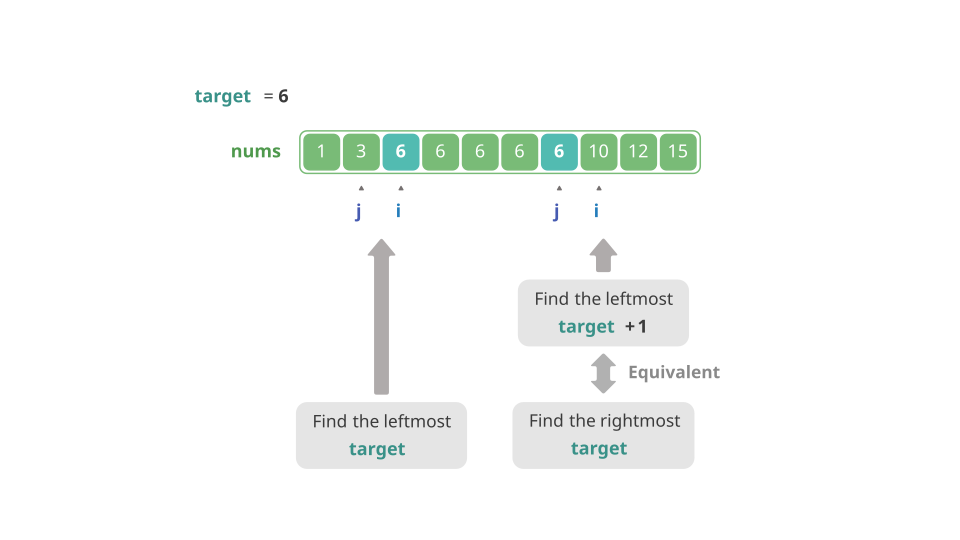

# 10.3 &nbsp; Finding boundaries with binary search

## 10.3.1 &nbsp; Finding the left boundary

!!! question

    Given a sorted array `nums` of length $n$ that may contain duplicates, return the index of the leftmost occurrence of `target`. If the value is absent, return $-1$.

Recall how binary search finds an insertion point. When the search ends, $i$ points to the leftmost occurrence of `target`. Thus, **finding the insertion point is essentially finding the index of the leftmost occurrence of `target`**.

We can use the insertion-point function to find the left boundary. If the array does not contain `target`, one of two things will happen.

- The insertion index $i$ is out of bounds.
- The element `nums[i]` differs from `target`.

In either case, return $-1$, as shown below:

=== "Python"

    ```python title="binary_search_edge.py"
    def binary_search_left_edge(nums: list[int], target: int) -> int:
        """Use binary search to find the leftmost occurrence of target"""
        # Equivalent to finding the insertion point for target
        i = binary_search_insertion(nums, target)
        # Target not found. Return -1
        if i == len(nums) or nums[i] != target:
            return -1
        # Found target. Return index i
        return i
    ```

=== "C++"

    ```cpp title="binary_search_edge.cpp"
    /* Use binary search to find the leftmost occurrence of target */
    int binarySearchLeftEdge(vector<int> &nums, int target) {
        // Equivalent to finding the insertion point for target
        int i = binarySearchInsertion(nums, target);
        // Target not found. Return -1
        if (i == nums.size() || nums[i] != target) {
            return -1;
        }
        // Found target. Return index i
        return i;
    }
    ```

=== "Java"

    ```java title="binary_search_edge.java"
    /* Use binary search to find the leftmost occurrence of target */
    int binarySearchLeftEdge(int[] nums, int target) {
        // Equivalent to finding the insertion point for target
        int i = binary_search_insertion.binarySearchInsertion(nums, target);
        // Target not found. Return -1
        if (i == nums.length || nums[i] != target) {
            return -1;
        }
        // Found target. Return index i
        return i;
    }
    ```

=== "C#"

    ```csharp title="binary_search_edge.cs"
    /* Use binary search to find the leftmost occurrence of target */
    int BinarySearchLeftEdge(int[] nums, int target) {
        // Equivalent to finding the insertion point for target
        int i = binary_search_insertion.BinarySearchInsertion(nums, target);
        // Target not found. Return -1
        if (i == nums.Length || nums[i] != target) {
            return -1;
        }
        // Found target. Return index i
        return i;
    }
    ```

=== "Go"

    ```go title="binary_search_edge.go"
    /* Use binary search to find the leftmost occurrence of target */
    func binarySearchLeftEdge(nums []int, target int) int {
        // Equivalent to finding the insertion point for target
        i := binarySearchInsertion(nums, target)
        // Target not found. Return -1
        if i == len(nums) || nums[i] != target {
            return -1
        }
        // Found target. Return index i
        return i
    }
    ```

=== "Swift"

    ```swift title="binary_search_edge.swift"
    /* Use binary search to find the leftmost occurrence of target */
    func binarySearchLeftEdge(nums: [Int], target: Int) -> Int {
        // Equivalent to finding the insertion point for target
        let i = binarySearchInsertion(nums: nums, target: target)
        // Target not found. Return -1
        if i == nums.endIndex || nums[i] != target {
            return -1
        }
        // Found target. Return index i
        return i
    }
    ```

=== "JS"

    ```javascript title="binary_search_edge.js"
    /* Use binary search to find the leftmost occurrence of target */
    function binarySearchLeftEdge(nums, target) {
        // Equivalent to finding the insertion point for target
        const i = binarySearchInsertion(nums, target);
        // Target not found. Return -1
        if (i === nums.length || nums[i] !== target) {
            return -1;
        }
        // Found target. Return index i
        return i;
    }
    ```

=== "TS"

    ```typescript title="binary_search_edge.ts"
    /* Use binary search to find the leftmost occurrence of target */
    function binarySearchLeftEdge(nums: Array<number>, target: number): number {
        // Equivalent to finding the insertion point for target
        const i = binarySearchInsertion(nums, target);
        // Target not found. Return -1
        if (i === nums.length || nums[i] !== target) {
            return -1;
        }
        // Found target. Return index i
        return i;
    }
    ```

=== "Dart"

    ```dart title="binary_search_edge.dart"
    /* Use binary search to find the leftmost occurrence of target */
    int binarySearchLeftEdge(List<int> nums, int target) {
      // Equivalent to finding the insertion point for target
      int i = binarySearchInsertion(nums, target);
      // Target not found. Return -1
      if (i == nums.length || nums[i] != target) {
        return -1;
      }
      // Found target. Return index i
      return i;
    }
    ```

=== "Rust"

    ```rust title="binary_search_edge.rs"
    /* Use binary search to find the leftmost occurrence of target */
    fn binary_search_left_edge(nums: &[i32], target: i32) -> i32 {
        // Equivalent to finding the insertion point for target
        let i = binary_search_insertion(nums, target);
        // Target not found. Return -1
        if i == nums.len() as i32 || nums[i as usize] != target {
            return -1;
        }
        // Found target. Return index i
        i
    }
    ```

=== "C"

    ```c title="binary_search_edge.c"
    /* Use binary search to find the leftmost occurrence of target */
    int binarySearchLeftEdge(int *nums, int numSize, int target) {
        // Equivalent to finding the insertion point for target
        int i = binarySearchInsertion(nums, numSize, target);
        // Target not found. Return -1
        if (i == numSize || nums[i] != target) {
            return -1;
        }
        // Found target. Return index i
        return i;
    }
    ```

=== "Kotlin"

    ```kotlin title="binary_search_edge.kt"
    /* Use binary search to find the leftmost occurrence of target */
    fun binarySearchLeftEdge(nums: IntArray, target: Int): Int {
        // Equivalent to finding the insertion point for target
        val i = binarySearchInsertion(nums, target)
        // Target not found. Return -1
        if (i == nums.size || nums[i] != target) {
            return -1
        }
        // Found target. Return index i
        return i
    }
    ```

=== "Ruby"

    ```ruby title="binary_search_edge.rb"
    ### Use binary search to find the leftmost occurrence of target ###
    def binary_search_left_edge(nums, target)
      # Equivalent to finding the insertion point for target
      i = binary_search_insertion(nums, target)

      # Target not found. Return -1
      return -1 if i == nums.length || nums[i] != target

      i # Found target. Return index i
    end
    ```

??? pythontutor "Visualize execution"

    <div style="height: 549px; width: 100%;"><iframe class="pythontutor-iframe" title="Visualize execution" src="https://pythontutor.com/iframe-embed.html#code=def%20binary_search_insertion%28nums%3A%20list%5Bint%5D,%20target%3A%20int%29%20-%3E%20int%3A%0A%20%20%20%20%22%22%22Binary%20search%20for%20an%20insertion%20point%20%28duplicates%20allowed%29%22%22%22%0A%20%20%20%20i,%20j%20%3D%200,%20len%28nums%29%20-%201%20%20%23%20Initialize%20the%20closed%20interval%20%5B0,%20n-1%5D%0A%20%20%20%20while%20i%20%3C%3D%20j%3A%0A%20%20%20%20%20%20%20%20m%20%3D%20%28i%20%2B%20j%29%20//%202%20%20%23%20Compute%20the%20midpoint%20index%20m%0A%20%20%20%20%20%20%20%20if%20nums%5Bm%5D%20%3C%20target%3A%0A%20%20%20%20%20%20%20%20%20%20%20%20i%20%3D%20m%20%2B%201%20%20%23%20Any%20match%20must%20lie%20in%20%5Bm%2B1,%20j%5D%0A%20%20%20%20%20%20%20%20elif%20nums%5Bm%5D%20%3E%20target%3A%0A%20%20%20%20%20%20%20%20%20%20%20%20j%20%3D%20m%20-%201%20%20%23%20Any%20match%20must%20lie%20in%20%5Bi,%20m-1%5D%0A%20%20%20%20%20%20%20%20else%3A%0A%20%20%20%20%20%20%20%20%20%20%20%20j%20%3D%20m%20-%201%20%20%23%20Look%20in%20%5Bi,%20m-1%5D%20for%20the%20first%20element%20less%20than%20target%0A%20%20%20%20%23%20Return%20insertion%20point%20i%0A%20%20%20%20return%20i%0A%0Adef%20binary_search_left_edge%28nums%3A%20list%5Bint%5D,%20target%3A%20int%29%20-%3E%20int%3A%0A%20%20%20%20%22%22%22Use%20binary%20search%20to%20find%20the%20leftmost%20occurrence%20of%20target%22%22%22%0A%20%20%20%20%23%20Equivalent%20to%20finding%20the%20insertion%20point%20for%20target%0A%20%20%20%20i%20%3D%20binary_search_insertion%28nums,%20target%29%0A%20%20%20%20%23%20Target%20not%20found.%20Return%20-1%0A%20%20%20%20if%20i%20%3D%3D%20len%28nums%29%20or%20nums%5Bi%5D%20%21%3D%20target%3A%0A%20%20%20%20%20%20%20%20return%20-1%0A%20%20%20%20%23%20Found%20target.%20Return%20index%20i%0A%20%20%20%20return%20i%0A%0A%22%22%22Driver%20Code%22%22%22%0Aif%20__name__%20%3D%3D%20%22__main__%22%3A%0A%20%20%20%20%23%20Array%20with%20duplicates%0A%20%20%20%20nums%20%3D%20%5B1,%203,%206,%206,%206,%206,%206,%2010,%2012,%2015%5D%0A%20%20%20%20%23%20Find%20the%20left%20and%20right%20boundaries%20using%20binary%20search%0A%20%20%20%20target%20%3D%206%0A%20%20%20%20index%20%3D%20binary_search_left_edge%28nums,%20target%29%0A%20%20%20%20print%28f%22Index%20of%20the%20leftmost%20occurrence%20of%20%7Btarget%7D%20%3D%20%7Bindex%7D%22%29&codeDivHeight=472&codeDivWidth=350&cumulative=false&curInstr=6&heapPrimitives=nevernest&origin=opt-frontend.js&py=311&rawInputLstJSON=%5B%5D&textReferences=false"> </iframe></div>
    <div style="margin-top: 5px;"><a href="https://pythontutor.com/iframe-embed.html#code=def%20binary_search_insertion%28nums%3A%20list%5Bint%5D,%20target%3A%20int%29%20-%3E%20int%3A%0A%20%20%20%20%22%22%22Binary%20search%20for%20an%20insertion%20point%20%28duplicates%20allowed%29%22%22%22%0A%20%20%20%20i,%20j%20%3D%200,%20len%28nums%29%20-%201%20%20%23%20Initialize%20the%20closed%20interval%20%5B0,%20n-1%5D%0A%20%20%20%20while%20i%20%3C%3D%20j%3A%0A%20%20%20%20%20%20%20%20m%20%3D%20%28i%20%2B%20j%29%20//%202%20%20%23%20Compute%20the%20midpoint%20index%20m%0A%20%20%20%20%20%20%20%20if%20nums%5Bm%5D%20%3C%20target%3A%0A%20%20%20%20%20%20%20%20%20%20%20%20i%20%3D%20m%20%2B%201%20%20%23%20Any%20match%20must%20lie%20in%20%5Bm%2B1,%20j%5D%0A%20%20%20%20%20%20%20%20elif%20nums%5Bm%5D%20%3E%20target%3A%0A%20%20%20%20%20%20%20%20%20%20%20%20j%20%3D%20m%20-%201%20%20%23%20Any%20match%20must%20lie%20in%20%5Bi,%20m-1%5D%0A%20%20%20%20%20%20%20%20else%3A%0A%20%20%20%20%20%20%20%20%20%20%20%20j%20%3D%20m%20-%201%20%20%23%20Look%20in%20%5Bi,%20m-1%5D%20for%20the%20first%20element%20less%20than%20target%0A%20%20%20%20%23%20Return%20insertion%20point%20i%0A%20%20%20%20return%20i%0A%0Adef%20binary_search_left_edge%28nums%3A%20list%5Bint%5D,%20target%3A%20int%29%20-%3E%20int%3A%0A%20%20%20%20%22%22%22Use%20binary%20search%20to%20find%20the%20leftmost%20occurrence%20of%20target%22%22%22%0A%20%20%20%20%23%20Equivalent%20to%20finding%20the%20insertion%20point%20for%20target%0A%20%20%20%20i%20%3D%20binary_search_insertion%28nums,%20target%29%0A%20%20%20%20%23%20Target%20not%20found.%20Return%20-1%0A%20%20%20%20if%20i%20%3D%3D%20len%28nums%29%20or%20nums%5Bi%5D%20%21%3D%20target%3A%0A%20%20%20%20%20%20%20%20return%20-1%0A%20%20%20%20%23%20Found%20target.%20Return%20index%20i%0A%20%20%20%20return%20i%0A%0A%22%22%22Driver%20Code%22%22%22%0Aif%20__name__%20%3D%3D%20%22__main__%22%3A%0A%20%20%20%20%23%20Array%20with%20duplicates%0A%20%20%20%20nums%20%3D%20%5B1,%203,%206,%206,%206,%206,%206,%2010,%2012,%2015%5D%0A%20%20%20%20%23%20Find%20the%20left%20and%20right%20boundaries%20using%20binary%20search%0A%20%20%20%20target%20%3D%206%0A%20%20%20%20index%20%3D%20binary_search_left_edge%28nums,%20target%29%0A%20%20%20%20print%28f%22Index%20of%20the%20leftmost%20occurrence%20of%20%7Btarget%7D%20%3D%20%7Bindex%7D%22%29&codeDivHeight=800&codeDivWidth=600&cumulative=false&curInstr=6&heapPrimitives=nevernest&origin=opt-frontend.js&py=311&rawInputLstJSON=%5B%5D&textReferences=false" target="_blank" rel="noopener noreferrer">View full screen ></a></div>

## 10.3.2 &nbsp; Finding the right boundary

How can we find the rightmost occurrence of `target`? The most direct approach is to change how the pointers narrow the interval when `nums[m] == target`. Try implementing this version yourself.

Here are two shortcuts.

### 1. &nbsp; Reusing the left-boundary search

We can use the function that finds the leftmost occurrence to find the rightmost one: **to locate the rightmost `target`, search for the leftmost `target + 1`**.

As Figure 10-7 shows, when the search ends, $i$ points to the leftmost `target + 1` (if present), and $j$ points to the rightmost `target`. **Return $j$ to get the right boundary**.

{ class="animation-figure" }

<p align="center"> Figure 10-7 &nbsp; Turning a right-boundary search into a left-boundary search </p>

The insertion-point function returns $i$. Subtract $1$ from it to obtain $j$:

=== "Python"

    ```python title="binary_search_edge.py"
    def binary_search_right_edge(nums: list[int], target: int) -> int:
        """Use binary search to find the rightmost occurrence of target"""
        # Search for the leftmost occurrence of target + 1
        i = binary_search_insertion(nums, target + 1)
        # j points to the rightmost occurrence of target, and i to the first larger element
        j = i - 1
        # Target not found. Return -1
        if j == -1 or nums[j] != target:
            return -1
        # Found target. Return index j
        return j
    ```

=== "C++"

    ```cpp title="binary_search_edge.cpp"
    /* Use binary search to find the rightmost occurrence of target */
    int binarySearchRightEdge(vector<int> &nums, int target) {
        // Search for the leftmost occurrence of target + 1
        int i = binarySearchInsertion(nums, target + 1);
        // j points to the rightmost occurrence of target, and i to the first larger element
        int j = i - 1;
        // Target not found. Return -1
        if (j == -1 || nums[j] != target) {
            return -1;
        }
        // Found target. Return index j
        return j;
    }
    ```

=== "Java"

    ```java title="binary_search_edge.java"
    /* Use binary search to find the rightmost occurrence of target */
    int binarySearchRightEdge(int[] nums, int target) {
        // Search for the leftmost occurrence of target + 1
        int i = binary_search_insertion.binarySearchInsertion(nums, target + 1);
        // j points to the rightmost occurrence of target, and i to the first larger element
        int j = i - 1;
        // Target not found. Return -1
        if (j == -1 || nums[j] != target) {
            return -1;
        }
        // Found target. Return index j
        return j;
    }
    ```

=== "C#"

    ```csharp title="binary_search_edge.cs"
    /* Use binary search to find the rightmost occurrence of target */
    int BinarySearchRightEdge(int[] nums, int target) {
        // Search for the leftmost occurrence of target + 1
        int i = binary_search_insertion.BinarySearchInsertion(nums, target + 1);
        // j points to the rightmost occurrence of target, and i to the first larger element
        int j = i - 1;
        // Target not found. Return -1
        if (j == -1 || nums[j] != target) {
            return -1;
        }
        // Found target. Return index j
        return j;
    }
    ```

=== "Go"

    ```go title="binary_search_edge.go"
    /* Use binary search to find the rightmost occurrence of target */
    func binarySearchRightEdge(nums []int, target int) int {
        // Search for the leftmost occurrence of target + 1
        i := binarySearchInsertion(nums, target+1)
        // j points to the rightmost occurrence of target, and i to the first larger element
        j := i - 1
        // Target not found. Return -1
        if j == -1 || nums[j] != target {
            return -1
        }
        // Found target. Return index j
        return j
    }
    ```

=== "Swift"

    ```swift title="binary_search_edge.swift"
    /* Use binary search to find the rightmost occurrence of target */
    func binarySearchRightEdge(nums: [Int], target: Int) -> Int {
        // Search for the leftmost occurrence of target + 1
        let i = binarySearchInsertion(nums: nums, target: target + 1)
        // j points to the rightmost occurrence of target, and i to the first larger element
        let j = i - 1
        // Target not found. Return -1
        if j == -1 || nums[j] != target {
            return -1
        }
        // Found target. Return index j
        return j
    }
    ```

=== "JS"

    ```javascript title="binary_search_edge.js"
    /* Use binary search to find the rightmost occurrence of target */
    function binarySearchRightEdge(nums, target) {
        // Search for the leftmost occurrence of target + 1
        const i = binarySearchInsertion(nums, target + 1);
        // j points to the rightmost occurrence of target, and i to the first larger element
        const j = i - 1;
        // Target not found. Return -1
        if (j === -1 || nums[j] !== target) {
            return -1;
        }
        // Found target. Return index j
        return j;
    }
    ```

=== "TS"

    ```typescript title="binary_search_edge.ts"
    /* Use binary search to find the rightmost occurrence of target */
    function binarySearchRightEdge(nums: Array<number>, target: number): number {
        // Search for the leftmost occurrence of target + 1
        const i = binarySearchInsertion(nums, target + 1);
        // j points to the rightmost occurrence of target, and i to the first larger element
        const j = i - 1;
        // Target not found. Return -1
        if (j === -1 || nums[j] !== target) {
            return -1;
        }
        // Found target. Return index j
        return j;
    }
    ```

=== "Dart"

    ```dart title="binary_search_edge.dart"
    /* Use binary search to find the rightmost occurrence of target */
    int binarySearchRightEdge(List<int> nums, int target) {
      // Search for the leftmost occurrence of target + 1
      int i = binarySearchInsertion(nums, target + 1);
      // j points to the rightmost occurrence of target, and i to the first larger element
      int j = i - 1;
      // Target not found. Return -1
      if (j == -1 || nums[j] != target) {
        return -1;
      }
      // Found target. Return index j
      return j;
    }
    ```

=== "Rust"

    ```rust title="binary_search_edge.rs"
    /* Use binary search to find the rightmost occurrence of target */
    fn binary_search_right_edge(nums: &[i32], target: i32) -> i32 {
        // Search for the leftmost occurrence of target + 1
        let i = binary_search_insertion(nums, target + 1);
        // j points to the rightmost occurrence of target, and i to the first larger element
        let j = i - 1;
        // Target not found. Return -1
        if j == -1 || nums[j as usize] != target {
            return -1;
        }
        // Found target. Return index j
        j
    }
    ```

=== "C"

    ```c title="binary_search_edge.c"
    /* Use binary search to find the rightmost occurrence of target */
    int binarySearchRightEdge(int *nums, int numSize, int target) {
        // Search for the leftmost occurrence of target + 1
        int i = binarySearchInsertion(nums, numSize, target + 1);
        // j points to the rightmost occurrence of target, and i to the first larger element
        int j = i - 1;
        // Target not found. Return -1
        if (j == -1 || nums[j] != target) {
            return -1;
        }
        // Found target. Return index j
        return j;
    }
    ```

=== "Kotlin"

    ```kotlin title="binary_search_edge.kt"
    /* Use binary search to find the rightmost occurrence of target */
    fun binarySearchRightEdge(nums: IntArray, target: Int): Int {
        // Search for the leftmost occurrence of target + 1
        val i = binarySearchInsertion(nums, target + 1)
        // j points to the rightmost occurrence of target, and i to the first larger element
        val j = i - 1
        // Target not found. Return -1
        if (j == -1 || nums[j] != target) {
            return -1
        }
        // Found target. Return index j
        return j
    }
    ```

=== "Ruby"

    ```ruby title="binary_search_edge.rb"
    ### Use binary search to find the rightmost occurrence of target ###
    def binary_search_right_edge(nums, target)
      # Search for the leftmost occurrence of target + 1
      i = binary_search_insertion(nums, target + 1)

      # j points to the rightmost occurrence of target, and i to the first larger element
      j = i - 1

      # Target not found. Return -1
      return -1 if j == -1 || nums[j] != target

      j # Found target. Return index j
    end
    ```

??? pythontutor "Visualize execution"

    <div style="height: 549px; width: 100%;"><iframe class="pythontutor-iframe" title="Visualize execution" src="https://pythontutor.com/iframe-embed.html#code=def%20binary_search_insertion%28nums%3A%20list%5Bint%5D,%20target%3A%20int%29%20-%3E%20int%3A%0A%20%20%20%20%22%22%22Binary%20search%20for%20an%20insertion%20point%20%28duplicates%20allowed%29%22%22%22%0A%20%20%20%20i,%20j%20%3D%200,%20len%28nums%29%20-%201%20%20%23%20Initialize%20the%20closed%20interval%20%5B0,%20n-1%5D%0A%20%20%20%20while%20i%20%3C%3D%20j%3A%0A%20%20%20%20%20%20%20%20m%20%3D%20%28i%20%2B%20j%29%20//%202%20%20%23%20Compute%20the%20midpoint%20index%20m%0A%20%20%20%20%20%20%20%20if%20nums%5Bm%5D%20%3C%20target%3A%0A%20%20%20%20%20%20%20%20%20%20%20%20i%20%3D%20m%20%2B%201%20%20%23%20Any%20match%20must%20lie%20in%20%5Bm%2B1,%20j%5D%0A%20%20%20%20%20%20%20%20elif%20nums%5Bm%5D%20%3E%20target%3A%0A%20%20%20%20%20%20%20%20%20%20%20%20j%20%3D%20m%20-%201%20%20%23%20Any%20match%20must%20lie%20in%20%5Bi,%20m-1%5D%0A%20%20%20%20%20%20%20%20else%3A%0A%20%20%20%20%20%20%20%20%20%20%20%20j%20%3D%20m%20-%201%20%20%23%20Look%20in%20%5Bi,%20m-1%5D%20for%20the%20first%20element%20less%20than%20target%0A%20%20%20%20%23%20Return%20insertion%20point%20i%0A%20%20%20%20return%20i%0A%0Adef%20binary_search_right_edge%28nums%3A%20list%5Bint%5D,%20target%3A%20int%29%20-%3E%20int%3A%0A%20%20%20%20%22%22%22Use%20binary%20search%20to%20find%20the%20rightmost%20occurrence%20of%20target%22%22%22%0A%20%20%20%20%23%20Search%20for%20the%20leftmost%20occurrence%20of%20target%20%2B%201%0A%20%20%20%20i%20%3D%20binary_search_insertion%28nums,%20target%20%2B%201%29%0A%20%20%20%20%23%20j%20points%20to%20the%20rightmost%20occurrence%20of%20target,%20and%20i%20to%20the%20first%20larger%20element%0A%20%20%20%20j%20%3D%20i%20-%201%0A%20%20%20%20%23%20Target%20not%20found.%20Return%20-1%0A%20%20%20%20if%20j%20%3D%3D%20-1%20or%20nums%5Bj%5D%20%21%3D%20target%3A%0A%20%20%20%20%20%20%20%20return%20-1%0A%20%20%20%20%23%20Found%20target.%20Return%20index%20j%0A%20%20%20%20return%20j%0A%0A%22%22%22Driver%20Code%22%22%22%0Aif%20__name__%20%3D%3D%20%22__main__%22%3A%0A%20%20%20%20%23%20Array%20with%20duplicates%0A%20%20%20%20nums%20%3D%20%5B1,%203,%206,%206,%206,%206,%206,%2010,%2012,%2015%5D%0A%20%20%20%20%23%20Find%20the%20left%20and%20right%20boundaries%20using%20binary%20search%0A%20%20%20%20target%20%3D%206%0A%20%20%20%20index%20%3D%20binary_search_right_edge%28nums,%20target%29%0A%20%20%20%20print%28f%22Index%20of%20the%20rightmost%20occurrence%20of%20%7Btarget%7D%20%3D%20%7Bindex%7D%22%29&codeDivHeight=472&codeDivWidth=350&cumulative=false&curInstr=6&heapPrimitives=nevernest&origin=opt-frontend.js&py=311&rawInputLstJSON=%5B%5D&textReferences=false"> </iframe></div>
    <div style="margin-top: 5px;"><a href="https://pythontutor.com/iframe-embed.html#code=def%20binary_search_insertion%28nums%3A%20list%5Bint%5D,%20target%3A%20int%29%20-%3E%20int%3A%0A%20%20%20%20%22%22%22Binary%20search%20for%20an%20insertion%20point%20%28duplicates%20allowed%29%22%22%22%0A%20%20%20%20i,%20j%20%3D%200,%20len%28nums%29%20-%201%20%20%23%20Initialize%20the%20closed%20interval%20%5B0,%20n-1%5D%0A%20%20%20%20while%20i%20%3C%3D%20j%3A%0A%20%20%20%20%20%20%20%20m%20%3D%20%28i%20%2B%20j%29%20//%202%20%20%23%20Compute%20the%20midpoint%20index%20m%0A%20%20%20%20%20%20%20%20if%20nums%5Bm%5D%20%3C%20target%3A%0A%20%20%20%20%20%20%20%20%20%20%20%20i%20%3D%20m%20%2B%201%20%20%23%20Any%20match%20must%20lie%20in%20%5Bm%2B1,%20j%5D%0A%20%20%20%20%20%20%20%20elif%20nums%5Bm%5D%20%3E%20target%3A%0A%20%20%20%20%20%20%20%20%20%20%20%20j%20%3D%20m%20-%201%20%20%23%20Any%20match%20must%20lie%20in%20%5Bi,%20m-1%5D%0A%20%20%20%20%20%20%20%20else%3A%0A%20%20%20%20%20%20%20%20%20%20%20%20j%20%3D%20m%20-%201%20%20%23%20Look%20in%20%5Bi,%20m-1%5D%20for%20the%20first%20element%20less%20than%20target%0A%20%20%20%20%23%20Return%20insertion%20point%20i%0A%20%20%20%20return%20i%0A%0Adef%20binary_search_right_edge%28nums%3A%20list%5Bint%5D,%20target%3A%20int%29%20-%3E%20int%3A%0A%20%20%20%20%22%22%22Use%20binary%20search%20to%20find%20the%20rightmost%20occurrence%20of%20target%22%22%22%0A%20%20%20%20%23%20Search%20for%20the%20leftmost%20occurrence%20of%20target%20%2B%201%0A%20%20%20%20i%20%3D%20binary_search_insertion%28nums,%20target%20%2B%201%29%0A%20%20%20%20%23%20j%20points%20to%20the%20rightmost%20occurrence%20of%20target,%20and%20i%20to%20the%20first%20larger%20element%0A%20%20%20%20j%20%3D%20i%20-%201%0A%20%20%20%20%23%20Target%20not%20found.%20Return%20-1%0A%20%20%20%20if%20j%20%3D%3D%20-1%20or%20nums%5Bj%5D%20%21%3D%20target%3A%0A%20%20%20%20%20%20%20%20return%20-1%0A%20%20%20%20%23%20Found%20target.%20Return%20index%20j%0A%20%20%20%20return%20j%0A%0A%22%22%22Driver%20Code%22%22%22%0Aif%20__name__%20%3D%3D%20%22__main__%22%3A%0A%20%20%20%20%23%20Array%20with%20duplicates%0A%20%20%20%20nums%20%3D%20%5B1,%203,%206,%206,%206,%206,%206,%2010,%2012,%2015%5D%0A%20%20%20%20%23%20Find%20the%20left%20and%20right%20boundaries%20using%20binary%20search%0A%20%20%20%20target%20%3D%206%0A%20%20%20%20index%20%3D%20binary_search_right_edge%28nums,%20target%29%0A%20%20%20%20print%28f%22Index%20of%20the%20rightmost%20occurrence%20of%20%7Btarget%7D%20%3D%20%7Bindex%7D%22%29&codeDivHeight=800&codeDivWidth=600&cumulative=false&curInstr=6&heapPrimitives=nevernest&origin=opt-frontend.js&py=311&rawInputLstJSON=%5B%5D&textReferences=false" target="_blank" rel="noopener noreferrer">View full screen ></a></div>

### 2. &nbsp; Finding a boundary by searching for a value

When the array does not contain `target`, the final positions of $i$ and $j$ mark the first element greater than `target` and the rightmost element less than `target`, respectively.

We can therefore find either boundary by searching for a value we know is absent, as Figure 10-8 shows.

- To find the leftmost `target`, search for `target - 0.5` and return the pointer $i$.
- To find the rightmost `target`, search for `target + 0.5` and return the pointer $j$.

{ class="animation-figure" }

<p align="center"> Figure 10-8 &nbsp; Finding a boundary by searching for a value </p>

The code is omitted here. Keep two details in mind.

- The given array contains only integers, so the equality case cannot arise for these fractional search values.
- Since this method introduces fractional values, change the function's `target` variable to a floating-point type. Python requires no change.
