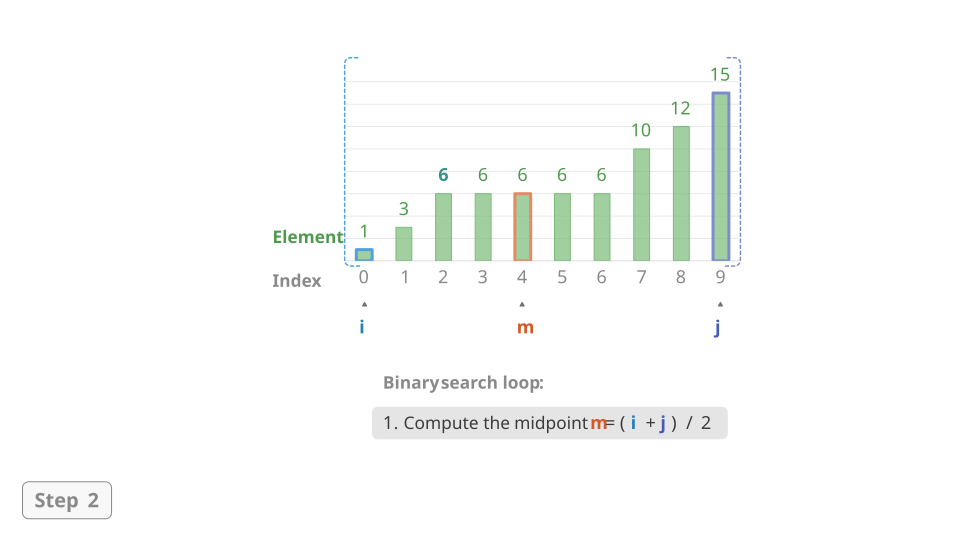
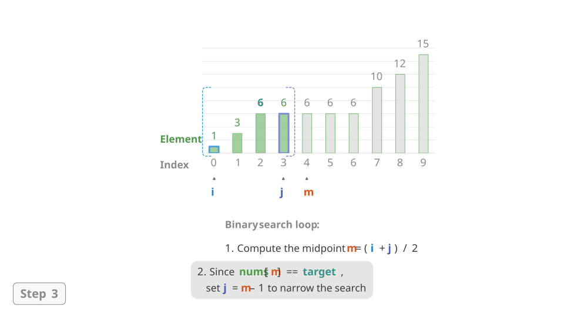
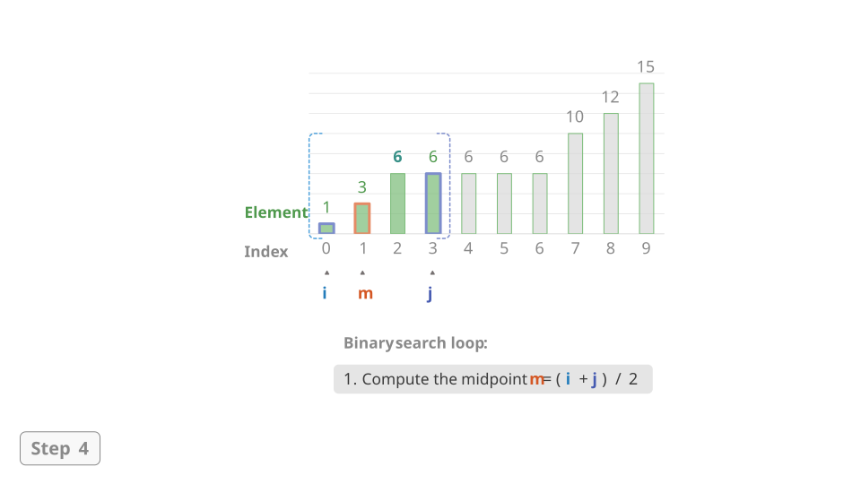
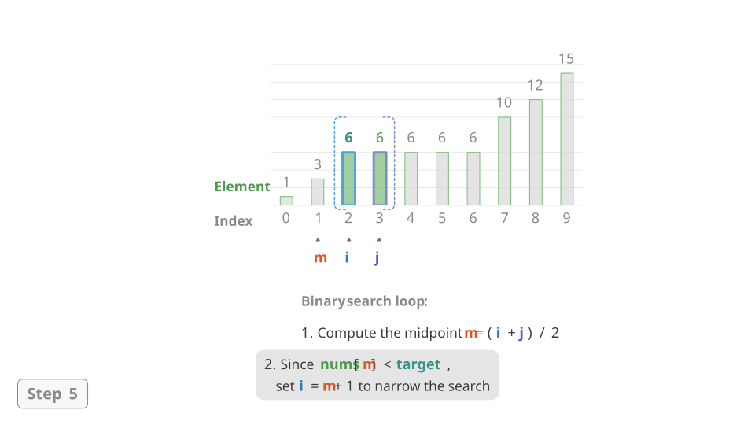
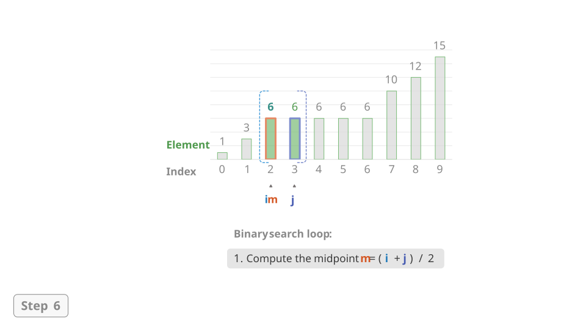

# Finding an insertion point with binary search

Binary search can solve many variations of the basic search problem. One is finding where to insert a target element.

## Arrays without duplicates

!!! question

    Given a sorted array `nums` of length $n$ with distinct elements and a value `target`, insert `target` into `nums` while keeping the array sorted. If `target` already occurs in the array, insert the new element to its left. Return the index the new `target` will occupy, as in the example below.


To reuse the binary search code from the previous section, we need to answer two questions.

**Question 1**: If the array contains `target`, is its index the insertion index?

The problem asks us to insert `target` to the left of an equal element, so the newly inserted `target` takes the position originally occupied by `target`. Thus, **when the array contains `target`, the insertion index is the index of the existing `target`**.

**Question 2**: If the array does not contain `target`, which index is the insertion point?

Consider how binary search moves its pointers. When `nums[m] < target`, the pointer $i$ moves right. This means $i$ approaches elements greater than or equal to `target`. Similarly, $j$ keeps moving toward elements less than or equal to `target`.

When the search ends, $i$ marks the first element greater than `target`, and $j$ marks the rightmost element less than `target`. Thus, **when the array does not contain `target`, its insertion index is $i$**. The following code implements this logic:

```src
[file]{binary_search_insertion}-[class]{}-[func]{binary_search_insertion_simple}
```

## Arrays with duplicates

!!! question

    Now suppose the array in the previous problem may contain duplicates. All other requirements stay the same.

If the array contains several occurrences of `target`, ordinary binary search returns the index of just one `target`. **It cannot tell us how many more occurrences of `target` lie on either side**.

The problem asks us to insert the target before all equal elements, **so we need the index of the leftmost `target` in the array**. The figure below shows an initial approach.

1. Use binary search to find any occurrence of `target`. Call its index $k$.
2. Starting at index $k$, scan to the left and return the index of the leftmost `target`.


This approach works, but the linear scan gives it $O(n)$ time complexity. It is inefficient when the array contains many occurrences of `target`.

We can instead adapt binary search. As the figure below shows, the overall procedure stays the same. In each iteration, first compute the midpoint index $m$, then compare `target` with `nums[m]`. The comparisons fall into the following cases.

- If `nums[m] < target` or `nums[m] > target`, we have yet to find `target`. Narrow the interval just as in ordinary binary search, **bringing the pointers $i$ and $j$ closer to `target`**.
- If `nums[m] == target`, any remaining elements less than `target` lie in $[i, m - 1]$. Narrow the interval by setting $j = m - 1$, **bringing $j$ closer to elements less than `target`**.

When the loop ends, $i$ points to the leftmost `target`, and $j$ points to the rightmost element less than `target`. **Index $i$ is therefore the insertion point**.

=== "<1>"
    

=== "<2>"
    

=== "<3>"
    

=== "<4>"
    

=== "<5>"
    

=== "<6>"
    

=== "<7>"
    

=== "<8>"
    

In the following code, the `nums[m] > target` and `nums[m] == target` branches do the same thing, so we can combine them.

We can also keep the conditions separate to make the logic clearer and easier to read.

```src
[file]{binary_search_insertion}-[class]{}-[func]{binary_search_insertion}
```

!!! tip

    The code in this section uses closed intervals throughout. Try implementing a version with a left-closed, right-open interval.

One way to think about binary search is to give each pointer, $i$ and $j$, a goal. The goal may be a specific element such as `target`, or an element in a particular range, such as one with a value below `target`.

As the loop repeatedly halves the interval, $i$ and $j$ approach their respective goals. They eventually find the answer or cross a boundary and stop.
