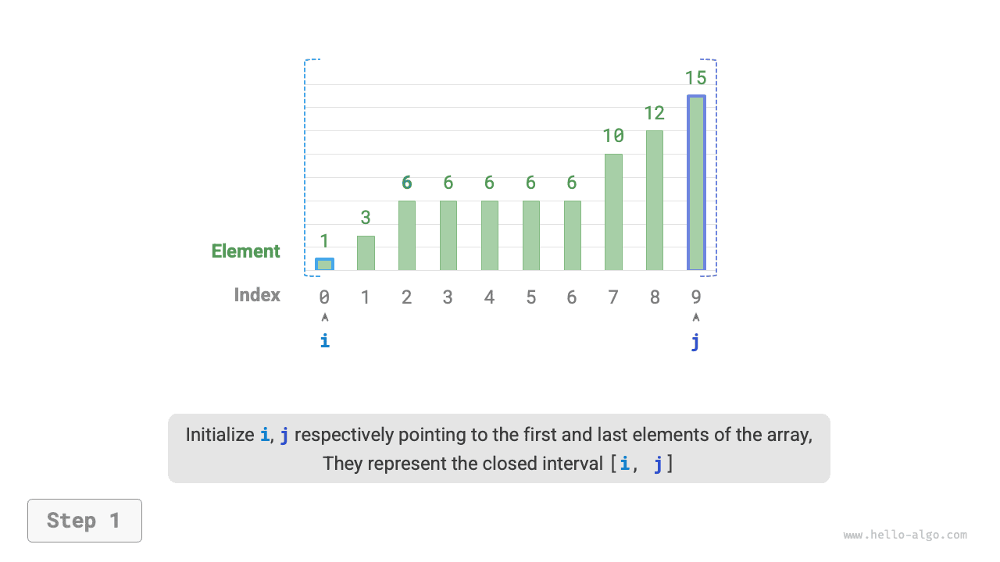
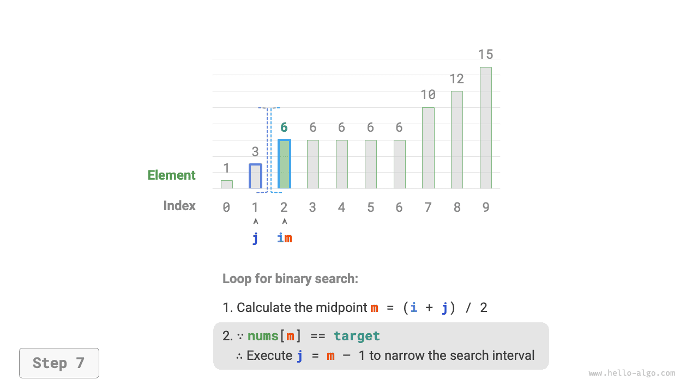

# 10.2 &nbsp; Finding an insertion point with binary search

Binary search can do more than find a target element. It also solves many variations of the problem, such as finding where to insert a target.

## 10.2.1 &nbsp; When there are no duplicates

!!! question

    Given a sorted array `nums` of length $n$ with no duplicate elements and a value `target`, insert `target` into `nums` while preserving its order. If `target` is already present, insert the new value to its left. Return the index of the newly inserted `target`, as illustrated below.

{ class="animation-figure" }

<p align="center"> Figure 10-4 &nbsp; Example data for finding an insertion point </p>

To reuse the binary search code from the previous section, we need to answer two questions.

**Question 1**: If the array contains `target`, is the insertion index the index of that element?

The problem asks us to insert `target` to the left of the equal element, so the new `target` takes the original one's position. Thus, **if the array contains `target`, the insertion index is the index of that `target`**.

**Question 2**: If the array does not contain `target`, which index is the insertion point?

Consider the search process more closely. Pointer $i$ moves when `nums[m] < target`, so $i$ approaches elements greater than or equal to `target`. Similarly, pointer $j$ keeps approaching elements less than or equal to `target`.

When the search ends, $i$ points to the first element greater than `target`, and $j$ points to the rightmost element smaller than `target`. **Thus, when `target` is absent, the insertion index is $i$**. The code is as follows:

=== "Python"

    ```python title="binary_search_insertion.py"
    def binary_search_insertion_simple(nums: list[int], target: int) -> int:
        """Find an insertion point using binary search (no duplicates)"""
        i, j = 0, len(nums) - 1  # Initialize the closed interval [0, n-1]
        while i <= j:
            m = (i + j) // 2  # Calculate the midpoint index m
            if nums[m] < target:
                i = m + 1  # Target must be in [m+1, j] if it exists
            elif nums[m] > target:
                j = m - 1  # Target must be in [i, m-1] if it exists
            else:
                return m  # Target was found; return insertion point m
        # Target was not found; return insertion point i
        return i
    ```

=== "C++"

    ```cpp title="binary_search_insertion.cpp"
    /* Find an insertion point using binary search (no duplicates) */
    int binarySearchInsertionSimple(vector<int> &nums, int target) {
        int i = 0, j = nums.size() - 1; // Initialize the closed interval [0, n-1]
        while (i <= j) {
            int m = i + (j - i) / 2; // Calculate the midpoint index m
            if (nums[m] < target) {
                i = m + 1; // Target must be in [m+1, j] if it exists
            } else if (nums[m] > target) {
                j = m - 1; // Target must be in [i, m-1] if it exists
            } else {
                return m; // Target was found; return insertion point m
            }
        }
        // Target was not found; return insertion point i
        return i;
    }
    ```

=== "Java"

    ```java title="binary_search_insertion.java"
    /* Find an insertion point using binary search (no duplicates) */
    int binarySearchInsertionSimple(int[] nums, int target) {
        int i = 0, j = nums.length - 1; // Initialize the closed interval [0, n-1]
        while (i <= j) {
            int m = i + (j - i) / 2; // Calculate the midpoint index m
            if (nums[m] < target) {
                i = m + 1; // Target must be in [m+1, j] if it exists
            } else if (nums[m] > target) {
                j = m - 1; // Target must be in [i, m-1] if it exists
            } else {
                return m; // Target was found; return insertion point m
            }
        }
        // Target was not found; return insertion point i
        return i;
    }
    ```

=== "C#"

    ```csharp title="binary_search_insertion.cs"
    /* Find an insertion point using binary search (no duplicates) */
    int BinarySearchInsertionSimple(int[] nums, int target) {
        int i = 0, j = nums.Length - 1; // Initialize the closed interval [0, n-1]
        while (i <= j) {
            int m = i + (j - i) / 2; // Calculate the midpoint index m
            if (nums[m] < target) {
                i = m + 1; // Target must be in [m+1, j] if it exists
            } else if (nums[m] > target) {
                j = m - 1; // Target must be in [i, m-1] if it exists
            } else {
                return m; // Target was found; return insertion point m
            }
        }
        // Target was not found; return insertion point i
        return i;
    }
    ```

=== "Go"

    ```go title="binary_search_insertion.go"
    /* Find an insertion point using binary search (no duplicates) */
    func binarySearchInsertionSimple(nums []int, target int) int {
        // Initialize the closed interval [0, n-1]
        i, j := 0, len(nums)-1
        for i <= j {
            // Calculate the midpoint index m
            m := i + (j-i)/2
            if nums[m] < target {
                // Target must be in [m+1, j] if it exists
                i = m + 1
            } else if nums[m] > target {
                // Target must be in [i, m-1] if it exists
                j = m - 1
            } else {
                // Target was found; return insertion point m
                return m
            }
        }
        // Target was not found; return insertion point i
        return i
    }
    ```

=== "Swift"

    ```swift title="binary_search_insertion.swift"
    /* Find an insertion point using binary search (no duplicates) */
    func binarySearchInsertionSimple(nums: [Int], target: Int) -> Int {
        // Initialize the closed interval [0, n-1]
        var i = nums.startIndex
        var j = nums.endIndex - 1
        while i <= j {
            let m = i + (j - i) / 2 // Calculate the midpoint index m
            if nums[m] < target {
                i = m + 1 // Target must be in [m+1, j] if it exists
            } else if nums[m] > target {
                j = m - 1 // Target must be in [i, m-1] if it exists
            } else {
                return m // Target was found; return insertion point m
            }
        }
        // Target was not found; return insertion point i
        return i
    }
    ```

=== "JS"

    ```javascript title="binary_search_insertion.js"
    /* Find an insertion point using binary search (no duplicates) */
    function binarySearchInsertionSimple(nums, target) {
        let i = 0,
            j = nums.length - 1; // Initialize the closed interval [0, n-1]
        while (i <= j) {
            const m = Math.floor(i + (j - i) / 2); // Calculate midpoint index m, using Math.floor() to round down
            if (nums[m] < target) {
                i = m + 1; // Target must be in [m+1, j] if it exists
            } else if (nums[m] > target) {
                j = m - 1; // Target must be in [i, m-1] if it exists
            } else {
                return m; // Target was found; return insertion point m
            }
        }
        // Target was not found; return insertion point i
        return i;
    }
    ```

=== "TS"

    ```typescript title="binary_search_insertion.ts"
    /* Find an insertion point using binary search (no duplicates) */
    function binarySearchInsertionSimple(
        nums: Array<number>,
        target: number
    ): number {
        let i = 0,
            j = nums.length - 1; // Initialize the closed interval [0, n-1]
        while (i <= j) {
            const m = Math.floor(i + (j - i) / 2); // Calculate midpoint index m, using Math.floor() to round down
            if (nums[m] < target) {
                i = m + 1; // Target must be in [m+1, j] if it exists
            } else if (nums[m] > target) {
                j = m - 1; // Target must be in [i, m-1] if it exists
            } else {
                return m; // Target was found; return insertion point m
            }
        }
        // Target was not found; return insertion point i
        return i;
    }
    ```

=== "Dart"

    ```dart title="binary_search_insertion.dart"
    /* Find an insertion point using binary search (no duplicates) */
    int binarySearchInsertionSimple(List<int> nums, int target) {
      int i = 0, j = nums.length - 1; // Initialize the closed interval [0, n-1]
      while (i <= j) {
        int m = i + (j - i) ~/ 2; // Calculate the midpoint index m
        if (nums[m] < target) {
          i = m + 1; // Target must be in [m+1, j] if it exists
        } else if (nums[m] > target) {
          j = m - 1; // Target must be in [i, m-1] if it exists
        } else {
          return m; // Target was found; return insertion point m
        }
      }
      // Target was not found; return insertion point i
      return i;
    }
    ```

=== "Rust"

    ```rust title="binary_search_insertion.rs"
    /* Find an insertion point using binary search (no duplicates) */
    fn binary_search_insertion_simple(nums: &[i32], target: i32) -> i32 {
        let (mut i, mut j) = (0, nums.len() as i32 - 1); // Initialize the closed interval [0, n-1]
        while i <= j {
            let m = i + (j - i) / 2; // Calculate the midpoint index m
            if nums[m as usize] < target {
                i = m + 1; // Target must be in [m+1, j] if it exists
            } else if nums[m as usize] > target {
                j = m - 1; // Target must be in [i, m-1] if it exists
            } else {
                return m;
            }
        }
        // Target was not found; return insertion point i
        i
    }
    ```

=== "C"

    ```c title="binary_search_insertion.c"
    /* Find an insertion point using binary search (no duplicates) */
    int binarySearchInsertionSimple(int *nums, int numSize, int target) {
        int i = 0, j = numSize - 1; // Initialize the closed interval [0, n-1]
        while (i <= j) {
            int m = i + (j - i) / 2; // Calculate the midpoint index m
            if (nums[m] < target) {
                i = m + 1; // Target must be in [m+1, j] if it exists
            } else if (nums[m] > target) {
                j = m - 1; // Target must be in [i, m-1] if it exists
            } else {
                return m; // Target was found; return insertion point m
            }
        }
        // Target was not found; return insertion point i
        return i;
    }
    ```

=== "Kotlin"

    ```kotlin title="binary_search_insertion.kt"
    /* Find an insertion point using binary search (no duplicates) */
    fun binarySearchInsertionSimple(nums: IntArray, target: Int): Int {
        var i = 0
        var j = nums.size - 1 // Initialize the closed interval [0, n-1]
        while (i <= j) {
            val m = i + (j - i) / 2 // Calculate the midpoint index m
            if (nums[m] < target) {
                i = m + 1 // Target must be in [m+1, j] if it exists
            } else if (nums[m] > target) {
                j = m - 1 // Target must be in [i, m-1] if it exists
            } else {
                return m // Target was found; return insertion point m
            }
        }
        // Target was not found; return insertion point i
        return i
    }
    ```

=== "Ruby"

    ```ruby title="binary_search_insertion.rb"
    ### Find an insertion point using binary search (no duplicates) ###
    def binary_search_insertion_simple(nums, target)
      # Initialize the closed interval [0, n-1]
      i, j = 0, nums.length - 1

      while i <= j
        # Calculate the midpoint index m
        m = (i + j) / 2

        if nums[m] < target
          i = m + 1 # Target must be in [m+1, j] if it exists
        elsif nums[m] > target
          j = m - 1 # Target must be in [i, m-1] if it exists
        else
          return m  # Target was found; return insertion point m
        end
      end

      i # Target was not found; return insertion point i
    end
    ```

??? pythontutor "Visualize execution"

    <div style="height: 549px; width: 100%;"><iframe class="pythontutor-iframe" title="Visualize execution" src="https://pythontutor.com/iframe-embed.html#code=def%20binary_search_insertion_simple%28nums%3A%20list%5Bint%5D,%20target%3A%20int%29%20-%3E%20int%3A%0A%20%20%20%20%22%22%22Find%20an%20insertion%20point%20using%20binary%20search%20%28no%20duplicates%29%22%22%22%0A%20%20%20%20i,%20j%20%3D%200,%20len%28nums%29%20-%201%20%20%23%20Initialize%20the%20closed%20interval%20%5B0,%20n-1%5D%0A%20%20%20%20while%20i%20%3C%3D%20j%3A%0A%20%20%20%20%20%20%20%20m%20%3D%20%28i%20%2B%20j%29%20//%202%20%20%23%20Calculate%20the%20midpoint%20index%20m%0A%20%20%20%20%20%20%20%20if%20nums%5Bm%5D%20%3C%20target%3A%0A%20%20%20%20%20%20%20%20%20%20%20%20i%20%3D%20m%20%2B%201%20%20%23%20Target%20must%20be%20in%20%5Bm%2B1,%20j%5D%20if%20it%20exists%0A%20%20%20%20%20%20%20%20elif%20nums%5Bm%5D%20%3E%20target%3A%0A%20%20%20%20%20%20%20%20%20%20%20%20j%20%3D%20m%20-%201%20%20%23%20Target%20must%20be%20in%20%5Bi,%20m-1%5D%20if%20it%20exists%0A%20%20%20%20%20%20%20%20else%3A%0A%20%20%20%20%20%20%20%20%20%20%20%20return%20m%20%20%23%20Target%20was%20found%3B%20return%20insertion%20point%20m%0A%20%20%20%20%23%20Target%20was%20not%20found%3B%20return%20insertion%20point%20i%0A%20%20%20%20return%20i%0A%0A%0A%22%22%22Driver%20code%22%22%22%0Aif%20__name__%20%3D%3D%20%22__main__%22%3A%0A%20%20%20%20%23%20Array%20with%20no%20duplicate%20elements%0A%20%20%20%20nums%20%3D%20%5B1,%203,%206,%208,%2012,%2015,%2023,%2026,%2031,%2035%5D%0A%20%20%20%20%23%20Find%20an%20insertion%20point%20using%20binary%20search%0A%20%20%20%20target%20%3D%206%0A%20%20%20%20index%20%3D%20binary_search_insertion_simple%28nums,%20target%29%0A%20%20%20%20print%28f%22Insertion%20index%20for%20element%20%7Btarget%7D%3A%20%7Bindex%7D%22%29&codeDivHeight=472&codeDivWidth=350&cumulative=false&curInstr=5&heapPrimitives=nevernest&origin=opt-frontend.js&py=311&rawInputLstJSON=%5B%5D&textReferences=false"> </iframe></div>
    <div style="margin-top: 5px;"><a href="https://pythontutor.com/iframe-embed.html#code=def%20binary_search_insertion_simple%28nums%3A%20list%5Bint%5D,%20target%3A%20int%29%20-%3E%20int%3A%0A%20%20%20%20%22%22%22Find%20an%20insertion%20point%20using%20binary%20search%20%28no%20duplicates%29%22%22%22%0A%20%20%20%20i,%20j%20%3D%200,%20len%28nums%29%20-%201%20%20%23%20Initialize%20the%20closed%20interval%20%5B0,%20n-1%5D%0A%20%20%20%20while%20i%20%3C%3D%20j%3A%0A%20%20%20%20%20%20%20%20m%20%3D%20%28i%20%2B%20j%29%20//%202%20%20%23%20Calculate%20the%20midpoint%20index%20m%0A%20%20%20%20%20%20%20%20if%20nums%5Bm%5D%20%3C%20target%3A%0A%20%20%20%20%20%20%20%20%20%20%20%20i%20%3D%20m%20%2B%201%20%20%23%20Target%20must%20be%20in%20%5Bm%2B1,%20j%5D%20if%20it%20exists%0A%20%20%20%20%20%20%20%20elif%20nums%5Bm%5D%20%3E%20target%3A%0A%20%20%20%20%20%20%20%20%20%20%20%20j%20%3D%20m%20-%201%20%20%23%20Target%20must%20be%20in%20%5Bi,%20m-1%5D%20if%20it%20exists%0A%20%20%20%20%20%20%20%20else%3A%0A%20%20%20%20%20%20%20%20%20%20%20%20return%20m%20%20%23%20Target%20was%20found%3B%20return%20insertion%20point%20m%0A%20%20%20%20%23%20Target%20was%20not%20found%3B%20return%20insertion%20point%20i%0A%20%20%20%20return%20i%0A%0A%0A%22%22%22Driver%20code%22%22%22%0Aif%20__name__%20%3D%3D%20%22__main__%22%3A%0A%20%20%20%20%23%20Array%20with%20no%20duplicate%20elements%0A%20%20%20%20nums%20%3D%20%5B1,%203,%206,%208,%2012,%2015,%2023,%2026,%2031,%2035%5D%0A%20%20%20%20%23%20Find%20an%20insertion%20point%20using%20binary%20search%0A%20%20%20%20target%20%3D%206%0A%20%20%20%20index%20%3D%20binary_search_insertion_simple%28nums,%20target%29%0A%20%20%20%20print%28f%22Insertion%20index%20for%20element%20%7Btarget%7D%3A%20%7Bindex%7D%22%29&codeDivHeight=800&codeDivWidth=600&cumulative=false&curInstr=5&heapPrimitives=nevernest&origin=opt-frontend.js&py=311&rawInputLstJSON=%5B%5D&textReferences=false" target="_blank" rel="noopener noreferrer">View full screen ></a></div>

## 10.2.2 &nbsp; When duplicates are present

!!! question

    Modify the previous problem to allow duplicate elements in the array. All other requirements remain the same.

If the array contains multiple occurrences of `target`, ordinary binary search can return the index of one occurrence, **but cannot determine how many more occurrences lie to its left or right**.

The target must be inserted as far left as possible, **so we need the index of the leftmost `target`**. One initial approach follows the steps below.

1. Run binary search to find the index of any `target`, denoted by $k$.
2. Starting at index $k$, scan leftward and return when the leftmost `target` is reached.

{ class="animation-figure" }

<p align="center"> Figure 10-5 &nbsp; Finding the insertion point among duplicates with a linear scan </p>

Although this works, it includes a linear search and therefore takes $O(n)$ time. It is inefficient when the array contains many occurrences of `target`.

Now consider extending binary search itself. As shown below, the overall process remains the same: each round calculates midpoint index $m$ and compares `target` with `nums[m]`. The cases are as follows.

- If `nums[m] < target` or `nums[m] > target`, we have not found `target`. Narrow the interval as in ordinary binary search, **bringing pointers $i$ and $j$ closer to `target`**.
- If `nums[m] == target`, elements smaller than `target` lie in $[i, m - 1]$. Narrow the interval by setting $j = m - 1$, **bringing pointer $j$ closer to elements smaller than `target`**.

When the loop finishes, $i$ points to the leftmost `target`, and $j$ points to the rightmost element smaller than `target`. **Index $i$ is therefore the insertion point**.

=== "<1>"
    { class="animation-figure" }

=== "<2>"
    { class="animation-figure" }

=== "<3>"
    { class="animation-figure" }

=== "<4>"
    { class="animation-figure" }

=== "<5>"
    { class="animation-figure" }

=== "<6>"
    { class="animation-figure" }

=== "<7>"
    { class="animation-figure" }

=== "<8>"
    { class="animation-figure" }

<p align="center"> Figure 10-6 &nbsp; Steps for finding an insertion point among duplicates </p>

In the code below, the branches for `nums[m] > target` and `nums[m] == target` perform the same operation, so they can be combined.

Even so, we can leave them separate to make the logic clearer and easier to read.

=== "Python"

    ```python title="binary_search_insertion.py"
    def binary_search_insertion(nums: list[int], target: int) -> int:
        """Find an insertion point using binary search (with duplicates)"""
        i, j = 0, len(nums) - 1  # Initialize the closed interval [0, n-1]
        while i <= j:
            m = (i + j) // 2  # Calculate the midpoint index m
            if nums[m] < target:
                i = m + 1  # Target must be in [m+1, j] if it exists
            elif nums[m] > target:
                j = m - 1  # Target must be in [i, m-1] if it exists
            else:
                j = m - 1  # Continue in [i, m-1] to find the rightmost element smaller than target
        # Return insertion point i
        return i
    ```

=== "C++"

    ```cpp title="binary_search_insertion.cpp"
    /* Find an insertion point using binary search (with duplicates) */
    int binarySearchInsertion(vector<int> &nums, int target) {
        int i = 0, j = nums.size() - 1; // Initialize the closed interval [0, n-1]
        while (i <= j) {
            int m = i + (j - i) / 2; // Calculate the midpoint index m
            if (nums[m] < target) {
                i = m + 1; // Target must be in [m+1, j] if it exists
            } else if (nums[m] > target) {
                j = m - 1; // Target must be in [i, m-1] if it exists
            } else {
                j = m - 1; // Continue searching [i, m-1] for the insertion point before any equal elements
            }
        }
        // Return insertion point i
        return i;
    }
    ```

=== "Java"

    ```java title="binary_search_insertion.java"
    /* Find an insertion point using binary search (with duplicates) */
    int binarySearchInsertion(int[] nums, int target) {
        int i = 0, j = nums.length - 1; // Initialize the closed interval [0, n-1]
        while (i <= j) {
            int m = i + (j - i) / 2; // Calculate the midpoint index m
            if (nums[m] < target) {
                i = m + 1; // Target must be in [m+1, j] if it exists
            } else if (nums[m] > target) {
                j = m - 1; // Target must be in [i, m-1] if it exists
            } else {
                j = m - 1; // Continue in [i, m-1] to find the rightmost element smaller than target
            }
        }
        // Return insertion point i
        return i;
    }
    ```

=== "C#"

    ```csharp title="binary_search_insertion.cs"
    /* Find an insertion point using binary search (with duplicates) */
    int BinarySearchInsertion(int[] nums, int target) {
        int i = 0, j = nums.Length - 1; // Initialize the closed interval [0, n-1]
        while (i <= j) {
            int m = i + (j - i) / 2; // Calculate the midpoint index m
            if (nums[m] < target) {
                i = m + 1; // Target must be in [m+1, j] if it exists
            } else if (nums[m] > target) {
                j = m - 1; // Target must be in [i, m-1] if it exists
            } else {
                j = m - 1; // Continue in [i, m-1] to find the rightmost element smaller than target
            }
        }
        // Return insertion point i
        return i;
    }
    ```

=== "Go"

    ```go title="binary_search_insertion.go"
    /* Find an insertion point using binary search (with duplicates) */
    func binarySearchInsertion(nums []int, target int) int {
        // Initialize the closed interval [0, n-1]
        i, j := 0, len(nums)-1
        for i <= j {
            // Calculate the midpoint index m
            m := i + (j-i)/2
            if nums[m] < target {
                // Target must be in [m+1, j] if it exists
                i = m + 1
            } else if nums[m] > target {
                // Target must be in [i, m-1] if it exists
                j = m - 1
            } else {
                // Continue in [i, m-1] to find the rightmost element smaller than target
                j = m - 1
            }
        }
        // Return insertion point i
        return i
    }
    ```

=== "Swift"

    ```swift title="binary_search_insertion.swift"
    /* Find an insertion point using binary search (with duplicates) */
    func binarySearchInsertion(nums: [Int], target: Int) -> Int {
        // Initialize the closed interval [0, n-1]
        var i = nums.startIndex
        var j = nums.endIndex - 1
        while i <= j {
            let m = i + (j - i) / 2 // Calculate the midpoint index m
            if nums[m] < target {
                i = m + 1 // Target must be in [m+1, j] if it exists
            } else if nums[m] > target {
                j = m - 1 // Target must be in [i, m-1] if it exists
            } else {
                j = m - 1 // Continue in [i, m-1] to find the rightmost element smaller than target
            }
        }
        // Return insertion point i
        return i
    }
    ```

=== "JS"

    ```javascript title="binary_search_insertion.js"
    /* Find an insertion point using binary search (with duplicates) */
    function binarySearchInsertion(nums, target) {
        let i = 0,
            j = nums.length - 1; // Initialize the closed interval [0, n-1]
        while (i <= j) {
            const m = Math.floor(i + (j - i) / 2); // Calculate midpoint index m, using Math.floor() to round down
            if (nums[m] < target) {
                i = m + 1; // Target must be in [m+1, j] if it exists
            } else if (nums[m] > target) {
                j = m - 1; // Target must be in [i, m-1] if it exists
            } else {
                j = m - 1; // Continue in [i, m-1] to find the rightmost element smaller than target
            }
        }
        // Return insertion point i
        return i;
    }
    ```

=== "TS"

    ```typescript title="binary_search_insertion.ts"
    /* Find an insertion point using binary search (with duplicates) */
    function binarySearchInsertion(nums: Array<number>, target: number): number {
        let i = 0,
            j = nums.length - 1; // Initialize the closed interval [0, n-1]
        while (i <= j) {
            const m = Math.floor(i + (j - i) / 2); // Calculate midpoint index m, using Math.floor() to round down
            if (nums[m] < target) {
                i = m + 1; // Target must be in [m+1, j] if it exists
            } else if (nums[m] > target) {
                j = m - 1; // Target must be in [i, m-1] if it exists
            } else {
                j = m - 1; // Continue in [i, m-1] to find the rightmost element smaller than target
            }
        }
        // Return insertion point i
        return i;
    }
    ```

=== "Dart"

    ```dart title="binary_search_insertion.dart"
    /* Find an insertion point using binary search (with duplicates) */
    int binarySearchInsertion(List<int> nums, int target) {
      int i = 0, j = nums.length - 1; // Initialize the closed interval [0, n-1]
      while (i <= j) {
        int m = i + (j - i) ~/ 2; // Calculate the midpoint index m
        if (nums[m] < target) {
          i = m + 1; // Target must be in [m+1, j] if it exists
        } else if (nums[m] > target) {
          j = m - 1; // Target must be in [i, m-1] if it exists
        } else {
          j = m - 1; // Continue in [i, m-1] to find the rightmost element smaller than target
        }
      }
      // Return insertion point i
      return i;
    }
    ```

=== "Rust"

    ```rust title="binary_search_insertion.rs"
    /* Find an insertion point using binary search (with duplicates) */
    pub fn binary_search_insertion(nums: &[i32], target: i32) -> i32 {
        let (mut i, mut j) = (0, nums.len() as i32 - 1); // Initialize the closed interval [0, n-1]
        while i <= j {
            let m = i + (j - i) / 2; // Calculate the midpoint index m
            if nums[m as usize] < target {
                i = m + 1; // Target must be in [m+1, j] if it exists
            } else if nums[m as usize] > target {
                j = m - 1; // Target must be in [i, m-1] if it exists
            } else {
                j = m - 1; // Continue searching [i, m-1] for the insertion point before any equal elements
            }
        }
        // Return insertion point i
        i
    }
    ```

=== "C"

    ```c title="binary_search_insertion.c"
    /* Find an insertion point using binary search (with duplicates) */
    int binarySearchInsertion(int *nums, int numSize, int target) {
        int i = 0, j = numSize - 1; // Initialize the closed interval [0, n-1]
        while (i <= j) {
            int m = i + (j - i) / 2; // Calculate the midpoint index m
            if (nums[m] < target) {
                i = m + 1; // Target must be in [m+1, j] if it exists
            } else if (nums[m] > target) {
                j = m - 1; // Target must be in [i, m-1] if it exists
            } else {
                j = m - 1; // Continue in [i, m-1] to find the rightmost element smaller than target
            }
        }
        // Return insertion point i
        return i;
    }
    ```

=== "Kotlin"

    ```kotlin title="binary_search_insertion.kt"
    /* Find an insertion point using binary search (with duplicates) */
    fun binarySearchInsertion(nums: IntArray, target: Int): Int {
        var i = 0
        var j = nums.size - 1 // Initialize the closed interval [0, n-1]
        while (i <= j) {
            val m = i + (j - i) / 2 // Calculate the midpoint index m
            if (nums[m] < target) {
                i = m + 1 // Target must be in [m+1, j] if it exists
            } else if (nums[m] > target) {
                j = m - 1 // Target must be in [i, m-1] if it exists
            } else {
                j = m - 1 // Continue in [i, m-1] to find the rightmost element smaller than target
            }
        }
        // Return insertion point i
        return i
    }
    ```

=== "Ruby"

    ```ruby title="binary_search_insertion.rb"
    ### Find an insertion point using binary search (with duplicates) ###
    def binary_search_insertion(nums, target)
      # Initialize the closed interval [0, n-1]
      i, j = 0, nums.length - 1

      while i <= j
        # Calculate the midpoint index m
        m = (i + j) / 2

        if nums[m] < target
          i = m + 1 # Target must be in [m+1, j] if it exists
        elsif nums[m] > target
          j = m - 1 # Target must be in [i, m-1] if it exists
        else
          j = m - 1 # Continue in [i, m-1] to find the rightmost element smaller than target
        end
      end

      i # Return insertion point i
    end
    ```

??? pythontutor "Visualize execution"

    <div style="height: 549px; width: 100%;"><iframe class="pythontutor-iframe" title="Visualize execution" src="https://pythontutor.com/iframe-embed.html#code=def%20binary_search_insertion%28nums%3A%20list%5Bint%5D,%20target%3A%20int%29%20-%3E%20int%3A%0A%20%20%20%20%22%22%22Find%20an%20insertion%20point%20using%20binary%20search%20%28with%20duplicates%29%22%22%22%0A%20%20%20%20i,%20j%20%3D%200,%20len%28nums%29%20-%201%20%20%23%20Initialize%20the%20closed%20interval%20%5B0,%20n-1%5D%0A%20%20%20%20while%20i%20%3C%3D%20j%3A%0A%20%20%20%20%20%20%20%20m%20%3D%20%28i%20%2B%20j%29%20//%202%20%20%23%20Calculate%20the%20midpoint%20index%20m%0A%20%20%20%20%20%20%20%20if%20nums%5Bm%5D%20%3C%20target%3A%0A%20%20%20%20%20%20%20%20%20%20%20%20i%20%3D%20m%20%2B%201%20%20%23%20Target%20must%20be%20in%20%5Bm%2B1,%20j%5D%20if%20it%20exists%0A%20%20%20%20%20%20%20%20elif%20nums%5Bm%5D%20%3E%20target%3A%0A%20%20%20%20%20%20%20%20%20%20%20%20j%20%3D%20m%20-%201%20%20%23%20Target%20must%20be%20in%20%5Bi,%20m-1%5D%20if%20it%20exists%0A%20%20%20%20%20%20%20%20else%3A%0A%20%20%20%20%20%20%20%20%20%20%20%20j%20%3D%20m%20-%201%20%20%23%20Search%20%5Bi,%20m-1%5D%20for%20the%20insertion%20point%20before%20equal%20elements%0A%20%20%20%20%23%20Return%20insertion%20point%20i%0A%20%20%20%20return%20i%0A%0A%0A%22%22%22Driver%20code%22%22%22%0Aif%20__name__%20%3D%3D%20%22__main__%22%3A%0A%20%20%20%20%23%20Array%20containing%20duplicate%20elements%0A%20%20%20%20nums%20%3D%20%5B1,%203,%206,%206,%206,%206,%206,%2010,%2012,%2015%5D%0A%20%20%20%20%23%20Find%20an%20insertion%20point%20using%20binary%20search%0A%20%20%20%20target%20%3D%206%0A%20%20%20%20index%20%3D%20binary_search_insertion%28nums,%20target%29%0A%20%20%20%20print%28f%22Insertion%20index%20for%20element%20%7Btarget%7D%3A%20%7Bindex%7D%22%29&codeDivHeight=472&codeDivWidth=350&cumulative=false&curInstr=5&heapPrimitives=nevernest&origin=opt-frontend.js&py=311&rawInputLstJSON=%5B%5D&textReferences=false"> </iframe></div>
    <div style="margin-top: 5px;"><a href="https://pythontutor.com/iframe-embed.html#code=def%20binary_search_insertion%28nums%3A%20list%5Bint%5D,%20target%3A%20int%29%20-%3E%20int%3A%0A%20%20%20%20%22%22%22Find%20an%20insertion%20point%20using%20binary%20search%20%28with%20duplicates%29%22%22%22%0A%20%20%20%20i,%20j%20%3D%200,%20len%28nums%29%20-%201%20%20%23%20Initialize%20the%20closed%20interval%20%5B0,%20n-1%5D%0A%20%20%20%20while%20i%20%3C%3D%20j%3A%0A%20%20%20%20%20%20%20%20m%20%3D%20%28i%20%2B%20j%29%20//%202%20%20%23%20Calculate%20the%20midpoint%20index%20m%0A%20%20%20%20%20%20%20%20if%20nums%5Bm%5D%20%3C%20target%3A%0A%20%20%20%20%20%20%20%20%20%20%20%20i%20%3D%20m%20%2B%201%20%20%23%20Target%20must%20be%20in%20%5Bm%2B1,%20j%5D%20if%20it%20exists%0A%20%20%20%20%20%20%20%20elif%20nums%5Bm%5D%20%3E%20target%3A%0A%20%20%20%20%20%20%20%20%20%20%20%20j%20%3D%20m%20-%201%20%20%23%20Target%20must%20be%20in%20%5Bi,%20m-1%5D%20if%20it%20exists%0A%20%20%20%20%20%20%20%20else%3A%0A%20%20%20%20%20%20%20%20%20%20%20%20j%20%3D%20m%20-%201%20%20%23%20Search%20%5Bi,%20m-1%5D%20for%20the%20insertion%20point%20before%20equal%20elements%0A%20%20%20%20%23%20Return%20insertion%20point%20i%0A%20%20%20%20return%20i%0A%0A%0A%22%22%22Driver%20code%22%22%22%0Aif%20__name__%20%3D%3D%20%22__main__%22%3A%0A%20%20%20%20%23%20Array%20containing%20duplicate%20elements%0A%20%20%20%20nums%20%3D%20%5B1,%203,%206,%206,%206,%206,%206,%2010,%2012,%2015%5D%0A%20%20%20%20%23%20Find%20an%20insertion%20point%20using%20binary%20search%0A%20%20%20%20target%20%3D%206%0A%20%20%20%20index%20%3D%20binary_search_insertion%28nums,%20target%29%0A%20%20%20%20print%28f%22Insertion%20index%20for%20element%20%7Btarget%7D%3A%20%7Bindex%7D%22%29&codeDivHeight=800&codeDivWidth=600&cumulative=false&curInstr=5&heapPrimitives=nevernest&origin=opt-frontend.js&py=311&rawInputLstJSON=%5B%5D&textReferences=false" target="_blank" rel="noopener noreferrer">View full screen ></a></div>

!!! tip

    All the code in this section uses closed intervals. Interested readers can implement versions using left-closed, right-open intervals.

Viewed more broadly, binary search simply assigns a search goal to each of pointers $i$ and $j$. The goal may be a particular element, such as `target`, or a range of elements, such as those smaller than `target`.

As the interval is repeatedly halved, pointers $i$ and $j$ approach their assigned goals. Eventually they either find the answer or stop after crossing a boundary.
