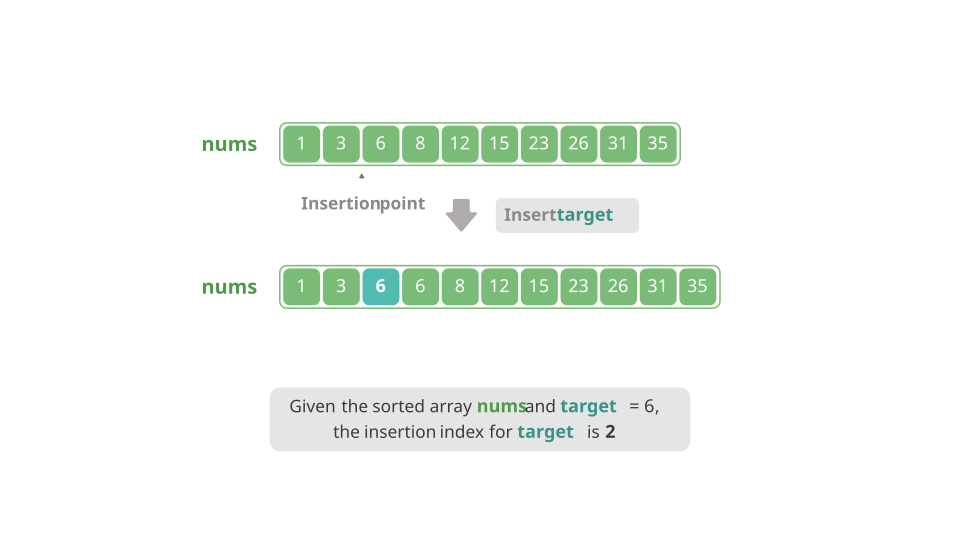
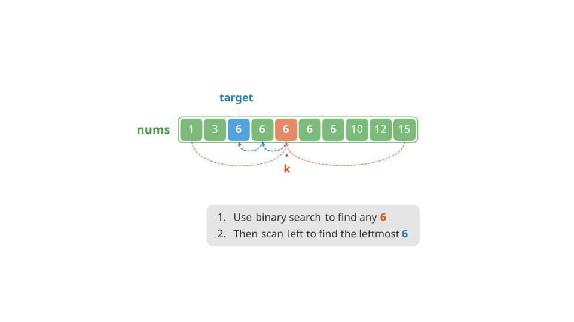
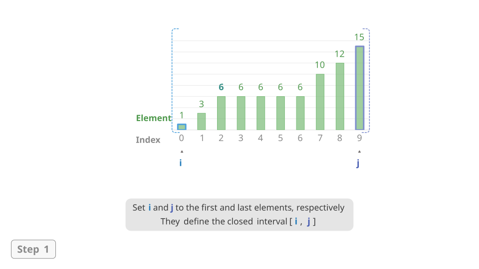
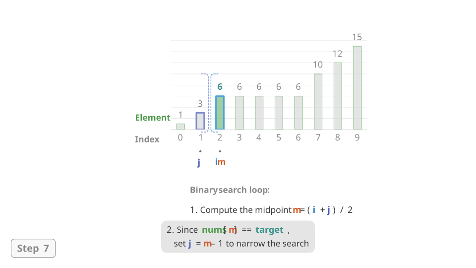
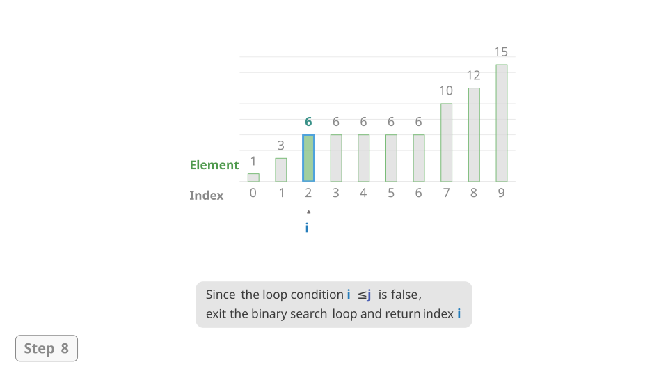

# 10.2 &nbsp; Finding an insertion point with binary search

Binary search can solve many variations of the basic search problem. One is finding where to insert a target element.

## 10.2.1 &nbsp; Arrays without duplicates

!!! question

    Given a sorted array `nums` of length $n$ with distinct elements and a value `target`, insert `target` into `nums` while keeping the array sorted. If `target` already occurs in the array, insert the new element to its left. Return the index the new `target` will occupy, as in the example below.

{ class="animation-figure" }

<p align="center"> Figure 10-4 &nbsp; Sample data for finding an insertion point with binary search </p>

To reuse the binary search code from the previous section, we need to answer two questions.

**Question 1**: If the array contains `target`, is its index the insertion index?

The problem asks us to insert `target` to the left of an equal element, so the newly inserted `target` takes the position originally occupied by `target`. Thus, **when the array contains `target`, the insertion index is the index of the existing `target`**.

**Question 2**: If the array does not contain `target`, which index is the insertion point?

Consider how binary search moves its pointers. When `nums[m] < target`, the pointer $i$ moves right. This means $i$ approaches elements greater than or equal to `target`. Similarly, $j$ keeps moving toward elements less than or equal to `target`.

When the search ends, $i$ marks the first element greater than `target`, and $j$ marks the rightmost element less than `target`. Thus, **when the array does not contain `target`, its insertion index is $i$**. The following code implements this logic:

=== "Python"

    ```python title="binary_search_insertion.py"
    def binary_search_insertion_simple(nums: list[int], target: int) -> int:
        """Binary search for an insertion point (no duplicates)"""
        i, j = 0, len(nums) - 1  # Initialize the closed interval [0, n-1]
        while i <= j:
            m = (i + j) // 2  # Compute the midpoint index m
            if nums[m] < target:
                i = m + 1  # Any match must lie in [m+1, j]
            elif nums[m] > target:
                j = m - 1  # Any match must lie in [i, m-1]
            else:
                return m  # Found target. Return insertion point m
        # Target not found. Return insertion point i
        return i
    ```

=== "C++"

    ```cpp title="binary_search_insertion.cpp"
    /* Binary search for an insertion point (no duplicates) */
    int binarySearchInsertionSimple(vector<int> &nums, int target) {
        int i = 0, j = nums.size() - 1; // Initialize the closed interval [0, n-1]
        while (i <= j) {
            int m = i + (j - i) / 2; // Compute the midpoint index m
            if (nums[m] < target) {
                i = m + 1; // Any match must lie in [m+1, j]
            } else if (nums[m] > target) {
                j = m - 1; // Any match must lie in [i, m-1]
            } else {
                return m; // Found target. Return insertion point m
            }
        }
        // Target not found. Return insertion point i
        return i;
    }
    ```

=== "Java"

    ```java title="binary_search_insertion.java"
    /* Binary search for an insertion point (no duplicates) */
    int binarySearchInsertionSimple(int[] nums, int target) {
        int i = 0, j = nums.length - 1; // Initialize the closed interval [0, n-1]
        while (i <= j) {
            int m = i + (j - i) / 2; // Compute the midpoint index m
            if (nums[m] < target) {
                i = m + 1; // Any match must lie in [m+1, j]
            } else if (nums[m] > target) {
                j = m - 1; // Any match must lie in [i, m-1]
            } else {
                return m; // Found target. Return insertion point m
            }
        }
        // Target not found. Return insertion point i
        return i;
    }
    ```

=== "C#"

    ```csharp title="binary_search_insertion.cs"
    /* Binary search for an insertion point (no duplicates) */
    int BinarySearchInsertionSimple(int[] nums, int target) {
        int i = 0, j = nums.Length - 1; // Initialize the closed interval [0, n-1]
        while (i <= j) {
            int m = i + (j - i) / 2; // Compute the midpoint index m
            if (nums[m] < target) {
                i = m + 1; // Any match must lie in [m+1, j]
            } else if (nums[m] > target) {
                j = m - 1; // Any match must lie in [i, m-1]
            } else {
                return m; // Found target. Return insertion point m
            }
        }
        // Target not found. Return insertion point i
        return i;
    }
    ```

=== "Go"

    ```go title="binary_search_insertion.go"
    /* Binary search for an insertion point (no duplicates) */
    func binarySearchInsertionSimple(nums []int, target int) int {
        // Initialize the closed interval [0, n-1]
        i, j := 0, len(nums)-1
        for i <= j {
            // Compute the midpoint index m
            m := i + (j-i)/2
            if nums[m] < target {
                // Any match must lie in [m+1, j]
                i = m + 1
            } else if nums[m] > target {
                // Any match must lie in [i, m-1]
                j = m - 1
            } else {
                // Found target. Return insertion point m
                return m
            }
        }
        // Target not found. Return insertion point i
        return i
    }
    ```

=== "Swift"

    ```swift title="binary_search_insertion.swift"
    /* Binary search for an insertion point (no duplicates) */
    func binarySearchInsertionSimple(nums: [Int], target: Int) -> Int {
        // Initialize the closed interval [0, n-1]
        var i = nums.startIndex
        var j = nums.endIndex - 1
        while i <= j {
            let m = i + (j - i) / 2 // Compute the midpoint index m
            if nums[m] < target {
                i = m + 1 // Any match must lie in [m+1, j]
            } else if nums[m] > target {
                j = m - 1 // Any match must lie in [i, m-1]
            } else {
                return m // Found target. Return insertion point m
            }
        }
        // Target not found. Return insertion point i
        return i
    }
    ```

=== "JS"

    ```javascript title="binary_search_insertion.js"
    /* Binary search for an insertion point (no duplicates) */
    function binarySearchInsertionSimple(nums, target) {
        let i = 0,
            j = nums.length - 1; // Initialize the closed interval [0, n-1]
        while (i <= j) {
            const m = Math.floor(i + (j - i) / 2); // Compute the midpoint index m, rounding down with Math.floor()
            if (nums[m] < target) {
                i = m + 1; // Any match must lie in [m+1, j]
            } else if (nums[m] > target) {
                j = m - 1; // Any match must lie in [i, m-1]
            } else {
                return m; // Found target. Return insertion point m
            }
        }
        // Target not found. Return insertion point i
        return i;
    }
    ```

=== "TS"

    ```typescript title="binary_search_insertion.ts"
    /* Binary search for an insertion point (no duplicates) */
    function binarySearchInsertionSimple(
        nums: Array<number>,
        target: number
    ): number {
        let i = 0,
            j = nums.length - 1; // Initialize the closed interval [0, n-1]
        while (i <= j) {
            const m = Math.floor(i + (j - i) / 2); // Compute the midpoint index m, rounding down with Math.floor()
            if (nums[m] < target) {
                i = m + 1; // Any match must lie in [m+1, j]
            } else if (nums[m] > target) {
                j = m - 1; // Any match must lie in [i, m-1]
            } else {
                return m; // Found target. Return insertion point m
            }
        }
        // Target not found. Return insertion point i
        return i;
    }
    ```

=== "Dart"

    ```dart title="binary_search_insertion.dart"
    /* Binary search for an insertion point (no duplicates) */
    int binarySearchInsertionSimple(List<int> nums, int target) {
      int i = 0, j = nums.length - 1; // Initialize the closed interval [0, n-1]
      while (i <= j) {
        int m = i + (j - i) ~/ 2; // Compute the midpoint index m
        if (nums[m] < target) {
          i = m + 1; // Any match must lie in [m+1, j]
        } else if (nums[m] > target) {
          j = m - 1; // Any match must lie in [i, m-1]
        } else {
          return m; // Found target. Return insertion point m
        }
      }
      // Target not found. Return insertion point i
      return i;
    }
    ```

=== "Rust"

    ```rust title="binary_search_insertion.rs"
    /* Binary search for an insertion point (no duplicates) */
    fn binary_search_insertion_simple(nums: &[i32], target: i32) -> i32 {
        let (mut i, mut j) = (0, nums.len() as i32 - 1); // Initialize the closed interval [0, n-1]
        while i <= j {
            let m = i + (j - i) / 2; // Compute the midpoint index m
            if nums[m as usize] < target {
                i = m + 1; // Any match must lie in [m+1, j]
            } else if nums[m as usize] > target {
                j = m - 1; // Any match must lie in [i, m-1]
            } else {
                return m;
            }
        }
        // Target not found. Return insertion point i
        i
    }
    ```

=== "C"

    ```c title="binary_search_insertion.c"
    /* Binary search for an insertion point (no duplicates) */
    int binarySearchInsertionSimple(int *nums, int numSize, int target) {
        int i = 0, j = numSize - 1; // Initialize the closed interval [0, n-1]
        while (i <= j) {
            int m = i + (j - i) / 2; // Compute the midpoint index m
            if (nums[m] < target) {
                i = m + 1; // Any match must lie in [m+1, j]
            } else if (nums[m] > target) {
                j = m - 1; // Any match must lie in [i, m-1]
            } else {
                return m; // Found target. Return insertion point m
            }
        }
        // Target not found. Return insertion point i
        return i;
    }
    ```

=== "Kotlin"

    ```kotlin title="binary_search_insertion.kt"
    /* Binary search for an insertion point (no duplicates) */
    fun binarySearchInsertionSimple(nums: IntArray, target: Int): Int {
        var i = 0
        var j = nums.size - 1 // Initialize the closed interval [0, n-1]
        while (i <= j) {
            val m = i + (j - i) / 2 // Compute the midpoint index m
            if (nums[m] < target) {
                i = m + 1 // Any match must lie in [m+1, j]
            } else if (nums[m] > target) {
                j = m - 1 // Any match must lie in [i, m-1]
            } else {
                return m // Found target. Return insertion point m
            }
        }
        // Target not found. Return insertion point i
        return i
    }
    ```

=== "Ruby"

    ```ruby title="binary_search_insertion.rb"
    ### Binary search for an insertion point (no duplicates) ###
    def binary_search_insertion_simple(nums, target)
      # Initialize the closed interval [0, n-1]
      i, j = 0, nums.length - 1

      while i <= j
        # Compute the midpoint index m
        m = (i + j) / 2

        if nums[m] < target
          i = m + 1 # Any match must lie in [m+1, j]
        elsif nums[m] > target
          j = m - 1 # Any match must lie in [i, m-1]
        else
          return m  # Found target. Return insertion point m
        end
      end

      i # Target not found. Return insertion point i
    end
    ```

??? pythontutor "Visualize execution"

    <div style="height: 549px; width: 100%;"><iframe class="pythontutor-iframe" title="Visualize execution" src="https://pythontutor.com/iframe-embed.html#code=def%20binary_search_insertion_simple%28nums%3A%20list%5Bint%5D,%20target%3A%20int%29%20-%3E%20int%3A%0A%20%20%20%20%22%22%22Binary%20search%20for%20an%20insertion%20point%20%28no%20duplicates%29%22%22%22%0A%20%20%20%20i,%20j%20%3D%200,%20len%28nums%29%20-%201%20%20%23%20Initialize%20the%20closed%20interval%20%5B0,%20n-1%5D%0A%20%20%20%20while%20i%20%3C%3D%20j%3A%0A%20%20%20%20%20%20%20%20m%20%3D%20%28i%20%2B%20j%29%20//%202%20%20%23%20Compute%20the%20midpoint%20index%20m%0A%20%20%20%20%20%20%20%20if%20nums%5Bm%5D%20%3C%20target%3A%0A%20%20%20%20%20%20%20%20%20%20%20%20i%20%3D%20m%20%2B%201%20%20%23%20Any%20match%20must%20lie%20in%20%5Bm%2B1,%20j%5D%0A%20%20%20%20%20%20%20%20elif%20nums%5Bm%5D%20%3E%20target%3A%0A%20%20%20%20%20%20%20%20%20%20%20%20j%20%3D%20m%20-%201%20%20%23%20Any%20match%20must%20lie%20in%20%5Bi,%20m-1%5D%0A%20%20%20%20%20%20%20%20else%3A%0A%20%20%20%20%20%20%20%20%20%20%20%20return%20m%20%20%23%20Found%20target.%20Return%20insertion%20point%20m%0A%20%20%20%20%23%20Target%20not%20found.%20Return%20insertion%20point%20i%0A%20%20%20%20return%20i%0A%0A%0A%22%22%22Driver%20Code%22%22%22%0Aif%20__name__%20%3D%3D%20%22__main__%22%3A%0A%20%20%20%20%23%20Array%20without%20duplicates%0A%20%20%20%20nums%20%3D%20%5B1,%203,%206,%208,%2012,%2015,%2023,%2026,%2031,%2035%5D%0A%20%20%20%20%23%20Find%20the%20insertion%20point%20using%20binary%20search%0A%20%20%20%20target%20%3D%206%0A%20%20%20%20index%20%3D%20binary_search_insertion_simple%28nums,%20target%29%0A%20%20%20%20print%28f%22Insertion%20index%20for%20%7Btarget%7D%20%3D%20%7Bindex%7D%22%29&codeDivHeight=472&codeDivWidth=350&cumulative=false&curInstr=5&heapPrimitives=nevernest&origin=opt-frontend.js&py=311&rawInputLstJSON=%5B%5D&textReferences=false"> </iframe></div>
    <div style="margin-top: 5px;"><a href="https://pythontutor.com/iframe-embed.html#code=def%20binary_search_insertion_simple%28nums%3A%20list%5Bint%5D,%20target%3A%20int%29%20-%3E%20int%3A%0A%20%20%20%20%22%22%22Binary%20search%20for%20an%20insertion%20point%20%28no%20duplicates%29%22%22%22%0A%20%20%20%20i,%20j%20%3D%200,%20len%28nums%29%20-%201%20%20%23%20Initialize%20the%20closed%20interval%20%5B0,%20n-1%5D%0A%20%20%20%20while%20i%20%3C%3D%20j%3A%0A%20%20%20%20%20%20%20%20m%20%3D%20%28i%20%2B%20j%29%20//%202%20%20%23%20Compute%20the%20midpoint%20index%20m%0A%20%20%20%20%20%20%20%20if%20nums%5Bm%5D%20%3C%20target%3A%0A%20%20%20%20%20%20%20%20%20%20%20%20i%20%3D%20m%20%2B%201%20%20%23%20Any%20match%20must%20lie%20in%20%5Bm%2B1,%20j%5D%0A%20%20%20%20%20%20%20%20elif%20nums%5Bm%5D%20%3E%20target%3A%0A%20%20%20%20%20%20%20%20%20%20%20%20j%20%3D%20m%20-%201%20%20%23%20Any%20match%20must%20lie%20in%20%5Bi,%20m-1%5D%0A%20%20%20%20%20%20%20%20else%3A%0A%20%20%20%20%20%20%20%20%20%20%20%20return%20m%20%20%23%20Found%20target.%20Return%20insertion%20point%20m%0A%20%20%20%20%23%20Target%20not%20found.%20Return%20insertion%20point%20i%0A%20%20%20%20return%20i%0A%0A%0A%22%22%22Driver%20Code%22%22%22%0Aif%20__name__%20%3D%3D%20%22__main__%22%3A%0A%20%20%20%20%23%20Array%20without%20duplicates%0A%20%20%20%20nums%20%3D%20%5B1,%203,%206,%208,%2012,%2015,%2023,%2026,%2031,%2035%5D%0A%20%20%20%20%23%20Find%20the%20insertion%20point%20using%20binary%20search%0A%20%20%20%20target%20%3D%206%0A%20%20%20%20index%20%3D%20binary_search_insertion_simple%28nums,%20target%29%0A%20%20%20%20print%28f%22Insertion%20index%20for%20%7Btarget%7D%20%3D%20%7Bindex%7D%22%29&codeDivHeight=800&codeDivWidth=600&cumulative=false&curInstr=5&heapPrimitives=nevernest&origin=opt-frontend.js&py=311&rawInputLstJSON=%5B%5D&textReferences=false" target="_blank" rel="noopener noreferrer">View full screen ></a></div>

## 10.2.2 &nbsp; Arrays with duplicates

!!! question

    Now suppose the array in the previous problem may contain duplicates. All other requirements stay the same.

If the array contains several occurrences of `target`, ordinary binary search returns the index of just one `target`. **It cannot tell us how many more occurrences of `target` lie on either side**.

The problem asks us to insert the target before all equal elements, **so we need the index of the leftmost `target` in the array**. Figure 10-5 shows an initial approach.

1. Use binary search to find any occurrence of `target`. Call its index $k$.
2. Starting at index $k$, scan to the left and return the index of the leftmost `target`.

{ class="animation-figure" }

<p align="center"> Figure 10-5 &nbsp; Finding the insertion point among duplicates by linear search </p>

This approach works, but the linear scan gives it $O(n)$ time complexity. It is inefficient when the array contains many occurrences of `target`.

We can instead adapt binary search. As Figure 10-6 shows, the overall procedure stays the same. In each iteration, first compute the midpoint index $m$, then compare `target` with `nums[m]`. The comparisons fall into the following cases.

- If `nums[m] < target` or `nums[m] > target`, we have yet to find `target`. Narrow the interval just as in ordinary binary search, **bringing the pointers $i$ and $j$ closer to `target`**.
- If `nums[m] == target`, any remaining elements less than `target` lie in $[i, m - 1]$. Narrow the interval by setting $j = m - 1$, **bringing $j$ closer to elements less than `target`**.

When the loop ends, $i$ points to the leftmost `target`, and $j$ points to the rightmost element less than `target`. **Index $i$ is therefore the insertion point**.

=== "<1>"
    { class="animation-figure" }

=== "<2>"
    { class="animation-figure" }

=== "<3>"
    { class="animation-figure" }

=== "<4>"
    { class="animation-figure" }

=== "<5>"
    { class="animation-figure" }

=== "<6>"
    { class="animation-figure" }

=== "<7>"
    { class="animation-figure" }

=== "<8>"
    { class="animation-figure" }

<p align="center"> Figure 10-6 &nbsp; Steps for finding the insertion point among duplicates by binary search </p>

In the following code, the `nums[m] > target` and `nums[m] == target` branches do the same thing, so we can combine them.

We can also keep the conditions separate to make the logic clearer and easier to read.

=== "Python"

    ```python title="binary_search_insertion.py"
    def binary_search_insertion(nums: list[int], target: int) -> int:
        """Binary search for an insertion point (duplicates allowed)"""
        i, j = 0, len(nums) - 1  # Initialize the closed interval [0, n-1]
        while i <= j:
            m = (i + j) // 2  # Compute the midpoint index m
            if nums[m] < target:
                i = m + 1  # Any match must lie in [m+1, j]
            elif nums[m] > target:
                j = m - 1  # Any match must lie in [i, m-1]
            else:
                j = m - 1  # Look in [i, m-1] for the rightmost element less than target
        # Return insertion point i
        return i
    ```

=== "C++"

    ```cpp title="binary_search_insertion.cpp"
    /* Binary search for an insertion point (duplicates allowed) */
    int binarySearchInsertion(vector<int> &nums, int target) {
        int i = 0, j = nums.size() - 1; // Initialize the closed interval [0, n-1]
        while (i <= j) {
            int m = i + (j - i) / 2; // Compute the midpoint index m
            if (nums[m] < target) {
                i = m + 1; // Any match must lie in [m+1, j]
            } else if (nums[m] > target) {
                j = m - 1; // Any match must lie in [i, m-1]
            } else {
                j = m - 1; // Look in [i, m-1] for the rightmost element less than target
            }
        }
        // Return insertion point i
        return i;
    }
    ```

=== "Java"

    ```java title="binary_search_insertion.java"
    /* Binary search for an insertion point (duplicates allowed) */
    int binarySearchInsertion(int[] nums, int target) {
        int i = 0, j = nums.length - 1; // Initialize the closed interval [0, n-1]
        while (i <= j) {
            int m = i + (j - i) / 2; // Compute the midpoint index m
            if (nums[m] < target) {
                i = m + 1; // Any match must lie in [m+1, j]
            } else if (nums[m] > target) {
                j = m - 1; // Any match must lie in [i, m-1]
            } else {
                j = m - 1; // Look in [i, m-1] for the rightmost element less than target
            }
        }
        // Return insertion point i
        return i;
    }
    ```

=== "C#"

    ```csharp title="binary_search_insertion.cs"
    /* Binary search for an insertion point (duplicates allowed) */
    int BinarySearchInsertion(int[] nums, int target) {
        int i = 0, j = nums.Length - 1; // Initialize the closed interval [0, n-1]
        while (i <= j) {
            int m = i + (j - i) / 2; // Compute the midpoint index m
            if (nums[m] < target) {
                i = m + 1; // Any match must lie in [m+1, j]
            } else if (nums[m] > target) {
                j = m - 1; // Any match must lie in [i, m-1]
            } else {
                j = m - 1; // Look in [i, m-1] for the rightmost element less than target
            }
        }
        // Return insertion point i
        return i;
    }
    ```

=== "Go"

    ```go title="binary_search_insertion.go"
    /* Binary search for an insertion point (duplicates allowed) */
    func binarySearchInsertion(nums []int, target int) int {
        // Initialize the closed interval [0, n-1]
        i, j := 0, len(nums)-1
        for i <= j {
            // Compute the midpoint index m
            m := i + (j-i)/2
            if nums[m] < target {
                // Any match must lie in [m+1, j]
                i = m + 1
            } else if nums[m] > target {
                // Any match must lie in [i, m-1]
                j = m - 1
            } else {
                // Look in [i, m-1] for the rightmost element less than target
                j = m - 1
            }
        }
        // Return insertion point i
        return i
    }
    ```

=== "Swift"

    ```swift title="binary_search_insertion.swift"
    /* Binary search for an insertion point (duplicates allowed) */
    func binarySearchInsertion(nums: [Int], target: Int) -> Int {
        // Initialize the closed interval [0, n-1]
        var i = nums.startIndex
        var j = nums.endIndex - 1
        while i <= j {
            let m = i + (j - i) / 2 // Compute the midpoint index m
            if nums[m] < target {
                i = m + 1 // Any match must lie in [m+1, j]
            } else if nums[m] > target {
                j = m - 1 // Any match must lie in [i, m-1]
            } else {
                j = m - 1 // Look in [i, m-1] for the rightmost element less than target
            }
        }
        // Return insertion point i
        return i
    }
    ```

=== "JS"

    ```javascript title="binary_search_insertion.js"
    /* Binary search for an insertion point (duplicates allowed) */
    function binarySearchInsertion(nums, target) {
        let i = 0,
            j = nums.length - 1; // Initialize the closed interval [0, n-1]
        while (i <= j) {
            const m = Math.floor(i + (j - i) / 2); // Compute the midpoint index m, rounding down with Math.floor()
            if (nums[m] < target) {
                i = m + 1; // Any match must lie in [m+1, j]
            } else if (nums[m] > target) {
                j = m - 1; // Any match must lie in [i, m-1]
            } else {
                j = m - 1; // Look in [i, m-1] for the rightmost element less than target
            }
        }
        // Return insertion point i
        return i;
    }
    ```

=== "TS"

    ```typescript title="binary_search_insertion.ts"
    /* Binary search for an insertion point (duplicates allowed) */
    function binarySearchInsertion(nums: Array<number>, target: number): number {
        let i = 0,
            j = nums.length - 1; // Initialize the closed interval [0, n-1]
        while (i <= j) {
            const m = Math.floor(i + (j - i) / 2); // Compute the midpoint index m, rounding down with Math.floor()
            if (nums[m] < target) {
                i = m + 1; // Any match must lie in [m+1, j]
            } else if (nums[m] > target) {
                j = m - 1; // Any match must lie in [i, m-1]
            } else {
                j = m - 1; // Look in [i, m-1] for the rightmost element less than target
            }
        }
        // Return insertion point i
        return i;
    }
    ```

=== "Dart"

    ```dart title="binary_search_insertion.dart"
    /* Binary search for an insertion point (duplicates allowed) */
    int binarySearchInsertion(List<int> nums, int target) {
      int i = 0, j = nums.length - 1; // Initialize the closed interval [0, n-1]
      while (i <= j) {
        int m = i + (j - i) ~/ 2; // Compute the midpoint index m
        if (nums[m] < target) {
          i = m + 1; // Any match must lie in [m+1, j]
        } else if (nums[m] > target) {
          j = m - 1; // Any match must lie in [i, m-1]
        } else {
          j = m - 1; // Look in [i, m-1] for the rightmost element less than target
        }
      }
      // Return insertion point i
      return i;
    }
    ```

=== "Rust"

    ```rust title="binary_search_insertion.rs"
    /* Binary search for an insertion point (duplicates allowed) */
    pub fn binary_search_insertion(nums: &[i32], target: i32) -> i32 {
        let (mut i, mut j) = (0, nums.len() as i32 - 1); // Initialize the closed interval [0, n-1]
        while i <= j {
            let m = i + (j - i) / 2; // Compute the midpoint index m
            if nums[m as usize] < target {
                i = m + 1; // Any match must lie in [m+1, j]
            } else if nums[m as usize] > target {
                j = m - 1; // Any match must lie in [i, m-1]
            } else {
                j = m - 1; // Look in [i, m-1] for the rightmost element less than target
            }
        }
        // Return insertion point i
        i
    }
    ```

=== "C"

    ```c title="binary_search_insertion.c"
    /* Binary search for an insertion point (duplicates allowed) */
    int binarySearchInsertion(int *nums, int numSize, int target) {
        int i = 0, j = numSize - 1; // Initialize the closed interval [0, n-1]
        while (i <= j) {
            int m = i + (j - i) / 2; // Compute the midpoint index m
            if (nums[m] < target) {
                i = m + 1; // Any match must lie in [m+1, j]
            } else if (nums[m] > target) {
                j = m - 1; // Any match must lie in [i, m-1]
            } else {
                j = m - 1; // Look in [i, m-1] for the rightmost element less than target
            }
        }
        // Return insertion point i
        return i;
    }
    ```

=== "Kotlin"

    ```kotlin title="binary_search_insertion.kt"
    /* Binary search for an insertion point (duplicates allowed) */
    fun binarySearchInsertion(nums: IntArray, target: Int): Int {
        var i = 0
        var j = nums.size - 1 // Initialize the closed interval [0, n-1]
        while (i <= j) {
            val m = i + (j - i) / 2 // Compute the midpoint index m
            if (nums[m] < target) {
                i = m + 1 // Any match must lie in [m+1, j]
            } else if (nums[m] > target) {
                j = m - 1 // Any match must lie in [i, m-1]
            } else {
                j = m - 1 // Look in [i, m-1] for the rightmost element less than target
            }
        }
        // Return insertion point i
        return i
    }
    ```

=== "Ruby"

    ```ruby title="binary_search_insertion.rb"
    ### Binary search for an insertion point (duplicates allowed) ###
    def binary_search_insertion(nums, target)
      # Initialize the closed interval [0, n-1]
      i, j = 0, nums.length - 1

      while i <= j
        # Compute the midpoint index m
        m = (i + j) / 2

        if nums[m] < target
          i = m + 1 # Any match must lie in [m+1, j]
        elsif nums[m] > target
          j = m - 1 # Any match must lie in [i, m-1]
        else
          j = m - 1 # Look in [i, m-1] for the rightmost element less than target
        end
      end

      i # Return insertion point i
    end
    ```

??? pythontutor "Visualize execution"

    <div style="height: 549px; width: 100%;"><iframe class="pythontutor-iframe" title="Visualize execution" src="https://pythontutor.com/iframe-embed.html#code=def%20binary_search_insertion%28nums%3A%20list%5Bint%5D,%20target%3A%20int%29%20-%3E%20int%3A%0A%20%20%20%20%22%22%22Binary%20search%20for%20an%20insertion%20point%20%28duplicates%20allowed%29%22%22%22%0A%20%20%20%20i,%20j%20%3D%200,%20len%28nums%29%20-%201%20%20%23%20Initialize%20the%20closed%20interval%20%5B0,%20n-1%5D%0A%20%20%20%20while%20i%20%3C%3D%20j%3A%0A%20%20%20%20%20%20%20%20m%20%3D%20%28i%20%2B%20j%29%20//%202%20%20%23%20Compute%20the%20midpoint%20index%20m%0A%20%20%20%20%20%20%20%20if%20nums%5Bm%5D%20%3C%20target%3A%0A%20%20%20%20%20%20%20%20%20%20%20%20i%20%3D%20m%20%2B%201%20%20%23%20Any%20match%20must%20lie%20in%20%5Bm%2B1,%20j%5D%0A%20%20%20%20%20%20%20%20elif%20nums%5Bm%5D%20%3E%20target%3A%0A%20%20%20%20%20%20%20%20%20%20%20%20j%20%3D%20m%20-%201%20%20%23%20Any%20match%20must%20lie%20in%20%5Bi,%20m-1%5D%0A%20%20%20%20%20%20%20%20else%3A%0A%20%20%20%20%20%20%20%20%20%20%20%20j%20%3D%20m%20-%201%20%20%23%20Look%20in%20%5Bi,%20m-1%5D%20for%20the%20first%20element%20less%20than%20target%0A%20%20%20%20%23%20Return%20insertion%20point%20i%0A%20%20%20%20return%20i%0A%0A%0A%22%22%22Driver%20Code%22%22%22%0Aif%20__name__%20%3D%3D%20%22__main__%22%3A%0A%20%20%20%20%23%20Array%20with%20duplicates%0A%20%20%20%20nums%20%3D%20%5B1,%203,%206,%206,%206,%206,%206,%2010,%2012,%2015%5D%0A%20%20%20%20%23%20Find%20the%20insertion%20point%20using%20binary%20search%0A%20%20%20%20target%20%3D%206%0A%20%20%20%20index%20%3D%20binary_search_insertion%28nums,%20target%29%0A%20%20%20%20print%28f%22Insertion%20index%20for%20%7Btarget%7D%20%3D%20%7Bindex%7D%22%29&codeDivHeight=472&codeDivWidth=350&cumulative=false&curInstr=5&heapPrimitives=nevernest&origin=opt-frontend.js&py=311&rawInputLstJSON=%5B%5D&textReferences=false"> </iframe></div>
    <div style="margin-top: 5px;"><a href="https://pythontutor.com/iframe-embed.html#code=def%20binary_search_insertion%28nums%3A%20list%5Bint%5D,%20target%3A%20int%29%20-%3E%20int%3A%0A%20%20%20%20%22%22%22Binary%20search%20for%20an%20insertion%20point%20%28duplicates%20allowed%29%22%22%22%0A%20%20%20%20i,%20j%20%3D%200,%20len%28nums%29%20-%201%20%20%23%20Initialize%20the%20closed%20interval%20%5B0,%20n-1%5D%0A%20%20%20%20while%20i%20%3C%3D%20j%3A%0A%20%20%20%20%20%20%20%20m%20%3D%20%28i%20%2B%20j%29%20//%202%20%20%23%20Compute%20the%20midpoint%20index%20m%0A%20%20%20%20%20%20%20%20if%20nums%5Bm%5D%20%3C%20target%3A%0A%20%20%20%20%20%20%20%20%20%20%20%20i%20%3D%20m%20%2B%201%20%20%23%20Any%20match%20must%20lie%20in%20%5Bm%2B1,%20j%5D%0A%20%20%20%20%20%20%20%20elif%20nums%5Bm%5D%20%3E%20target%3A%0A%20%20%20%20%20%20%20%20%20%20%20%20j%20%3D%20m%20-%201%20%20%23%20Any%20match%20must%20lie%20in%20%5Bi,%20m-1%5D%0A%20%20%20%20%20%20%20%20else%3A%0A%20%20%20%20%20%20%20%20%20%20%20%20j%20%3D%20m%20-%201%20%20%23%20Look%20in%20%5Bi,%20m-1%5D%20for%20the%20first%20element%20less%20than%20target%0A%20%20%20%20%23%20Return%20insertion%20point%20i%0A%20%20%20%20return%20i%0A%0A%0A%22%22%22Driver%20Code%22%22%22%0Aif%20__name__%20%3D%3D%20%22__main__%22%3A%0A%20%20%20%20%23%20Array%20with%20duplicates%0A%20%20%20%20nums%20%3D%20%5B1,%203,%206,%206,%206,%206,%206,%2010,%2012,%2015%5D%0A%20%20%20%20%23%20Find%20the%20insertion%20point%20using%20binary%20search%0A%20%20%20%20target%20%3D%206%0A%20%20%20%20index%20%3D%20binary_search_insertion%28nums,%20target%29%0A%20%20%20%20print%28f%22Insertion%20index%20for%20%7Btarget%7D%20%3D%20%7Bindex%7D%22%29&codeDivHeight=800&codeDivWidth=600&cumulative=false&curInstr=5&heapPrimitives=nevernest&origin=opt-frontend.js&py=311&rawInputLstJSON=%5B%5D&textReferences=false" target="_blank" rel="noopener noreferrer">View full screen ></a></div>

!!! tip

    The code in this section uses closed intervals throughout. Try implementing a version with a left-closed, right-open interval.

One way to think about binary search is to give each pointer, $i$ and $j$, a goal. The goal may be a specific element such as `target`, or an element in a particular range, such as one with a value below `target`.

As the loop repeatedly halves the interval, $i$ and $j$ approach their respective goals. They eventually find the answer or cross a boundary and stop.
