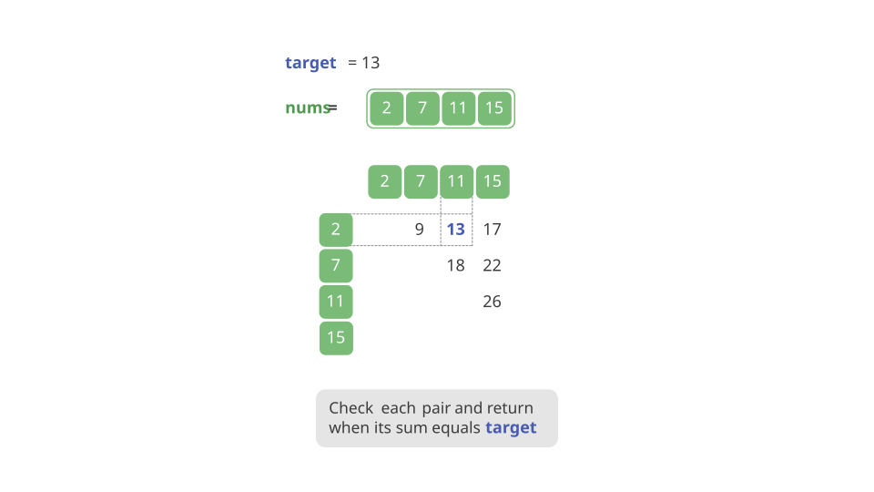
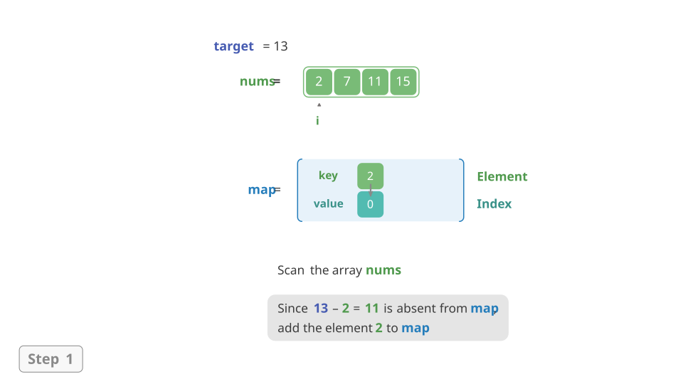
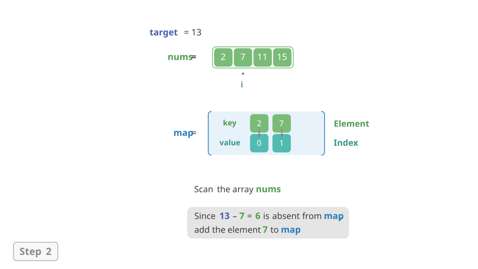
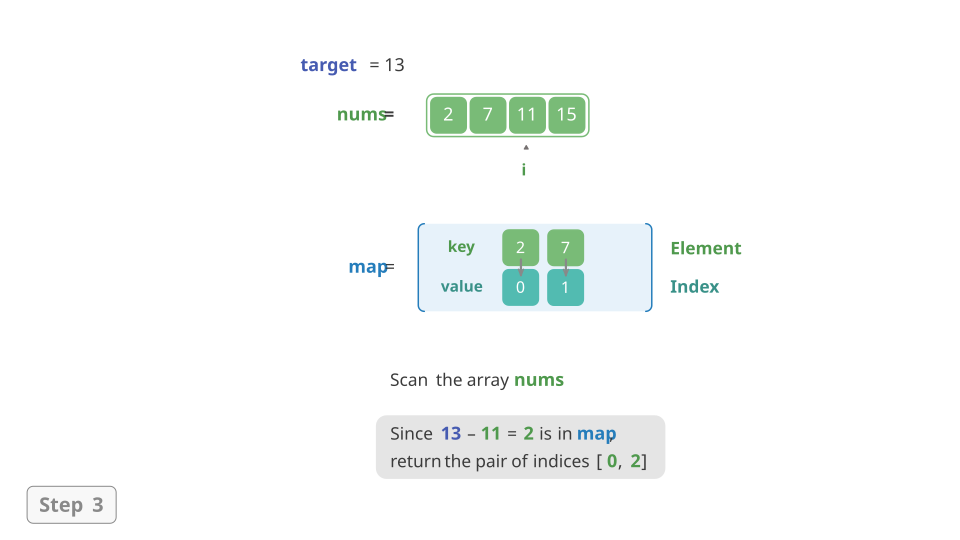

# Using hashing to speed up a search

In algorithm problems, **replacing a linear search with a hash lookup often reduces time complexity**. Let’s work through an example.

!!! question

    Given an integer array `nums` and a target value `target`, find two elements whose sum equals `target` and return their array indices. Any one solution will do.

## Linear search: Trading time for space

One approach is to check every possible pair. As the figure below shows, use two nested loops to test whether the two integers add up to `target`. If they do, return their indices.



The following code implements the search:

```src
[file]{two_sum}-[class]{}-[func]{two_sum_brute_force}
```

This method takes $O(n^2)$ time and $O(1)$ space. It can be very slow on large inputs.

## Hash lookup: Trading space for time

Use a hash table with array elements as keys and their indices as values. Scan the array, performing the steps shown below at each iteration.

1. Check whether `target - nums[i]` is in the hash table. If it is, return the indices of the two elements immediately.
2. Add an entry with `nums[i]` as its key and index `i` as its value.

=== "<1>"
    

=== "<2>"
    

=== "<3>"
    

The implementation needs just one loop:

```src
[file]{two_sum}-[class]{}-[func]{two_sum_hash_table}
```

Hash lookup reduces the time complexity from $O(n^2)$ to $O(n)$, making the algorithm substantially faster.

The auxiliary hash table brings the space complexity to $O(n)$. **Even so, this method strikes a better balance between time and space, making it the optimal solution for this problem**.
