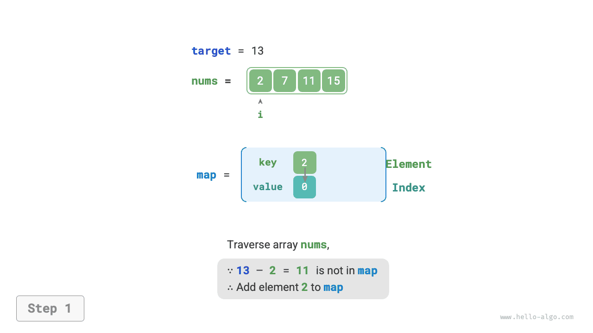

# 10.4 &nbsp; Optimizing with hashing

In algorithm problems, **we often reduce time complexity by replacing linear search with hash lookup**. Let us explore this strategy through a problem.

!!! question

    Given an integer array `nums` and a target value `target`, find two elements whose sum equals `target` and return their array indices. Any valid solution is acceptable.

## 10.4.1 &nbsp; Linear search: trading time for space

Consider examining every possible pair directly. As shown below, use two nested loops and check whether the two integers sum to `target` each time. If they do, return their indices.

{ class="animation-figure" }

<p align="center"> Figure 10-9 &nbsp; Solving two sum with linear search </p>

The code is as follows:

=== "Python"

    ```python title="two_sum.py"
    def two_sum_brute_force(nums: list[int], target: int) -> list[int]:
        """Method 1: brute-force enumeration"""
        # Two nested loops give a time complexity of O(n^2)
        for i in range(len(nums) - 1):
            for j in range(i + 1, len(nums)):
                if nums[i] + nums[j] == target:
                    return [i, j]
        return []
    ```

=== "C++"

    ```cpp title="two_sum.cpp"
    /* Method 1: brute-force enumeration */
    vector<int> twoSumBruteForce(vector<int> &nums, int target) {
        int size = nums.size();
        // Two nested loops give a time complexity of O(n^2)
        for (int i = 0; i < size - 1; i++) {
            for (int j = i + 1; j < size; j++) {
                if (nums[i] + nums[j] == target)
                    return {i, j};
            }
        }
        return {};
    }
    ```

=== "Java"

    ```java title="two_sum.java"
    /* Method 1: brute-force enumeration */
    int[] twoSumBruteForce(int[] nums, int target) {
        int size = nums.length;
        // Two nested loops give a time complexity of O(n^2)
        for (int i = 0; i < size - 1; i++) {
            for (int j = i + 1; j < size; j++) {
                if (nums[i] + nums[j] == target)
                    return new int[] { i, j };
            }
        }
        return new int[0];
    }
    ```

=== "C#"

    ```csharp title="two_sum.cs"
    /* Method 1: brute-force enumeration */
    int[] TwoSumBruteForce(int[] nums, int target) {
        int size = nums.Length;
        // Two nested loops give a time complexity of O(n^2)
        for (int i = 0; i < size - 1; i++) {
            for (int j = i + 1; j < size; j++) {
                if (nums[i] + nums[j] == target)
                    return [i, j];
            }
        }
        return [];
    }
    ```

=== "Go"

    ```go title="two_sum.go"
    /* Method 1: brute-force enumeration */
    func twoSumBruteForce(nums []int, target int) []int {
        size := len(nums)
        // Two nested loops give a time complexity of O(n^2)
        for i := 0; i < size-1; i++ {
            for j := i + 1; j < size; j++ {
                if nums[i]+nums[j] == target {
                    return []int{i, j}
                }
            }
        }
        return nil
    }
    ```

=== "Swift"

    ```swift title="two_sum.swift"
    /* Method 1: brute-force enumeration */
    func twoSumBruteForce(nums: [Int], target: Int) -> [Int] {
        // Two nested loops give a time complexity of O(n^2)
        for i in nums.indices.dropLast() {
            for j in nums.indices.dropFirst(i + 1) {
                if nums[i] + nums[j] == target {
                    return [i, j]
                }
            }
        }
        return [0]
    }
    ```

=== "JS"

    ```javascript title="two_sum.js"
    /* Method 1: brute-force enumeration */
    function twoSumBruteForce(nums, target) {
        const n = nums.length;
        // Two nested loops give a time complexity of O(n^2)
        for (let i = 0; i < n; i++) {
            for (let j = i + 1; j < n; j++) {
                if (nums[i] + nums[j] === target) {
                    return [i, j];
                }
            }
        }
        return [];
    }
    ```

=== "TS"

    ```typescript title="two_sum.ts"
    /* Method 1: brute-force enumeration */
    function twoSumBruteForce(nums: number[], target: number): number[] {
        const n = nums.length;
        // Two nested loops give a time complexity of O(n^2)
        for (let i = 0; i < n; i++) {
            for (let j = i + 1; j < n; j++) {
                if (nums[i] + nums[j] === target) {
                    return [i, j];
                }
            }
        }
        return [];
    }
    ```

=== "Dart"

    ```dart title="two_sum.dart"
    /* Method 1: brute-force enumeration */
    List<int> twoSumBruteForce(List<int> nums, int target) {
      int size = nums.length;
      // Two nested loops give a time complexity of O(n^2)
      for (var i = 0; i < size - 1; i++) {
        for (var j = i + 1; j < size; j++) {
          if (nums[i] + nums[j] == target) return [i, j];
        }
      }
      return [0];
    }
    ```

=== "Rust"

    ```rust title="two_sum.rs"
    /* Method 1: brute-force enumeration */
    pub fn two_sum_brute_force(nums: &Vec<i32>, target: i32) -> Option<Vec<i32>> {
        let size = nums.len();
        // Two nested loops give a time complexity of O(n^2)
        for i in 0..size - 1 {
            for j in i + 1..size {
                if nums[i] + nums[j] == target {
                    return Some(vec![i as i32, j as i32]);
                }
            }
        }
        None
    }
    ```

=== "C"

    ```c title="two_sum.c"
    /* Method 1: brute-force enumeration */
    int *twoSumBruteForce(int *nums, int numsSize, int target, int *returnSize) {
        for (int i = 0; i < numsSize; ++i) {
            for (int j = i + 1; j < numsSize; ++j) {
                if (nums[i] + nums[j] == target) {
                    int *res = malloc(sizeof(int) * 2);
                    res[0] = i, res[1] = j;
                    *returnSize = 2;
                    return res;
                }
            }
        }
        *returnSize = 0;
        return NULL;
    }
    ```

=== "Kotlin"

    ```kotlin title="two_sum.kt"
    /* Method 1: brute-force enumeration */
    fun twoSumBruteForce(nums: IntArray, target: Int): IntArray {
        val size = nums.size
        // Two nested loops give a time complexity of O(n^2)
        for (i in 0..<size - 1) {
            for (j in i + 1..<size) {
                if (nums[i] + nums[j] == target) return intArrayOf(i, j)
            }
        }
        return IntArray(0)
    }
    ```

=== "Ruby"

    ```ruby title="two_sum.rb"
    ### Method 1: brute-force enumeration ###
    def two_sum_brute_force(nums, target)
      # Two nested loops give a time complexity of O(n^2)
      for i in 0...(nums.length - 1)
        for j in (i + 1)...nums.length
          return [i, j] if nums[i] + nums[j] == target
        end
      end

      []
    end
    ```

??? pythontutor "Visualize execution"

    <div style="height: 441px; width: 100%;"><iframe class="pythontutor-iframe" title="Visualize execution" src="https://pythontutor.com/iframe-embed.html#code=def%20two_sum_brute_force%28nums%3A%20list%5Bint%5D,%20target%3A%20int%29%20-%3E%20list%5Bint%5D%3A%0A%20%20%20%20%22%22%22Method%201%3A%20brute-force%20enumeration%22%22%22%0A%20%20%20%20%23%20Two%20nested%20loops%20give%20a%20time%20complexity%20of%20O%28n%5E2%29%0A%20%20%20%20for%20i%20in%20range%28len%28nums%29%20-%201%29%3A%0A%20%20%20%20%20%20%20%20for%20j%20in%20range%28i%20%2B%201,%20len%28nums%29%29%3A%0A%20%20%20%20%20%20%20%20%20%20%20%20if%20nums%5Bi%5D%20%2B%20nums%5Bj%5D%20%3D%3D%20target%3A%0A%20%20%20%20%20%20%20%20%20%20%20%20%20%20%20%20return%20%5Bi,%20j%5D%0A%20%20%20%20return%20%5B%5D%0A%0A%22%22%22Driver%20code%22%22%22%0Aif%20__name__%20%3D%3D%20%22__main__%22%3A%0A%20%20%20%20nums%20%3D%20%5B2,%207,%2011,%2015%5D%0A%20%20%20%20target%20%3D%2013%0A%20%20%20%20res%20%3D%20two_sum_brute_force%28nums,%20target%29&codeDivHeight=472&codeDivWidth=350&cumulative=false&curInstr=5&heapPrimitives=nevernest&origin=opt-frontend.js&py=311&rawInputLstJSON=%5B%5D&textReferences=false"> </iframe></div>
    <div style="margin-top: 5px;"><a href="https://pythontutor.com/iframe-embed.html#code=def%20two_sum_brute_force%28nums%3A%20list%5Bint%5D,%20target%3A%20int%29%20-%3E%20list%5Bint%5D%3A%0A%20%20%20%20%22%22%22Method%201%3A%20brute-force%20enumeration%22%22%22%0A%20%20%20%20%23%20Two%20nested%20loops%20give%20a%20time%20complexity%20of%20O%28n%5E2%29%0A%20%20%20%20for%20i%20in%20range%28len%28nums%29%20-%201%29%3A%0A%20%20%20%20%20%20%20%20for%20j%20in%20range%28i%20%2B%201,%20len%28nums%29%29%3A%0A%20%20%20%20%20%20%20%20%20%20%20%20if%20nums%5Bi%5D%20%2B%20nums%5Bj%5D%20%3D%3D%20target%3A%0A%20%20%20%20%20%20%20%20%20%20%20%20%20%20%20%20return%20%5Bi,%20j%5D%0A%20%20%20%20return%20%5B%5D%0A%0A%22%22%22Driver%20code%22%22%22%0Aif%20__name__%20%3D%3D%20%22__main__%22%3A%0A%20%20%20%20nums%20%3D%20%5B2,%207,%2011,%2015%5D%0A%20%20%20%20target%20%3D%2013%0A%20%20%20%20res%20%3D%20two_sum_brute_force%28nums,%20target%29&codeDivHeight=800&codeDivWidth=600&cumulative=false&curInstr=5&heapPrimitives=nevernest&origin=opt-frontend.js&py=311&rawInputLstJSON=%5B%5D&textReferences=false" target="_blank" rel="noopener noreferrer">View full screen ></a></div>

This approach takes $O(n^2)$ time and $O(1)$ space, making it very slow for large datasets.

## 10.4.2 &nbsp; Hash lookup: trading space for time

Now use a hash table whose keys are array elements and whose values are their indices. Iterate through the array, performing the steps below each round.

1. Check whether `target - nums[i]` is in the hash table. If it is, return the indices of the two elements.
2. Add the key-value pair consisting of `nums[i]` and index `i` to the hash table.

=== "<1>"
    { class="animation-figure" }

=== "<2>"
    { class="animation-figure" }

=== "<3>"
    { class="animation-figure" }

<p align="center"> Figure 10-10 &nbsp; Solving two sum with an auxiliary hash table </p>

The implementation below requires only one loop:

=== "Python"

    ```python title="two_sum.py"
    def two_sum_hash_table(nums: list[int], target: int) -> list[int]:
        """Method 2: auxiliary hash table"""
        # The auxiliary hash table uses O(n) space
        dic = {}
        # A single loop with average O(1) hash operations gives an average time complexity of O(n)
        for i in range(len(nums)):
            if target - nums[i] in dic:
                return [dic[target - nums[i]], i]
            dic[nums[i]] = i
        return []
    ```

=== "C++"

    ```cpp title="two_sum.cpp"
    /* Method 2: auxiliary hash table */
    vector<int> twoSumHashTable(vector<int> &nums, int target) {
        int size = nums.size();
        // The auxiliary hash table uses O(n) space
        unordered_map<int, int> dic;
        // A single loop gives a time complexity of O(n)
        for (int i = 0; i < size; i++) {
            if (dic.find(target - nums[i]) != dic.end()) {
                return {dic[target - nums[i]], i};
            }
            dic.emplace(nums[i], i);
        }
        return {};
    }
    ```

=== "Java"

    ```java title="two_sum.java"
    /* Method 2: auxiliary hash table */
    int[] twoSumHashTable(int[] nums, int target) {
        int size = nums.length;
        // The auxiliary hash table uses O(n) space
        Map<Integer, Integer> dic = new HashMap<>();
        // A single loop gives a time complexity of O(n)
        for (int i = 0; i < size; i++) {
            if (dic.containsKey(target - nums[i])) {
                return new int[] { dic.get(target - nums[i]), i };
            }
            dic.put(nums[i], i);
        }
        return new int[0];
    }
    ```

=== "C#"

    ```csharp title="two_sum.cs"
    /* Method 2: auxiliary hash table */
    int[] TwoSumHashTable(int[] nums, int target) {
        int size = nums.Length;
        // The auxiliary hash table uses O(n) space
        Dictionary<int, int> dic = [];
        // A single loop gives a time complexity of O(n)
        for (int i = 0; i < size; i++) {
            if (dic.ContainsKey(target - nums[i])) {
                return [dic[target - nums[i]], i];
            }
            dic.Add(nums[i], i);
        }
        return [];
    }
    ```

=== "Go"

    ```go title="two_sum.go"
    /* Method 2: auxiliary hash table */
    func twoSumHashTable(nums []int, target int) []int {
        // The auxiliary hash table uses O(n) space
        hashTable := map[int]int{}
        // A single loop gives a time complexity of O(n)
        for idx, val := range nums {
            if preIdx, ok := hashTable[target-val]; ok {
                return []int{preIdx, idx}
            }
            hashTable[val] = idx
        }
        return nil
    }
    ```

=== "Swift"

    ```swift title="two_sum.swift"
    /* Method 2: auxiliary hash table */
    func twoSumHashTable(nums: [Int], target: Int) -> [Int] {
        // The auxiliary hash table uses O(n) space
        var dic: [Int: Int] = [:]
        // A single loop gives a time complexity of O(n)
        for i in nums.indices {
            if let j = dic[target - nums[i]] {
                return [j, i]
            }
            dic[nums[i]] = i
        }
        return [0]
    }
    ```

=== "JS"

    ```javascript title="two_sum.js"
    /* Method 2: auxiliary hash table */
    function twoSumHashTable(nums, target) {
        // The auxiliary hash table uses O(n) space
        let m = {};
        // A single loop gives a time complexity of O(n)
        for (let i = 0; i < nums.length; i++) {
            if (m[target - nums[i]] !== undefined) {
                return [m[target - nums[i]], i];
            } else {
                m[nums[i]] = i;
            }
        }
        return [];
    }
    ```

=== "TS"

    ```typescript title="two_sum.ts"
    /* Method 2: auxiliary hash table */
    function twoSumHashTable(nums: number[], target: number): number[] {
        // The auxiliary hash table uses O(n) space
        let m: Map<number, number> = new Map();
        // A single loop gives a time complexity of O(n)
        for (let i = 0; i < nums.length; i++) {
            let index = m.get(target - nums[i]);
            if (index !== undefined) {
                return [index, i];
            } else {
                m.set(nums[i], i);
            }
        }
        return [];
    }
    ```

=== "Dart"

    ```dart title="two_sum.dart"
    /* Method 2: auxiliary hash table */
    List<int> twoSumHashTable(List<int> nums, int target) {
      int size = nums.length;
      // The auxiliary hash table uses O(n) space
      Map<int, int> dic = HashMap();
      // A single loop gives a time complexity of O(n)
      for (var i = 0; i < size; i++) {
        if (dic.containsKey(target - nums[i])) {
          return [dic[target - nums[i]]!, i];
        }
        dic.putIfAbsent(nums[i], () => i);
      }
      return [0];
    }
    ```

=== "Rust"

    ```rust title="two_sum.rs"
    /* Method 2: auxiliary hash table */
    pub fn two_sum_hash_table(nums: &Vec<i32>, target: i32) -> Option<Vec<i32>> {
        // The auxiliary hash table uses O(n) space
        let mut dic = HashMap::new();
        // A single loop gives a time complexity of O(n)
        for (i, num) in nums.iter().enumerate() {
            match dic.get(&(target - num)) {
                Some(v) => return Some(vec![*v as i32, i as i32]),
                None => dic.insert(num, i as i32),
            };
        }
        None
    }
    ```

=== "C"

    ```c title="two_sum.c"
    /* Hash table */
    typedef struct {
        int key;
        int val;
        UT_hash_handle hh; // Implemented using uthash.h
    } HashTable;

    /* Look up a key in the hash table */
    HashTable *find(HashTable *h, int key) {
        HashTable *tmp;
        HASH_FIND_INT(h, &key, tmp);
        return tmp;
    }

    /* Insert an entry into the hash table */
    void insert(HashTable **h, int key, int val) {
        HashTable *t = find(*h, key);
        if (t == NULL) {
            HashTable *tmp = malloc(sizeof(HashTable));
            tmp->key = key, tmp->val = val;
            HASH_ADD_INT(*h, key, tmp);
        } else {
            t->val = val;
        }
    }

    /* Method 2: auxiliary hash table */
    int *twoSumHashTable(int *nums, int numsSize, int target, int *returnSize) {
        HashTable *hashtable = NULL;
        for (int i = 0; i < numsSize; i++) {
            HashTable *t = find(hashtable, target - nums[i]);
            if (t != NULL) {
                int *res = malloc(sizeof(int) * 2);
                res[0] = t->val, res[1] = i;
                *returnSize = 2;
                return res;
            }
            insert(&hashtable, nums[i], i);
        }
        *returnSize = 0;
        return NULL;
    }
    ```

=== "Kotlin"

    ```kotlin title="two_sum.kt"
    /* Method 2: auxiliary hash table */
    fun twoSumHashTable(nums: IntArray, target: Int): IntArray {
        val size = nums.size
        // The auxiliary hash table uses O(n) space
        val dic = HashMap<Int, Int>()
        // A single loop gives a time complexity of O(n)
        for (i in 0..<size) {
            if (dic.containsKey(target - nums[i])) {
                return intArrayOf(dic[target - nums[i]]!!, i)
            }
            dic[nums[i]] = i
        }
        return IntArray(0)
    }
    ```

=== "Ruby"

    ```ruby title="two_sum.rb"
    ### Method 2: auxiliary hash table ###
    def two_sum_hash_table(nums, target)
      # The auxiliary hash table uses O(n) space
      dic = {}
      # A single loop gives a time complexity of O(n)
      for i in 0...nums.length
        return [dic[target - nums[i]], i] if dic.has_key?(target - nums[i])

        dic[nums[i]] = i
      end

      []
    end
    ```

??? pythontutor "Visualize execution"

    <div style="height: 477px; width: 100%;"><iframe class="pythontutor-iframe" title="Visualize execution" src="https://pythontutor.com/iframe-embed.html#code=def%20two_sum_hash_table%28nums%3A%20list%5Bint%5D,%20target%3A%20int%29%20-%3E%20list%5Bint%5D%3A%0A%20%20%20%20%22%22%22Method%202%3A%20auxiliary%20hash%20table%22%22%22%0A%20%20%20%20%23%20The%20auxiliary%20hash%20table%20uses%20O%28n%29%20space%0A%20%20%20%20dic%20%3D%20%7B%7D%0A%20%20%20%20%23%20A%20single%20loop%20gives%20average%20O%28n%29%20time%20with%20average%20O%281%29%20hash-table%20operations%0A%20%20%20%20for%20i%20in%20range%28len%28nums%29%29%3A%0A%20%20%20%20%20%20%20%20if%20target%20-%20nums%5Bi%5D%20in%20dic%3A%0A%20%20%20%20%20%20%20%20%20%20%20%20return%20%5Bdic%5Btarget%20-%20nums%5Bi%5D%5D,%20i%5D%0A%20%20%20%20%20%20%20%20dic%5Bnums%5Bi%5D%5D%20%3D%20i%0A%20%20%20%20return%20%5B%5D%0A%0A%22%22%22Driver%20code%22%22%22%0Aif%20__name__%20%3D%3D%20%22__main__%22%3A%0A%20%20%20%20nums%20%3D%20%5B2,%207,%2011,%2015%5D%0A%20%20%20%20target%20%3D%2013%0A%20%20%20%20res%20%3D%20two_sum_hash_table%28nums,%20target%29&codeDivHeight=472&codeDivWidth=350&cumulative=false&curInstr=5&heapPrimitives=nevernest&origin=opt-frontend.js&py=311&rawInputLstJSON=%5B%5D&textReferences=false"> </iframe></div>
    <div style="margin-top: 5px;"><a href="https://pythontutor.com/iframe-embed.html#code=def%20two_sum_hash_table%28nums%3A%20list%5Bint%5D,%20target%3A%20int%29%20-%3E%20list%5Bint%5D%3A%0A%20%20%20%20%22%22%22Method%202%3A%20auxiliary%20hash%20table%22%22%22%0A%20%20%20%20%23%20The%20auxiliary%20hash%20table%20uses%20O%28n%29%20space%0A%20%20%20%20dic%20%3D%20%7B%7D%0A%20%20%20%20%23%20A%20single%20loop%20gives%20average%20O%28n%29%20time%20with%20average%20O%281%29%20hash-table%20operations%0A%20%20%20%20for%20i%20in%20range%28len%28nums%29%29%3A%0A%20%20%20%20%20%20%20%20if%20target%20-%20nums%5Bi%5D%20in%20dic%3A%0A%20%20%20%20%20%20%20%20%20%20%20%20return%20%5Bdic%5Btarget%20-%20nums%5Bi%5D%5D,%20i%5D%0A%20%20%20%20%20%20%20%20dic%5Bnums%5Bi%5D%5D%20%3D%20i%0A%20%20%20%20return%20%5B%5D%0A%0A%22%22%22Driver%20code%22%22%22%0Aif%20__name__%20%3D%3D%20%22__main__%22%3A%0A%20%20%20%20nums%20%3D%20%5B2,%207,%2011,%2015%5D%0A%20%20%20%20target%20%3D%2013%0A%20%20%20%20res%20%3D%20two_sum_hash_table%28nums,%20target%29&codeDivHeight=800&codeDivWidth=600&cumulative=false&curInstr=5&heapPrimitives=nevernest&origin=opt-frontend.js&py=311&rawInputLstJSON=%5B%5D&textReferences=false" target="_blank" rel="noopener noreferrer">View full screen ></a></div>

Hash lookup reduces the time complexity from $O(n^2)$ to $O(n)$, greatly improving efficiency.

Maintaining an additional hash table requires $O(n)$ space. **Even so, this approach offers a better balance of time and space efficiency, making it the optimal solution to this problem**.
