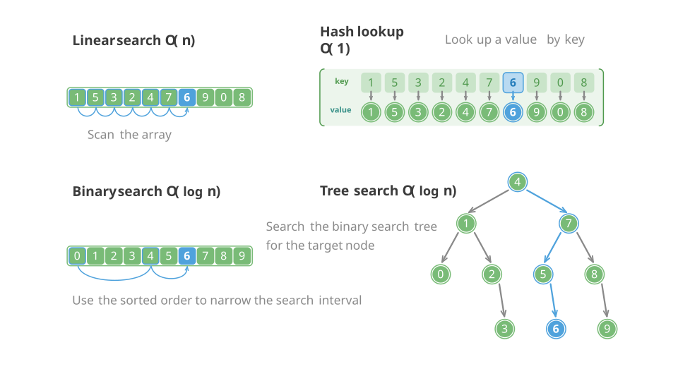

# 10.5 &nbsp; Search algorithms revisited

A <u>search algorithm</u> finds one or more elements that meet a given condition in a data structure such as an array, linked list, tree, or graph.

We can group search algorithms into two categories based on how they work.

- **Traverse the data structure to locate the target element**. Examples include array, linked list, tree, and graph traversals.
- **Use the organization of the data or prior knowledge about it to find elements efficiently**. Examples include binary search, hash lookup, and binary search tree lookup.

We have already encountered these ideas in earlier chapters. Let’s bring them together and take a more systematic look at search algorithms.

## 10.5.1 &nbsp; Brute-force search

Brute-force search locates a target by visiting the elements of a data structure one by one.

- Linear search works on linear data structures such as arrays and linked lists. Start at one end and visit each element in turn until you find the target or reach the other end without a match.
- Breadth-first search and depth-first search are two ways to traverse graphs and trees. Breadth-first search starts at an initial node and visits nodes layer by layer, from nearest to farthest. Depth-first search starts at an initial node, follows one path as far as it can, then backtracks to explore other paths until it has traversed the entire structure.

Brute-force search is simple and widely applicable. **It requires no preprocessing of the data or additional data structure**.

However, **these algorithms take $O(n)$ time**, where $n$ is the number of elements. This makes them slow on large inputs.

## 10.5.2 &nbsp; Adaptive search

Adaptive search exploits a property of the data, such as its sorted order, to locate the target more efficiently.

- Binary search uses the sorted order of the data for efficient lookup and applies only to arrays.
- Hash lookup uses a hash table to map search keys to the associated data, so a query can retrieve a value by its key.
- Tree search compares node values in a structure such as a binary search tree, quickly ruling out nodes to locate the target.

These algorithms are efficient: **their time complexity can be as low as $O(\log n)$ or even $O(1)$**.

However, **these algorithms often require preprocessing**. For example, binary search needs a sorted array. Hash lookup and tree search require extra data structures, which take additional time and space to maintain.

!!! tip

    Adaptive search algorithms are often called lookup algorithms. **Their main purpose is to retrieve a target element quickly from a particular data structure**.

## 10.5.3 &nbsp; Choosing a search method

To find a target in a dataset of size $n$, we can use linear search, binary search, tree search, or hash lookup. Figure 10-11 illustrates how each method works.

{ class="animation-figure" }

 Figure 10-11 &nbsp; Search strategies 

Table 10-1 compares the cost of common operations and the properties of each method.

 Table 10-1 &nbsp; Comparing the efficiency of search algorithms 

|              | Linear search | Binary search           | Tree search             | Hash lookup        |
| ------------ | -------- | ------------------ | ------------------ | --------------- |
| Find an element     | $O(n)$   | $O(\log n)$        | $O(\log n)$        | $O(1)$          |
| Insert an element     | $O(1)$   | $O(n)$             | $O(\log n)$        | $O(1)$          |
| Delete an element     | $O(n)$   | $O(n)$             | $O(\log n)$        | $O(1)$          |
| Extra space     | $O(1)$   | $O(1)$             | $O(n)$             | $O(n)$          |
| Data preprocessing   | /        | Sort $O(n \log n)$ | Build the tree $O(n \log n)$ | Build the hash table $O(n)$ |
| Data order | Unsorted     | Sorted               | Sorted               | Unsorted            |

The choice also depends on the size of the dataset, the required search performance, and how often you query or update the data.

**Linear search**

- It works in many settings and needs no preprocessing. For a single query, the other three methods take longer to preprocess the data than a linear search takes to scan it.
- It suits small datasets, where time complexity has less impact on performance.
- It also suits frequently updated data because it requires no extra maintenance.

**Binary search**

- It performs consistently on large datasets, with a worst-case search time of $O(\log n)$.
- The dataset must still fit in a contiguous block of memory because it is stored in an array.
- It is a poor fit for frequent insertions and deletions because maintaining a sorted array is expensive.

**Hash lookup**

- With an average lookup time of $O(1)$, it suits applications that need very fast queries.
- It is a poor fit for ordered data or range queries because hash tables do not maintain the data in sorted order.
- Performance depends heavily on the hash function and the collision resolution strategy, so it can degrade substantially.
- It is a poor fit for very large datasets because the hash table needs extra space to minimize collisions and keep lookups fast.

**Tree search**

- It can handle very large datasets because tree nodes can occupy scattered locations in memory.
- It suits applications that need to keep data sorted or support range queries.
- Repeated insertions and deletions can skew a binary search tree, degrading its time complexity to $O(n)$.
- An AVL tree or a red-black tree keeps operations at $O(\log n)$ time, though maintaining balance adds overhead.
