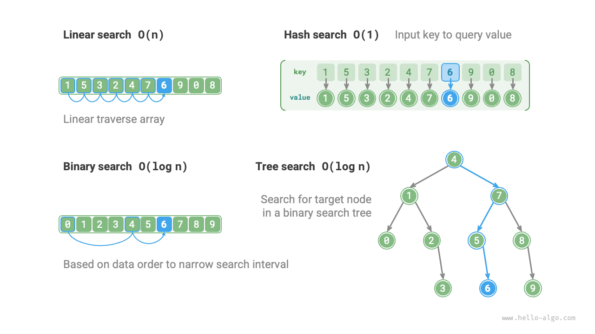

# Search algorithms revisited

A <u>search algorithm</u> finds one or more elements that satisfy specified conditions in a data structure, such as an array, linked list, tree, or graph.

Search algorithms fall into two categories according to their approach.

- **Locate the target by traversing the data structure**, as in traversals of arrays, linked lists, trees, and graphs.
- **Find elements efficiently by using the organization of the data or prior information about it**, as in binary search, hash lookup, and binary search tree lookup.

These ideas have all appeared in earlier chapters, so search algorithms are already familiar to us. In this section, we revisit them from a more systematic perspective.

## Brute-force search

Brute-force search locates a target by visiting the elements of a data structure one by one.

- “Linear search” applies to linear data structures such as arrays and linked lists. Starting at one end, it visits elements in sequence until it finds the target or reaches the other end without finding it.
- “Breadth-first search” and “depth-first search” are two strategies for traversing graphs and trees. Breadth-first search starts at an initial node and searches level by level, visiting nearby nodes before more distant ones. Depth-first search follows a path as far as possible, then backtracks and tries other paths until the whole structure has been traversed.

Brute-force search is simple and broadly applicable. **It requires neither preprocessing the data nor building an additional data structure**.

However, **these algorithms take $O(n)$ time**, where $n$ is the number of elements, so they perform poorly on large datasets.

## Adaptive search

Adaptive search uses properties of the data, such as its ordering, to optimize the search process and locate the target more efficiently.

- “Binary search” uses sorted data to search efficiently and applies only to arrays.
- “Hash lookup” uses a hash table to map lookup keys to target data as key-value pairs.
- “Tree search” uses comparisons of node values in a particular tree structure, such as a binary search tree, to rule out nodes quickly and locate the target.

These algorithms are efficient, **achieving time complexities of $O(\log n)$ or even $O(1)$**.

However, **they often require preprocessing the data**. Binary search requires sorting the array in advance; hash lookup and tree search require additional data structures, whose maintenance also costs time and space.

!!! tip

    Adaptive search algorithms are often called lookup algorithms. **Their main purpose is to retrieve target elements quickly from specific data structures**.

## Choosing a search method

Given a dataset of size $n$, we can find a target using linear search, binary search, tree search, hash lookup, and other methods. The figure below illustrates how these methods work.

The table below compares their efficiency and properties.

 Table <id> &nbsp; Efficiency of lookup algorithms 

|              | Linear search | Binary search           | Tree search             | Hash lookup        |
| ------------ | -------- | ------------------ | ------------------ | --------------- |
| Find an element     | $O(n)$   | $O(\log n)$        | $O(\log n)$        | $O(1)$          |
| Insert an element     | $O(1)$   | $O(n)$             | $O(\log n)$        | $O(1)$          |
| Delete an element     | $O(n)$   | $O(n)$             | $O(\log n)$        | $O(1)$          |
| Extra space     | $O(1)$   | $O(1)$             | $O(n)$             | $O(n)$          |
| Preprocessing   | /        | Sort $O(n \log n)$ | Build a tree $O(n \log n)$ | Build a hash table $O(n)$ |
| Data ordering | Unsorted     | Sorted               | Sorted               | Unsorted            |

The choice also depends on dataset size, required search performance, and how frequently the data is queried and updated.

**Linear search**

- It is broadly applicable and requires no preprocessing. If we need only one lookup, preprocessing for the other three methods takes longer than a linear search itself.
- It suits small datasets, where time complexity has less influence on actual performance.
- It suits frequently updated data because no additional data structure needs to be maintained.

**Binary search**

- It suits large datasets, with predictable performance and a worst-case time complexity of $O(\log n)$.
- The dataset cannot be excessively large, because an array requires contiguous memory.
- It is unsuitable for frequent insertions and deletions, since maintaining a sorted array is expensive.

**Hash lookup**

- It suits situations demanding very fast queries, with an average time complexity of $O(1)$.
- It is unsuitable when sorted data or range queries are needed, because a hash table does not preserve order.
- It depends heavily on the hash function and collision-resolution strategy, creating a greater risk of performance degradation.
- It is unsuitable for excessively large datasets, because a hash table needs extra space to minimize collisions and maintain good query performance.

**Tree search**

- It suits very large datasets, because tree nodes are stored at separate locations in memory.
- It suits situations requiring sorted data or range queries.
- Repeated insertions and deletions can make a binary search tree skewed, degrading its time complexity to $O(n)$.
- An AVL tree or red-black tree keeps operations at $O(\log n)$, but maintaining balance adds overhead.
