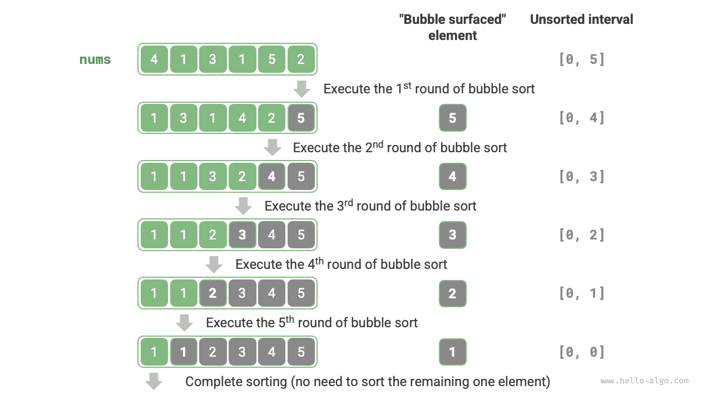

# 11.3 &nbsp; Bubble sort

<u>Bubble sort</u> sorts by repeatedly comparing and swapping adjacent elements. The process resembles bubbles rising from the bottom to the top, which gives the algorithm its name.

As shown below, we can simulate bubbling through swaps. Scan from the left end of the array to the right, comparing each pair of adjacent elements. If the left element is greater than the right, swap them. After the scan, the largest element has moved to the far right.

=== "<1>"
    { class="animation-figure" }

=== "<2>"
    { class="animation-figure" }

=== "<3>"
    { class="animation-figure" }

=== "<4>"
    { class="animation-figure" }

=== "<5>"
    { class="animation-figure" }

=== "<6>"
    { class="animation-figure" }

=== "<7>"
    { class="animation-figure" }

<p align="center"> Figure 11-4 &nbsp; Simulating bubbling through element swaps </p>

## 11.3.1 &nbsp; Algorithm steps

For an array of length $n$, bubble sort proceeds as shown below.

1. First, perform a bubbling pass over all $n$ elements, **moving the largest element to its correct position**.
2. Next, perform a pass over the remaining $n - 1$ elements, **moving the second-largest element to its correct position**.
3. Continue in this way. After $n - 1$ passes, **the largest $n - 1$ elements are all in their correct positions**.
4. The one remaining element must be the smallest and needs no further sorting. The array is now sorted.

{ class="animation-figure" }

<p align="center"> Figure 11-5 &nbsp; The bubble sort process </p>

An implementation follows:

=== "Python"

    ```python title="bubble_sort.py"
    def bubble_sort(nums: list[int]):
        """Bubble sort"""
        n = len(nums)
        # Outer loop: the unsorted range is [0, i]
        for i in range(n - 1, 0, -1):
            # Inner loop: move the largest element in the unsorted range [0, i] to its right end through swaps
            for j in range(i):
                if nums[j] > nums[j + 1]:
                    # Swap nums[j] and nums[j + 1]
                    nums[j], nums[j + 1] = nums[j + 1], nums[j]
    ```

=== "C++"

    ```cpp title="bubble_sort.cpp"
    /* Bubble sort */
    void bubbleSort(vector<int> &nums) {
        // Outer loop: the unsorted range is [0, i]
        for (int i = nums.size() - 1; i > 0; i--) {
            // Inner loop: move the largest element in the unsorted range [0, i] to its right end through swaps
            for (int j = 0; j < i; j++) {
                if (nums[j] > nums[j + 1]) {
                    // Swap nums[j] and nums[j + 1]
                    // Use the std::swap() function here
                    swap(nums[j], nums[j + 1]);
                }
            }
        }
    }
    ```

=== "Java"

    ```java title="bubble_sort.java"
    /* Bubble sort */
    void bubbleSort(int[] nums) {
        // Outer loop: the unsorted range is [0, i]
        for (int i = nums.length - 1; i > 0; i--) {
            // Inner loop: move the largest element in the unsorted range [0, i] to its right end through swaps
            for (int j = 0; j < i; j++) {
                if (nums[j] > nums[j + 1]) {
                    // Swap nums[j] and nums[j + 1]
                    int tmp = nums[j];
                    nums[j] = nums[j + 1];
                    nums[j + 1] = tmp;
                }
            }
        }
    }
    ```

=== "C#"

    ```csharp title="bubble_sort.cs"
    /* Bubble sort */
    void BubbleSort(int[] nums) {
        // Outer loop: the unsorted range is [0, i]
        for (int i = nums.Length - 1; i > 0; i--) {
            // Inner loop: move the largest element in the unsorted range [0, i] to its right end through swaps
            for (int j = 0; j < i; j++) {
                if (nums[j] > nums[j + 1]) {
                    // Swap nums[j] and nums[j + 1]
                    (nums[j + 1], nums[j]) = (nums[j], nums[j + 1]);
                }
            }
        }
    }
    ```

=== "Go"

    ```go title="bubble_sort.go"
    /* Bubble sort */
    func bubbleSort(nums []int) {
        // Outer loop: the unsorted range is [0, i]
        for i := len(nums) - 1; i > 0; i-- {
            // Inner loop: move the largest element in the unsorted range [0, i] to its right end through swaps
            for j := 0; j < i; j++ {
                if nums[j] > nums[j+1] {
                    // Swap nums[j] and nums[j + 1]
                    nums[j], nums[j+1] = nums[j+1], nums[j]
                }
            }
        }
    }
    ```

=== "Swift"

    ```swift title="bubble_sort.swift"
    /* Bubble sort */
    func bubbleSort(nums: inout [Int]) {
        // Outer loop: the unsorted range is [0, i]
        for i in nums.indices.dropFirst().reversed() {
            // Inner loop: move the largest element in the unsorted range [0, i] to its right end through swaps
            for j in 0 ..< i {
                if nums[j] > nums[j + 1] {
                    // Swap nums[j] and nums[j + 1]
                    nums.swapAt(j, j + 1)
                }
            }
        }
    }
    ```

=== "JS"

    ```javascript title="bubble_sort.js"
    /* Bubble sort */
    function bubbleSort(nums) {
        // Outer loop: the unsorted range is [0, i]
        for (let i = nums.length - 1; i > 0; i--) {
            // Inner loop: move the largest element in the unsorted range [0, i] to its right end through swaps
            for (let j = 0; j < i; j++) {
                if (nums[j] > nums[j + 1]) {
                    // Swap nums[j] and nums[j + 1]
                    let tmp = nums[j];
                    nums[j] = nums[j + 1];
                    nums[j + 1] = tmp;
                }
            }
        }
    }
    ```

=== "TS"

    ```typescript title="bubble_sort.ts"
    /* Bubble sort */
    function bubbleSort(nums: number[]): void {
        // Outer loop: the unsorted range is [0, i]
        for (let i = nums.length - 1; i > 0; i--) {
            // Inner loop: move the largest element in the unsorted range [0, i] to its right end through swaps
            for (let j = 0; j < i; j++) {
                if (nums[j] > nums[j + 1]) {
                    // Swap nums[j] and nums[j + 1]
                    let tmp = nums[j];
                    nums[j] = nums[j + 1];
                    nums[j + 1] = tmp;
                }
            }
        }
    }
    ```

=== "Dart"

    ```dart title="bubble_sort.dart"
    /* Bubble sort */
    void bubbleSort(List<int> nums) {
      // Outer loop: the unsorted range is [0, i]
      for (int i = nums.length - 1; i > 0; i--) {
        // Inner loop: move the largest element in the unsorted range [0, i] to its right end through swaps
        for (int j = 0; j < i; j++) {
          if (nums[j] > nums[j + 1]) {
            // Swap nums[j] and nums[j + 1]
            int tmp = nums[j];
            nums[j] = nums[j + 1];
            nums[j + 1] = tmp;
          }
        }
      }
    }
    ```

=== "Rust"

    ```rust title="bubble_sort.rs"
    /* Bubble sort */
    fn bubble_sort(nums: &mut [i32]) {
        // Outer loop: the unsorted range is [0, i]
        for i in (1..nums.len()).rev() {
            // Inner loop: move the largest element in the unsorted range [0, i] to its right end through swaps
            for j in 0..i {
                if nums[j] > nums[j + 1] {
                    // Swap nums[j] and nums[j + 1]
                    nums.swap(j, j + 1);
                }
            }
        }
    }
    ```

=== "C"

    ```c title="bubble_sort.c"
    /* Bubble sort */
    void bubbleSort(int nums[], int size) {
        // Outer loop: the unsorted range is [0, i]
        for (int i = size - 1; i > 0; i--) {
            // Inner loop: move the largest element in the unsorted range [0, i] to its right end through swaps
            for (int j = 0; j < i; j++) {
                if (nums[j] > nums[j + 1]) {
                    int temp = nums[j];
                    nums[j] = nums[j + 1];
                    nums[j + 1] = temp;
                }
            }
        }
    }
    ```

=== "Kotlin"

    ```kotlin title="bubble_sort.kt"
    /* Bubble sort */
    fun bubbleSort(nums: IntArray) {
        // Outer loop: the unsorted range is [0, i]
        for (i in nums.size - 1 downTo 1) {
            // Inner loop: move the largest element in the unsorted range [0, i] to its right end through swaps
            for (j in 0..<i) {
                if (nums[j] > nums[j + 1]) {
                    // Swap nums[j] and nums[j + 1]
                    val temp = nums[j]
                    nums[j] = nums[j + 1]
                    nums[j + 1] = temp
                }
            }
        }
    }
    ```

=== "Ruby"

    ```ruby title="bubble_sort.rb"
    ### Bubble sort ###
    def bubble_sort(nums)
      n = nums.length
      # Outer loop: the unsorted range is [0, i]
      for i in (n - 1).downto(1)
        # Inner loop: move the largest element in the unsorted range [0, i] to its right end through swaps
        for j in 0...i
          if nums[j] > nums[j + 1]
            # Swap nums[j] and nums[j + 1]
            nums[j], nums[j + 1] = nums[j + 1], nums[j]
          end
        end
      end
    end
    ```

??? pythontutor "Visualize execution"

    <div style="height: 477px; width: 100%;"><iframe class="pythontutor-iframe" title="Visualize execution" src="https://pythontutor.com/iframe-embed.html#code=def%20bubble_sort%28nums%3A%20list%5Bint%5D%29%3A%0A%20%20%20%20%22%22%22Bubble%20sort%22%22%22%0A%20%20%20%20n%20%3D%20len%28nums%29%0A%20%20%20%20%23%20Outer%20loop%3A%20the%20unsorted%20range%20is%20%5B0,%20i%5D%0A%20%20%20%20for%20i%20in%20range%28n%20-%201,%200,%20-1%29%3A%0A%20%20%20%20%20%20%20%20%23%20Inner%20loop%3A%20move%20the%20largest%20element%20in%20the%20unsorted%20range%20%5B0,%20i%5D%20to%20its%20right%20end%20through%20swaps%0A%20%20%20%20%20%20%20%20for%20j%20in%20range%28i%29%3A%0A%20%20%20%20%20%20%20%20%20%20%20%20if%20nums%5Bj%5D%20%3E%20nums%5Bj%20%2B%201%5D%3A%0A%20%20%20%20%20%20%20%20%20%20%20%20%20%20%20%20%23%20Swap%20nums%5Bj%5D%20and%20nums%5Bj%20%2B%201%5D%0A%20%20%20%20%20%20%20%20%20%20%20%20%20%20%20%20nums%5Bj%5D,%20nums%5Bj%20%2B%201%5D%20%3D%20nums%5Bj%20%2B%201%5D,%20nums%5Bj%5D%0A%0A%22%22%22Driver%20code%22%22%22%0Aif%20__name__%20%3D%3D%20%22__main__%22%3A%0A%20%20%20%20nums%20%3D%20%5B4,%201,%203,%201,%205,%202%5D%0A%20%20%20%20bubble_sort%28nums%29%0A%20%20%20%20print%28%22After%20bubble%20sort,%20nums%20%3D%22,%20nums%29&codeDivHeight=472&codeDivWidth=350&cumulative=false&curInstr=4&heapPrimitives=nevernest&origin=opt-frontend.js&py=311&rawInputLstJSON=%5B%5D&textReferences=false"> </iframe></div>
    <div style="margin-top: 5px;"><a href="https://pythontutor.com/iframe-embed.html#code=def%20bubble_sort%28nums%3A%20list%5Bint%5D%29%3A%0A%20%20%20%20%22%22%22Bubble%20sort%22%22%22%0A%20%20%20%20n%20%3D%20len%28nums%29%0A%20%20%20%20%23%20Outer%20loop%3A%20the%20unsorted%20range%20is%20%5B0,%20i%5D%0A%20%20%20%20for%20i%20in%20range%28n%20-%201,%200,%20-1%29%3A%0A%20%20%20%20%20%20%20%20%23%20Inner%20loop%3A%20move%20the%20largest%20element%20in%20the%20unsorted%20range%20%5B0,%20i%5D%20to%20its%20right%20end%20through%20swaps%0A%20%20%20%20%20%20%20%20for%20j%20in%20range%28i%29%3A%0A%20%20%20%20%20%20%20%20%20%20%20%20if%20nums%5Bj%5D%20%3E%20nums%5Bj%20%2B%201%5D%3A%0A%20%20%20%20%20%20%20%20%20%20%20%20%20%20%20%20%23%20Swap%20nums%5Bj%5D%20and%20nums%5Bj%20%2B%201%5D%0A%20%20%20%20%20%20%20%20%20%20%20%20%20%20%20%20nums%5Bj%5D,%20nums%5Bj%20%2B%201%5D%20%3D%20nums%5Bj%20%2B%201%5D,%20nums%5Bj%5D%0A%0A%22%22%22Driver%20code%22%22%22%0Aif%20__name__%20%3D%3D%20%22__main__%22%3A%0A%20%20%20%20nums%20%3D%20%5B4,%201,%203,%201,%205,%202%5D%0A%20%20%20%20bubble_sort%28nums%29%0A%20%20%20%20print%28%22After%20bubble%20sort,%20nums%20%3D%22,%20nums%29&codeDivHeight=800&codeDivWidth=600&cumulative=false&curInstr=4&heapPrimitives=nevernest&origin=opt-frontend.js&py=311&rawInputLstJSON=%5B%5D&textReferences=false" target="_blank" rel="noopener noreferrer">View full screen ></a></div>

## 11.3.2 &nbsp; Improving efficiency

If a bubbling pass performs no swaps, the array is already sorted and we can return immediately. We can therefore add a variable `flag` to detect this situation and stop as soon as it occurs.

With this optimization, the worst-case and average time complexities remain $O(n^2)$. However, a fully sorted input achieves the best-case time complexity of $O(n)$.

=== "Python"

    ```python title="bubble_sort.py"
    def bubble_sort_with_flag(nums: list[int]):
        """Bubble sort (flag optimization)"""
        n = len(nums)
        # Outer loop: the unsorted range is [0, i]
        for i in range(n - 1, 0, -1):
            flag = False  # Initialize the flag
            # Inner loop: move the largest element in the unsorted range [0, i] to its right end through swaps
            for j in range(i):
                if nums[j] > nums[j + 1]:
                    # Swap nums[j] and nums[j + 1]
                    nums[j], nums[j + 1] = nums[j + 1], nums[j]
                    flag = True  # Record that a swap occurred
            if not flag:
                break  # Exit immediately if this pass made no swaps
    ```

=== "C++"

    ```cpp title="bubble_sort.cpp"
    /* Bubble sort (flag optimization)*/
    void bubbleSortWithFlag(vector<int> &nums) {
        // Outer loop: the unsorted range is [0, i]
        for (int i = nums.size() - 1; i > 0; i--) {
            bool flag = false; // Initialize the flag
            // Inner loop: move the largest element in the unsorted range [0, i] to its right end through swaps
            for (int j = 0; j < i; j++) {
                if (nums[j] > nums[j + 1]) {
                    // Swap nums[j] and nums[j + 1]
                    // Use the std::swap() function here
                    swap(nums[j], nums[j + 1]);
                    flag = true; // Record that a swap occurred
                }
            }
            if (!flag)
                break; // Exit immediately if this pass made no swaps
        }
    }
    ```

=== "Java"

    ```java title="bubble_sort.java"
    /* Bubble sort (flag optimization) */
    void bubbleSortWithFlag(int[] nums) {
        // Outer loop: the unsorted range is [0, i]
        for (int i = nums.length - 1; i > 0; i--) {
            boolean flag = false; // Initialize the flag
            // Inner loop: move the largest element in the unsorted range [0, i] to its right end through swaps
            for (int j = 0; j < i; j++) {
                if (nums[j] > nums[j + 1]) {
                    // Swap nums[j] and nums[j + 1]
                    int tmp = nums[j];
                    nums[j] = nums[j + 1];
                    nums[j + 1] = tmp;
                    flag = true; // Record that a swap occurred
                }
            }
            if (!flag)
                break; // Exit immediately if this pass made no swaps
        }
    }
    ```

=== "C#"

    ```csharp title="bubble_sort.cs"
    /* Bubble sort (flag optimization)*/
    void BubbleSortWithFlag(int[] nums) {
        // Outer loop: the unsorted range is [0, i]
        for (int i = nums.Length - 1; i > 0; i--) {
            bool flag = false; // Initialize the flag
            // Inner loop: move the largest element in the unsorted range [0, i] to its right end through swaps
            for (int j = 0; j < i; j++) {
                if (nums[j] > nums[j + 1]) {
                    // Swap nums[j] and nums[j + 1]
                    (nums[j + 1], nums[j]) = (nums[j], nums[j + 1]);
                    flag = true;  // Record that a swap occurred
                }
            }
            if (!flag) break;     // Exit immediately if this pass made no swaps
        }
    }
    ```

=== "Go"

    ```go title="bubble_sort.go"
    /* Bubble sort (flag optimization)*/
    func bubbleSortWithFlag(nums []int) {
        // Outer loop: the unsorted range is [0, i]
        for i := len(nums) - 1; i > 0; i-- {
            flag := false // Initialize the flag
            // Inner loop: move the largest element in the unsorted range [0, i] to its right end through swaps
            for j := 0; j < i; j++ {
                if nums[j] > nums[j+1] {
                    // Swap nums[j] and nums[j + 1]
                    nums[j], nums[j+1] = nums[j+1], nums[j]
                    flag = true // Record that a swap occurred
                }
            }
            if flag == false { // Exit immediately if this pass made no swaps
                break
            }
        }
    }
    ```

=== "Swift"

    ```swift title="bubble_sort.swift"
    /* Bubble sort (flag optimization)*/
    func bubbleSortWithFlag(nums: inout [Int]) {
        // Outer loop: the unsorted range is [0, i]
        for i in nums.indices.dropFirst().reversed() {
            var flag = false // Initialize the flag
            for j in 0 ..< i {
                if nums[j] > nums[j + 1] {
                    // Swap nums[j] and nums[j + 1]
                    nums.swapAt(j, j + 1)
                    flag = true // Record that a swap occurred
                }
            }
            if !flag { // Exit immediately if this pass made no swaps
                break
            }
        }
    }
    ```

=== "JS"

    ```javascript title="bubble_sort.js"
    /* Bubble sort (flag optimization)*/
    function bubbleSortWithFlag(nums) {
        // Outer loop: the unsorted range is [0, i]
        for (let i = nums.length - 1; i > 0; i--) {
            let flag = false; // Initialize the flag
            // Inner loop: move the largest element in the unsorted range [0, i] to its right end through swaps
            for (let j = 0; j < i; j++) {
                if (nums[j] > nums[j + 1]) {
                    // Swap nums[j] and nums[j + 1]
                    let tmp = nums[j];
                    nums[j] = nums[j + 1];
                    nums[j + 1] = tmp;
                    flag = true; // Record that a swap occurred
                }
            }
            if (!flag) break; // Exit immediately if this pass made no swaps
        }
    }
    ```

=== "TS"

    ```typescript title="bubble_sort.ts"
    /* Bubble sort (flag optimization)*/
    function bubbleSortWithFlag(nums: number[]): void {
        // Outer loop: the unsorted range is [0, i]
        for (let i = nums.length - 1; i > 0; i--) {
            let flag = false; // Initialize the flag
            // Inner loop: move the largest element in the unsorted range [0, i] to its right end through swaps
            for (let j = 0; j < i; j++) {
                if (nums[j] > nums[j + 1]) {
                    // Swap nums[j] and nums[j + 1]
                    let tmp = nums[j];
                    nums[j] = nums[j + 1];
                    nums[j + 1] = tmp;
                    flag = true; // Record that a swap occurred
                }
            }
            if (!flag) break; // Exit immediately if this pass made no swaps
        }
    }
    ```

=== "Dart"

    ```dart title="bubble_sort.dart"
    /* Bubble sort (flag optimization)*/
    void bubbleSortWithFlag(List<int> nums) {
      // Outer loop: the unsorted range is [0, i]
      for (int i = nums.length - 1; i > 0; i--) {
        bool flag = false; // Initialize the flag
        // Inner loop: move the largest element in the unsorted range [0, i] to its right end through swaps
        for (int j = 0; j < i; j++) {
          if (nums[j] > nums[j + 1]) {
            // Swap nums[j] and nums[j + 1]
            int tmp = nums[j];
            nums[j] = nums[j + 1];
            nums[j + 1] = tmp;
            flag = true; // Record that a swap occurred
          }
        }
        if (!flag) break; // Exit immediately if this pass made no swaps
      }
    }
    ```

=== "Rust"

    ```rust title="bubble_sort.rs"
    /* Bubble sort (flag optimization) */
    fn bubble_sort_with_flag(nums: &mut [i32]) {
        // Outer loop: the unsorted range is [0, i]
        for i in (1..nums.len()).rev() {
            let mut flag = false; // Initialize the flag
            // Inner loop: move the largest element in the unsorted range [0, i] to its right end through swaps
            for j in 0..i {
                if nums[j] > nums[j + 1] {
                    // Swap nums[j] and nums[j + 1]
                    nums.swap(j, j + 1);
                    flag = true; // Record that a swap occurred
                }
            }
            if !flag {
                break; // Exit immediately if this pass made no swaps
            };
        }
    }
    ```

=== "C"

    ```c title="bubble_sort.c"
    /* Bubble sort (flag optimization)*/
    void bubbleSortWithFlag(int nums[], int size) {
        // Outer loop: the unsorted range is [0, i]
        for (int i = size - 1; i > 0; i--) {
            bool flag = false;
            // Inner loop: move the largest element in the unsorted range [0, i] to its right end through swaps
            for (int j = 0; j < i; j++) {
                if (nums[j] > nums[j + 1]) {
                    int temp = nums[j];
                    nums[j] = nums[j + 1];
                    nums[j + 1] = temp;
                    flag = true;
                }
            }
            if (!flag)
                break;
        }
    }
    ```

=== "Kotlin"

    ```kotlin title="bubble_sort.kt"
    /* Bubble sort (flag optimization) */
    fun bubbleSortWithFlag(nums: IntArray) {
        // Outer loop: the unsorted range is [0, i]
        for (i in nums.size - 1 downTo 1) {
            var flag = false // Initialize the flag
            // Inner loop: move the largest element in the unsorted range [0, i] to its right end through swaps
            for (j in 0..<i) {
                if (nums[j] > nums[j + 1]) {
                    // Swap nums[j] and nums[j + 1]
                    val temp = nums[j]
                    nums[j] = nums[j + 1]
                    nums[j + 1] = temp
                    flag = true // Record that a swap occurred
                }
            }
            if (!flag) break // Exit immediately if this pass made no swaps
        }
    }
    ```

=== "Ruby"

    ```ruby title="bubble_sort.rb"
    ### Bubble sort (flag optimization)###
    def bubble_sort_with_flag(nums)
      n = nums.length
      # Outer loop: the unsorted range is [0, i]
      for i in (n - 1).downto(1)
        flag = false # Initialize the flag

        # Inner loop: move the largest element in the unsorted range [0, i] to its right end through swaps
        for j in 0...i
          if nums[j] > nums[j + 1]
            # Swap nums[j] and nums[j + 1]
            nums[j], nums[j + 1] = nums[j + 1], nums[j]
            flag = true # Record that a swap occurred
          end
        end

        break unless flag # Exit immediately if this pass made no swaps
      end
    end
    ```

??? pythontutor "Visualize execution"

    <div style="height: 549px; width: 100%;"><iframe class="pythontutor-iframe" title="Visualize execution" src="https://pythontutor.com/iframe-embed.html#code=def%20bubble_sort_with_flag%28nums%3A%20list%5Bint%5D%29%3A%0A%20%20%20%20%22%22%22Bubble%20sort%20%28flag%20optimization%29%22%22%22%0A%20%20%20%20n%20%3D%20len%28nums%29%0A%20%20%20%20%23%20Outer%20loop%3A%20the%20unsorted%20range%20is%20%5B0,%20i%5D%0A%20%20%20%20for%20i%20in%20range%28n%20-%201,%200,%20-1%29%3A%0A%20%20%20%20%20%20%20%20flag%20%3D%20False%20%20%23%20Initialize%20the%20flag%0A%20%20%20%20%20%20%20%20%23%20Inner%20loop%3A%20move%20the%20largest%20element%20in%20the%20unsorted%20range%20%5B0,%20i%5D%20to%20its%20right%20end%20through%20swaps%0A%20%20%20%20%20%20%20%20for%20j%20in%20range%28i%29%3A%0A%20%20%20%20%20%20%20%20%20%20%20%20if%20nums%5Bj%5D%20%3E%20nums%5Bj%20%2B%201%5D%3A%0A%20%20%20%20%20%20%20%20%20%20%20%20%20%20%20%20%23%20Swap%20nums%5Bj%5D%20and%20nums%5Bj%20%2B%201%5D%0A%20%20%20%20%20%20%20%20%20%20%20%20%20%20%20%20nums%5Bj%5D,%20nums%5Bj%20%2B%201%5D%20%3D%20nums%5Bj%20%2B%201%5D,%20nums%5Bj%5D%0A%20%20%20%20%20%20%20%20%20%20%20%20%20%20%20%20flag%20%3D%20True%20%20%23%20Record%20that%20a%20swap%20occurred%0A%20%20%20%20%20%20%20%20if%20not%20flag%3A%0A%20%20%20%20%20%20%20%20%20%20%20%20break%20%20%23%20Exit%20immediately%20if%20this%20pass%20made%20no%20swaps%0A%0A%22%22%22Driver%20code%22%22%22%0Aif%20__name__%20%3D%3D%20%22__main__%22%3A%0A%20%20%20%20nums%20%3D%20%5B4,%201,%203,%201,%205,%202%5D%0A%20%20%20%20bubble_sort_with_flag%28nums%29%0A%20%20%20%20print%28%22After%20bubble%20sort,%20nums%20%3D%22,%20nums%29&codeDivHeight=472&codeDivWidth=350&cumulative=false&curInstr=4&heapPrimitives=nevernest&origin=opt-frontend.js&py=311&rawInputLstJSON=%5B%5D&textReferences=false"> </iframe></div>
    <div style="margin-top: 5px;"><a href="https://pythontutor.com/iframe-embed.html#code=def%20bubble_sort_with_flag%28nums%3A%20list%5Bint%5D%29%3A%0A%20%20%20%20%22%22%22Bubble%20sort%20%28flag%20optimization%29%22%22%22%0A%20%20%20%20n%20%3D%20len%28nums%29%0A%20%20%20%20%23%20Outer%20loop%3A%20the%20unsorted%20range%20is%20%5B0,%20i%5D%0A%20%20%20%20for%20i%20in%20range%28n%20-%201,%200,%20-1%29%3A%0A%20%20%20%20%20%20%20%20flag%20%3D%20False%20%20%23%20Initialize%20the%20flag%0A%20%20%20%20%20%20%20%20%23%20Inner%20loop%3A%20move%20the%20largest%20element%20in%20the%20unsorted%20range%20%5B0,%20i%5D%20to%20its%20right%20end%20through%20swaps%0A%20%20%20%20%20%20%20%20for%20j%20in%20range%28i%29%3A%0A%20%20%20%20%20%20%20%20%20%20%20%20if%20nums%5Bj%5D%20%3E%20nums%5Bj%20%2B%201%5D%3A%0A%20%20%20%20%20%20%20%20%20%20%20%20%20%20%20%20%23%20Swap%20nums%5Bj%5D%20and%20nums%5Bj%20%2B%201%5D%0A%20%20%20%20%20%20%20%20%20%20%20%20%20%20%20%20nums%5Bj%5D,%20nums%5Bj%20%2B%201%5D%20%3D%20nums%5Bj%20%2B%201%5D,%20nums%5Bj%5D%0A%20%20%20%20%20%20%20%20%20%20%20%20%20%20%20%20flag%20%3D%20True%20%20%23%20Record%20that%20a%20swap%20occurred%0A%20%20%20%20%20%20%20%20if%20not%20flag%3A%0A%20%20%20%20%20%20%20%20%20%20%20%20break%20%20%23%20Exit%20immediately%20if%20this%20pass%20made%20no%20swaps%0A%0A%22%22%22Driver%20code%22%22%22%0Aif%20__name__%20%3D%3D%20%22__main__%22%3A%0A%20%20%20%20nums%20%3D%20%5B4,%201,%203,%201,%205,%202%5D%0A%20%20%20%20bubble_sort_with_flag%28nums%29%0A%20%20%20%20print%28%22After%20bubble%20sort,%20nums%20%3D%22,%20nums%29&codeDivHeight=800&codeDivWidth=600&cumulative=false&curInstr=4&heapPrimitives=nevernest&origin=opt-frontend.js&py=311&rawInputLstJSON=%5B%5D&textReferences=false" target="_blank" rel="noopener noreferrer">View full screen ></a></div>

## 11.3.3 &nbsp; Algorithm properties

- **Time complexity: $O(n^2)$; adaptive**. Successive passes traverse $n - 1$, $n - 2$, $\dots$, $2$, and $1$ positions, totaling $(n - 1) n / 2$. With the `flag` optimization, the best-case time complexity is $O(n)$.
- **Space complexity: $O(1)$; in-place**. Pointers $i$ and $j$ use constant extra space.
- **Stable**. Equal elements are not swapped during a bubbling pass.
