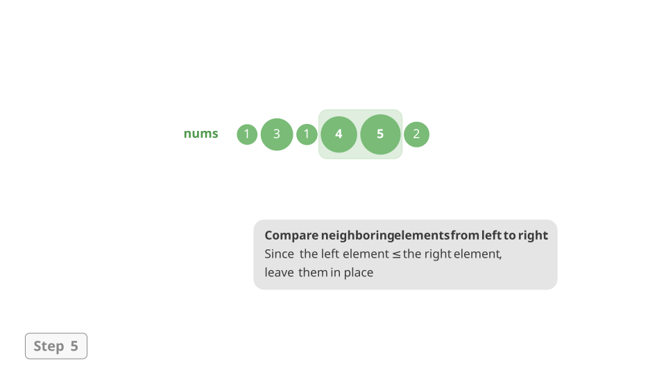
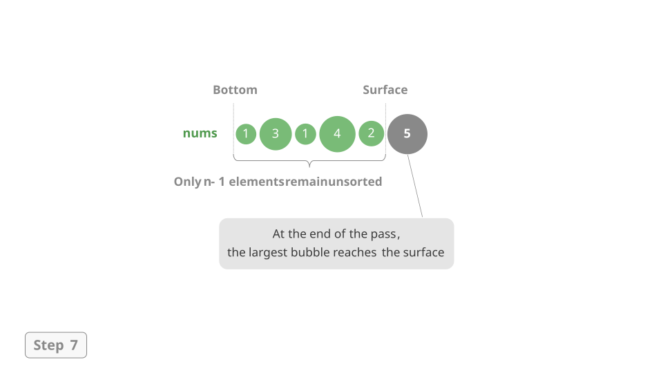
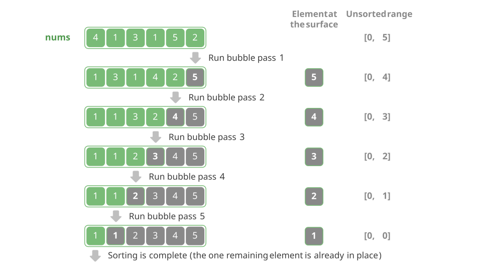

# Bubble sort

<u>Bubble sort</u> sorts elements by repeatedly comparing and swapping adjacent pairs. The way elements move resembles bubbles rising from the bottom to the surface, hence the name.

The figure below shows how swaps simulate this movement. Start at the left end of the array and work to the right, comparing each pair of neighbors. If the left element is greater than the right, swap them. By the end of the pass, the largest element has moved to the right end of the array.

=== "<1>"
    

=== "<2>"
    

=== "<3>"
    

=== "<4>"
    

=== "<5>"
    

=== "<6>"
    

=== "<7>"
    

## How the algorithm works

For an array of length $n$, bubble sort proceeds as shown below.

1. First, make a pass over all $n$ elements to **move the largest element into its final position**.
2. Next, make a pass over the remaining $n - 1$ elements to **move the second-largest element into its final position**.
3. Continue in this way. After $n - 1$ passes, **the largest $n - 1$ elements are in their final positions**.
4. The one remaining element must be the smallest. It is already in place, so the entire array is sorted.



Here is an implementation:

```src
[file]{bubble_sort}-[class]{}-[func]{bubble_sort}
```

## Improving efficiency

If a pass makes no swaps, the array is already sorted and we can return it immediately. We can use a flag, `flag`, to detect this condition and stop as soon as it occurs.

With this optimization, the worst-case and average time complexities are still $O(n^2)$. A fully sorted input achieves the best-case time complexity of $O(n)$.

```src
[file]{bubble_sort}-[class]{}-[func]{bubble_sort_with_flag}
```

## Algorithm properties

- **Time complexity: $O(n^2)$, adaptive**. The successive passes scan ranges of length $n - 1$, $n - 2$, $\dots$, $2$, and $1$, for a total of $(n - 1) n / 2$. With the `flag` optimization, the best-case time complexity is $O(n)$.
- **Space complexity: $O(1)$, in-place**. The two indices $i$ and $j$ use a constant amount of extra space.
- **Stable**. A bubble sort pass never swaps two equal elements.
