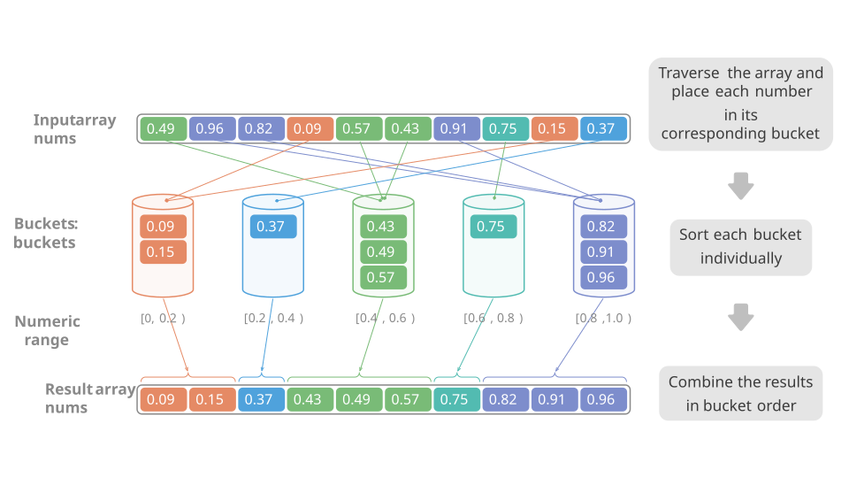
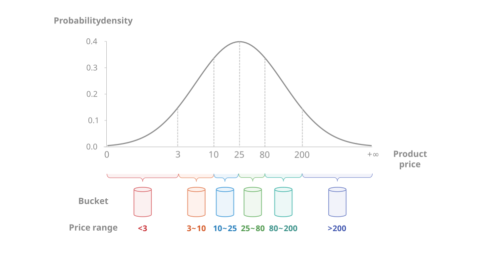

# 11.8 &nbsp; Bucket sort

The sorting algorithms we have seen so far are comparison sorts: they order elements by comparing them with one another. Their worst-case time complexity has a lower bound of $\Omega(n \log n)$. Next we will look at several non-comparison sorts that can run in linear time.

<u>Bucket sort</u> is a classic application of divide and conquer. It divides the data as evenly as possible among a series of ordered buckets, each covering a range of values. It then sorts each bucket separately and combines all the elements in bucket order.

## 11.8.1 &nbsp; How the algorithm works

Consider an array of length $n$ whose elements are floating-point numbers in $[0, 1)$. Figure 11-13 shows how bucket sort works.

1. Initialize $k$ buckets and distribute the $n$ elements among those $k$ buckets.
2. Sort each bucket separately (here we use the language's built-in sorting function).
3. Combine the results in order, starting with the bucket for the smallest values.

{ class="animation-figure" }

<p align="center"> Figure 11-13 &nbsp; Bucket sort procedure </p>

Here is the code:

=== "Python"

    ```python title="bucket_sort.py"
    def bucket_sort(nums: list[float]):
        """Bucket sort"""
        # Initialize k = n/2 buckets, expecting 2 elements per bucket
        k = len(nums) // 2
        buckets = [[] for _ in range(k)]
        # 1. Distribute the array elements among the buckets
        for num in nums:
            # For inputs in [0, 1), use num * k to map each value to an index in [0, k-1]
            i = int(num * k)
            # Add num to bucket i
            buckets[i].append(num)
        # 2. Sort each bucket
        for bucket in buckets:
            # Use the built-in sort or another sorting algorithm
            bucket.sort()
        # 3. Traverse the buckets to combine the results
        i = 0
        for bucket in buckets:
            for num in bucket:
                nums[i] = num
                i += 1
    ```

=== "C++"

    ```cpp title="bucket_sort.cpp"
    /* Bucket sort */
    void bucketSort(vector<float> &nums) {
        // Initialize k = n/2 buckets, expecting 2 elements per bucket
        int k = nums.size() / 2;
        vector<vector<float>> buckets(k);
        // 1. Distribute the array elements among the buckets
        for (float num : nums) {
            // For inputs in [0, 1), use num * k to map each value to an index in [0, k-1]
            int i = num * k;
            // Add num to bucket bucket_idx
            buckets[i].push_back(num);
        }
        // 2. Sort each bucket
        for (vector<float> &bucket : buckets) {
            // Use the built-in sort or another sorting algorithm
            sort(bucket.begin(), bucket.end());
        }
        // 3. Traverse the buckets to combine the results
        int i = 0;
        for (vector<float> &bucket : buckets) {
            for (float num : bucket) {
                nums[i++] = num;
            }
        }
    }
    ```

=== "Java"

    ```java title="bucket_sort.java"
    /* Bucket sort */
    void bucketSort(float[] nums) {
        // Initialize k = n/2 buckets, expecting 2 elements per bucket
        int k = nums.length / 2;
        List<List<Float>> buckets = new ArrayList<>();
        for (int i = 0; i < k; i++) {
            buckets.add(new ArrayList<>());
        }
        // 1. Distribute the array elements among the buckets
        for (float num : nums) {
            // For inputs in [0, 1), use num * k to map each value to an index in [0, k-1]
            int i = (int) (num * k);
            // Add num to bucket i
            buckets.get(i).add(num);
        }
        // 2. Sort each bucket
        for (List<Float> bucket : buckets) {
            // Use the built-in sort or another sorting algorithm
            Collections.sort(bucket);
        }
        // 3. Traverse the buckets to combine the results
        int i = 0;
        for (List<Float> bucket : buckets) {
            for (float num : bucket) {
                nums[i++] = num;
            }
        }
    }
    ```

=== "C#"

    ```csharp title="bucket_sort.cs"
    /* Bucket sort */
    void BucketSort(float[] nums) {
        // Initialize k = n/2 buckets, expecting 2 elements per bucket
        int k = nums.Length / 2;
        List<List<float>> buckets = [];
        for (int i = 0; i < k; i++) {
            buckets.Add([]);
        }
        // 1. Distribute the array elements among the buckets
        foreach (float num in nums) {
            // For inputs in [0, 1), use num * k to map each value to an index in [0, k-1]
            int i = (int)(num * k);
            // Add num to bucket i
            buckets[i].Add(num);
        }
        // 2. Sort each bucket
        foreach (List<float> bucket in buckets) {
            // Use the built-in sort or another sorting algorithm
            bucket.Sort();
        }
        // 3. Traverse the buckets to combine the results
        int j = 0;
        foreach (List<float> bucket in buckets) {
            foreach (float num in bucket) {
                nums[j++] = num;
            }
        }
    }
    ```

=== "Go"

    ```go title="bucket_sort.go"
    /* Bucket sort */
    func bucketSort(nums []float64) {
        // Initialize k = n/2 buckets, expecting 2 elements per bucket
        k := len(nums) / 2
        buckets := make([][]float64, k)
        for i := 0; i < k; i++ {
            buckets[i] = make([]float64, 0)
        }
        // 1. Distribute the array elements among the buckets
        for _, num := range nums {
            // For inputs in [0, 1), use num * k to map each value to an index in [0, k-1]
            i := int(num * float64(k))
            // Add num to bucket i
            buckets[i] = append(buckets[i], num)
        }
        // 2. Sort each bucket
        for i := 0; i < k; i++ {
            // Use the built-in slice sort or another sorting algorithm
            sort.Float64s(buckets[i])
        }
        // 3. Traverse the buckets to combine the results
        i := 0
        for _, bucket := range buckets {
            for _, num := range bucket {
                nums[i] = num
                i++
            }
        }
    }
    ```

=== "Swift"

    ```swift title="bucket_sort.swift"
    /* Bucket sort */
    func bucketSort(nums: inout [Double]) {
        // Initialize k = n/2 buckets, expecting 2 elements per bucket
        let k = nums.count / 2
        var buckets = (0 ..< k).map { _ in [Double]() }
        // 1. Distribute the array elements among the buckets
        for num in nums {
            // For inputs in [0, 1), use num * k to map each value to an index in [0, k-1]
            let i = Int(num * Double(k))
            // Add num to bucket i
            buckets[i].append(num)
        }
        // 2. Sort each bucket
        for i in buckets.indices {
            // Use the built-in sort or another sorting algorithm
            buckets[i].sort()
        }
        // 3. Traverse the buckets to combine the results
        var i = nums.startIndex
        for bucket in buckets {
            for num in bucket {
                nums[i] = num
                i += 1
            }
        }
    }
    ```

=== "JS"

    ```javascript title="bucket_sort.js"
    /* Bucket sort */
    function bucketSort(nums) {
        // Initialize k = n/2 buckets, expecting 2 elements per bucket
        const k = nums.length / 2;
        const buckets = [];
        for (let i = 0; i < k; i++) {
            buckets.push([]);
        }
        // 1. Distribute the array elements among the buckets
        for (const num of nums) {
            // For inputs in [0, 1), use num * k to map each value to an index in [0, k-1]
            const i = Math.floor(num * k);
            // Add num to bucket i
            buckets[i].push(num);
        }
        // 2. Sort each bucket
        for (const bucket of buckets) {
            // Use the built-in sort or another sorting algorithm
            bucket.sort((a, b) => a - b);
        }
        // 3. Traverse the buckets to combine the results
        let i = 0;
        for (const bucket of buckets) {
            for (const num of bucket) {
                nums[i++] = num;
            }
        }
    }
    ```

=== "TS"

    ```typescript title="bucket_sort.ts"
    /* Bucket sort */
    function bucketSort(nums: number[]): void {
        // Initialize k = n/2 buckets, expecting 2 elements per bucket
        const k = nums.length / 2;
        const buckets: number[][] = [];
        for (let i = 0; i < k; i++) {
            buckets.push([]);
        }
        // 1. Distribute the array elements among the buckets
        for (const num of nums) {
            // For inputs in [0, 1), use num * k to map each value to an index in [0, k-1]
            const i = Math.floor(num * k);
            // Add num to bucket i
            buckets[i].push(num);
        }
        // 2. Sort each bucket
        for (const bucket of buckets) {
            // Use the built-in sort or another sorting algorithm
            bucket.sort((a, b) => a - b);
        }
        // 3. Traverse the buckets to combine the results
        let i = 0;
        for (const bucket of buckets) {
            for (const num of bucket) {
                nums[i++] = num;
            }
        }
    }
    ```

=== "Dart"

    ```dart title="bucket_sort.dart"
    /* Bucket sort */
    void bucketSort(List<double> nums) {
      // Initialize k = n/2 buckets, expecting 2 elements per bucket
      int k = nums.length ~/ 2;
      List<List<double>> buckets = List.generate(k, (index) => []);

      // 1. Distribute the array elements among the buckets
      for (double _num in nums) {
        // For inputs in [0, 1), use _num * k to map each value to an index in [0, k-1]
        int i = (_num * k).toInt();
        // Add _num to bucket bucket_idx
        buckets[i].add(_num);
      }
      // 2. Sort each bucket
      for (List<double> bucket in buckets) {
        bucket.sort();
      }
      // 3. Traverse the buckets to combine the results
      int i = 0;
      for (List<double> bucket in buckets) {
        for (double _num in bucket) {
          nums[i++] = _num;
        }
      }
    }
    ```

=== "Rust"

    ```rust title="bucket_sort.rs"
    /* Bucket sort */
    fn bucket_sort(nums: &mut [f64]) {
        // Initialize k = n/2 buckets, expecting 2 elements per bucket
        let k = nums.len() / 2;
        let mut buckets = vec![vec![]; k];
        // 1. Distribute the array elements among the buckets
        for &num in nums.iter() {
            // For inputs in [0, 1), use num * k to map each value to an index in [0, k-1]
            let i = (num * k as f64) as usize;
            // Add num to bucket i
            buckets[i].push(num);
        }
        // 2. Sort each bucket
        for bucket in &mut buckets {
            // Use the built-in sort or another sorting algorithm
            bucket.sort_by(|a, b| a.partial_cmp(b).unwrap());
        }
        // 3. Traverse the buckets to combine the results
        let mut i = 0;
        for bucket in buckets.iter() {
            for &num in bucket.iter() {
                nums[i] = num;
                i += 1;
            }
        }
    }
    ```

=== "C"

    ```c title="bucket_sort.c"
    /* Bucket sort */
    void bucketSort(float nums[], int n) {
        int k = n / 2;                                 // Initialize k = n/2 buckets
        int *sizes = malloc(k * sizeof(int));          // Track the size of each bucket
        float **buckets = malloc(k * sizeof(float *)); // Array of dynamic arrays (buckets)
        // Preallocate enough space for each bucket
        for (int i = 0; i < k; ++i) {
            buckets[i] = (float *)malloc(n * sizeof(float));
            sizes[i] = 0;
        }
        // 1. Distribute the array elements among the buckets
        for (int i = 0; i < n; ++i) {
            int idx = (int)(nums[i] * k);
            buckets[idx][sizes[idx]++] = nums[i];
        }
        // 2. Sort each bucket
        for (int i = 0; i < k; ++i) {
            qsort(buckets[i], sizes[i], sizeof(float), compare);
        }
        // 3. Combine the sorted buckets
        int idx = 0;
        for (int i = 0; i < k; ++i) {
            for (int j = 0; j < sizes[i]; ++j) {
                nums[idx++] = buckets[i][j];
            }
            // Free memory
            free(buckets[i]);
        }
    }
    ```

=== "Kotlin"

    ```kotlin title="bucket_sort.kt"
    /* Bucket sort */
    fun bucketSort(nums: FloatArray) {
        // Initialize k = n/2 buckets, expecting 2 elements per bucket
        val k = nums.size / 2
        val buckets = mutableListOf<MutableList<Float>>()
        for (i in 0..<k) {
            buckets.add(mutableListOf())
        }
        // 1. Distribute the array elements among the buckets
        for (num in nums) {
            // For inputs in [0, 1), use num * k to map each value to an index in [0, k-1]
            val i = (num * k).toInt()
            // Add num to bucket i
            buckets[i].add(num)
        }
        // 2. Sort each bucket
        for (bucket in buckets) {
            // Use the built-in sort or another sorting algorithm
            bucket.sort()
        }
        // 3. Traverse the buckets to combine the results
        var i = 0
        for (bucket in buckets) {
            for (num in bucket) {
                nums[i++] = num
            }
        }
    }
    ```

=== "Ruby"

    ```ruby title="bucket_sort.rb"
    ### Bucket sort ###
    def bucket_sort(nums)
      # Initialize k = n/2 buckets, expecting 2 elements per bucket
      k = nums.length / 2
      buckets = Array.new(k) { [] }
      
      # 1. Distribute the array elements among the buckets
      nums.each do |num|
        # For inputs in [0, 1), use num * k to map each value to an index in [0, k-1]
        i = (num * k).to_i
        # Add num to bucket i
        buckets[i] << num
      end

      # 2. Sort each bucket
      buckets.each do |bucket|
        # Use the built-in sort or another sorting algorithm
        bucket.sort!
      end

      # 3. Traverse the buckets to combine the results
      i = 0
      buckets.each do |bucket|
        bucket.each do |num|
          nums[i] = num
          i += 1
        end
      end
    end
    ```

??? pythontutor "Visualize execution"

    <div style="height: 549px; width: 100%;"><iframe class="pythontutor-iframe" title="Visualize execution" src="https://pythontutor.com/iframe-embed.html#code=def%20bucket_sort%28nums%3A%20list%5Bfloat%5D%29%3A%0A%20%20%20%20%22%22%22Bucket%20sort%22%22%22%0A%20%20%20%20%23%20Initialize%20k%20%3D%20n/2%20buckets,%20expecting%202%20elements%20per%20bucket%0A%20%20%20%20k%20%3D%20len%28nums%29%20//%202%0A%20%20%20%20buckets%20%3D%20%5B%5B%5D%20for%20_%20in%20range%28k%29%5D%0A%20%20%20%20%23%201.%20Distribute%20the%20array%20elements%20among%20the%20buckets%0A%20%20%20%20for%20num%20in%20nums%3A%0A%20%20%20%20%20%20%20%20%23%20For%20inputs%20in%20%5B0,%201%29,%20use%20num%20%2A%20k%20to%20map%20each%20value%20to%20an%20index%20in%20%5B0,%20k-1%5D%0A%20%20%20%20%20%20%20%20i%20%3D%20int%28num%20%2A%20k%29%0A%20%20%20%20%20%20%20%20%23%20Add%20num%20to%20bucket%20i%0A%20%20%20%20%20%20%20%20buckets%5Bi%5D.append%28num%29%0A%20%20%20%20%23%202.%20Sort%20each%20bucket%0A%20%20%20%20for%20bucket%20in%20buckets%3A%0A%20%20%20%20%20%20%20%20%23%20Use%20the%20built-in%20sort%20or%20another%20sorting%20algorithm%0A%20%20%20%20%20%20%20%20bucket.sort%28%29%0A%20%20%20%20%23%203.%20Traverse%20the%20buckets%20to%20combine%20the%20results%0A%20%20%20%20i%20%3D%200%0A%20%20%20%20for%20bucket%20in%20buckets%3A%0A%20%20%20%20%20%20%20%20for%20num%20in%20bucket%3A%0A%20%20%20%20%20%20%20%20%20%20%20%20nums%5Bi%5D%20%3D%20num%0A%20%20%20%20%20%20%20%20%20%20%20%20i%20%2B%3D%201%0A%0Aif%20__name__%20%3D%3D%20%22__main__%22%3A%0A%20%20%20%20%23%20Assume%20floating-point%20inputs%20in%20%5B0,%201%29%0A%20%20%20%20nums%20%3D%20%5B0.49,%200.96,%200.82,%200.09,%200.57,%200.43,%200.91,%200.75,%200.15,%200.37%5D%0A%20%20%20%20bucket_sort%28nums%29%0A%20%20%20%20print%28%22After%20bucket%20sort,%20nums%20%3D%22,%20nums%29&codeDivHeight=472&codeDivWidth=350&cumulative=false&curInstr=3&heapPrimitives=nevernest&origin=opt-frontend.js&py=311&rawInputLstJSON=%5B%5D&textReferences=false"> </iframe></div>
    <div style="margin-top: 5px;"><a href="https://pythontutor.com/iframe-embed.html#code=def%20bucket_sort%28nums%3A%20list%5Bfloat%5D%29%3A%0A%20%20%20%20%22%22%22Bucket%20sort%22%22%22%0A%20%20%20%20%23%20Initialize%20k%20%3D%20n/2%20buckets,%20expecting%202%20elements%20per%20bucket%0A%20%20%20%20k%20%3D%20len%28nums%29%20//%202%0A%20%20%20%20buckets%20%3D%20%5B%5B%5D%20for%20_%20in%20range%28k%29%5D%0A%20%20%20%20%23%201.%20Distribute%20the%20array%20elements%20among%20the%20buckets%0A%20%20%20%20for%20num%20in%20nums%3A%0A%20%20%20%20%20%20%20%20%23%20For%20inputs%20in%20%5B0,%201%29,%20use%20num%20%2A%20k%20to%20map%20each%20value%20to%20an%20index%20in%20%5B0,%20k-1%5D%0A%20%20%20%20%20%20%20%20i%20%3D%20int%28num%20%2A%20k%29%0A%20%20%20%20%20%20%20%20%23%20Add%20num%20to%20bucket%20i%0A%20%20%20%20%20%20%20%20buckets%5Bi%5D.append%28num%29%0A%20%20%20%20%23%202.%20Sort%20each%20bucket%0A%20%20%20%20for%20bucket%20in%20buckets%3A%0A%20%20%20%20%20%20%20%20%23%20Use%20the%20built-in%20sort%20or%20another%20sorting%20algorithm%0A%20%20%20%20%20%20%20%20bucket.sort%28%29%0A%20%20%20%20%23%203.%20Traverse%20the%20buckets%20to%20combine%20the%20results%0A%20%20%20%20i%20%3D%200%0A%20%20%20%20for%20bucket%20in%20buckets%3A%0A%20%20%20%20%20%20%20%20for%20num%20in%20bucket%3A%0A%20%20%20%20%20%20%20%20%20%20%20%20nums%5Bi%5D%20%3D%20num%0A%20%20%20%20%20%20%20%20%20%20%20%20i%20%2B%3D%201%0A%0Aif%20__name__%20%3D%3D%20%22__main__%22%3A%0A%20%20%20%20%23%20Assume%20floating-point%20inputs%20in%20%5B0,%201%29%0A%20%20%20%20nums%20%3D%20%5B0.49,%200.96,%200.82,%200.09,%200.57,%200.43,%200.91,%200.75,%200.15,%200.37%5D%0A%20%20%20%20bucket_sort%28nums%29%0A%20%20%20%20print%28%22After%20bucket%20sort,%20nums%20%3D%22,%20nums%29&codeDivHeight=800&codeDivWidth=600&cumulative=false&curInstr=3&heapPrimitives=nevernest&origin=opt-frontend.js&py=311&rawInputLstJSON=%5B%5D&textReferences=false" target="_blank" rel="noopener noreferrer">View full screen ></a></div>

## 11.8.2 &nbsp; Algorithm properties

Bucket sort is well suited to very large datasets. Suppose the input contains one million elements and the system has too little memory to load them all at once. We can distribute the data among 1,000 buckets, sort each bucket separately, and then combine the results.

- **Time complexity: $O(n + k)$**. If the elements are evenly distributed, each bucket holds $\frac{n}{k}$ elements. If sorting one bucket takes $O(\frac{n}{k} \log\frac{n}{k})$ time, sorting all the buckets takes $O(n \log\frac{n}{k})$ time. **As the number of buckets $k$ grows large, this approaches $O(n)$**. Combining the results requires visiting all buckets and elements, which takes $O(n + k)$ time. In the worst case, all the data lands in one bucket, and sorting it takes $O(n^2)$ time.
- **Space complexity: $O(n + k)$, out-of-place**. The algorithm needs extra space for $k$ buckets and a total of $n$ elements.
- Bucket sort is stable if the algorithm used to sort each bucket is stable.

## 11.8.3 &nbsp; Distributing the elements evenly

In theory, bucket sort can run in $O(n)$ time. **The challenge is to distribute the elements evenly among the buckets**, since real data often has an uneven distribution. Suppose we want to divide all the products on Taobao evenly among 10 buckets by price. Many products cost less than 100 yuan, and very few cost more than 1,000 yuan. Dividing the price range into 10 equal intervals would give the buckets vastly different numbers of products.

To distribute the products more evenly, first choose rough boundaries and divide the data among 3 buckets. **Then split each crowded bucket into 3 more buckets, repeating until all buckets hold roughly the same number of elements**.

As Figure 11-14 shows, this method builds a recursion tree. The aim is to make the counts at the leaves as nearly equal as possible. You need not split the data into 3 buckets every time. Choose a split that suits the data.

{ class="animation-figure" }

<p align="center"> Figure 11-14 &nbsp; Splitting buckets recursively </p>

If we know the probability distribution of product prices in advance, **we can use it to choose the price boundaries for each bucket**. We do not necessarily need to measure the distribution explicitly. A probability model that reflects the characteristics of the data can approximate it.

In Figure 11-15, we assume that product prices follow a normal distribution. This lets us choose price intervals that distribute the products evenly among the buckets.

{ class="animation-figure" }

<p align="center"> Figure 11-15 &nbsp; Defining buckets from a probability distribution </p>
