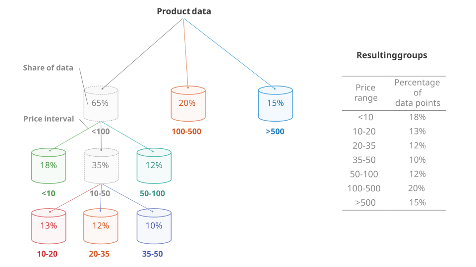

# Bucket sort

The sorting algorithms we have seen so far are comparison sorts: they order elements by comparing them with one another. Their worst-case time complexity has a lower bound of $\Omega(n \log n)$. Next we will look at several non-comparison sorts that can run in linear time.

<u>Bucket sort</u> is a classic application of divide and conquer. It divides the data as evenly as possible among a series of ordered buckets, each covering a range of values. It then sorts each bucket separately and combines all the elements in bucket order.

## How the algorithm works

Consider an array of length $n$ whose elements are floating-point numbers in $[0, 1)$. The figure below shows how bucket sort works.

1. Initialize $k$ buckets and distribute the $n$ elements among those $k$ buckets.
2. Sort each bucket separately (here we use the language's built-in sorting function).
3. Combine the results in order, starting with the bucket for the smallest values.


Here is the code:

```src
[file]{bucket_sort}-[class]{}-[func]{bucket_sort}
```

## Algorithm properties

Bucket sort is well suited to very large datasets. Suppose the input contains one million elements and the system has too little memory to load them all at once. We can distribute the data among 1,000 buckets, sort each bucket separately, and then combine the results.

- **Time complexity: $O(n + k)$**. If the elements are evenly distributed, each bucket holds $\frac{n}{k}$ elements. If sorting one bucket takes $O(\frac{n}{k} \log\frac{n}{k})$ time, sorting all the buckets takes $O(n \log\frac{n}{k})$ time. **As the number of buckets $k$ grows large, this approaches $O(n)$**. Combining the results requires visiting all buckets and elements, which takes $O(n + k)$ time. In the worst case, all the data lands in one bucket, and sorting it takes $O(n^2)$ time.
- **Space complexity: $O(n + k)$, out-of-place**. The algorithm needs extra space for $k$ buckets and a total of $n$ elements.
- Bucket sort is stable if the algorithm used to sort each bucket is stable.

## Distributing the elements evenly

In theory, bucket sort can run in $O(n)$ time. **The challenge is to distribute the elements evenly among the buckets**, since real data often has an uneven distribution. Suppose we want to divide all the products on Taobao evenly among 10 buckets by price. Many products cost less than 100 yuan, and very few cost more than 1,000 yuan. Dividing the price range into 10 equal intervals would give the buckets vastly different numbers of products.

To distribute the products more evenly, first choose rough boundaries and divide the data among 3 buckets. **Then split each crowded bucket into 3 more buckets, repeating until all buckets hold roughly the same number of elements**.

As the figure below shows, this method builds a recursion tree. The aim is to make the counts at the leaves as nearly equal as possible. You need not split the data into 3 buckets every time. Choose a split that suits the data.



If we know the probability distribution of product prices in advance, **we can use it to choose the price boundaries for each bucket**. We do not necessarily need to measure the distribution explicitly. A probability model that reflects the characteristics of the data can approximate it.

In the figure below, we assume that product prices follow a normal distribution. This lets us choose price intervals that distribute the products evenly among the buckets.


