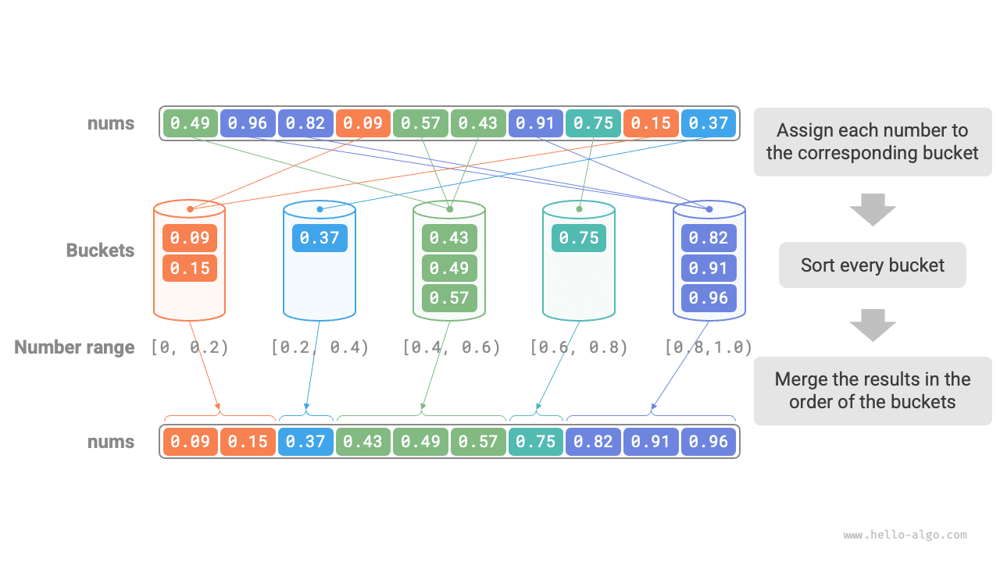

# Bucket sort

The sorting algorithms discussed so far are “comparison-based”: they sort by comparing elements. Their worst-case time complexity has a lower bound of $\Omega(n \log n)$. We now turn to several “non-comparison” sorting algorithms, which can achieve linear time complexity.

<u>Bucket sort</u> is a classic application of divide and conquer. It creates ordered buckets, each corresponding to a range of values, and distributes the data evenly among them. It then sorts each bucket separately and combines the results in bucket order.

## Algorithm steps

Consider an array of length $n$ containing floating-point values in $[0, 1)$. Bucket sort proceeds as shown below.

1. Initialize $k$ buckets and distribute the $n$ elements among the $k$ buckets.
2. Sort each bucket separately, using the programming language's built-in sorting function here.
3. Combine the results in ascending bucket order.



The code is as follows:

```src
[file]{bucket_sort}-[class]{}-[func]{bucket_sort}
```

## Algorithm properties

Bucket sort is useful for very large datasets. For example, suppose the input contains one million elements and memory limitations prevent loading all of them at once. We can divide them into 1,000 buckets, sort the buckets separately, and combine the results.

- **Time complexity: $O(n + k)$**. If the elements are evenly distributed, each bucket contains $\frac{n}{k}$ elements. If sorting one bucket takes $O(\frac{n}{k} \log\frac{n}{k})$ time, sorting all buckets takes $O(n \log\frac{n}{k})$. **When the number of buckets $k$ is relatively large, this approaches $O(n)$**. Combining the results visits all buckets and elements, taking $O(n + k)$ time. In the worst case, all data falls into one bucket, and sorting it takes $O(n^2)$ time.
- **Space complexity: $O(n + k)$; not in-place**. Extra space is needed for $k$ buckets and a total of $n$ elements.
- Whether bucket sort is stable depends on whether the algorithm used to sort within each bucket is stable.

## Distributing elements evenly

Bucket sort can theoretically achieve $O(n)$ time. **The key is distributing elements evenly among the buckets**, since real data is often unevenly distributed. Suppose we want to divide all products on Taobao evenly into 10 buckets by price. There are many products below 100 yuan but few above 1,000 yuan. Splitting the price range into 10 equal intervals would leave very different numbers of products in the buckets.

To obtain an even distribution, we can first choose rough boundaries and divide the data into 3 buckets. **Then split the more crowded buckets into 3 smaller buckets, repeating until all buckets contain roughly equal numbers of elements**.

As shown below, this effectively creates a recursion tree whose leaf values should be as balanced as possible. We need not use 3 buckets at every step; the subdivision can be chosen to suit the data.


If we know the probability distribution of product prices in advance, **we can choose bucket boundaries according to that distribution**. We do not necessarily need to measure the distribution explicitly; we can approximate it with a probability model suited to the data.

In the figure below, we assume prices follow a normal distribution. This lets us choose suitable price intervals and distribute products evenly among the buckets.


