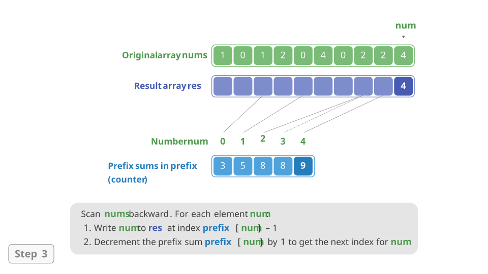
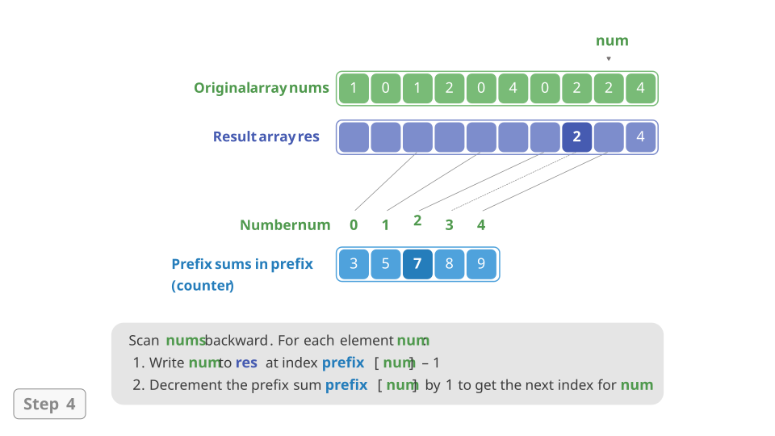
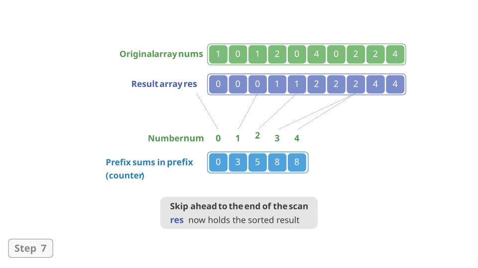
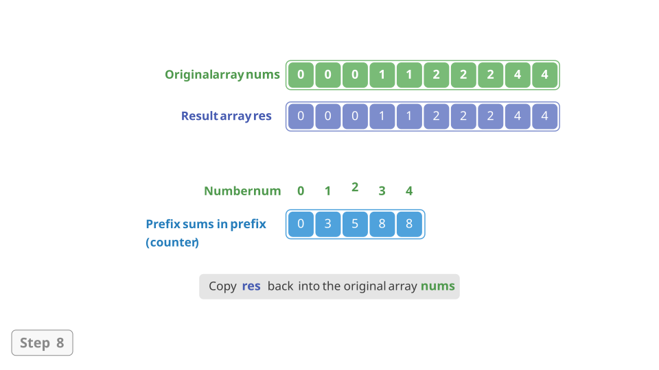

# 11.9 &nbsp; Counting sort

<u>Counting sort</u> sorts elements by counting their occurrences. It is typically used for arrays of integers.

## 11.9.1 &nbsp; A simple implementation

Let's start with a simple example. Given an array `nums` of length $n$ containing nonnegative integers, counting sort proceeds as shown below.

1. Scan the array to find the largest number, $m$. Then create an auxiliary array `counter` of length $m + 1$.
2. **Use `counter` to count how many times each number occurs in `nums`**. The entry `counter[num]` gives the count for `num`. To obtain the counts, scan `nums`. For each number `num`, increase `counter[num]` by $1$.
3. **The indices of `counter` are naturally ordered, so they already give us the numbers in sorted order**. Scan `counter` and write the numbers into `nums` from smallest to largest, repeating each one as many times as its count indicates.

{ class="animation-figure" }

<p align="center"> Figure 11-16 &nbsp; Counting sort procedure </p>

Here is the code:

=== "Python"

    ```python title="counting_sort.py"
    def counting_sort_naive(nums: list[int]):
        """Counting sort"""
        # Simple implementation that cannot sort objects
        # 1. Find the largest array element m
        m = max(nums)
        # 2. Count the occurrences of each number
        # counter[num] holds the number of occurrences of num
        counter = [0] * (m + 1)
        for num in nums:
            counter[num] += 1
        # 3. Traverse counter and write each value back into nums
        i = 0
        for num in range(m + 1):
            for _ in range(counter[num]):
                nums[i] = num
                i += 1
    ```

=== "C++"

    ```cpp title="counting_sort.cpp"
    /* Counting sort */
    // Simple implementation that cannot sort objects
    void countingSortNaive(vector<int> &nums) {
        // 1. Find the largest array element m
        int m = 0;
        for (int num : nums) {
            m = max(m, num);
        }
        // 2. Count the occurrences of each number
        // counter[num] holds the number of occurrences of num
        vector<int> counter(m + 1, 0);
        for (int num : nums) {
            counter[num]++;
        }
        // 3. Traverse counter and write each value back into nums
        int i = 0;
        for (int num = 0; num < m + 1; num++) {
            for (int j = 0; j < counter[num]; j++, i++) {
                nums[i] = num;
            }
        }
    }
    ```

=== "Java"

    ```java title="counting_sort.java"
    /* Counting sort */
    // Simple implementation that cannot sort objects
    void countingSortNaive(int[] nums) {
        // 1. Find the largest array element m
        int m = 0;
        for (int num : nums) {
            m = Math.max(m, num);
        }
        // 2. Count the occurrences of each number
        // counter[num] holds the number of occurrences of num
        int[] counter = new int[m + 1];
        for (int num : nums) {
            counter[num]++;
        }
        // 3. Traverse counter and write each value back into nums
        int i = 0;
        for (int num = 0; num < m + 1; num++) {
            for (int j = 0; j < counter[num]; j++, i++) {
                nums[i] = num;
            }
        }
    }
    ```

=== "C#"

    ```csharp title="counting_sort.cs"
    /* Counting sort */
    // Simple implementation that cannot sort objects
    void CountingSortNaive(int[] nums) {
        // 1. Find the largest array element m
        int m = 0;
        foreach (int num in nums) {
            m = Math.Max(m, num);
        }
        // 2. Count the occurrences of each number
        // counter[num] holds the number of occurrences of num
        int[] counter = new int[m + 1];
        foreach (int num in nums) {
            counter[num]++;
        }
        // 3. Traverse counter and write each value back into nums
        int i = 0;
        for (int num = 0; num < m + 1; num++) {
            for (int j = 0; j < counter[num]; j++, i++) {
                nums[i] = num;
            }
        }
    }
    ```

=== "Go"

    ```go title="counting_sort.go"
    /* Counting sort */
    // Simple implementation that cannot sort objects
    func countingSortNaive(nums []int) {
        // 1. Find the largest array element m
        m := 0
        for _, num := range nums {
            if num > m {
                m = num
            }
        }
        // 2. Count the occurrences of each number
        // counter[num] holds the number of occurrences of num
        counter := make([]int, m+1)
        for _, num := range nums {
            counter[num]++
        }
        // 3. Traverse counter and write each value back into nums
        for i, num := 0, 0; num < m+1; num++ {
            for j := 0; j < counter[num]; j++ {
                nums[i] = num
                i++
            }
        }
    }
    ```

=== "Swift"

    ```swift title="counting_sort.swift"
    /* Counting sort */
    // Simple implementation that cannot sort objects
    func countingSortNaive(nums: inout [Int]) {
        // 1. Find the largest array element m
        let m = nums.max()!
        // 2. Count the occurrences of each number
        // counter[num] holds the number of occurrences of num
        var counter = Array(repeating: 0, count: m + 1)
        for num in nums {
            counter[num] += 1
        }
        // 3. Traverse counter and write each value back into nums
        var i = 0
        for num in 0 ..< m + 1 {
            for _ in 0 ..< counter[num] {
                nums[i] = num
                i += 1
            }
        }
    }
    ```

=== "JS"

    ```javascript title="counting_sort.js"
    /* Counting sort */
    // Simple implementation that cannot sort objects
    function countingSortNaive(nums) {
        // 1. Find the largest array element m
        let m = Math.max(...nums);
        // 2. Count the occurrences of each number
        // counter[num] holds the number of occurrences of num
        const counter = new Array(m + 1).fill(0);
        for (const num of nums) {
            counter[num]++;
        }
        // 3. Traverse counter and write each value back into nums
        let i = 0;
        for (let num = 0; num < m + 1; num++) {
            for (let j = 0; j < counter[num]; j++, i++) {
                nums[i] = num;
            }
        }
    }
    ```

=== "TS"

    ```typescript title="counting_sort.ts"
    /* Counting sort */
    // Simple implementation that cannot sort objects
    function countingSortNaive(nums: number[]): void {
        // 1. Find the largest array element m
        let m: number = Math.max(...nums);
        // 2. Count the occurrences of each number
        // counter[num] holds the number of occurrences of num
        const counter: number[] = new Array<number>(m + 1).fill(0);
        for (const num of nums) {
            counter[num]++;
        }
        // 3. Traverse counter and write each value back into nums
        let i = 0;
        for (let num = 0; num < m + 1; num++) {
            for (let j = 0; j < counter[num]; j++, i++) {
                nums[i] = num;
            }
        }
    }
    ```

=== "Dart"

    ```dart title="counting_sort.dart"
    /* Counting sort */
    // Simple implementation that cannot sort objects
    void countingSortNaive(List<int> nums) {
      // 1. Find the largest array element m
      int m = 0;
      for (int _num in nums) {
        m = max(m, _num);
      }
      // 2. Count the occurrences of each number
      // counter[_num] holds the number of occurrences of _num
      List<int> counter = List.filled(m + 1, 0);
      for (int _num in nums) {
        counter[_num]++;
      }
      // 3. Traverse counter and write each value back into nums
      int i = 0;
      for (int _num = 0; _num < m + 1; _num++) {
        for (int j = 0; j < counter[_num]; j++, i++) {
          nums[i] = _num;
        }
      }
    }
    ```

=== "Rust"

    ```rust title="counting_sort.rs"
    /* Counting sort */
    // Simple implementation that cannot sort objects
    fn counting_sort_naive(nums: &mut [i32]) {
        // 1. Find the largest array element m
        let m = *nums.iter().max().unwrap();
        // 2. Count the occurrences of each number
        // counter[num] holds the number of occurrences of num
        let mut counter = vec![0; m as usize + 1];
        for &num in nums.iter() {
            counter[num as usize] += 1;
        }
        // 3. Traverse counter and write each value back into nums
        let mut i = 0;
        for num in 0..m + 1 {
            for _ in 0..counter[num as usize] {
                nums[i] = num;
                i += 1;
            }
        }
    }
    ```

=== "C"

    ```c title="counting_sort.c"
    /* Counting sort */
    // Simple implementation that cannot sort objects
    void countingSortNaive(int nums[], int size) {
        // 1. Find the largest array element m
        int m = 0;
        for (int i = 0; i < size; i++) {
            if (nums[i] > m) {
                m = nums[i];
            }
        }
        // 2. Count the occurrences of each number
        // counter[num] holds the number of occurrences of num
        int *counter = calloc(m + 1, sizeof(int));
        for (int i = 0; i < size; i++) {
            counter[nums[i]]++;
        }
        // 3. Traverse counter and write each value back into nums
        int i = 0;
        for (int num = 0; num < m + 1; num++) {
            for (int j = 0; j < counter[num]; j++, i++) {
                nums[i] = num;
            }
        }
        // 4. Free memory
        free(counter);
    }
    ```

=== "Kotlin"

    ```kotlin title="counting_sort.kt"
    /* Counting sort */
    // Simple implementation that cannot sort objects
    fun countingSortNaive(nums: IntArray) {
        // 1. Find the largest array element m
        var m = 0
        for (num in nums) {
            m = max(m, num)
        }
        // 2. Count the occurrences of each number
        // counter[num] holds the number of occurrences of num
        val counter = IntArray(m + 1)
        for (num in nums) {
            counter[num]++
        }
        // 3. Traverse counter and write each value back into nums
        var i = 0
        for (num in 0..<m + 1) {
            var j = 0
            while (j < counter[num]) {
                nums[i] = num
                j++
                i++
            }
        }
    }
    ```

=== "Ruby"

    ```ruby title="counting_sort.rb"
    ### Counting sort ###
    def counting_sort_naive(nums)
      # Simple implementation that cannot sort objects
      # 1. Find the largest array element m
      m = 0
      nums.each { |num| m = [m, num].max }
      # 2. Count the occurrences of each number
      # counter[num] holds the number of occurrences of num
      counter = Array.new(m + 1, 0)
      nums.each { |num| counter[num] += 1 }
      # 3. Traverse counter and write each value back into nums
      i = 0
      for num in 0...(m + 1)
        (0...counter[num]).each do
          nums[i] = num
          i += 1
        end
      end
    end
    ```

??? pythontutor "Visualize execution"

    <div style="height: 549px; width: 100%;"><iframe class="pythontutor-iframe" title="Visualize execution" src="https://pythontutor.com/iframe-embed.html#code=def%20counting_sort_naive%28nums%3A%20list%5Bint%5D%29%3A%0A%20%20%20%20%22%22%22Counting%20sort%22%22%22%0A%20%20%20%20%23%20Simple%20implementation%20that%20cannot%20sort%20objects%0A%20%20%20%20%23%201.%20Find%20the%20largest%20array%20element%20m%0A%20%20%20%20m%20%3D%200%0A%20%20%20%20for%20num%20in%20nums%3A%0A%20%20%20%20%20%20%20%20m%20%3D%20max%28m,%20num%29%0A%20%20%20%20%23%202.%20Count%20the%20occurrences%20of%20each%20number%0A%20%20%20%20%23%20counter%5Bnum%5D%20holds%20the%20number%20of%20occurrences%20of%20num%0A%20%20%20%20counter%20%3D%20%5B0%5D%20%2A%20%28m%20%2B%201%29%0A%20%20%20%20for%20num%20in%20nums%3A%0A%20%20%20%20%20%20%20%20counter%5Bnum%5D%20%2B%3D%201%0A%20%20%20%20%23%203.%20Traverse%20counter%20and%20write%20each%20value%20back%20into%20nums%0A%20%20%20%20i%20%3D%200%0A%20%20%20%20for%20num%20in%20range%28m%20%2B%201%29%3A%0A%20%20%20%20%20%20%20%20for%20_%20in%20range%28counter%5Bnum%5D%29%3A%0A%20%20%20%20%20%20%20%20%20%20%20%20nums%5Bi%5D%20%3D%20num%0A%20%20%20%20%20%20%20%20%20%20%20%20i%20%2B%3D%201%0A%0A%22%22%22Driver%20Code%22%22%22%0Aif%20__name__%20%3D%3D%20%22__main__%22%3A%0A%20%20%20%20nums%20%3D%20%5B1,%200,%201,%202,%200,%204,%200,%202,%202,%204%5D%0A%20%20%20%20counting_sort_naive%28nums%29%0A%20%20%20%20print%28f%22After%20counting%20sort%20%28values%20only%29,%20nums%20%3D%20%7Bnums%7D%22%29&codeDivHeight=472&codeDivWidth=350&cumulative=false&curInstr=4&heapPrimitives=nevernest&origin=opt-frontend.js&py=311&rawInputLstJSON=%5B%5D&textReferences=false"> </iframe></div>
    <div style="margin-top: 5px;"><a href="https://pythontutor.com/iframe-embed.html#code=def%20counting_sort_naive%28nums%3A%20list%5Bint%5D%29%3A%0A%20%20%20%20%22%22%22Counting%20sort%22%22%22%0A%20%20%20%20%23%20Simple%20implementation%20that%20cannot%20sort%20objects%0A%20%20%20%20%23%201.%20Find%20the%20largest%20array%20element%20m%0A%20%20%20%20m%20%3D%200%0A%20%20%20%20for%20num%20in%20nums%3A%0A%20%20%20%20%20%20%20%20m%20%3D%20max%28m,%20num%29%0A%20%20%20%20%23%202.%20Count%20the%20occurrences%20of%20each%20number%0A%20%20%20%20%23%20counter%5Bnum%5D%20holds%20the%20number%20of%20occurrences%20of%20num%0A%20%20%20%20counter%20%3D%20%5B0%5D%20%2A%20%28m%20%2B%201%29%0A%20%20%20%20for%20num%20in%20nums%3A%0A%20%20%20%20%20%20%20%20counter%5Bnum%5D%20%2B%3D%201%0A%20%20%20%20%23%203.%20Traverse%20counter%20and%20write%20each%20value%20back%20into%20nums%0A%20%20%20%20i%20%3D%200%0A%20%20%20%20for%20num%20in%20range%28m%20%2B%201%29%3A%0A%20%20%20%20%20%20%20%20for%20_%20in%20range%28counter%5Bnum%5D%29%3A%0A%20%20%20%20%20%20%20%20%20%20%20%20nums%5Bi%5D%20%3D%20num%0A%20%20%20%20%20%20%20%20%20%20%20%20i%20%2B%3D%201%0A%0A%22%22%22Driver%20Code%22%22%22%0Aif%20__name__%20%3D%3D%20%22__main__%22%3A%0A%20%20%20%20nums%20%3D%20%5B1,%200,%201,%202,%200,%204,%200,%202,%202,%204%5D%0A%20%20%20%20counting_sort_naive%28nums%29%0A%20%20%20%20print%28f%22After%20counting%20sort%20%28values%20only%29,%20nums%20%3D%20%7Bnums%7D%22%29&codeDivHeight=800&codeDivWidth=600&cumulative=false&curInstr=4&heapPrimitives=nevernest&origin=opt-frontend.js&py=311&rawInputLstJSON=%5B%5D&textReferences=false" target="_blank" rel="noopener noreferrer">View full screen ></a></div>

!!! note "How counting sort relates to bucket sort"

    From the perspective of bucket sort, each index in the count array `counter` acts as a bucket, and counting elements amounts to distributing them among their corresponding buckets. Counting sort is essentially a special case of bucket sort for integers.

## 11.9.2 &nbsp; A full implementation

You may have noticed that **step `3.` breaks down if the input consists of objects**. Suppose the objects represent products and we want to sort them by price, a member variable of the class. The algorithm above can return only the sorted prices.

How can we get the original objects in sorted order? First, compute the prefix sums of `counter`. At index `i`, the prefix sum `prefix[i]` is the sum of the first `i + 1` elements of the array:

$$
\text{prefix}[i] = \sum_{j=0}^i \text{counter[j]}
$$

**The prefix sums tell us where to place elements: `prefix[num] - 1` is the last index at which `num` occurs in the result array `res`**. With these positions in hand, traverse the original array `nums` in reverse. For each element `num`, perform the following two steps.

1. Write `num` to array `res` at index `prefix[num] - 1`.
2. Decrease the prefix sum `prefix[num]` by $1$ to get the next index for `num`.

After the traversal, `res` holds the sorted result. Copy `res` back into the original array `nums`. Figure 11-17 shows the complete counting sort procedure.

=== "<1>"
    { class="animation-figure" }

=== "<2>"
    { class="animation-figure" }

=== "<3>"
    { class="animation-figure" }

=== "<4>"
    { class="animation-figure" }

=== "<5>"
    { class="animation-figure" }

=== "<6>"
    { class="animation-figure" }

=== "<7>"
    { class="animation-figure" }

=== "<8>"
    { class="animation-figure" }

<p align="center"> Figure 11-17 &nbsp; Counting sort steps </p>

Here is the implementation of counting sort:

=== "Python"

    ```python title="counting_sort.py"
    def counting_sort(nums: list[int]):
        """Counting sort"""
        # Full implementation that can sort objects and is stable
        # 1. Find the largest array element m
        m = max(nums)
        # 2. Count the occurrences of each number
        # counter[num] holds the number of occurrences of num
        counter = [0] * (m + 1)
        for num in nums:
            counter[num] += 1
        # 3. Compute prefix sums in counter to locate the last position for each value
        # That is, counter[num]-1 is the last index of num in res
        for i in range(m):
            counter[i + 1] += counter[i]
        # 4. Traverse nums backward and place each element in the result array res
        # Initialize the result array res
        n = len(nums)
        res = [0] * n
        for i in range(n - 1, -1, -1):
            num = nums[i]
            res[counter[num] - 1] = num  # Place num at its corresponding index
            counter[num] -= 1  # Decrement the prefix sum by 1 to find the next index for num
        # Copy res back into the original array nums
        for i in range(n):
            nums[i] = res[i]
    ```

=== "C++"

    ```cpp title="counting_sort.cpp"
    /* Counting sort */
    // Full implementation that can sort objects and is stable
    void countingSort(vector<int> &nums) {
        // 1. Find the largest array element m
        int m = 0;
        for (int num : nums) {
            m = max(m, num);
        }
        // 2. Count the occurrences of each number
        // counter[num] holds the number of occurrences of num
        vector<int> counter(m + 1, 0);
        for (int num : nums) {
            counter[num]++;
        }
        // 3. Compute prefix sums in counter to locate the last position for each value
        // That is, counter[num]-1 is the last index of num in res
        for (int i = 0; i < m; i++) {
            counter[i + 1] += counter[i];
        }
        // 4. Traverse nums backward and place each element in the result array res
        // Initialize the result array res
        int n = nums.size();
        vector<int> res(n);
        for (int i = n - 1; i >= 0; i--) {
            int num = nums[i];
            res[counter[num] - 1] = num; // Place num at its corresponding index
            counter[num]--;              // Decrement the prefix sum by 1 to find the next index for num
        }
        // Copy res back into the original array nums
        nums = res;
    }
    ```

=== "Java"

    ```java title="counting_sort.java"
    /* Counting sort */
    // Full implementation that can sort objects and is stable
    void countingSort(int[] nums) {
        // 1. Find the largest array element m
        int m = 0;
        for (int num : nums) {
            m = Math.max(m, num);
        }
        // 2. Count the occurrences of each number
        // counter[num] holds the number of occurrences of num
        int[] counter = new int[m + 1];
        for (int num : nums) {
            counter[num]++;
        }
        // 3. Compute prefix sums in counter to locate the last position for each value
        // That is, counter[num]-1 is the last index of num in res
        for (int i = 0; i < m; i++) {
            counter[i + 1] += counter[i];
        }
        // 4. Traverse nums backward and place each element in the result array res
        // Initialize the result array res
        int n = nums.length;
        int[] res = new int[n];
        for (int i = n - 1; i >= 0; i--) {
            int num = nums[i];
            res[counter[num] - 1] = num; // Place num at its corresponding index
            counter[num]--; // Decrement the prefix sum by 1 to find the next index for num
        }
        // Copy res back into the original array nums
        for (int i = 0; i < n; i++) {
            nums[i] = res[i];
        }
    }
    ```

=== "C#"

    ```csharp title="counting_sort.cs"
    /* Counting sort */
    // Full implementation that can sort objects and is stable
    void CountingSort(int[] nums) {
        // 1. Find the largest array element m
        int m = 0;
        foreach (int num in nums) {
            m = Math.Max(m, num);
        }
        // 2. Count the occurrences of each number
        // counter[num] holds the number of occurrences of num
        int[] counter = new int[m + 1];
        foreach (int num in nums) {
            counter[num]++;
        }
        // 3. Compute prefix sums in counter to locate the last position for each value
        // That is, counter[num]-1 is the last index of num in res
        for (int i = 0; i < m; i++) {
            counter[i + 1] += counter[i];
        }
        // 4. Traverse nums backward and place each element in the result array res
        // Initialize the result array res
        int n = nums.Length;
        int[] res = new int[n];
        for (int i = n - 1; i >= 0; i--) {
            int num = nums[i];
            res[counter[num] - 1] = num; // Place num at its corresponding index
            counter[num]--; // Decrement the prefix sum by 1 to find the next index for num
        }
        // Copy res back into the original array nums
        for (int i = 0; i < n; i++) {
            nums[i] = res[i];
        }
    }
    ```

=== "Go"

    ```go title="counting_sort.go"
    /* Counting sort */
    // Full implementation that can sort objects and is stable
    func countingSort(nums []int) {
        // 1. Find the largest array element m
        m := 0
        for _, num := range nums {
            if num > m {
                m = num
            }
        }
        // 2. Count the occurrences of each number
        // counter[num] holds the number of occurrences of num
        counter := make([]int, m+1)
        for _, num := range nums {
            counter[num]++
        }
        // 3. Compute prefix sums in counter to locate the last position for each value
        // That is, counter[num]-1 is the last index of num in res
        for i := 0; i < m; i++ {
            counter[i+1] += counter[i]
        }
        // 4. Traverse nums backward and place each element in the result array res
        // Initialize the result array res
        n := len(nums)
        res := make([]int, n)
        for i := n - 1; i >= 0; i-- {
            num := nums[i]
            // Place num at its corresponding index
            res[counter[num]-1] = num
            // Decrement the prefix sum by 1 to find the next index for num
            counter[num]--
        }
        // Copy res back into the original array nums
        copy(nums, res)
    }
    ```

=== "Swift"

    ```swift title="counting_sort.swift"
    /* Counting sort */
    // Full implementation that can sort objects and is stable
    func countingSort(nums: inout [Int]) {
        // 1. Find the largest array element m
        let m = nums.max()!
        // 2. Count the occurrences of each number
        // counter[num] holds the number of occurrences of num
        var counter = Array(repeating: 0, count: m + 1)
        for num in nums {
            counter[num] += 1
        }
        // 3. Compute prefix sums in counter to locate the last position for each value
        // That is, counter[num]-1 is the last index of num in res
        for i in 0 ..< m {
            counter[i + 1] += counter[i]
        }
        // 4. Traverse nums backward and place each element in the result array res
        // Initialize the result array res
        var res = Array(repeating: 0, count: nums.count)
        for i in nums.indices.reversed() {
            let num = nums[i]
            res[counter[num] - 1] = num // Place num at its corresponding index
            counter[num] -= 1 // Decrement the prefix sum by 1 to find the next index for num
        }
        // Copy res back into the original array nums
        for i in nums.indices {
            nums[i] = res[i]
        }
    }
    ```

=== "JS"

    ```javascript title="counting_sort.js"
    /* Counting sort */
    // Full implementation that can sort objects and is stable
    function countingSort(nums) {
        // 1. Find the largest array element m
        let m = Math.max(...nums);
        // 2. Count the occurrences of each number
        // counter[num] holds the number of occurrences of num
        const counter = new Array(m + 1).fill(0);
        for (const num of nums) {
            counter[num]++;
        }
        // 3. Compute prefix sums in counter to locate the last position for each value
        // That is, counter[num]-1 is the last index of num in res
        for (let i = 0; i < m; i++) {
            counter[i + 1] += counter[i];
        }
        // 4. Traverse nums backward and place each element in the result array res
        // Initialize the result array res
        const n = nums.length;
        const res = new Array(n);
        for (let i = n - 1; i >= 0; i--) {
            const num = nums[i];
            res[counter[num] - 1] = num; // Place num at its corresponding index
            counter[num]--; // Decrement the prefix sum by 1 to find the next index for num
        }
        // Copy res back into the original array nums
        for (let i = 0; i < n; i++) {
            nums[i] = res[i];
        }
    }
    ```

=== "TS"

    ```typescript title="counting_sort.ts"
    /* Counting sort */
    // Full implementation that can sort objects and is stable
    function countingSort(nums: number[]): void {
        // 1. Find the largest array element m
        let m: number = Math.max(...nums);
        // 2. Count the occurrences of each number
        // counter[num] holds the number of occurrences of num
        const counter: number[] = new Array<number>(m + 1).fill(0);
        for (const num of nums) {
            counter[num]++;
        }
        // 3. Compute prefix sums in counter to locate the last position for each value
        // That is, counter[num]-1 is the last index of num in res
        for (let i = 0; i < m; i++) {
            counter[i + 1] += counter[i];
        }
        // 4. Traverse nums backward and place each element in the result array res
        // Initialize the result array res
        const n = nums.length;
        const res: number[] = new Array<number>(n);
        for (let i = n - 1; i >= 0; i--) {
            const num = nums[i];
            res[counter[num] - 1] = num; // Place num at its corresponding index
            counter[num]--; // Decrement the prefix sum by 1 to find the next index for num
        }
        // Copy res back into the original array nums
        for (let i = 0; i < n; i++) {
            nums[i] = res[i];
        }
    }
    ```

=== "Dart"

    ```dart title="counting_sort.dart"
    /* Counting sort */
    // Full implementation that can sort objects and is stable
    void countingSort(List<int> nums) {
      // 1. Find the largest array element m
      int m = 0;
      for (int _num in nums) {
        m = max(m, _num);
      }
      // 2. Count the occurrences of each number
      // counter[_num] holds the number of occurrences of _num
      List<int> counter = List.filled(m + 1, 0);
      for (int _num in nums) {
        counter[_num]++;
      }
      // 3. Compute prefix sums in counter to locate the last position for each value
      // That is, counter[_num]-1 is the last index of _num in res
      for (int i = 0; i < m; i++) {
        counter[i + 1] += counter[i];
      }
      // 4. Traverse nums backward and place each element in the result array res
      // Initialize the result array res
      int n = nums.length;
      List<int> res = List.filled(n, 0);
      for (int i = n - 1; i >= 0; i--) {
        int _num = nums[i];
        res[counter[_num] - 1] = _num; // Place _num at its corresponding index
        counter[_num]--; // Decrement the prefix sum by 1 to find the next index for _num
      }
      // Copy res back into the original array nums
      nums.setAll(0, res);
    }
    ```

=== "Rust"

    ```rust title="counting_sort.rs"
    /* Counting sort */
    // Full implementation that can sort objects and is stable
    fn counting_sort(nums: &mut [i32]) {
        // 1. Find the largest array element m
        let m = *nums.iter().max().unwrap() as usize;
        // 2. Count the occurrences of each number
        // counter[num] holds the number of occurrences of num
        let mut counter = vec![0; m + 1];
        for &num in nums.iter() {
            counter[num as usize] += 1;
        }
        // 3. Compute prefix sums in counter to locate the last position for each value
        // That is, counter[num]-1 is the last index of num in res
        for i in 0..m {
            counter[i + 1] += counter[i];
        }
        // 4. Traverse nums backward and place each element in the result array res
        // Initialize the result array res
        let n = nums.len();
        let mut res = vec![0; n];
        for i in (0..n).rev() {
            let num = nums[i];
            res[counter[num as usize] - 1] = num; // Place num at its corresponding index
            counter[num as usize] -= 1; // Decrement the prefix sum by 1 to find the next index for num
        }
        // Copy res back into the original array nums
        nums.copy_from_slice(&res)
    }
    ```

=== "C"

    ```c title="counting_sort.c"
    /* Counting sort */
    // Full implementation that can sort objects and is stable
    void countingSort(int nums[], int size) {
        // 1. Find the largest array element m
        int m = 0;
        for (int i = 0; i < size; i++) {
            if (nums[i] > m) {
                m = nums[i];
            }
        }
        // 2. Count the occurrences of each number
        // counter[num] holds the number of occurrences of num
        int *counter = calloc(m + 1, sizeof(int));
        for (int i = 0; i < size; i++) {
            counter[nums[i]]++;
        }
        // 3. Compute prefix sums in counter to locate the last position for each value
        // That is, counter[num]-1 is the last index of num in res
        for (int i = 0; i < m; i++) {
            counter[i + 1] += counter[i];
        }
        // 4. Traverse nums backward and place each element in the result array res
        // Initialize the result array res
        int *res = malloc(sizeof(int) * size);
        for (int i = size - 1; i >= 0; i--) {
            int num = nums[i];
            res[counter[num] - 1] = num; // Place num at its corresponding index
            counter[num]--;              // Decrement the prefix sum by 1 to find the next index for num
        }
        // Copy res back into the original array nums
        memcpy(nums, res, size * sizeof(int));
        // 5. Free memory
        free(res);
        free(counter);
    }
    ```

=== "Kotlin"

    ```kotlin title="counting_sort.kt"
    /* Counting sort */
    // Full implementation that can sort objects and is stable
    fun countingSort(nums: IntArray) {
        // 1. Find the largest array element m
        var m = 0
        for (num in nums) {
            m = max(m, num)
        }
        // 2. Count the occurrences of each number
        // counter[num] holds the number of occurrences of num
        val counter = IntArray(m + 1)
        for (num in nums) {
            counter[num]++
        }
        // 3. Compute prefix sums in counter to locate the last position for each value
        // That is, counter[num]-1 is the last index of num in res
        for (i in 0..<m) {
            counter[i + 1] += counter[i]
        }
        // 4. Traverse nums backward and place each element in the result array res
        // Initialize the result array res
        val n = nums.size
        val res = IntArray(n)
        for (i in n - 1 downTo 0) {
            val num = nums[i]
            res[counter[num] - 1] = num // Place num at its corresponding index
            counter[num]-- // Decrement the prefix sum by 1 to find the next index for num
        }
        // Copy res back into the original array nums
        for (i in 0..<n) {
            nums[i] = res[i]
        }
    }
    ```

=== "Ruby"

    ```ruby title="counting_sort.rb"
    ### Counting sort ###
    def counting_sort(nums)
      # Full implementation that can sort objects and is stable
      # 1. Find the largest array element m
      m = nums.max
      # 2. Count the occurrences of each number
      # counter[num] holds the number of occurrences of num
      counter = Array.new(m + 1, 0)
      nums.each { |num| counter[num] += 1 }
      # 3. Compute prefix sums in counter to locate the last position for each value
      # That is, counter[num]-1 is the last index of num in res
      (0...m).each { |i| counter[i + 1] += counter[i] }
      # 4. Traverse nums backward and place each element in the result array res
      # Initialize the result array res
      n = nums.length
      res = Array.new(n, 0)
      (n - 1).downto(0).each do |i|
        num = nums[i]
        res[counter[num] - 1] = num # Place num at its corresponding index
        counter[num] -= 1 # Decrement the prefix sum by 1 to find the next index for num
      end
      # Copy res back into the original array nums
      (0...n).each { |i| nums[i] = res[i] }
    end
    ```

??? pythontutor "Visualize execution"

    <div style="height: 549px; width: 100%;"><iframe class="pythontutor-iframe" title="Visualize execution" src="https://pythontutor.com/iframe-embed.html#code=def%20counting_sort%28nums%3A%20list%5Bint%5D%29%3A%0A%20%20%20%20%22%22%22Counting%20sort%22%22%22%0A%20%20%20%20%23%20Full%20implementation%20that%20can%20sort%20objects%20and%20is%20stable%0A%20%20%20%20%23%201.%20Find%20the%20largest%20array%20element%20m%0A%20%20%20%20m%20%3D%20max%28nums%29%0A%20%20%20%20%23%202.%20Count%20the%20occurrences%20of%20each%20number%0A%20%20%20%20%23%20counter%5Bnum%5D%20holds%20the%20number%20of%20occurrences%20of%20num%0A%20%20%20%20counter%20%3D%20%5B0%5D%20%2A%20%28m%20%2B%201%29%0A%20%20%20%20for%20num%20in%20nums%3A%0A%20%20%20%20%20%20%20%20counter%5Bnum%5D%20%2B%3D%201%0A%20%20%20%20%23%203.%20Compute%20prefix%20sums%20in%20counter%20to%20locate%20the%20last%20position%20for%20each%20value%0A%20%20%20%20%23%20That%20is,%20counter%5Bnum%5D-1%20is%20the%20last%20index%20of%20num%20in%20res%0A%20%20%20%20for%20i%20in%20range%28m%29%3A%0A%20%20%20%20%20%20%20%20counter%5Bi%20%2B%201%5D%20%2B%3D%20counter%5Bi%5D%0A%20%20%20%20%23%204.%20Traverse%20nums%20backward%20and%20place%20each%20element%20in%20the%20result%20array%20res%0A%20%20%20%20%23%20Initialize%20the%20result%20array%20res%0A%20%20%20%20n%20%3D%20len%28nums%29%0A%20%20%20%20res%20%3D%20%5B0%5D%20%2A%20n%0A%20%20%20%20for%20i%20in%20range%28n%20-%201,%20-1,%20-1%29%3A%0A%20%20%20%20%20%20%20%20num%20%3D%20nums%5Bi%5D%0A%20%20%20%20%20%20%20%20res%5Bcounter%5Bnum%5D%20-%201%5D%20%3D%20num%20%20%23%20Place%20num%20at%20its%20corresponding%20index%0A%20%20%20%20%20%20%20%20counter%5Bnum%5D%20-%3D%201%20%20%23%20Decrement%20the%20prefix%20sum%20by%201%20to%20find%20the%20next%20index%20for%20num%0A%20%20%20%20%23%20Copy%20res%20back%20into%20the%20original%20array%20nums%0A%20%20%20%20for%20i%20in%20range%28n%29%3A%0A%20%20%20%20%20%20%20%20nums%5Bi%5D%20%3D%20res%5Bi%5D%0A%0A%22%22%22Driver%20Code%22%22%22%0Aif%20__name__%20%3D%3D%20%22__main__%22%3A%0A%20%20%20%20nums%20%3D%20%5B1,%200,%201,%202,%200,%204,%200,%202,%202,%204%5D%0A%20%20%20%20counting_sort%28nums%29%0A%20%20%20%20print%28f%22After%20counting%20sort,%20nums%20%3D%20%7Bnums%7D%22%29&codeDivHeight=472&codeDivWidth=350&cumulative=false&curInstr=4&heapPrimitives=nevernest&origin=opt-frontend.js&py=311&rawInputLstJSON=%5B%5D&textReferences=false"> </iframe></div>
    <div style="margin-top: 5px;"><a href="https://pythontutor.com/iframe-embed.html#code=def%20counting_sort%28nums%3A%20list%5Bint%5D%29%3A%0A%20%20%20%20%22%22%22Counting%20sort%22%22%22%0A%20%20%20%20%23%20Full%20implementation%20that%20can%20sort%20objects%20and%20is%20stable%0A%20%20%20%20%23%201.%20Find%20the%20largest%20array%20element%20m%0A%20%20%20%20m%20%3D%20max%28nums%29%0A%20%20%20%20%23%202.%20Count%20the%20occurrences%20of%20each%20number%0A%20%20%20%20%23%20counter%5Bnum%5D%20holds%20the%20number%20of%20occurrences%20of%20num%0A%20%20%20%20counter%20%3D%20%5B0%5D%20%2A%20%28m%20%2B%201%29%0A%20%20%20%20for%20num%20in%20nums%3A%0A%20%20%20%20%20%20%20%20counter%5Bnum%5D%20%2B%3D%201%0A%20%20%20%20%23%203.%20Compute%20prefix%20sums%20in%20counter%20to%20locate%20the%20last%20position%20for%20each%20value%0A%20%20%20%20%23%20That%20is,%20counter%5Bnum%5D-1%20is%20the%20last%20index%20of%20num%20in%20res%0A%20%20%20%20for%20i%20in%20range%28m%29%3A%0A%20%20%20%20%20%20%20%20counter%5Bi%20%2B%201%5D%20%2B%3D%20counter%5Bi%5D%0A%20%20%20%20%23%204.%20Traverse%20nums%20backward%20and%20place%20each%20element%20in%20the%20result%20array%20res%0A%20%20%20%20%23%20Initialize%20the%20result%20array%20res%0A%20%20%20%20n%20%3D%20len%28nums%29%0A%20%20%20%20res%20%3D%20%5B0%5D%20%2A%20n%0A%20%20%20%20for%20i%20in%20range%28n%20-%201,%20-1,%20-1%29%3A%0A%20%20%20%20%20%20%20%20num%20%3D%20nums%5Bi%5D%0A%20%20%20%20%20%20%20%20res%5Bcounter%5Bnum%5D%20-%201%5D%20%3D%20num%20%20%23%20Place%20num%20at%20its%20corresponding%20index%0A%20%20%20%20%20%20%20%20counter%5Bnum%5D%20-%3D%201%20%20%23%20Decrement%20the%20prefix%20sum%20by%201%20to%20find%20the%20next%20index%20for%20num%0A%20%20%20%20%23%20Copy%20res%20back%20into%20the%20original%20array%20nums%0A%20%20%20%20for%20i%20in%20range%28n%29%3A%0A%20%20%20%20%20%20%20%20nums%5Bi%5D%20%3D%20res%5Bi%5D%0A%0A%22%22%22Driver%20Code%22%22%22%0Aif%20__name__%20%3D%3D%20%22__main__%22%3A%0A%20%20%20%20nums%20%3D%20%5B1,%200,%201,%202,%200,%204,%200,%202,%202,%204%5D%0A%20%20%20%20counting_sort%28nums%29%0A%20%20%20%20print%28f%22After%20counting%20sort,%20nums%20%3D%20%7Bnums%7D%22%29&codeDivHeight=800&codeDivWidth=600&cumulative=false&curInstr=4&heapPrimitives=nevernest&origin=opt-frontend.js&py=311&rawInputLstJSON=%5B%5D&textReferences=false" target="_blank" rel="noopener noreferrer">View full screen ></a></div>

## 11.9.3 &nbsp; Algorithm properties

- **Time complexity: $O(n + m)$, nonadaptive**. Scanning `nums` and scanning `counter` each take linear time. Typically, $n \gg m$, so the time complexity approaches $O(n)$.
- **Space complexity: $O(n + m)$, out-of-place**. The algorithm uses an array of length $n$ for `res` and an array of length $m$ for `counter`.
- **Stable**. For each value, we fill its positions in `res` from right to left. Scanning `nums` backward therefore preserves the relative order of equal elements, making the sort stable. Scanning `nums` forward would still produce a correctly sorted sequence of values, but the sort would be unstable.

## 11.9.4 &nbsp; Limitations

Counting sort is an ingenious way to sort efficiently simply by counting occurrences. However, the input has to meet fairly strict requirements.

**Counting sort works directly only with nonnegative integers**. For other types, we must be able to convert the data to nonnegative integers while preserving the ordering by value. For example, if an integer array contains negative values, we can add a constant to every value to make them all positive, sort the array, and then subtract the constant.

**Counting sort works well when there are many elements but the range of values is small**. In our example, a large $m$ would require too much space. And when $n \ll m$, counting sort takes $O(m)$ time and may be slower than an $O(n \log n)$ sorting algorithm.
