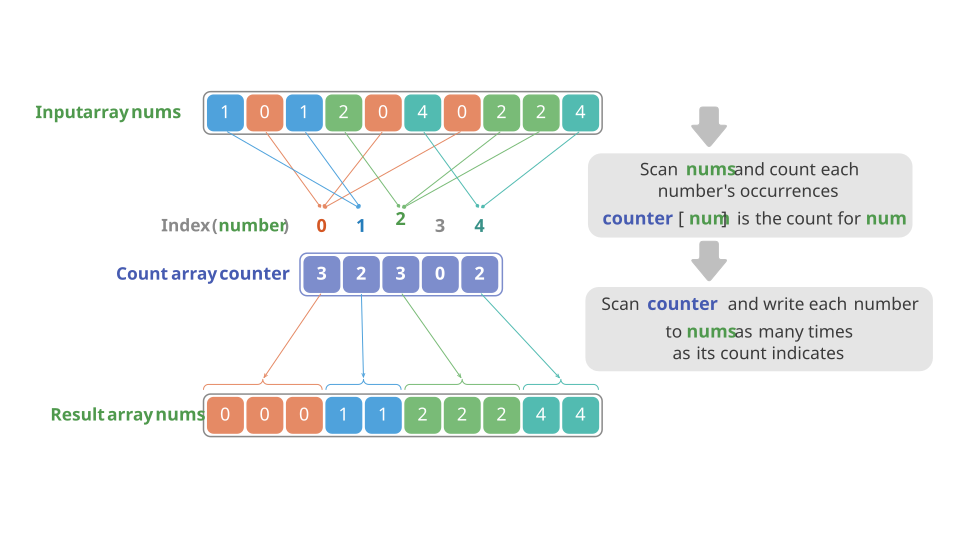
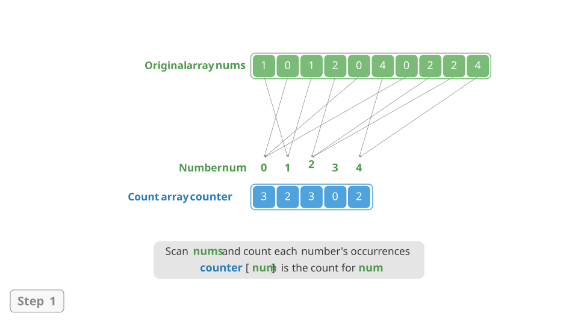
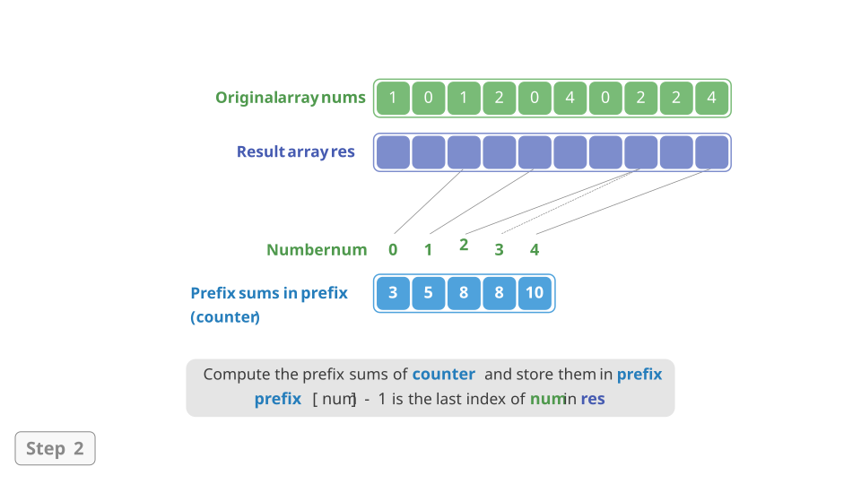
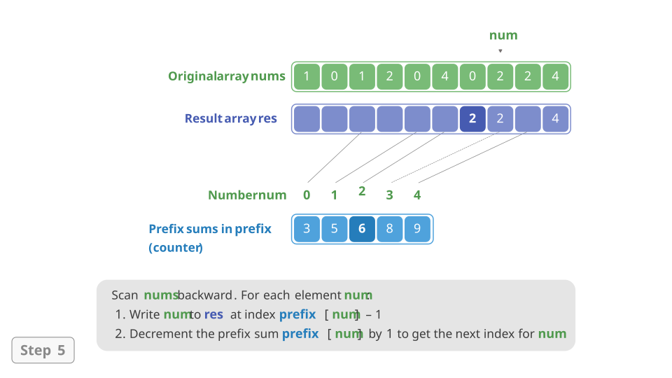
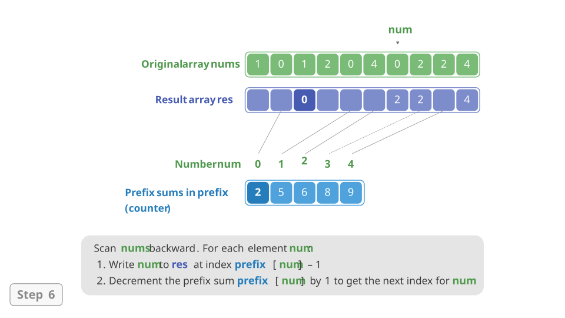

# Counting sort

<u>Counting sort</u> sorts elements by counting their occurrences. It is typically used for arrays of integers.

## A simple implementation

Let's start with a simple example. Given an array `nums` of length $n$ containing nonnegative integers, counting sort proceeds as shown below.

1. Scan the array to find the largest number, $m$. Then create an auxiliary array `counter` of length $m + 1$.
2. **Use `counter` to count how many times each number occurs in `nums`**. The entry `counter[num]` gives the count for `num`. To obtain the counts, scan `nums`. For each number `num`, increase `counter[num]` by $1$.
3. **The indices of `counter` are naturally ordered, so they already give us the numbers in sorted order**. Scan `counter` and write the numbers into `nums` from smallest to largest, repeating each one as many times as its count indicates.



Here is the code:

```src
[file]{counting_sort}-[class]{}-[func]{counting_sort_naive}
```

!!! note "How counting sort relates to bucket sort"

    From the perspective of bucket sort, each index in the count array `counter` acts as a bucket, and counting elements amounts to distributing them among their corresponding buckets. Counting sort is essentially a special case of bucket sort for integers.

## A full implementation

You may have noticed that **step `3.` breaks down if the input consists of objects**. Suppose the objects represent products and we want to sort them by price, a member variable of the class. The algorithm above can return only the sorted prices.

How can we get the original objects in sorted order? First, compute the prefix sums of `counter`. At index `i`, the prefix sum `prefix[i]` is the sum of the first `i + 1` elements of the array:

$$
\text{prefix}[i] = \sum_{j=0}^i \text{counter[j]}
$$

**The prefix sums tell us where to place elements: `prefix[num] - 1` is the last index at which `num` occurs in the result array `res`**. With these positions in hand, traverse the original array `nums` in reverse. For each element `num`, perform the following two steps.

1. Write `num` to array `res` at index `prefix[num] - 1`.
2. Decrease the prefix sum `prefix[num]` by $1$ to get the next index for `num`.

After the traversal, `res` holds the sorted result. Copy `res` back into the original array `nums`. The figure below shows the complete counting sort procedure.

=== "<1>"
    

=== "<2>"
    

=== "<3>"
    

=== "<4>"
    

=== "<5>"
    

=== "<6>"
    

=== "<7>"
    

=== "<8>"
    

Here is the implementation of counting sort:

```src
[file]{counting_sort}-[class]{}-[func]{counting_sort}
```

## Algorithm properties

- **Time complexity: $O(n + m)$, nonadaptive**. Scanning `nums` and scanning `counter` each take linear time. Typically, $n \gg m$, so the time complexity approaches $O(n)$.
- **Space complexity: $O(n + m)$, out-of-place**. The algorithm uses an array of length $n$ for `res` and an array of length $m$ for `counter`.
- **Stable**. For each value, we fill its positions in `res` from right to left. Scanning `nums` backward therefore preserves the relative order of equal elements, making the sort stable. Scanning `nums` forward would still produce a correctly sorted sequence of values, but the sort would be unstable.

## Limitations

Counting sort is an ingenious way to sort efficiently simply by counting occurrences. However, the input has to meet fairly strict requirements.

**Counting sort works directly only with nonnegative integers**. For other types, we must be able to convert the data to nonnegative integers while preserving the ordering by value. For example, if an integer array contains negative values, we can add a constant to every value to make them all positive, sort the array, and then subtract the constant.

**Counting sort works well when there are many elements but the range of values is small**. In our example, a large $m$ would require too much space. And when $n \ll m$, counting sort takes $O(m)$ time and may be slower than an $O(n \log n)$ sorting algorithm.
