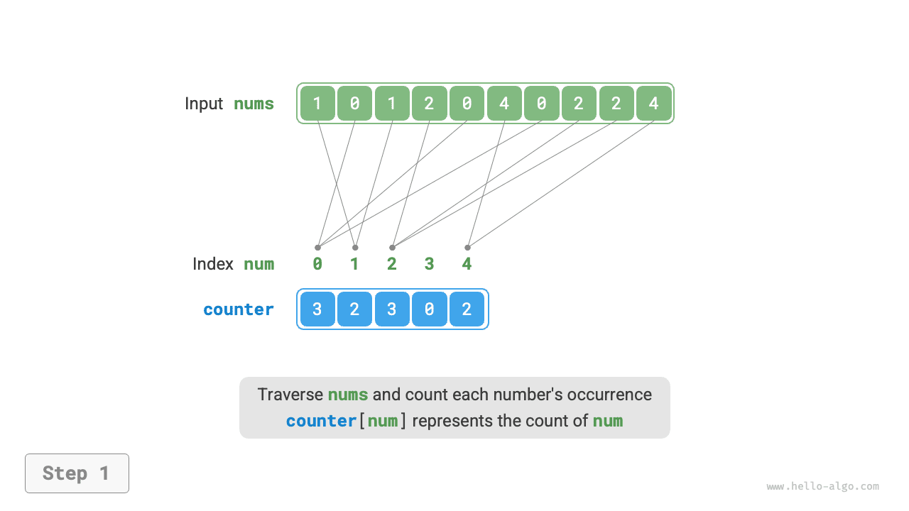
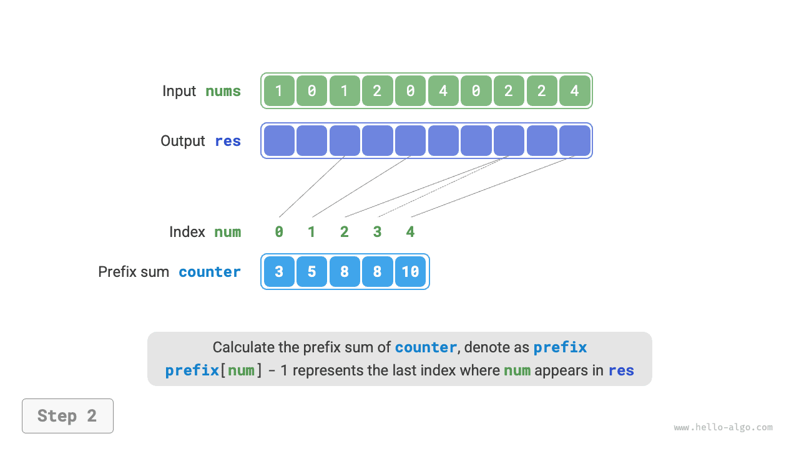
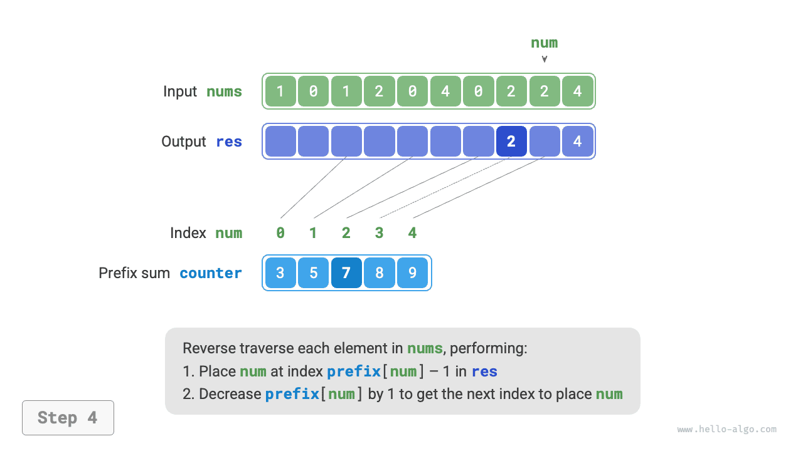
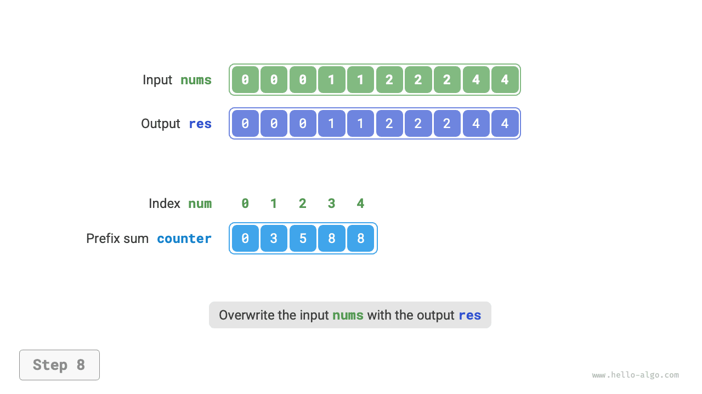

# Counting sort

<u>Counting sort</u> sorts by counting how often each element occurs. It is typically used for integer arrays.

## A simple implementation

Start with a simple example: an array `nums` of length $n$ containing nonnegative integers. The overall process is shown below.

1. Traverse the array to find its maximum value, denoted by $m$, then create an auxiliary array `counter` of length $m + 1$.
2. **Use `counter` to count occurrences of each number in `nums`**. Here, `counter[num]` is the number of occurrences of `num`. Simply traverse `nums` and increment `counter[num]` by $1$ for each current value `num`.
3. **Because the indices of `counter` are inherently ordered, the numbers are effectively already sorted**. Traverse `counter` and write each number into `nums` in ascending order, repeating it according to its count.


The code is as follows:

```src
[file]{counting_sort}-[class]{}-[func]{counting_sort_naive}
```

!!! note "How counting sort relates to bucket sort"

    From a bucket-sort perspective, each index of `counter` is a bucket, and counting occurrences is equivalent to distributing elements into their corresponding buckets. Counting sort is essentially a special case of bucket sort for integer data.

## A complete implementation

You may have noticed that **step `3.` above fails when the input consists of objects**. Suppose the inputs are product objects and we want to sort them by price, a member variable of the class. The algorithm above can produce only the sorted prices.

How can we obtain the sorted original data? First, calculate the “prefix sums” of `counter`. The prefix sum `prefix[i]` is the sum of the array entries up to index `i`:

$$
\text{prefix}[i] = \sum_{j=0}^i \text{counter[j]}
$$

**The prefix sum has a precise meaning: `prefix[num] - 1` is the index of the last occurrence of `num` in the result array `res`**. This tells us where each element belongs. Next, traverse the original array `nums` in reverse and perform two steps for each element `num`.

1. Place `num` at index `prefix[num] - 1` in `res`.
2. Decrease `prefix[num]` by $1$ to obtain the index for placing the next occurrence of `num`.

After the traversal, `res` contains the sorted result. Finally, copy `res` over the original array `nums`. The figure below shows the complete process.

=== "<1>"
    

=== "<2>"
    

=== "<3>"
    

=== "<4>"
    

=== "<5>"
    

=== "<6>"
    

=== "<7>"
    

=== "<8>"
    

The implementation is as follows:

```src
[file]{counting_sort}-[class]{}-[func]{counting_sort}
```

## Algorithm properties

- **Time complexity: $O(n + m)$; not adaptive**. Traversing `nums` and `counter` each takes linear time. Usually $n \gg m$, so the complexity approaches $O(n)$.
- **Space complexity: $O(n + m)$; not in-place**. The algorithm uses arrays `res` and `counter` of lengths $n$ and $m$, respectively.
- **Stable**. Since elements are placed into `res` from right to left, traversing `nums` in reverse preserves the relative order of equal elements. A forward traversal also produces a correctly sorted result, but it is not stable.

## Limitations

Counting sort may seem ingenious: it sorts efficiently simply by counting occurrences. However, its prerequisites are relatively restrictive.

**Counting sort applies only to nonnegative integers**. For other data types, the values must be convertible to nonnegative integers without changing their relative order. For example, if an integer array contains negative numbers, add a constant to every element to make them all positive, sort, and then reverse the transformation.

**Counting sort suits large datasets with a relatively small value range**. In the example above, $m$ must not be too large, or the algorithm will consume excessive space. When $n \ll m$, counting sort takes $O(m)$ time and may be slower than an $O(n \log n)$ sorting algorithm.
