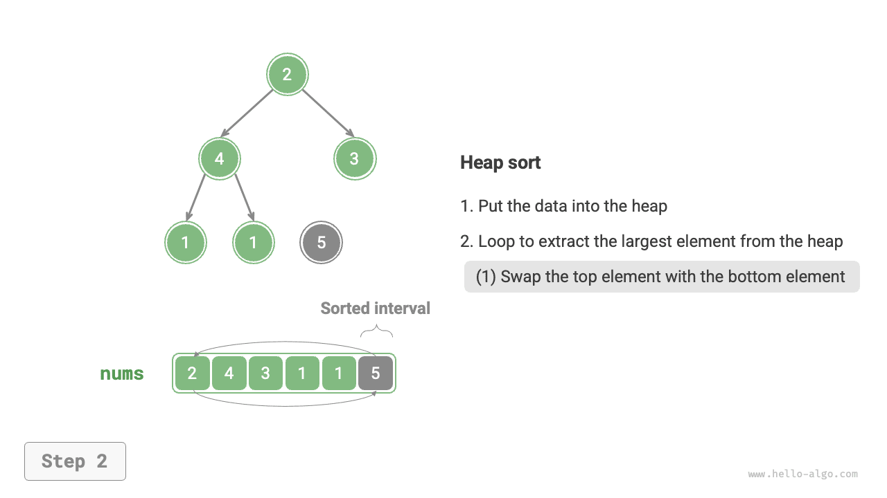
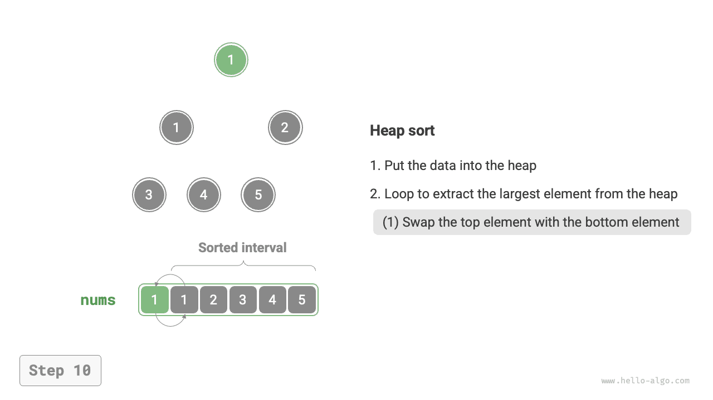
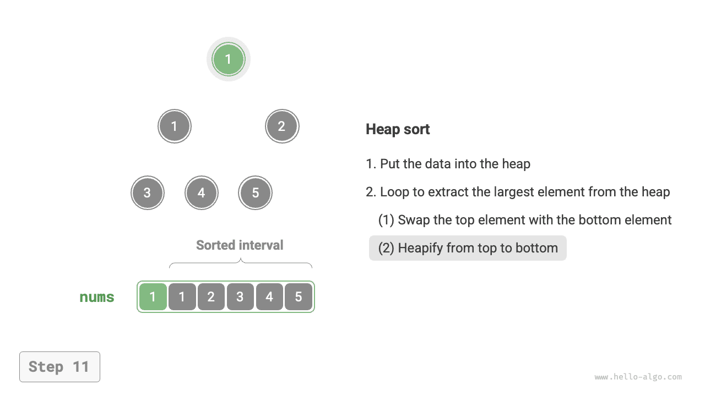
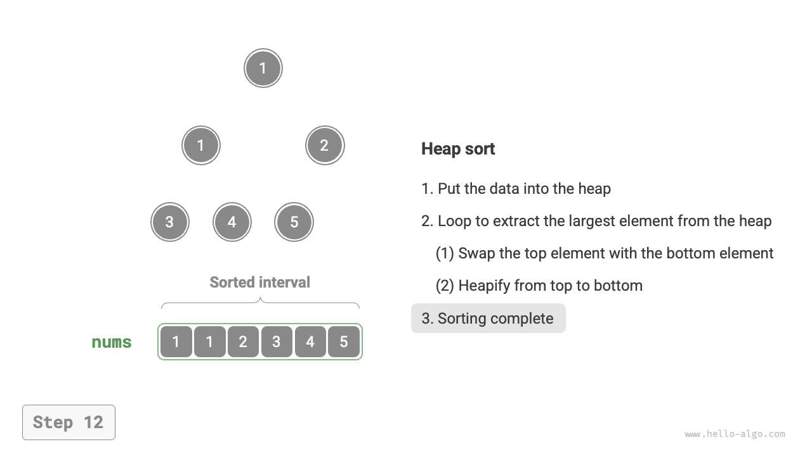

# 11.7 &nbsp; Heap sort

!!! tip

    Before reading this section, make sure you have completed the chapter on heaps.

<u>Heap sort</u> is an efficient sorting algorithm built on the heap data structure. We can implement it with the heap-building and removal operations we have already learned.

1. Build a min heap from the input array. The smallest element is now at the root.
2. Repeatedly remove the root and record the removed elements to obtain an ascending sequence.

Although this works, it requires an extra array to store the removed elements, wasting space. In practice, we usually use a more elegant implementation.

## 11.7.1 &nbsp; Algorithm steps

For an array of length $n$, heap sort proceeds as shown below.

1. Build a max heap from the input array. The largest element is now at the root.
2. Swap the root, the first element, with the last element of the heap. Reduce the heap's length by $1$ and increase the number of sorted elements by $1$.
3. Starting at the root, sift down to restore the heap property.
4. Repeat steps `2.` and `3.`. After $n - 1$ rounds, the array is sorted.

!!! tip

    In fact, removing the root of a heap also includes steps `2.` and `3.`, with the additional step of removing an element from the array.

=== "<1>"
    { class="animation-figure" }

=== "<2>"
    { class="animation-figure" }

=== "<3>"
    { class="animation-figure" }

=== "<4>"
    { class="animation-figure" }

=== "<5>"
    { class="animation-figure" }

=== "<6>"
    { class="animation-figure" }

=== "<7>"
    { class="animation-figure" }

=== "<8>"
    { class="animation-figure" }

=== "<9>"
    { class="animation-figure" }

=== "<10>"
    { class="animation-figure" }

=== "<11>"
    { class="animation-figure" }

=== "<12>"
    { class="animation-figure" }

<p align="center"> Figure 11-12 &nbsp; Steps of heap sort </p>

The implementation uses the same `sift_down()` function introduced in the heap chapter. Because the heap shrinks as maximum elements are extracted, add a length parameter $n$ to specify its current valid length. The code is as follows:

=== "Python"

    ```python title="heap_sort.py"
    def sift_down(nums: list[int], n: int, i: int):
        """Sift down from node i in a heap of size n"""
        while True:
            # Find the node with the largest value among i, l, and r, and store its index in ma
            l = 2 * i + 1
            r = 2 * i + 2
            ma = i
            if l < n and nums[l] > nums[ma]:
                ma = l
            if r < n and nums[r] > nums[ma]:
                ma = r
            # Stop if node i is largest or both child indices l and r are out of bounds
            if ma == i:
                break
            # Swap the two nodes
            nums[i], nums[ma] = nums[ma], nums[i]
            # Continue sifting down
            i = ma

    def heap_sort(nums: list[int]):
        """Heap sort"""
        # Build the heap by sifting down from every non-leaf node
        for i in range(len(nums) // 2 - 1, -1, -1):
            sift_down(nums, len(nums), i)
        # Extract the largest element from the heap, repeating for n-1 rounds
        for i in range(len(nums) - 1, 0, -1):
            # Swap the root with the rightmost leaf on the last level (the first and last elements of the current heap)
            nums[0], nums[i] = nums[i], nums[0]
            # Sift down starting at the root
            sift_down(nums, i, 0)
    ```

=== "C++"

    ```cpp title="heap_sort.cpp"
    /* Sift down from node i in a heap of size n */
    void siftDown(vector<int> &nums, int n, int i) {
        while (true) {
            // Find the node with the largest value among i, l, and r, and store its index in ma
            int l = 2 * i + 1;
            int r = 2 * i + 2;
            int ma = i;
            if (l < n && nums[l] > nums[ma])
                ma = l;
            if (r < n && nums[r] > nums[ma])
                ma = r;
            // Stop if node i is largest or both child indices l and r are out of bounds
            if (ma == i) {
                break;
            }
            // Swap the two nodes
            swap(nums[i], nums[ma]);
            // Continue sifting down
            i = ma;
        }
    }

    /* Heap sort */
    void heapSort(vector<int> &nums) {
        // Build the heap by sifting down from every non-leaf node
        for (int i = nums.size() / 2 - 1; i >= 0; --i) {
            siftDown(nums, nums.size(), i);
        }
        // Extract the largest element from the heap, repeating for n-1 rounds
        for (int i = nums.size() - 1; i > 0; --i) {
            // Swap the root with the rightmost leaf on the last level (the first and last elements of the current heap)
            swap(nums[0], nums[i]);
            // Sift down starting at the root
            siftDown(nums, i, 0);
        }
    }
    ```

=== "Java"

    ```java title="heap_sort.java"
    /* Sift down from node i in a heap of size n */
    void siftDown(int[] nums, int n, int i) {
        while (true) {
            // Find the node with the largest value among i, l, and r, and store its index in ma
            int l = 2 * i + 1;
            int r = 2 * i + 2;
            int ma = i;
            if (l < n && nums[l] > nums[ma])
                ma = l;
            if (r < n && nums[r] > nums[ma])
                ma = r;
            // Stop if node i is largest or both child indices l and r are out of bounds
            if (ma == i)
                break;
            // Swap the two nodes
            int temp = nums[i];
            nums[i] = nums[ma];
            nums[ma] = temp;
            // Continue sifting down
            i = ma;
        }
    }

    /* Heap sort */
    void heapSort(int[] nums) {
        // Build the heap by sifting down from every non-leaf node
        for (int i = nums.length / 2 - 1; i >= 0; i--) {
            siftDown(nums, nums.length, i);
        }
        // Extract the largest element from the heap, repeating for n-1 rounds
        for (int i = nums.length - 1; i > 0; i--) {
            // Swap the root with the rightmost leaf on the last level (the first and last elements of the current heap)
            int tmp = nums[0];
            nums[0] = nums[i];
            nums[i] = tmp;
            // Sift down starting at the root
            siftDown(nums, i, 0);
        }
    }
    ```

=== "C#"

    ```csharp title="heap_sort.cs"
    /* Sift down from node i in a heap of size n */
    void SiftDown(int[] nums, int n, int i) {
        while (true) {
            // Find the node with the largest value among i, l, and r, and store its index in ma
            int l = 2 * i + 1;
            int r = 2 * i + 2;
            int ma = i;
            if (l < n && nums[l] > nums[ma])
                ma = l;
            if (r < n && nums[r] > nums[ma])
                ma = r;
            // Stop if node i is largest or both child indices l and r are out of bounds
            if (ma == i)
                break;
            // Swap the two nodes
            (nums[ma], nums[i]) = (nums[i], nums[ma]);
            // Continue sifting down
            i = ma;
        }
    }

    /* Heap sort */
    void HeapSort(int[] nums) {
        // Build the heap by sifting down from every non-leaf node
        for (int i = nums.Length / 2 - 1; i >= 0; i--) {
            SiftDown(nums, nums.Length, i);
        }
        // Extract the largest element from the heap, repeating for n-1 rounds
        for (int i = nums.Length - 1; i > 0; i--) {
            // Swap the root with the rightmost leaf on the last level (the first and last elements of the current heap)
            (nums[i], nums[0]) = (nums[0], nums[i]);
            // Sift down starting at the root
            SiftDown(nums, i, 0);
        }
    }
    ```

=== "Go"

    ```go title="heap_sort.go"
    /* Sift down from node i in a heap of size n */
    func siftDown(nums *[]int, n, i int) {
        for true {
            // Find the node with the largest value among i, l, and r, and store its index in ma
            l := 2*i + 1
            r := 2*i + 2
            ma := i
            if l < n && (*nums)[l] > (*nums)[ma] {
                ma = l
            }
            if r < n && (*nums)[r] > (*nums)[ma] {
                ma = r
            }
            // Stop if node i is largest or both child indices l and r are out of bounds
            if ma == i {
                break
            }
            // Swap the two nodes
            (*nums)[i], (*nums)[ma] = (*nums)[ma], (*nums)[i]
            // Continue sifting down
            i = ma
        }
    }

    /* Heap sort */
    func heapSort(nums *[]int) {
        // Build the heap by sifting down from every non-leaf node
        for i := len(*nums)/2 - 1; i >= 0; i-- {
            siftDown(nums, len(*nums), i)
        }
        // Extract the largest element from the heap, repeating for n-1 rounds
        for i := len(*nums) - 1; i > 0; i-- {
            // Swap the root with the rightmost leaf on the last level (the first and last elements of the current heap)
            (*nums)[0], (*nums)[i] = (*nums)[i], (*nums)[0]
            // Sift down starting at the root
            siftDown(nums, i, 0)
        }
    }
    ```

=== "Swift"

    ```swift title="heap_sort.swift"
    /* Sift down from node i in a heap of size n */
    func siftDown(nums: inout [Int], n: Int, i: Int) {
        var i = i
        while true {
            // Find the node with the largest value among i, l, and r, and store its index in ma
            let l = 2 * i + 1
            let r = 2 * i + 2
            var ma = i
            if l < n, nums[l] > nums[ma] {
                ma = l
            }
            if r < n, nums[r] > nums[ma] {
                ma = r
            }
            // Stop if node i is largest or both child indices l and r are out of bounds
            if ma == i {
                break
            }
            // Swap the two nodes
            nums.swapAt(i, ma)
            // Continue sifting down
            i = ma
        }
    }

    /* Heap sort */
    func heapSort(nums: inout [Int]) {
        // Build the heap by sifting down from every non-leaf node
        for i in stride(from: nums.count / 2 - 1, through: 0, by: -1) {
            siftDown(nums: &nums, n: nums.count, i: i)
        }
        // Extract the largest element from the heap, repeating for n-1 rounds
        for i in nums.indices.dropFirst().reversed() {
            // Swap the root with the rightmost leaf on the last level (the first and last elements of the current heap)
            nums.swapAt(0, i)
            // Sift down starting at the root
            siftDown(nums: &nums, n: i, i: 0)
        }
    }
    ```

=== "JS"

    ```javascript title="heap_sort.js"
    /* Sift down from node i in a heap of size n */
    function siftDown(nums, n, i) {
        while (true) {
            // Find the node with the largest value among i, l, and r, and store its index in ma
            let l = 2 * i + 1;
            let r = 2 * i + 2;
            let ma = i;
            if (l < n && nums[l] > nums[ma]) {
                ma = l;
            }
            if (r < n && nums[r] > nums[ma]) {
                ma = r;
            }
            // Stop if node i is largest or both child indices l and r are out of bounds
            if (ma === i) {
                break;
            }
            // Swap the two nodes
            [nums[i], nums[ma]] = [nums[ma], nums[i]];
            // Continue sifting down
            i = ma;
        }
    }

    /* Heap sort */
    function heapSort(nums) {
        // Build the heap by sifting down from every non-leaf node
        for (let i = Math.floor(nums.length / 2) - 1; i >= 0; i--) {
            siftDown(nums, nums.length, i);
        }
        // Extract the largest element from the heap, repeating for n-1 rounds
        for (let i = nums.length - 1; i > 0; i--) {
            // Swap the root with the rightmost leaf on the last level (the first and last elements of the current heap)
            [nums[0], nums[i]] = [nums[i], nums[0]];
            // Sift down starting at the root
            siftDown(nums, i, 0);
        }
    }
    ```

=== "TS"

    ```typescript title="heap_sort.ts"
    /* Sift down from node i in a heap of size n */
    function siftDown(nums: number[], n: number, i: number): void {
        while (true) {
            // Find the node with the largest value among i, l, and r, and store its index in ma
            let l = 2 * i + 1;
            let r = 2 * i + 2;
            let ma = i;
            if (l < n && nums[l] > nums[ma]) {
                ma = l;
            }
            if (r < n && nums[r] > nums[ma]) {
                ma = r;
            }
            // Stop if node i is largest or both child indices l and r are out of bounds
            if (ma === i) {
                break;
            }
            // Swap the two nodes
            [nums[i], nums[ma]] = [nums[ma], nums[i]];
            // Continue sifting down
            i = ma;
        }
    }

    /* Heap sort */
    function heapSort(nums: number[]): void {
        // Build the heap by sifting down from every non-leaf node
        for (let i = Math.floor(nums.length / 2) - 1; i >= 0; i--) {
            siftDown(nums, nums.length, i);
        }
        // Extract the largest element from the heap, repeating for n-1 rounds
        for (let i = nums.length - 1; i > 0; i--) {
            // Swap the root with the rightmost leaf on the last level (the first and last elements of the current heap)
            [nums[0], nums[i]] = [nums[i], nums[0]];
            // Sift down starting at the root
            siftDown(nums, i, 0);
        }
    }
    ```

=== "Dart"

    ```dart title="heap_sort.dart"
    /* Sift down from node i in a heap of size n */
    void siftDown(List<int> nums, int n, int i) {
      while (true) {
        // Find the node with the largest value among i, l, and r, and store its index in ma
        int l = 2 * i + 1;
        int r = 2 * i + 2;
        int ma = i;
        if (l < n && nums[l] > nums[ma]) ma = l;
        if (r < n && nums[r] > nums[ma]) ma = r;
        // Stop if node i is largest or both child indices l and r are out of bounds
        if (ma == i) break;
        // Swap the two nodes
        int temp = nums[i];
        nums[i] = nums[ma];
        nums[ma] = temp;
        // Continue sifting down
        i = ma;
      }
    }

    /* Heap sort */
    void heapSort(List<int> nums) {
      // Build the heap by sifting down from every non-leaf node
      for (int i = nums.length ~/ 2 - 1; i >= 0; i--) {
        siftDown(nums, nums.length, i);
      }
      // Extract the largest element from the heap, repeating for n-1 rounds
      for (int i = nums.length - 1; i > 0; i--) {
        // Swap the root with the rightmost leaf on the last level (the first and last elements of the current heap)
        int tmp = nums[0];
        nums[0] = nums[i];
        nums[i] = tmp;
        // Sift down starting at the root
        siftDown(nums, i, 0);
      }
    }
    ```

=== "Rust"

    ```rust title="heap_sort.rs"
    /* Sift down from node i in a heap of size n */
    fn sift_down(nums: &mut [i32], n: usize, mut i: usize) {
        loop {
            // Find the node with the largest value among i, l, and r, and store its index in ma
            let l = 2 * i + 1;
            let r = 2 * i + 2;
            let mut ma = i;
            if l < n && nums[l] > nums[ma] {
                ma = l;
            }
            if r < n && nums[r] > nums[ma] {
                ma = r;
            }
            // Stop if node i is largest or both child indices l and r are out of bounds
            if ma == i {
                break;
            }
            // Swap the two nodes
            nums.swap(i, ma);
            // Continue sifting down
            i = ma;
        }
    }

    /* Heap sort */
    fn heap_sort(nums: &mut [i32]) {
        // Build the heap by sifting down from every non-leaf node
        for i in (0..nums.len() / 2).rev() {
            sift_down(nums, nums.len(), i);
        }
        // Extract the largest element from the heap, repeating for n-1 rounds
        for i in (1..nums.len()).rev() {
            // Swap the root with the rightmost leaf on the last level (the first and last elements of the current heap)
            nums.swap(0, i);
            // Sift down starting at the root
            sift_down(nums, i, 0);
        }
    }
    ```

=== "C"

    ```c title="heap_sort.c"
    /* Sift down from node i in a heap of size n */
    void siftDown(int nums[], int n, int i) {
        while (1) {
            // Find the node with the largest value among i, l, and r, and store its index in ma
            int l = 2 * i + 1;
            int r = 2 * i + 2;
            int ma = i;
            if (l < n && nums[l] > nums[ma])
                ma = l;
            if (r < n && nums[r] > nums[ma])
                ma = r;
            // Stop if node i is largest or both child indices l and r are out of bounds
            if (ma == i) {
                break;
            }
            // Swap the two nodes
            int temp = nums[i];
            nums[i] = nums[ma];
            nums[ma] = temp;
            // Continue sifting down
            i = ma;
        }
    }

    /* Heap sort */
    void heapSort(int nums[], int n) {
        // Build the heap by sifting down from every non-leaf node
        for (int i = n / 2 - 1; i >= 0; --i) {
            siftDown(nums, n, i);
        }
        // Extract the largest element from the heap, repeating for n-1 rounds
        for (int i = n - 1; i > 0; --i) {
            // Swap the root with the rightmost leaf on the last level (the first and last elements of the current heap)
            int tmp = nums[0];
            nums[0] = nums[i];
            nums[i] = tmp;
            // Sift down starting at the root
            siftDown(nums, i, 0);
        }
    }
    ```

=== "Kotlin"

    ```kotlin title="heap_sort.kt"
    /* Sift down from node i in a heap of size n */
    fun siftDown(nums: IntArray, n: Int, li: Int) {
        var i = li
        while (true) {
            // Find the node with the largest value among i, l, and r, and store its index in ma
            val l = 2 * i + 1
            val r = 2 * i + 2
            var ma = i
            if (l < n && nums[l] > nums[ma]) 
                ma = l
            if (r < n && nums[r] > nums[ma]) 
                ma = r
            // Stop if node i is largest or both child indices l and r are out of bounds
            if (ma == i) 
                break
            // Swap the two nodes
            val temp = nums[i]
            nums[i] = nums[ma]
            nums[ma] = temp
            // Continue sifting down
            i = ma
        }
    }

    /* Heap sort */
    fun heapSort(nums: IntArray) {
        // Build the heap by sifting down from every non-leaf node
        for (i in nums.size / 2 - 1 downTo 0) {
            siftDown(nums, nums.size, i)
        }
        // Extract the largest element from the heap, repeating for n-1 rounds
        for (i in nums.size - 1 downTo 1) {
            // Swap the root with the rightmost leaf on the last level (the first and last elements of the current heap)
            val temp = nums[0]
            nums[0] = nums[i]
            nums[i] = temp
            // Sift down starting at the root
            siftDown(nums, i, 0)
        }
    }
    ```

=== "Ruby"

    ```ruby title="heap_sort.rb"
    ### Sift down from node i in a heap of size n ###
    def sift_down(nums, n, i)
      while true
        # Find the node with the largest value among i, l, and r, and store its index in ma
        l = 2 * i + 1
        r = 2 * i + 2
        ma = i
        ma = l if l < n && nums[l] > nums[ma]
        ma = r if r < n && nums[r] > nums[ma]
        # Stop if node i is largest or both child indices l and r are out of bounds
        break if ma == i
        # Swap the two nodes
        nums[i], nums[ma] = nums[ma], nums[i]
        # Continue sifting down
        i = ma
      end
    end

    ### Heap sort ###
    def heap_sort(nums)
      # Build the heap by sifting down from every non-leaf node
      (nums.length / 2 - 1).downto(0) do |i|
        sift_down(nums, nums.length, i)
      end
      # Extract the largest element from the heap, repeating for n-1 rounds
      (nums.length - 1).downto(1) do |i|
        # Swap the root with the rightmost leaf on the last level (the first and last elements of the current heap)
        nums[0], nums[i] = nums[i], nums[0]
        # Sift down starting at the root
        sift_down(nums, i, 0)
      end
    end
    ```

??? pythontutor "Visualize execution"

    <div style="height: 549px; width: 100%;"><iframe class="pythontutor-iframe" title="Visualize execution" src="https://pythontutor.com/iframe-embed.html#code=def%20sift_down%28nums%3A%20list%5Bint%5D,%20n%3A%20int,%20i%3A%20int%29%3A%0A%20%20%20%20%22%22%22Sift%20down%20from%20node%20i%20in%20a%20heap%20of%20size%20n%22%22%22%0A%20%20%20%20while%20True%3A%0A%20%20%20%20%20%20%20%20%23%20Find%20the%20node%20with%20the%20largest%20value%20among%20i,%20l,%20and%20r,%20and%20store%20its%20index%20in%20ma%0A%20%20%20%20%20%20%20%20l%20%3D%202%20%2A%20i%20%2B%201%0A%20%20%20%20%20%20%20%20r%20%3D%202%20%2A%20i%20%2B%202%0A%20%20%20%20%20%20%20%20ma%20%3D%20i%0A%20%20%20%20%20%20%20%20if%20l%20%3C%20n%20and%20nums%5Bl%5D%20%3E%20nums%5Bma%5D%3A%0A%20%20%20%20%20%20%20%20%20%20%20%20ma%20%3D%20l%0A%20%20%20%20%20%20%20%20if%20r%20%3C%20n%20and%20nums%5Br%5D%20%3E%20nums%5Bma%5D%3A%0A%20%20%20%20%20%20%20%20%20%20%20%20ma%20%3D%20r%0A%20%20%20%20%20%20%20%20%23%20Stop%20if%20node%20i%20is%20largest%20or%20both%20child%20indices%20l%20and%20r%20are%20out%20of%20bounds%0A%20%20%20%20%20%20%20%20if%20ma%20%3D%3D%20i%3A%0A%20%20%20%20%20%20%20%20%20%20%20%20break%0A%20%20%20%20%20%20%20%20%23%20Swap%20the%20two%20nodes%0A%20%20%20%20%20%20%20%20nums%5Bi%5D,%20nums%5Bma%5D%20%3D%20nums%5Bma%5D,%20nums%5Bi%5D%0A%20%20%20%20%20%20%20%20%23%20Continue%20sifting%20down%0A%20%20%20%20%20%20%20%20i%20%3D%20ma%0A%0Adef%20heap_sort%28nums%3A%20list%5Bint%5D%29%3A%0A%20%20%20%20%22%22%22Heap%20sort%22%22%22%0A%20%20%20%20%23%20Build%20the%20heap%20by%20sifting%20down%20from%20every%20non-leaf%20node%0A%20%20%20%20for%20i%20in%20range%28len%28nums%29%20//%202%20-%201,%20-1,%20-1%29%3A%0A%20%20%20%20%20%20%20%20sift_down%28nums,%20len%28nums%29,%20i%29%0A%20%20%20%20%23%20Extract%20the%20largest%20element%20from%20the%20heap,%20repeating%20for%20n-1%20rounds%0A%20%20%20%20for%20i%20in%20range%28len%28nums%29%20-%201,%200,%20-1%29%3A%0A%20%20%20%20%20%20%20%20%23%20Swap%20the%20root%20with%20the%20rightmost%20leaf%20on%20the%20last%20level%20%28the%20first%20and%20last%20elements%20of%20the%20current%20heap%29%0A%20%20%20%20%20%20%20%20nums%5B0%5D,%20nums%5Bi%5D%20%3D%20nums%5Bi%5D,%20nums%5B0%5D%0A%20%20%20%20%20%20%20%20%23%20Sift%20down%20starting%20at%20the%20root%0A%20%20%20%20%20%20%20%20sift_down%28nums,%20i,%200%29%0A%0A%22%22%22Driver%20code%22%22%22%0Aif%20__name__%20%3D%3D%20%22__main__%22%3A%0A%20%20%20%20nums%20%3D%20%5B4,%201,%203,%201,%205,%202%5D%0A%20%20%20%20heap_sort%28nums%29%0A%20%20%20%20print%28%22After%20heap%20sort,%20nums%20%3D%22,%20nums%29&codeDivHeight=472&codeDivWidth=350&cumulative=false&curInstr=5&heapPrimitives=nevernest&origin=opt-frontend.js&py=311&rawInputLstJSON=%5B%5D&textReferences=false"> </iframe></div>
    <div style="margin-top: 5px;"><a href="https://pythontutor.com/iframe-embed.html#code=def%20sift_down%28nums%3A%20list%5Bint%5D,%20n%3A%20int,%20i%3A%20int%29%3A%0A%20%20%20%20%22%22%22Sift%20down%20from%20node%20i%20in%20a%20heap%20of%20size%20n%22%22%22%0A%20%20%20%20while%20True%3A%0A%20%20%20%20%20%20%20%20%23%20Find%20the%20node%20with%20the%20largest%20value%20among%20i,%20l,%20and%20r,%20and%20store%20its%20index%20in%20ma%0A%20%20%20%20%20%20%20%20l%20%3D%202%20%2A%20i%20%2B%201%0A%20%20%20%20%20%20%20%20r%20%3D%202%20%2A%20i%20%2B%202%0A%20%20%20%20%20%20%20%20ma%20%3D%20i%0A%20%20%20%20%20%20%20%20if%20l%20%3C%20n%20and%20nums%5Bl%5D%20%3E%20nums%5Bma%5D%3A%0A%20%20%20%20%20%20%20%20%20%20%20%20ma%20%3D%20l%0A%20%20%20%20%20%20%20%20if%20r%20%3C%20n%20and%20nums%5Br%5D%20%3E%20nums%5Bma%5D%3A%0A%20%20%20%20%20%20%20%20%20%20%20%20ma%20%3D%20r%0A%20%20%20%20%20%20%20%20%23%20Stop%20if%20node%20i%20is%20largest%20or%20both%20child%20indices%20l%20and%20r%20are%20out%20of%20bounds%0A%20%20%20%20%20%20%20%20if%20ma%20%3D%3D%20i%3A%0A%20%20%20%20%20%20%20%20%20%20%20%20break%0A%20%20%20%20%20%20%20%20%23%20Swap%20the%20two%20nodes%0A%20%20%20%20%20%20%20%20nums%5Bi%5D,%20nums%5Bma%5D%20%3D%20nums%5Bma%5D,%20nums%5Bi%5D%0A%20%20%20%20%20%20%20%20%23%20Continue%20sifting%20down%0A%20%20%20%20%20%20%20%20i%20%3D%20ma%0A%0Adef%20heap_sort%28nums%3A%20list%5Bint%5D%29%3A%0A%20%20%20%20%22%22%22Heap%20sort%22%22%22%0A%20%20%20%20%23%20Build%20the%20heap%20by%20sifting%20down%20from%20every%20non-leaf%20node%0A%20%20%20%20for%20i%20in%20range%28len%28nums%29%20//%202%20-%201,%20-1,%20-1%29%3A%0A%20%20%20%20%20%20%20%20sift_down%28nums,%20len%28nums%29,%20i%29%0A%20%20%20%20%23%20Extract%20the%20largest%20element%20from%20the%20heap,%20repeating%20for%20n-1%20rounds%0A%20%20%20%20for%20i%20in%20range%28len%28nums%29%20-%201,%200,%20-1%29%3A%0A%20%20%20%20%20%20%20%20%23%20Swap%20the%20root%20with%20the%20rightmost%20leaf%20on%20the%20last%20level%20%28the%20first%20and%20last%20elements%20of%20the%20current%20heap%29%0A%20%20%20%20%20%20%20%20nums%5B0%5D,%20nums%5Bi%5D%20%3D%20nums%5Bi%5D,%20nums%5B0%5D%0A%20%20%20%20%20%20%20%20%23%20Sift%20down%20starting%20at%20the%20root%0A%20%20%20%20%20%20%20%20sift_down%28nums,%20i,%200%29%0A%0A%22%22%22Driver%20code%22%22%22%0Aif%20__name__%20%3D%3D%20%22__main__%22%3A%0A%20%20%20%20nums%20%3D%20%5B4,%201,%203,%201,%205,%202%5D%0A%20%20%20%20heap_sort%28nums%29%0A%20%20%20%20print%28%22After%20heap%20sort,%20nums%20%3D%22,%20nums%29&codeDivHeight=800&codeDivWidth=600&cumulative=false&curInstr=5&heapPrimitives=nevernest&origin=opt-frontend.js&py=311&rawInputLstJSON=%5B%5D&textReferences=false" target="_blank" rel="noopener noreferrer">View full screen ></a></div>

## 11.7.2 &nbsp; Algorithm properties

- **Time complexity: $O(n \log n)$; not adaptive**. Building the heap takes $O(n)$ time. Extracting its maximum takes $O(\log n)$ time and is repeated $n - 1$ times.
- **Space complexity: $O(1)$; in-place**. A few pointer variables use $O(1)$ space. Swapping and sifting take place within the original array.
- **Not stable**. Swapping the root with the last element of the heap may change the relative order of equal elements.
