# Heap sort

!!! tip

    Before reading this section, work through the chapter on heaps.

<u>Heap sort</u> is an efficient sorting algorithm based on the heap data structure. We can implement it with two operations we have already seen: building a heap and removing its root.

1. Build a min-heap from the input array. The smallest element is now at the root.
2. Repeatedly remove the root and record each element as it comes out. The resulting sequence is in ascending order.

This approach works, but it requires an extra array to store the elements removed from the heap. In practice, we usually use a more space-efficient implementation.

## How the algorithm works

For an array of length $n$, heap sort proceeds as shown below.

1. Build a max-heap from the input array. The largest element is now at the root.
2. Swap the root (the first element) with the last element of the heap. This reduces the heap size by $1$ and increases the number of sorted elements by $1$.
3. Sift down from the root to restore the heap property.
4. Repeat steps `2.` and `3.`. After $n - 1$ rounds, the array is sorted.

!!! tip

    Removing the root of a heap also includes steps `2.` and `3.`, with the additional step of popping the element.

=== "<1>"
    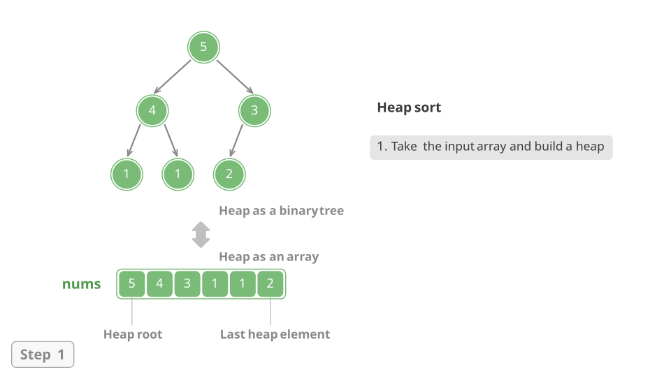

=== "<2>"
    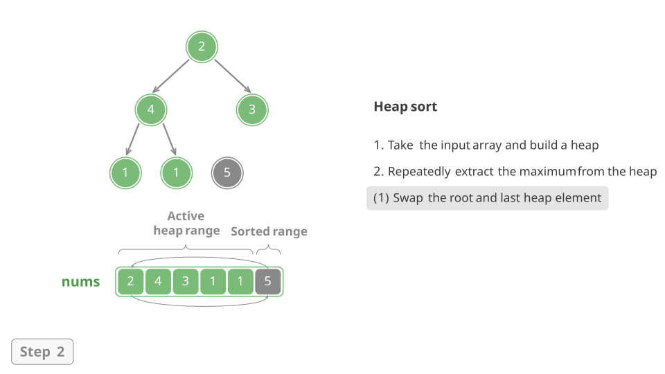

=== "<3>"
    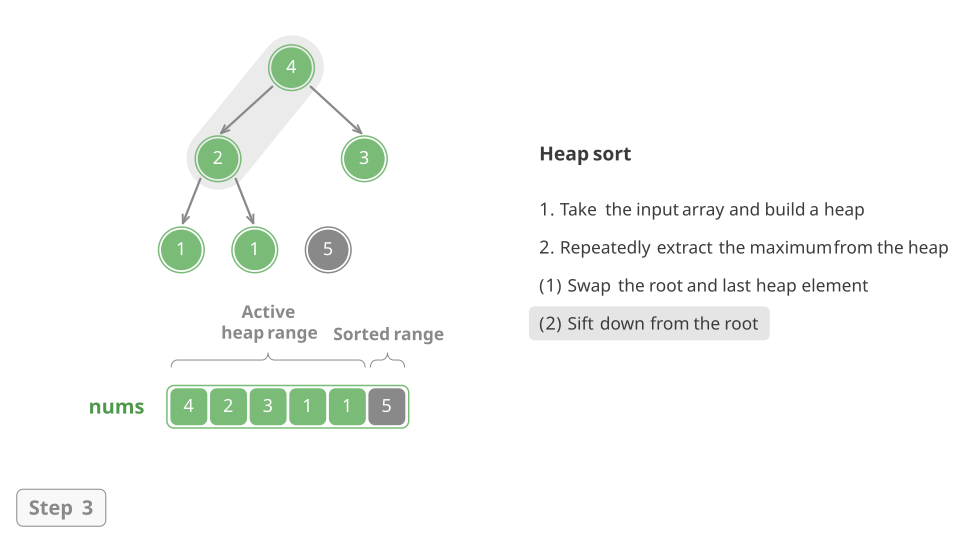

=== "<4>"
    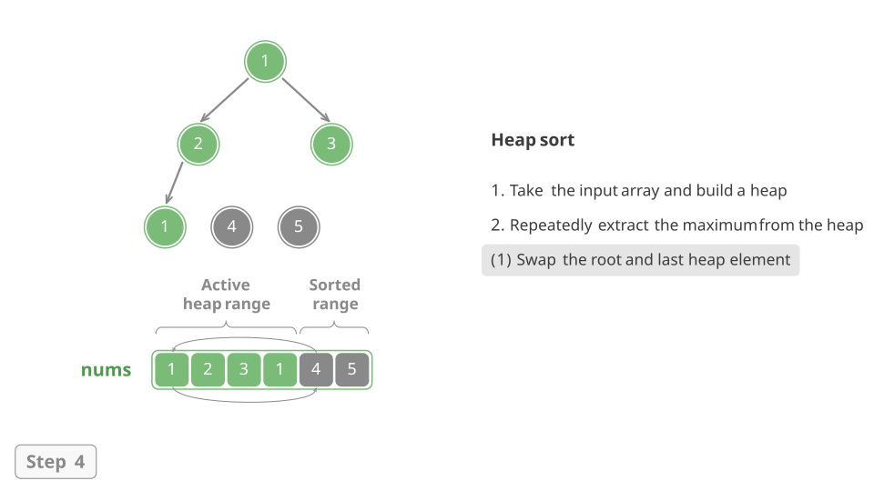

=== "<5>"
    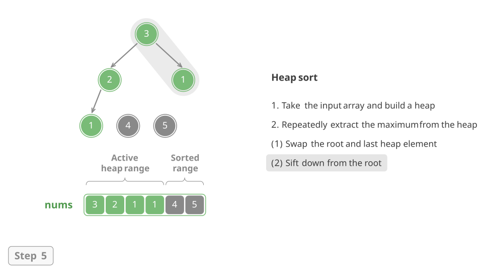

=== "<6>"
    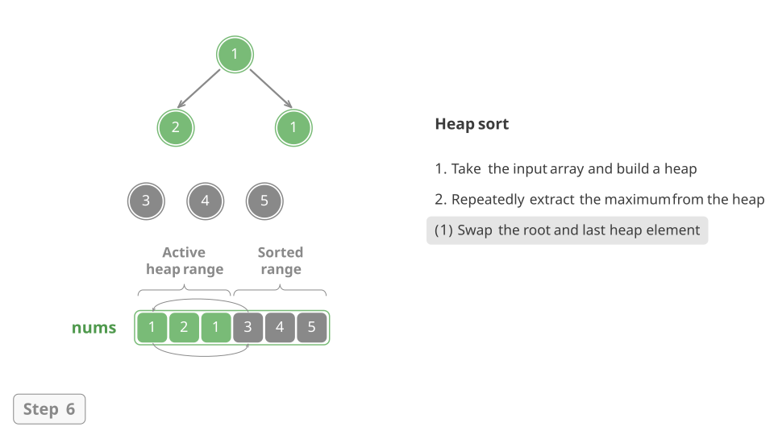

=== "<7>"
    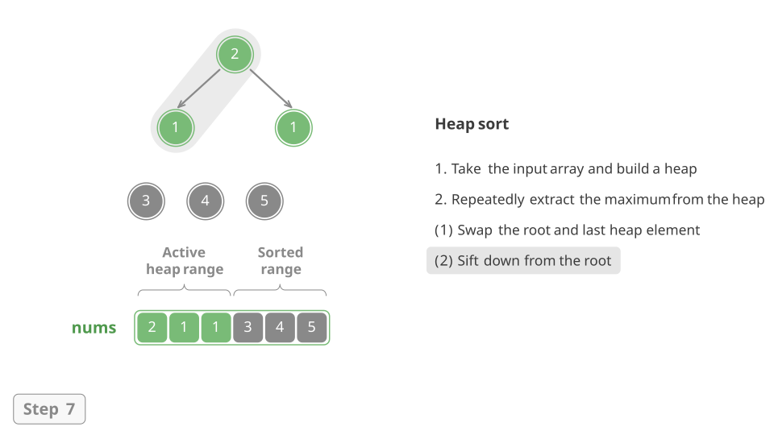

=== "<8>"
    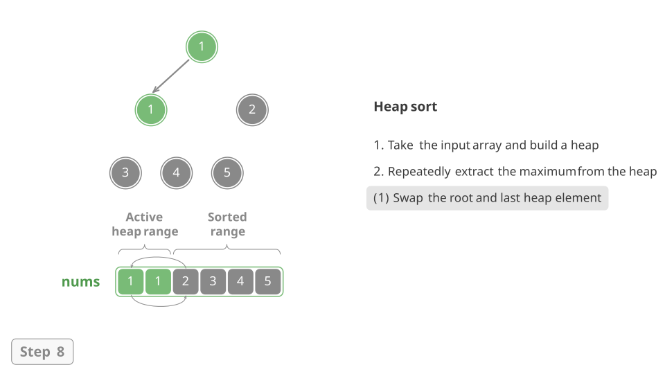

=== "<9>"
    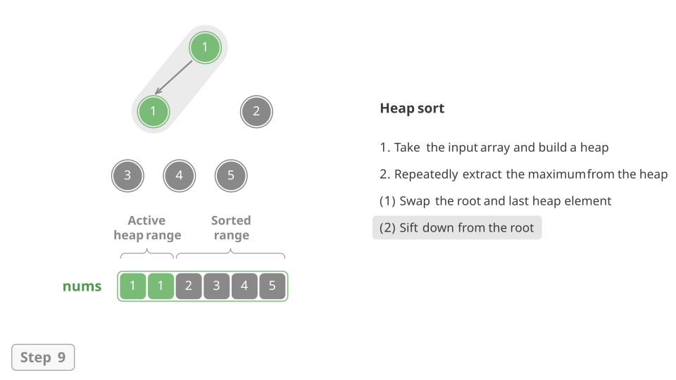

=== "<10>"
    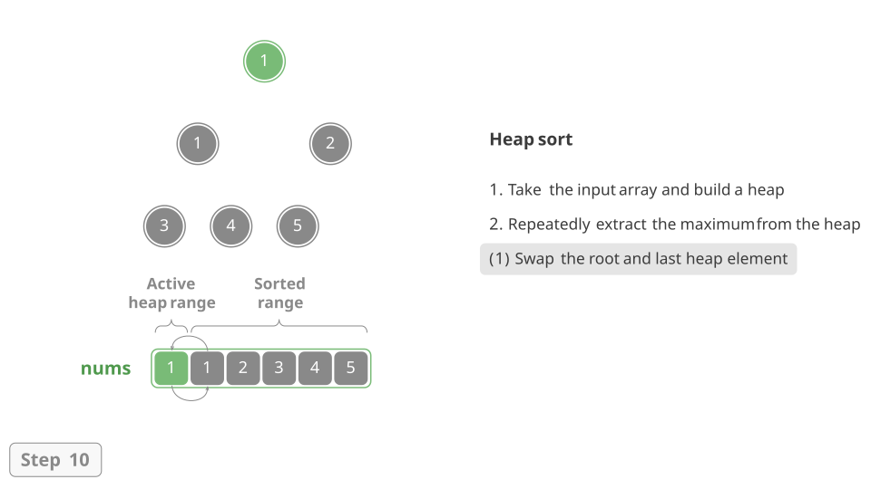

=== "<11>"
    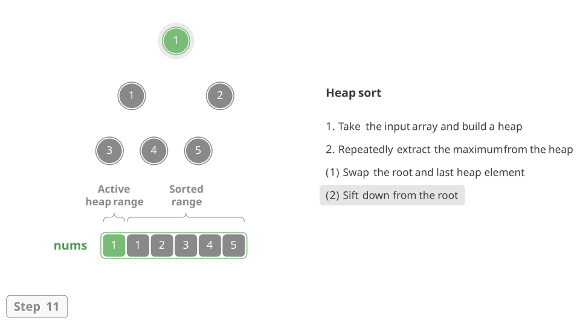

=== "<12>"
    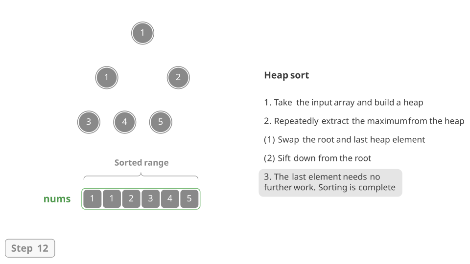

The implementation uses the same sift-down function, `sift_down()`, as the chapter on heaps. Because the heap shrinks each time we extract its maximum, we add a length parameter $n$ to `sift_down()` to specify the current size of the heap:

```src
[file]{heap_sort}-[class]{}-[func]{heap_sort}
```

## Algorithm properties

- **Time complexity: $O(n \log n)$, nonadaptive**. Building the heap takes $O(n)$ time. Extracting its maximum takes $O(\log n)$ time per round, for a total of $n - 1$ rounds.
- **Space complexity: $O(1)$, in-place**. The few index variables use $O(1)$ space. Swaps and sift-down operations both work directly on the original array.
- **Unstable**. Swapping the root with the last element of the heap can change the relative order of equal elements.
