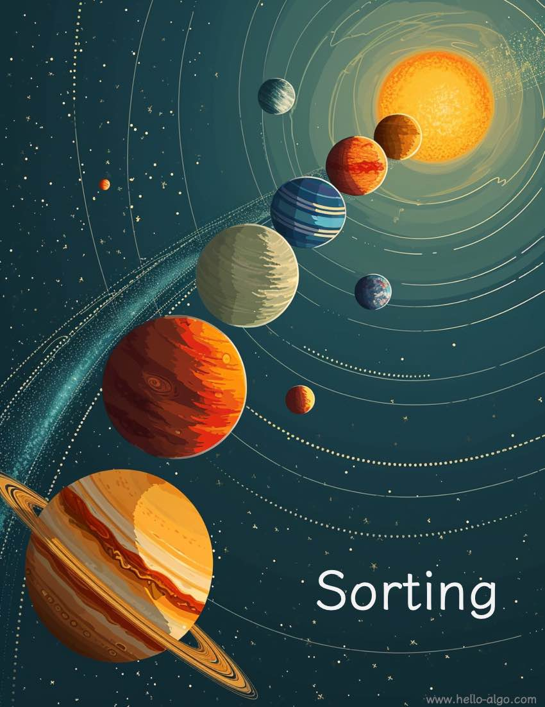

# Sorting

!!! abstract

    Sorting is like a magic key that turns disorder into order, helping us understand and process data more efficiently.

    From a simple ascending sequence to an intricate arrangement by category, sorting reveals patterns and harmony in data.
