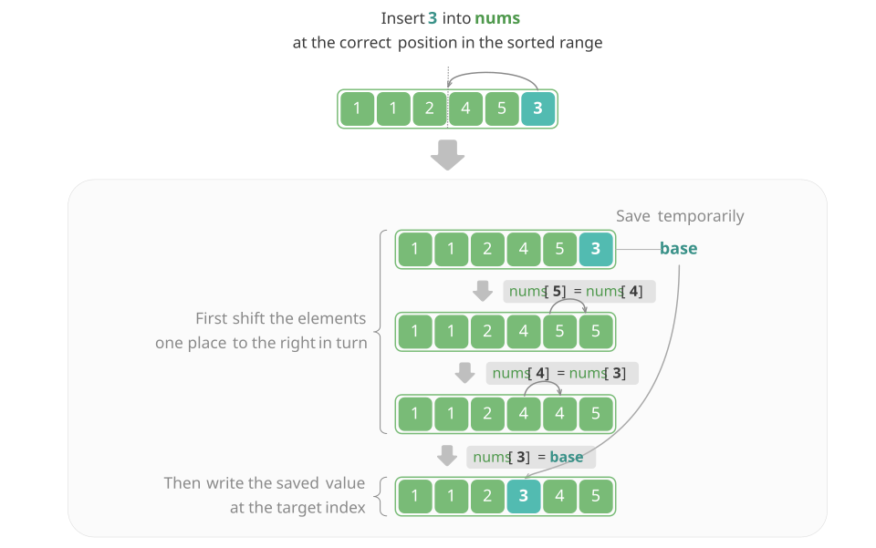
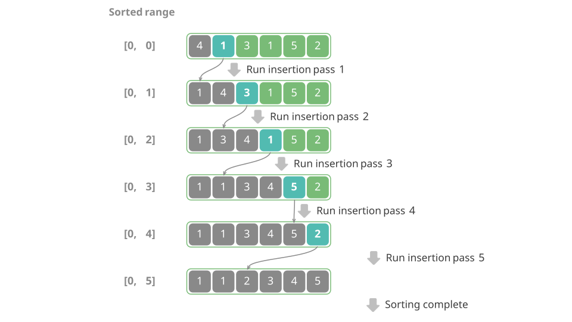

# Insertion sort

<u>Insertion sort</u> is a simple algorithm that works much like arranging a hand of playing cards.

Choose an element from the unsorted range, compare it with elements in the sorted range to its left one at a time, and insert it at the correct position.

The figure below shows how to insert an element into an array. Call the element `base`. Shift all elements from the target index up to, but excluding, `base` one position to the right. Then write `base` at the target index.



## How the algorithm works

The figure below shows the full insertion sort procedure.

1. Initially, the first element of the array is already sorted.
2. Choose the second element as `base` and insert it at the correct position. **The first two elements are now sorted**.
3. Choose the third element as `base` and insert it at the correct position. **The first three elements are now sorted**.
4. Continue in the same way. In the final pass, choose the last element as `base` and insert it at the correct position. **All elements are now sorted**.



Here is an implementation:

```src
[file]{insertion_sort}-[class]{}-[func]{insertion_sort}
```

## Algorithm properties

- **Time complexity: $O(n^2)$, adaptive**. In the worst case, the insertions require $n - 1$, $n-2$, $\dots$, $2$, and $1$ iterations, respectively, adding up to $(n - 1) n / 2$. The time complexity is therefore $O(n^2)$. On ordered data, the insertion loop stops early. A fully sorted array achieves the best-case time complexity of $O(n)$.
- **Space complexity: $O(1)$, in-place**. The two indices $i$ and $j$ use a constant amount of extra space.
- **Stable**. Each insertion places the new element to the right of any equal elements, preserving their relative order.

## Advantages of insertion sort

Insertion sort has time complexity $O(n^2)$, whereas quicksort, which we will study shortly, has time complexity $O(n \log n)$. Despite its higher time complexity, **insertion sort is usually faster on small inputs**.

This is similar to the trade-off between linear and binary search. Algorithms such as quicksort achieve $O(n \log n)$ time using divide and conquer, which often involves more elementary operations per round. For small inputs, the values of $n^2$ and $n \log n$ are close. The number of operations per round then matters more than the asymptotic growth rate.

In fact, the built-in sorts in many languages, including Java, use insertion sort. The general idea is to use a divide-and-conquer sort such as quicksort for long arrays and insertion sort directly for short arrays.

Bubble sort, selection sort, and insertion sort all have time complexity $O(n^2)$. In practice, however, **insertion sort is used far more often than either bubble sort or selection sort**, mainly for the following reasons.

- Bubble sort moves elements by swapping them. A swap with a temporary variable takes three elementary operations. Insertion sort shifts an element with a single assignment. As a result, **bubble sort usually requires more work than insertion sort**.
- Selection sort takes $O(n^2)$ time in all cases. **On partially sorted data, insertion sort is usually more efficient than selection sort**.
- Selection sort is unstable, so it cannot be used for successive sorts by different keys that must preserve earlier ordering.
