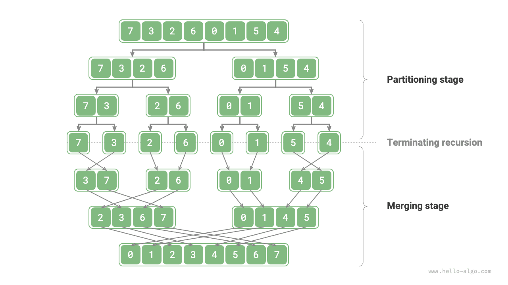
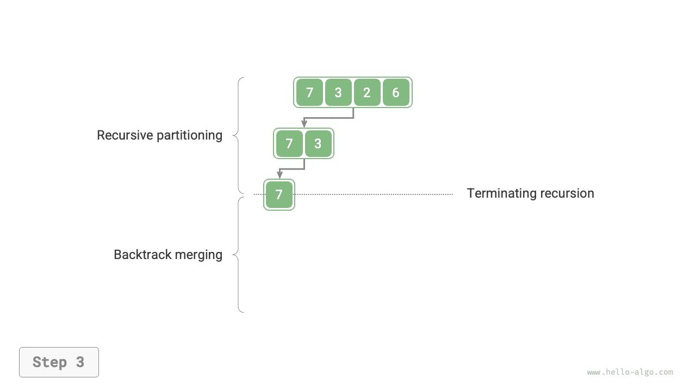
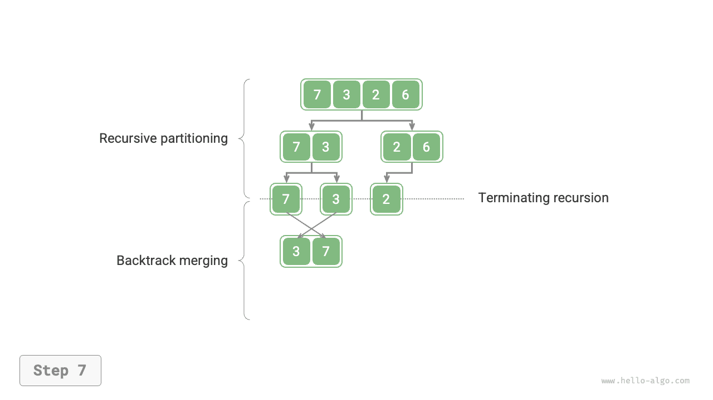
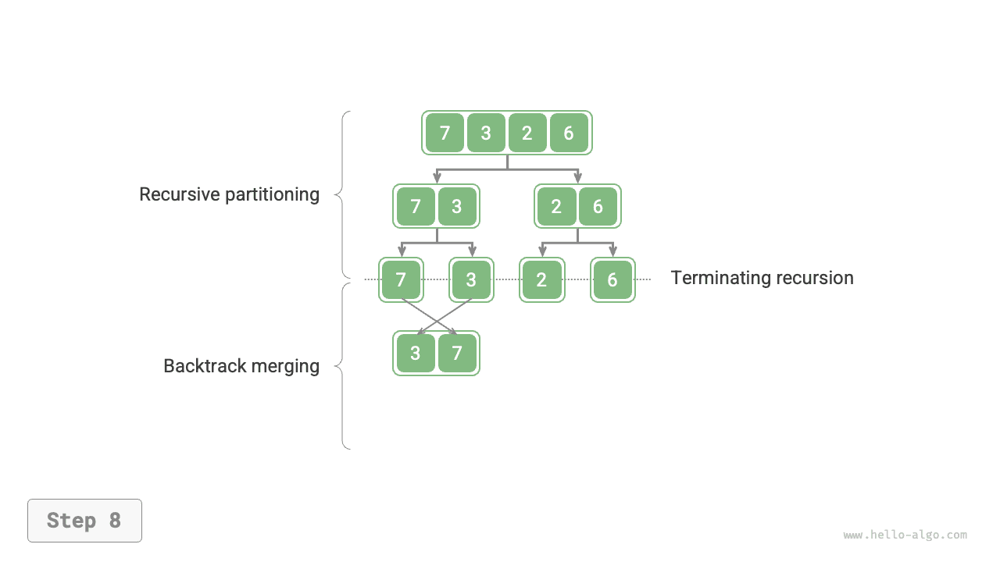
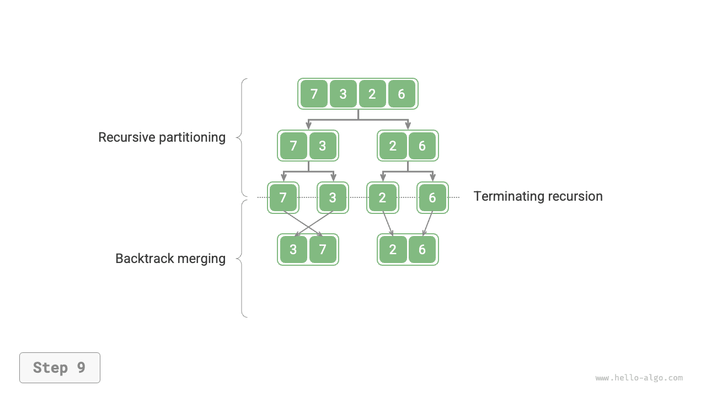

# 11.6 &nbsp; Merge sort

<u>Merge sort</u> is a divide-and-conquer sorting algorithm with the “division” and “merging” phases shown below.

1. **Division**: recursively split the array at its midpoint, turning the problem of sorting a long array into problems of sorting shorter arrays.
2. **Merging**: stop dividing when a subarray has length 1, then repeatedly merge two shorter sorted arrays into one longer sorted array until the process is complete.

{ class="animation-figure" }

<p align="center"> Figure 11-10 &nbsp; The division and merging phases of merge sort </p>

## 11.6.1 &nbsp; Algorithm steps

As shown below, the division phase works from the top down, recursively splitting each array into two subarrays at its midpoint.

1. Calculate the midpoint `mid`, then recursively divide the left subarray, `[left, mid]`, and the right subarray, `[mid + 1, right]`.
2. Repeat step `1.` recursively until each subarray has length 1.

The merging phase works from the bottom up, combining the left and right subarrays into a sorted array. Merging begins with subarrays of length 1, so every subarray involved in this phase is already sorted.

=== "<1>"
    { class="animation-figure" }

=== "<2>"
    { class="animation-figure" }

=== "<3>"
    { class="animation-figure" }

=== "<4>"
    { class="animation-figure" }

=== "<5>"
    { class="animation-figure" }

=== "<6>"
    { class="animation-figure" }

=== "<7>"
    { class="animation-figure" }

=== "<8>"
    { class="animation-figure" }

=== "<9>"
    { class="animation-figure" }

=== "<10>"
    { class="animation-figure" }

<p align="center"> Figure 11-11 &nbsp; Steps of merge sort </p>

Merge sort follows the same recursive order as a postorder traversal of a binary tree.

- **Postorder traversal**: recurse into the left subtree, then the right subtree, and finally process the root.
- **Merge sort**: recurse into the left subarray, then the right subarray, and finally merge them.

The implementation follows. The interval to merge in `nums` is `[left, right]`, while its corresponding interval in `tmp` is `[0, right - left]`.

=== "Python"

    ```python title="merge_sort.py"
    def merge(nums: list[int], left: int, mid: int, right: int):
        """Merge the left and right subarrays"""
        # The left subarray spans [left, mid], and the right subarray spans [mid+1, right]
        # Create a temporary array tmp to store the merged result
        tmp = [0] * (right - left + 1)
        # Initialize the starting indices of the left and right subarrays
        i, j, k = left, mid + 1, 0
        # While both subarrays have elements remaining, compare them and copy the smaller element into the temporary array
        while i <= mid and j <= right:
            if nums[i] <= nums[j]:
                tmp[k] = nums[i]
                i += 1
            else:
                tmp[k] = nums[j]
                j += 1
            k += 1
        # Copy the remaining elements of the left and right subarrays into the temporary array
        while i <= mid:
            tmp[k] = nums[i]
            i += 1
            k += 1
        while j <= right:
            tmp[k] = nums[j]
            j += 1
            k += 1
        # Copy the elements of temporary array tmp back into the corresponding range of the original array nums
        for k in range(0, len(tmp)):
            nums[left + k] = tmp[k]

    def merge_sort(nums: list[int], left: int, right: int):
        """Merge sort"""
        # Base case
        if left >= right:
            return  # Stop recursing when the subarray has at most one element
        # Divide phase
        mid = (left + right) // 2 # Calculate the midpoint
        merge_sort(nums, left, mid)  # Recurse on the left subarray
        merge_sort(nums, mid + 1, right)  # Recurse on the right subarray
        # Merge phase
        merge(nums, left, mid, right)
    ```

=== "C++"

    ```cpp title="merge_sort.cpp"
    /* Merge the left and right subarrays */
    void merge(vector<int> &nums, int left, int mid, int right) {
        // The left subarray spans [left, mid], and the right subarray spans [mid+1, right]
        // Create a temporary array tmp to store the merged result
        vector<int> tmp(right - left + 1);
        // Initialize the starting indices of the left and right subarrays
        int i = left, j = mid + 1, k = 0;
        // While both subarrays have elements remaining, compare them and copy the smaller element into the temporary array
        while (i <= mid && j <= right) {
            if (nums[i] <= nums[j])
                tmp[k++] = nums[i++];
            else
                tmp[k++] = nums[j++];
        }
        // Copy the remaining elements of the left and right subarrays into the temporary array
        while (i <= mid) {
            tmp[k++] = nums[i++];
        }
        while (j <= right) {
            tmp[k++] = nums[j++];
        }
        // Copy the elements of temporary array tmp back into the corresponding range of the original array nums
        for (k = 0; k < tmp.size(); k++) {
            nums[left + k] = tmp[k];
        }
    }

    /* Merge sort */
    void mergeSort(vector<int> &nums, int left, int right) {
        // Base case
        if (left >= right)
            return; // Stop recursing when the subarray has at most one element
        // Divide phase
        int mid = left + (right - left) / 2;    // Calculate the midpoint
        mergeSort(nums, left, mid);      // Recurse on the left subarray
        mergeSort(nums, mid + 1, right); // Recurse on the right subarray
        // Merge phase
        merge(nums, left, mid, right);
    }
    ```

=== "Java"

    ```java title="merge_sort.java"
    /* Merge the left and right subarrays */
    void merge(int[] nums, int left, int mid, int right) {
        // The left subarray spans [left, mid], and the right subarray spans [mid+1, right]
        // Create a temporary array tmp to store the merged result
        int[] tmp = new int[right - left + 1];
        // Initialize the starting indices of the left and right subarrays
        int i = left, j = mid + 1, k = 0;
        // While both subarrays have elements remaining, compare them and copy the smaller element into the temporary array
        while (i <= mid && j <= right) {
            if (nums[i] <= nums[j])
                tmp[k++] = nums[i++];
            else
                tmp[k++] = nums[j++];
        }
        // Copy the remaining elements of the left and right subarrays into the temporary array
        while (i <= mid) {
            tmp[k++] = nums[i++];
        }
        while (j <= right) {
            tmp[k++] = nums[j++];
        }
        // Copy the elements of temporary array tmp back into the corresponding range of the original array nums
        for (k = 0; k < tmp.length; k++) {
            nums[left + k] = tmp[k];
        }
    }

    /* Merge sort */
    void mergeSort(int[] nums, int left, int right) {
        // Base case
        if (left >= right)
            return; // Stop recursing when the subarray has at most one element
        // Divide phase
        int mid = left + (right - left) / 2; // Calculate the midpoint
        mergeSort(nums, left, mid); // Recurse on the left subarray
        mergeSort(nums, mid + 1, right); // Recurse on the right subarray
        // Merge phase
        merge(nums, left, mid, right);
    }
    ```

=== "C#"

    ```csharp title="merge_sort.cs"
    /* Merge the left and right subarrays */
    void Merge(int[] nums, int left, int mid, int right) {
        // The left subarray spans [left, mid], and the right subarray spans [mid+1, right]
        // Create a temporary array tmp to store the merged result
        int[] tmp = new int[right - left + 1];
        // Initialize the starting indices of the left and right subarrays
        int i = left, j = mid + 1, k = 0;
        // While both subarrays have elements remaining, compare them and copy the smaller element into the temporary array
        while (i <= mid && j <= right) {
            if (nums[i] <= nums[j])
                tmp[k++] = nums[i++];
            else
                tmp[k++] = nums[j++];
        }
        // Copy the remaining elements of the left and right subarrays into the temporary array
        while (i <= mid) {
            tmp[k++] = nums[i++];
        }
        while (j <= right) {
            tmp[k++] = nums[j++];
        }
        // Copy the elements of temporary array tmp back into the corresponding range of the original array nums
        for (k = 0; k < tmp.Length; ++k) {
            nums[left + k] = tmp[k];
        }
    }

    /* Merge sort */
    void MergeSort(int[] nums, int left, int right) {
        // Base case
        if (left >= right) return;       // Stop recursing when the subarray has at most one element
        // Divide phase
        int mid = left + (right - left) / 2;    // Calculate the midpoint
        MergeSort(nums, left, mid);      // Recurse on the left subarray
        MergeSort(nums, mid + 1, right); // Recurse on the right subarray
        // Merge phase
        Merge(nums, left, mid, right);
    }
    ```

=== "Go"

    ```go title="merge_sort.go"
    /* Merge the left and right subarrays */
    func merge(nums []int, left, mid, right int) {
        // The left subarray spans [left, mid], and the right subarray spans [mid+1, right]
        // Create a temporary array tmp to store the merged result
        tmp := make([]int, right-left+1)
        // Initialize the starting indices of the left and right subarrays
        i, j, k := left, mid+1, 0
        // While both subarrays have elements remaining, compare them and copy the smaller element into the temporary array
        for i <= mid && j <= right {
            if nums[i] <= nums[j] {
                tmp[k] = nums[i]
                i++
            } else {
                tmp[k] = nums[j]
                j++
            }
            k++
        }
        // Copy the remaining elements of the left and right subarrays into the temporary array
        for i <= mid {
            tmp[k] = nums[i]
            i++
            k++
        }
        for j <= right {
            tmp[k] = nums[j]
            j++
            k++
        }
        // Copy the elements of temporary array tmp back into the corresponding range of the original array nums
        for k := 0; k < len(tmp); k++ {
            nums[left+k] = tmp[k]
        }
    }

    /* Merge sort */
    func mergeSort(nums []int, left, right int) {
        // Base case
        if left >= right {
            return
        }
        // Divide phase
        mid := left + (right - left) / 2
        mergeSort(nums, left, mid)
        mergeSort(nums, mid+1, right)
        // Merge phase
        merge(nums, left, mid, right)
    }
    ```

=== "Swift"

    ```swift title="merge_sort.swift"
    /* Merge the left and right subarrays */
    func merge(nums: inout [Int], left: Int, mid: Int, right: Int) {
        // The left subarray spans [left, mid], and the right subarray spans [mid+1, right]
        // Create a temporary array tmp to store the merged result
        var tmp = Array(repeating: 0, count: right - left + 1)
        // Initialize the starting indices of the left and right subarrays
        var i = left, j = mid + 1, k = 0
        // While both subarrays have elements remaining, compare them and copy the smaller element into the temporary array
        while i <= mid, j <= right {
            if nums[i] <= nums[j] {
                tmp[k] = nums[i]
                i += 1
            } else {
                tmp[k] = nums[j]
                j += 1
            }
            k += 1
        }
        // Copy the remaining elements of the left and right subarrays into the temporary array
        while i <= mid {
            tmp[k] = nums[i]
            i += 1
            k += 1
        }
        while j <= right {
            tmp[k] = nums[j]
            j += 1
            k += 1
        }
        // Copy the elements of temporary array tmp back into the corresponding range of the original array nums
        for k in tmp.indices {
            nums[left + k] = tmp[k]
        }
    }

    /* Merge sort */
    func mergeSort(nums: inout [Int], left: Int, right: Int) {
        // Base case
        if left >= right { // Stop recursing when the subarray has at most one element
            return
        }
        // Divide phase
        let mid = left + (right - left) / 2 // Calculate the midpoint
        mergeSort(nums: &nums, left: left, right: mid) // Recurse on the left subarray
        mergeSort(nums: &nums, left: mid + 1, right: right) // Recurse on the right subarray
        // Merge phase
        merge(nums: &nums, left: left, mid: mid, right: right)
    }
    ```

=== "JS"

    ```javascript title="merge_sort.js"
    /* Merge the left and right subarrays */
    function merge(nums, left, mid, right) {
        // The left subarray spans [left, mid], and the right subarray spans [mid+1, right]
        // Create a temporary array tmp to store the merged result
        const tmp = new Array(right - left + 1);
        // Initialize the starting indices of the left and right subarrays
        let i = left,
            j = mid + 1,
            k = 0;
        // While both subarrays have elements remaining, compare them and copy the smaller element into the temporary array
        while (i <= mid && j <= right) {
            if (nums[i] <= nums[j]) {
                tmp[k++] = nums[i++];
            } else {
                tmp[k++] = nums[j++];
            }
        }
        // Copy the remaining elements of the left and right subarrays into the temporary array
        while (i <= mid) {
            tmp[k++] = nums[i++];
        }
        while (j <= right) {
            tmp[k++] = nums[j++];
        }
        // Copy the elements of temporary array tmp back into the corresponding range of the original array nums
        for (k = 0; k < tmp.length; k++) {
            nums[left + k] = tmp[k];
        }
    }

    /* Merge sort */
    function mergeSort(nums, left, right) {
        // Base case
        if (left >= right) return; // Stop recursing when the subarray has at most one element
        // Divide phase
        let mid = Math.floor(left + (right - left) / 2); // Calculate the midpoint
        mergeSort(nums, left, mid); // Recurse on the left subarray
        mergeSort(nums, mid + 1, right); // Recurse on the right subarray
        // Merge phase
        merge(nums, left, mid, right);
    }
    ```

=== "TS"

    ```typescript title="merge_sort.ts"
    /* Merge the left and right subarrays */
    function merge(nums: number[], left: number, mid: number, right: number): void {
        // The left subarray spans [left, mid], and the right subarray spans [mid+1, right]
        // Create a temporary array tmp to store the merged result
        const tmp = new Array(right - left + 1);
        // Initialize the starting indices of the left and right subarrays
        let i = left,
            j = mid + 1,
            k = 0;
        // While both subarrays have elements remaining, compare them and copy the smaller element into the temporary array
        while (i <= mid && j <= right) {
            if (nums[i] <= nums[j]) {
                tmp[k++] = nums[i++];
            } else {
                tmp[k++] = nums[j++];
            }
        }
        // Copy the remaining elements of the left and right subarrays into the temporary array
        while (i <= mid) {
            tmp[k++] = nums[i++];
        }
        while (j <= right) {
            tmp[k++] = nums[j++];
        }
        // Copy the elements of temporary array tmp back into the corresponding range of the original array nums
        for (k = 0; k < tmp.length; k++) {
            nums[left + k] = tmp[k];
        }
    }

    /* Merge sort */
    function mergeSort(nums: number[], left: number, right: number): void {
        // Base case
        if (left >= right) return; // Stop recursing when the subarray has zero or one element
        // Divide phase
        let mid = Math.floor(left + (right - left) / 2); // Calculate the midpoint
        mergeSort(nums, left, mid); // Recurse on the left subarray
        mergeSort(nums, mid + 1, right); // Recurse on the right subarray
        // Merge phase
        merge(nums, left, mid, right);
    }
    ```

=== "Dart"

    ```dart title="merge_sort.dart"
    /* Merge the left and right subarrays */
    void merge(List<int> nums, int left, int mid, int right) {
      // The left subarray spans [left, mid], and the right subarray spans [mid+1, right]
      // Create a temporary array tmp to store the merged result
      List<int> tmp = List.filled(right - left + 1, 0);
      // Initialize the starting indices of the left and right subarrays
      int i = left, j = mid + 1, k = 0;
      // While both subarrays have elements remaining, compare them and copy the smaller element into the temporary array
      while (i <= mid && j <= right) {
        if (nums[i] <= nums[j])
          tmp[k++] = nums[i++];
        else
          tmp[k++] = nums[j++];
      }
      // Copy the remaining elements of the left and right subarrays into the temporary array
      while (i <= mid) {
        tmp[k++] = nums[i++];
      }
      while (j <= right) {
        tmp[k++] = nums[j++];
      }
      // Copy the elements of temporary array tmp back into the corresponding range of the original array nums
      for (k = 0; k < tmp.length; k++) {
        nums[left + k] = tmp[k];
      }
    }

    /* Merge sort */
    void mergeSort(List<int> nums, int left, int right) {
      // Base case
      if (left >= right) return; // Stop recursing when the subarray has at most one element
      // Divide phase
      int mid = left + (right - left) ~/ 2; // Calculate the midpoint
      mergeSort(nums, left, mid); // Recurse on the left subarray
      mergeSort(nums, mid + 1, right); // Recurse on the right subarray
      // Merge phase
      merge(nums, left, mid, right);
    }
    ```

=== "Rust"

    ```rust title="merge_sort.rs"
    /* Merge the left and right subarrays */
    fn merge(nums: &mut [i32], left: usize, mid: usize, right: usize) {
        // The left subarray spans [left, mid], and the right subarray spans [mid+1, right]
        // Create a temporary array tmp to store the merged result
        let tmp_size = right - left + 1;
        let mut tmp = vec![0; tmp_size];
        // Initialize the starting indices of the left and right subarrays
        let (mut i, mut j, mut k) = (left, mid + 1, 0);
        // While both subarrays have elements remaining, compare them and copy the smaller element into the temporary array
        while i <= mid && j <= right {
            if nums[i] <= nums[j] {
                tmp[k] = nums[i];
                i += 1;
            } else {
                tmp[k] = nums[j];
                j += 1;
            }
            k += 1;
        }
        // Copy the remaining elements of the left and right subarrays into the temporary array
        while i <= mid {
            tmp[k] = nums[i];
            k += 1;
            i += 1;
        }
        while j <= right {
            tmp[k] = nums[j];
            k += 1;
            j += 1;
        }
        // Copy the elements of temporary array tmp back into the corresponding range of the original array nums
        for k in 0..tmp_size {
            nums[left + k] = tmp[k];
        }
    }

    /* Merge sort */
    fn merge_sort(nums: &mut [i32], left: usize, right: usize) {
        // Base case
        if left >= right {
            return; // Stop recursing when the subarray has at most one element
        }

        // Divide phase
        let mid = left + (right - left) / 2; // Calculate the midpoint
        merge_sort(nums, left, mid); // Recurse on the left subarray
        merge_sort(nums, mid + 1, right); // Recurse on the right subarray

        // Merge phase
        merge(nums, left, mid, right);
    }
    ```

=== "C"

    ```c title="merge_sort.c"
    /* Merge the left and right subarrays */
    void merge(int *nums, int left, int mid, int right) {
        // The left subarray spans [left, mid], and the right subarray spans [mid+1, right]
        // Create a temporary array tmp to store the merged result
        int tmpSize = right - left + 1;
        int *tmp = (int *)malloc(tmpSize * sizeof(int));
        // Initialize the starting indices of the left and right subarrays
        int i = left, j = mid + 1, k = 0;
        // While both subarrays have elements remaining, compare them and copy the smaller element into the temporary array
        while (i <= mid && j <= right) {
            if (nums[i] <= nums[j]) {
                tmp[k++] = nums[i++];
            } else {
                tmp[k++] = nums[j++];
            }
        }
        // Copy the remaining elements of the left and right subarrays into the temporary array
        while (i <= mid) {
            tmp[k++] = nums[i++];
        }
        while (j <= right) {
            tmp[k++] = nums[j++];
        }
        // Copy the elements of temporary array tmp back into the corresponding range of the original array nums
        for (k = 0; k < tmpSize; ++k) {
            nums[left + k] = tmp[k];
        }
        // Free memory
        free(tmp);
    }

    /* Merge sort */
    void mergeSort(int *nums, int left, int right) {
        // Base case
        if (left >= right)
            return; // Stop recursing when the subarray has at most one element
        // Divide phase
        int mid = left + (right - left) / 2;    // Calculate the midpoint
        mergeSort(nums, left, mid);      // Recurse on the left subarray
        mergeSort(nums, mid + 1, right); // Recurse on the right subarray
        // Merge phase
        merge(nums, left, mid, right);
    }
    ```

=== "Kotlin"

    ```kotlin title="merge_sort.kt"
    /* Merge the left and right subarrays */
    fun merge(nums: IntArray, left: Int, mid: Int, right: Int) {
        // The left subarray spans [left, mid], and the right subarray spans [mid+1, right]
        // Create a temporary array tmp to store the merged result
        val tmp = IntArray(right - left + 1)
        // Initialize the starting indices of the left and right subarrays
        var i = left
        var j = mid + 1
        var k = 0
        // While both subarrays have elements remaining, compare them and copy the smaller element into the temporary array
        while (i <= mid && j <= right) {
            if (nums[i] <= nums[j])
                tmp[k++] = nums[i++]
            else
                tmp[k++] = nums[j++]
        }
        // Copy the remaining elements of the left and right subarrays into the temporary array
        while (i <= mid) {
            tmp[k++] = nums[i++]
        }
        while (j <= right) {
            tmp[k++] = nums[j++]
        }
        // Copy the elements of temporary array tmp back into the corresponding range of the original array nums
        for (l in tmp.indices) {
            nums[left + l] = tmp[l]
        }
    }

    /* Merge sort */
    fun mergeSort(nums: IntArray, left: Int, right: Int) {
        // Base case
        if (left >= right) return  // Stop recursing when the subarray has at most one element
        // Divide phase
        val mid = left + (right - left) / 2 // Calculate the midpoint
        mergeSort(nums, left, mid) // Recurse on the left subarray
        mergeSort(nums, mid + 1, right) // Recurse on the right subarray
        // Merge phase
        merge(nums, left, mid, right)
    }
    ```

=== "Ruby"

    ```ruby title="merge_sort.rb"
    ### Merge the left and right subarrays ###
    def merge(nums, left, mid, right)
      # The left subarray spans [left, mid], and the right subarray spans [mid+1, right]
      # Create a temporary array tmp to store the merged result
      tmp = Array.new(right - left + 1, 0)
      # Initialize the starting indices of the left and right subarrays
      i, j, k = left, mid + 1, 0
      # While both subarrays have elements remaining, compare them and copy the smaller element into the temporary array
      while i <= mid && j <= right
        if nums[i] <= nums[j]
          tmp[k] = nums[i]
          i += 1
        else
          tmp[k] = nums[j]
          j += 1
        end
        k += 1
      end
      # Copy the remaining elements of the left and right subarrays into the temporary array
      while i <= mid
        tmp[k] = nums[i]
        i += 1
        k += 1
      end
      while j <= right
        tmp[k] = nums[j]
        j += 1
        k += 1
      end
      # Copy the elements of temporary array tmp back into the corresponding range of the original array nums
      (0...tmp.length).each do |k|
        nums[left + k] = tmp[k]
      end
    end

    ### Merge sort ###
    def merge_sort(nums, left, right)
      # Base case
      # Stop recursing when the subarray contains at most one element
      return if left >= right
      # Divide phase
      mid = left + (right - left) / 2 # Calculate the midpoint
      merge_sort(nums, left, mid) # Recurse on the left subarray
      merge_sort(nums, mid + 1, right) # Recurse on the right subarray
      # Merge phase
      merge(nums, left, mid, right)
    end
    ```

??? pythontutor "Visualize execution"

    <div style="height: 549px; width: 100%;"><iframe class="pythontutor-iframe" title="Visualize execution" src="https://pythontutor.com/iframe-embed.html#code=def%20merge%28nums%3A%20list%5Bint%5D,%20left%3A%20int,%20mid%3A%20int,%20right%3A%20int%29%3A%0A%20%20%20%20%22%22%22Merge%20the%20left%20and%20right%20subarrays%22%22%22%0A%20%20%20%20%23%20The%20left%20subarray%20spans%20%5Bleft,%20mid%5D,%20and%20the%20right%20subarray%20spans%20%5Bmid%2B1,%20right%5D%0A%20%20%20%20%23%20Create%20a%20temporary%20array%20tmp%20to%20store%20the%20merged%20result%0A%20%20%20%20tmp%20%3D%20%5B0%5D%20%2A%20%28right%20-%20left%20%2B%201%29%0A%20%20%20%20%23%20Initialize%20the%20starting%20indices%20of%20the%20left%20and%20right%20subarrays%0A%20%20%20%20i,%20j,%20k%20%3D%20left,%20mid%20%2B%201,%200%0A%20%20%20%20%23%20While%20both%20subarrays%20have%20elements%20remaining,%20compare%20them%20and%20copy%20the%20smaller%20element%20into%20the%20temporary%20array%0A%20%20%20%20while%20i%20%3C%3D%20mid%20and%20j%20%3C%3D%20right%3A%0A%20%20%20%20%20%20%20%20if%20nums%5Bi%5D%20%3C%3D%20nums%5Bj%5D%3A%0A%20%20%20%20%20%20%20%20%20%20%20%20tmp%5Bk%5D%20%3D%20nums%5Bi%5D%0A%20%20%20%20%20%20%20%20%20%20%20%20i%20%2B%3D%201%0A%20%20%20%20%20%20%20%20else%3A%0A%20%20%20%20%20%20%20%20%20%20%20%20tmp%5Bk%5D%20%3D%20nums%5Bj%5D%0A%20%20%20%20%20%20%20%20%20%20%20%20j%20%2B%3D%201%0A%20%20%20%20%20%20%20%20k%20%2B%3D%201%0A%20%20%20%20%23%20Copy%20the%20remaining%20elements%20of%20the%20left%20and%20right%20subarrays%20into%20the%20temporary%20array%0A%20%20%20%20while%20i%20%3C%3D%20mid%3A%0A%20%20%20%20%20%20%20%20tmp%5Bk%5D%20%3D%20nums%5Bi%5D%0A%20%20%20%20%20%20%20%20i%20%2B%3D%201%0A%20%20%20%20%20%20%20%20k%20%2B%3D%201%0A%20%20%20%20while%20j%20%3C%3D%20right%3A%0A%20%20%20%20%20%20%20%20tmp%5Bk%5D%20%3D%20nums%5Bj%5D%0A%20%20%20%20%20%20%20%20j%20%2B%3D%201%0A%20%20%20%20%20%20%20%20k%20%2B%3D%201%0A%20%20%20%20%23%20Copy%20the%20elements%20of%20temporary%20array%20tmp%20back%20into%20the%20corresponding%20range%20of%20the%20original%20array%20nums%0A%20%20%20%20for%20k%20in%20range%280,%20len%28tmp%29%29%3A%0A%20%20%20%20%20%20%20%20nums%5Bleft%20%2B%20k%5D%20%3D%20tmp%5Bk%5D%0A%0A%0Adef%20merge_sort%28nums%3A%20list%5Bint%5D,%20left%3A%20int,%20right%3A%20int%29%3A%0A%20%20%20%20%22%22%22Merge%20sort%22%22%22%0A%20%20%20%20%23%20Base%20case%0A%20%20%20%20if%20left%20%3E%3D%20right%3A%0A%20%20%20%20%20%20%20%20return%20%20%23%20Stop%20recursing%20when%20the%20subarray%20has%20at%20most%20one%20element%0A%20%20%20%20%23%20Divide%20phase%0A%20%20%20%20mid%20%3D%20%28left%20%2B%20right%29%20//%202%20%20%23%20Calculate%20the%20midpoint%0A%20%20%20%20merge_sort%28nums,%20left,%20mid%29%20%20%23%20Recurse%20on%20the%20left%20subarray%0A%20%20%20%20merge_sort%28nums,%20mid%20%2B%201,%20right%29%20%20%23%20Recurse%20on%20the%20right%20subarray%0A%20%20%20%20%23%20Merge%20phase%0A%20%20%20%20merge%28nums,%20left,%20mid,%20right%29%0A%0A%0A%22%22%22Driver%20code%22%22%22%0Aif%20__name__%20%3D%3D%20%22__main__%22%3A%0A%20%20%20%20nums%20%3D%20%5B7,%203,%202,%206,%200,%201,%205,%204%5D%0A%20%20%20%20merge_sort%28nums,%200,%20len%28nums%29%20-%201%29%0A%20%20%20%20print%28%22After%20merge%20sort,%20nums%20%3D%22,%20nums%29&codeDivHeight=472&codeDivWidth=350&cumulative=false&curInstr=5&heapPrimitives=nevernest&origin=opt-frontend.js&py=311&rawInputLstJSON=%5B%5D&textReferences=false"> </iframe></div>
    <div style="margin-top: 5px;"><a href="https://pythontutor.com/iframe-embed.html#code=def%20merge%28nums%3A%20list%5Bint%5D,%20left%3A%20int,%20mid%3A%20int,%20right%3A%20int%29%3A%0A%20%20%20%20%22%22%22Merge%20the%20left%20and%20right%20subarrays%22%22%22%0A%20%20%20%20%23%20The%20left%20subarray%20spans%20%5Bleft,%20mid%5D,%20and%20the%20right%20subarray%20spans%20%5Bmid%2B1,%20right%5D%0A%20%20%20%20%23%20Create%20a%20temporary%20array%20tmp%20to%20store%20the%20merged%20result%0A%20%20%20%20tmp%20%3D%20%5B0%5D%20%2A%20%28right%20-%20left%20%2B%201%29%0A%20%20%20%20%23%20Initialize%20the%20starting%20indices%20of%20the%20left%20and%20right%20subarrays%0A%20%20%20%20i,%20j,%20k%20%3D%20left,%20mid%20%2B%201,%200%0A%20%20%20%20%23%20While%20both%20subarrays%20have%20elements%20remaining,%20compare%20them%20and%20copy%20the%20smaller%20element%20into%20the%20temporary%20array%0A%20%20%20%20while%20i%20%3C%3D%20mid%20and%20j%20%3C%3D%20right%3A%0A%20%20%20%20%20%20%20%20if%20nums%5Bi%5D%20%3C%3D%20nums%5Bj%5D%3A%0A%20%20%20%20%20%20%20%20%20%20%20%20tmp%5Bk%5D%20%3D%20nums%5Bi%5D%0A%20%20%20%20%20%20%20%20%20%20%20%20i%20%2B%3D%201%0A%20%20%20%20%20%20%20%20else%3A%0A%20%20%20%20%20%20%20%20%20%20%20%20tmp%5Bk%5D%20%3D%20nums%5Bj%5D%0A%20%20%20%20%20%20%20%20%20%20%20%20j%20%2B%3D%201%0A%20%20%20%20%20%20%20%20k%20%2B%3D%201%0A%20%20%20%20%23%20Copy%20the%20remaining%20elements%20of%20the%20left%20and%20right%20subarrays%20into%20the%20temporary%20array%0A%20%20%20%20while%20i%20%3C%3D%20mid%3A%0A%20%20%20%20%20%20%20%20tmp%5Bk%5D%20%3D%20nums%5Bi%5D%0A%20%20%20%20%20%20%20%20i%20%2B%3D%201%0A%20%20%20%20%20%20%20%20k%20%2B%3D%201%0A%20%20%20%20while%20j%20%3C%3D%20right%3A%0A%20%20%20%20%20%20%20%20tmp%5Bk%5D%20%3D%20nums%5Bj%5D%0A%20%20%20%20%20%20%20%20j%20%2B%3D%201%0A%20%20%20%20%20%20%20%20k%20%2B%3D%201%0A%20%20%20%20%23%20Copy%20the%20elements%20of%20temporary%20array%20tmp%20back%20into%20the%20corresponding%20range%20of%20the%20original%20array%20nums%0A%20%20%20%20for%20k%20in%20range%280,%20len%28tmp%29%29%3A%0A%20%20%20%20%20%20%20%20nums%5Bleft%20%2B%20k%5D%20%3D%20tmp%5Bk%5D%0A%0A%0Adef%20merge_sort%28nums%3A%20list%5Bint%5D,%20left%3A%20int,%20right%3A%20int%29%3A%0A%20%20%20%20%22%22%22Merge%20sort%22%22%22%0A%20%20%20%20%23%20Base%20case%0A%20%20%20%20if%20left%20%3E%3D%20right%3A%0A%20%20%20%20%20%20%20%20return%20%20%23%20Stop%20recursing%20when%20the%20subarray%20has%20at%20most%20one%20element%0A%20%20%20%20%23%20Divide%20phase%0A%20%20%20%20mid%20%3D%20%28left%20%2B%20right%29%20//%202%20%20%23%20Calculate%20the%20midpoint%0A%20%20%20%20merge_sort%28nums,%20left,%20mid%29%20%20%23%20Recurse%20on%20the%20left%20subarray%0A%20%20%20%20merge_sort%28nums,%20mid%20%2B%201,%20right%29%20%20%23%20Recurse%20on%20the%20right%20subarray%0A%20%20%20%20%23%20Merge%20phase%0A%20%20%20%20merge%28nums,%20left,%20mid,%20right%29%0A%0A%0A%22%22%22Driver%20code%22%22%22%0Aif%20__name__%20%3D%3D%20%22__main__%22%3A%0A%20%20%20%20nums%20%3D%20%5B7,%203,%202,%206,%200,%201,%205,%204%5D%0A%20%20%20%20merge_sort%28nums,%200,%20len%28nums%29%20-%201%29%0A%20%20%20%20print%28%22After%20merge%20sort,%20nums%20%3D%22,%20nums%29&codeDivHeight=800&codeDivWidth=600&cumulative=false&curInstr=5&heapPrimitives=nevernest&origin=opt-frontend.js&py=311&rawInputLstJSON=%5B%5D&textReferences=false" target="_blank" rel="noopener noreferrer">View full screen ></a></div>

## 11.6.2 &nbsp; Algorithm properties

- **Time complexity: $O(n \log n)$; not adaptive**. Division produces a recursion tree of height $\log n$. Merging performs a total of $n$ operations at each level, giving $O(n \log n)$ overall.
- **Space complexity: $O(n)$; not in-place**. The recursion depth is $\log n$, requiring $O(\log n)$ space for stack frames. Merging uses an auxiliary array requiring $O(n)$ extra space.
- **Stable**. Merging preserves the order of equal elements.

## 11.6.3 &nbsp; Sorting linked lists

Merge sort has a significant advantage over other sorting algorithms for linked lists: **it can reduce the space complexity of sorting a linked list to $O(1)$**.

- **Division**: use iteration instead of recursion to divide the list, eliminating the space needed for recursive stack frames.
- **Merging**: inserting and deleting linked-list nodes requires only changing references or pointers. Merging two short sorted lists into a longer one therefore needs no additional list.

The implementation is fairly involved. Interested readers can consult further resources for details.
