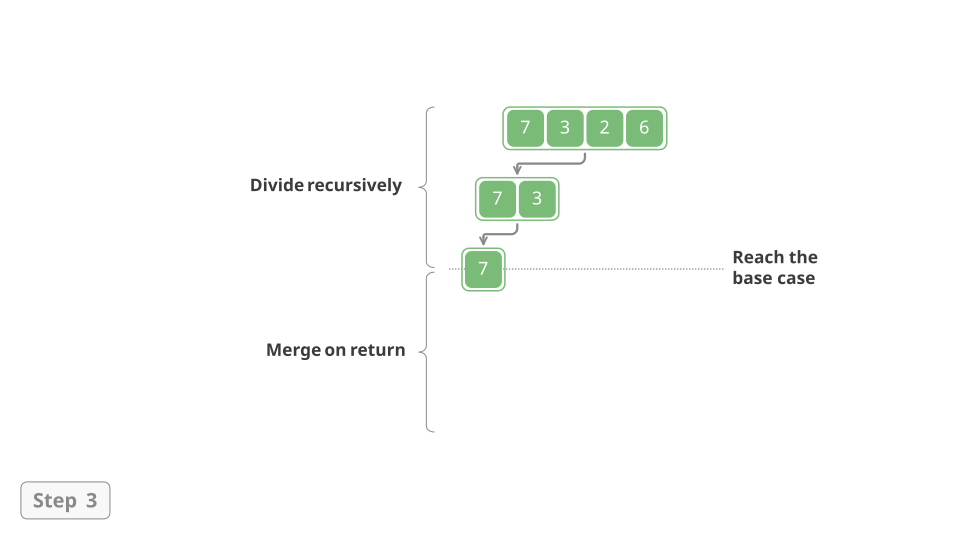
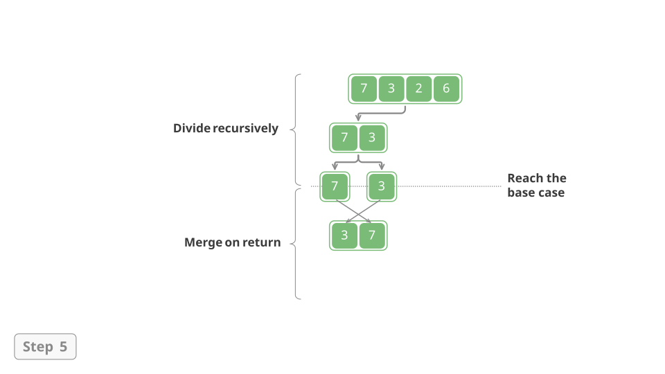
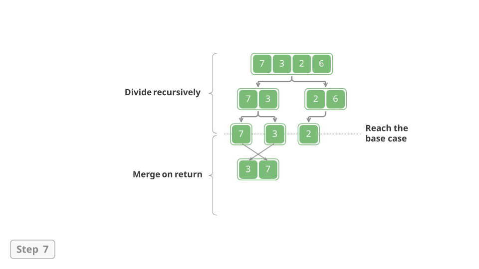
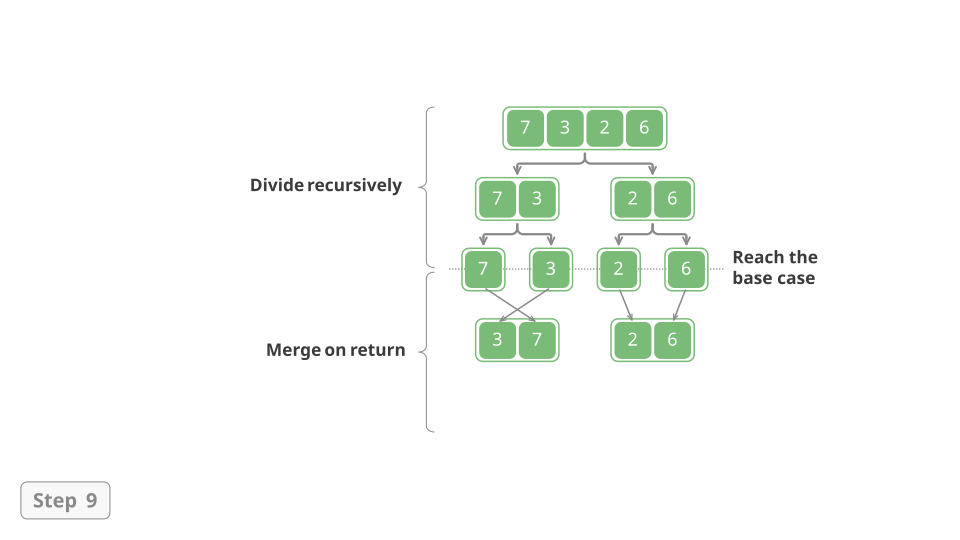
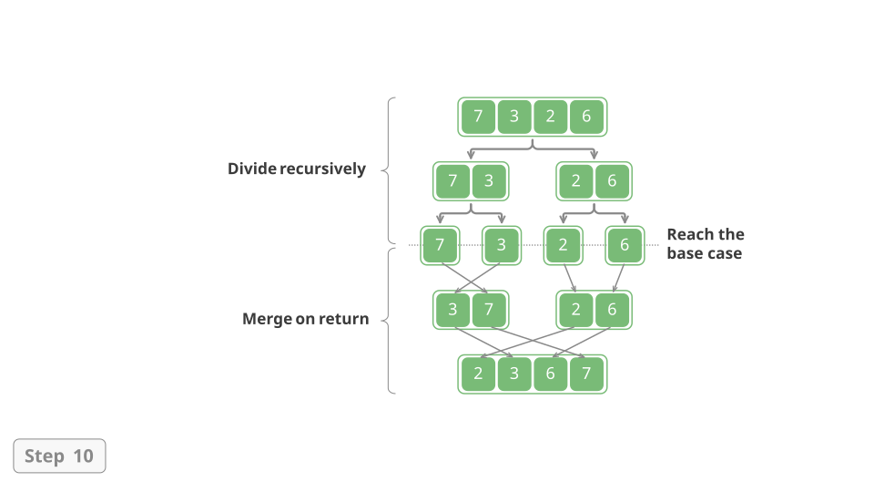

# Merge sort

<u>Merge sort</u> uses divide and conquer. It has two phases, dividing and merging, as shown below.

1. **Divide**. Recursively split the array at its midpoint, reducing the problem of sorting a long array to sorting shorter arrays.
2. **Merge**. When the subarrays have length 1, stop dividing and begin merging. Repeatedly combine two shorter sorted arrays into a longer sorted array until the entire array is sorted.


## How the algorithm works

As shown below, the divide phase works from the top down, recursively splitting each array at its midpoint into two subarrays.

1. Find the midpoint `mid` and recursively divide the left subarray (the closed interval `[left, mid]`) and the right subarray (the closed interval `[mid + 1, right]`).
2. Repeat step `1.` recursively until the subarray has length 1.

The merge phase works from the bottom up, combining the left and right subarrays into one sorted array. The first merges start with subarrays of length 1, so both inputs to every merge are already sorted.

=== "<1>"
    

=== "<2>"
    

=== "<3>"
    

=== "<4>"
    

=== "<5>"
    

=== "<6>"
    

=== "<7>"
    

=== "<8>"
    

=== "<9>"
    

=== "<10>"
    

Merge sort follows the same recursive order as a postorder traversal of a binary tree.

- **Postorder traversal**. Recurse on the left subtree, then the right subtree, and finally process the root.
- **Merge sort**. Recurse on the left subarray, then the right subarray, and finally merge the two.

The code below implements merge sort. Notice that the range being merged in `nums` is `[left, right]`, while the corresponding range in `tmp` is `[0, right - left]`.

```src
[file]{merge_sort}-[class]{}-[func]{merge_sort}
```

## Algorithm properties

- **Time complexity: $O(n \log n)$, nonadaptive**. Dividing the array produces a recursion tree of height $\log n$. Merging takes a total of $n$ operations per level, giving an overall time complexity of $O(n \log n)$.
- **Space complexity: $O(n)$, out-of-place**. The recursion depth is $\log n$, so the stack frames take $O(\log n)$ space. Merging requires an auxiliary array that uses $O(n)$ extra space.
- **Stable**. Merging preserves the relative order of equal elements.

## Sorting a linked list

Merge sort has a particular advantage over other algorithms when sorting a linked list: **it can sort the list in $O(1)$ extra space**.

- **Divide**. We can split the list iteratively, avoiding the stack frames that recursion would require.
- **Merge**. Inserting or removing nodes only requires changing references (pointers). We can therefore merge two short sorted lists into one longer sorted list without allocating another list.

The implementation details are more involved. Interested readers can explore them further.
