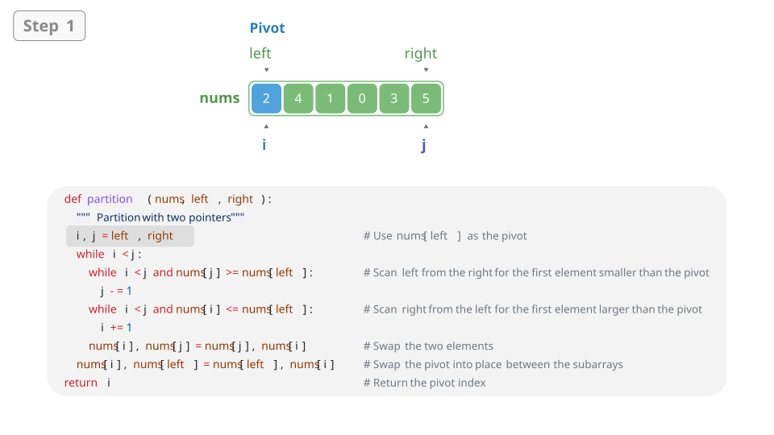
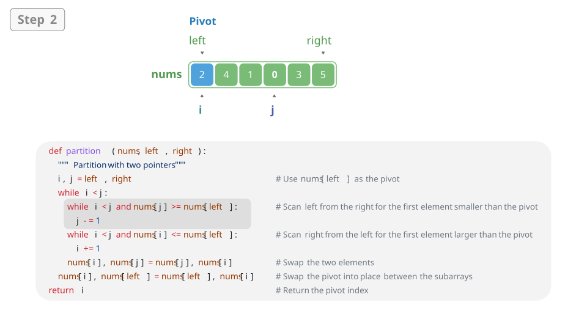
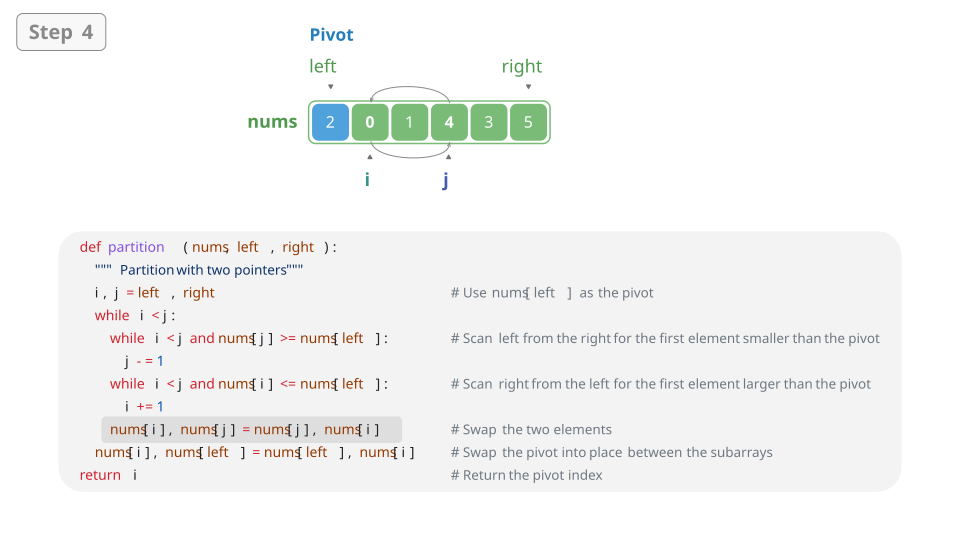
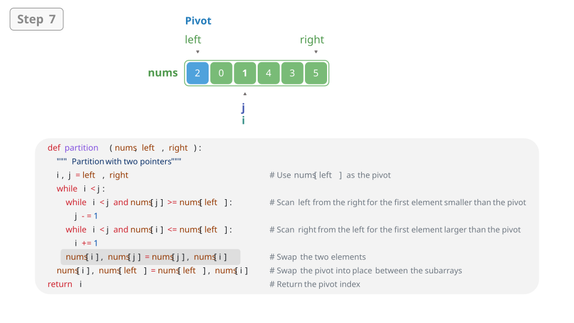

# 11.5 &nbsp; Quicksort

<u>Quicksort</u> is an efficient, widely used divide-and-conquer sorting algorithm.

The core operation in quicksort is two-pointer partitioning. Choose an array element as the pivot, then move all elements smaller than the pivot to its left and all larger elements to its right. Figure 11-8 shows the process.

1. Choose the leftmost element as the pivot. Initialize pointers `i` and `j` at the left and right ends of the array, respectively.
2. In each iteration, use `i` to find the first element greater than the pivot and `j` to find the first element smaller than the pivot. Swap the two elements.
3. Repeat step `2.` until `i` and `j` meet. Finally, swap the pivot into place between the two subarrays.

=== "<1>"
    { class="animation-figure" }

=== "<2>"
    { class="animation-figure" }

=== "<3>"
    { class="animation-figure" }

=== "<4>"
    { class="animation-figure" }

=== "<5>"
    { class="animation-figure" }

=== "<6>"
    { class="animation-figure" }

=== "<7>"
    { class="animation-figure" }

=== "<8>"
    { class="animation-figure" }

=== "<9>"
    { class="animation-figure" }

<p align="center"> Figure 11-8 &nbsp; Two-pointer partitioning steps </p>

Partitioning splits the original array into three parts: a left subarray, the pivot, and a right subarray. Every element on the left $\leq$ the pivot $\leq$ every element on the right. All that remains is to sort the two subarrays.

!!! note "Divide and conquer in quicksort"

    Partitioning turns the problem of sorting one long array into two smaller problems, one for each shorter array.

=== "Python"

    ```python title="quick_sort.py"
    def partition(self, nums: list[int], left: int, right: int) -> int:
        """Partition with two pointers"""
        # Use nums[left] as the pivot
        i, j = left, right
        while i < j:
            while i < j and nums[j] >= nums[left]:
                j -= 1  # Scan from right to left for the first element smaller than the pivot
            while i < j and nums[i] <= nums[left]:
                i += 1  # Scan from left to right for the first element larger than the pivot
            # Swap elements
            nums[i], nums[j] = nums[j], nums[i]
        # Swap the pivot into place between the two subarrays
        nums[i], nums[left] = nums[left], nums[i]
        return i  # Return the pivot index
    ```

=== "C++"

    ```cpp title="quick_sort.cpp"
    /* Partition with two pointers */
    int partition(vector<int> &nums, int left, int right) {
        // Use nums[left] as the pivot
        int i = left, j = right;
        while (i < j) {
            while (i < j && nums[j] >= nums[left])
                j--;                // Scan from right to left for the first element smaller than the pivot
            while (i < j && nums[i] <= nums[left])
                i++;                // Scan from left to right for the first element larger than the pivot
            swap(nums[i], nums[j]); // Swap these two elements
        }
        swap(nums[i], nums[left]);  // Swap the pivot into place between the two subarrays
        return i;                   // Return the pivot index
    }
    ```

=== "Java"

    ```java title="quick_sort.java"
    /* Swap elements */
    void swap(int[] nums, int i, int j) {
        int tmp = nums[i];
        nums[i] = nums[j];
        nums[j] = tmp;
    }

    /* Partition with two pointers */
    int partition(int[] nums, int left, int right) {
        // Use nums[left] as the pivot
        int i = left, j = right;
        while (i < j) {
            while (i < j && nums[j] >= nums[left])
                j--;          // Scan from right to left for the first element smaller than the pivot
            while (i < j && nums[i] <= nums[left])
                i++;          // Scan from left to right for the first element larger than the pivot
            swap(nums, i, j); // Swap these two elements
        }
        swap(nums, i, left);  // Swap the pivot into place between the two subarrays
        return i;             // Return the pivot index
    }
    ```

=== "C#"

    ```csharp title="quick_sort.cs"
    /* Swap elements */
    void Swap(int[] nums, int i, int j) {
        (nums[j], nums[i]) = (nums[i], nums[j]);
    }

    /* Partition with two pointers */
    int Partition(int[] nums, int left, int right) {
        // Use nums[left] as the pivot
        int i = left, j = right;
        while (i < j) {
            while (i < j && nums[j] >= nums[left])
                j--;          // Scan from right to left for the first element smaller than the pivot
            while (i < j && nums[i] <= nums[left])
                i++;          // Scan from left to right for the first element larger than the pivot
            Swap(nums, i, j); // Swap these two elements
        }
        Swap(nums, i, left);  // Swap the pivot into place between the two subarrays
        return i;             // Return the pivot index
    }
    ```

=== "Go"

    ```go title="quick_sort.go"
    /* Partition with two pointers */
    func (q *quickSort) partition(nums []int, left, right int) int {
        // Use nums[left] as the pivot
        i, j := left, right
        for i < j {
            for i < j && nums[j] >= nums[left] {
                j-- // Scan from right to left for the first element smaller than the pivot
            }
            for i < j && nums[i] <= nums[left] {
                i++ // Scan from left to right for the first element larger than the pivot
            }
            // Swap elements
            nums[i], nums[j] = nums[j], nums[i]
        }
        // Swap the pivot into place between the two subarrays
        nums[i], nums[left] = nums[left], nums[i]
        return i // Return the pivot index
    }
    ```

=== "Swift"

    ```swift title="quick_sort.swift"
    /* Partition with two pointers */
    func partition(nums: inout [Int], left: Int, right: Int) -> Int {
        // Use nums[left] as the pivot
        var i = left
        var j = right
        while i < j {
            while i < j, nums[j] >= nums[left] {
                j -= 1 // Scan from right to left for the first element smaller than the pivot
            }
            while i < j, nums[i] <= nums[left] {
                i += 1 // Scan from left to right for the first element larger than the pivot
            }
            nums.swapAt(i, j) // Swap these two elements
        }
        nums.swapAt(i, left) // Swap the pivot into place between the two subarrays
        return i // Return the pivot index
    }
    ```

=== "JS"

    ```javascript title="quick_sort.js"
    /* Swap elements */
    swap(nums, i, j) {
        let tmp = nums[i];
        nums[i] = nums[j];
        nums[j] = tmp;
    }

    /* Partition with two pointers */
    partition(nums, left, right) {
        // Use nums[left] as the pivot
        let i = left,
            j = right;
        while (i < j) {
            while (i < j && nums[j] >= nums[left]) {
                j -= 1; // Scan from right to left for the first element smaller than the pivot
            }
            while (i < j && nums[i] <= nums[left]) {
                i += 1; // Scan from left to right for the first element larger than the pivot
            }
            // Swap elements
            this.swap(nums, i, j); // Swap these two elements
        }
        this.swap(nums, i, left); // Swap the pivot into place between the two subarrays
        return i; // Return the pivot index
    }
    ```

=== "TS"

    ```typescript title="quick_sort.ts"
    /* Swap elements */
    swap(nums: number[], i: number, j: number): void {
        let tmp = nums[i];
        nums[i] = nums[j];
        nums[j] = tmp;
    }

    /* Partition with two pointers */
    partition(nums: number[], left: number, right: number): number {
        // Use nums[left] as the pivot
        let i = left,
            j = right;
        while (i < j) {
            while (i < j && nums[j] >= nums[left]) {
                j -= 1; // Scan from right to left for the first element smaller than the pivot
            }
            while (i < j && nums[i] <= nums[left]) {
                i += 1; // Scan from left to right for the first element larger than the pivot
            }
            // Swap elements
            this.swap(nums, i, j); // Swap these two elements
        }
        this.swap(nums, i, left); // Swap the pivot into place between the two subarrays
        return i; // Return the pivot index
    }
    ```

=== "Dart"

    ```dart title="quick_sort.dart"
    /* Swap elements */
    void _swap(List<int> nums, int i, int j) {
      int tmp = nums[i];
      nums[i] = nums[j];
      nums[j] = tmp;
    }

    /* Partition with two pointers */
    int _partition(List<int> nums, int left, int right) {
      // Use nums[left] as the pivot
      int i = left, j = right;
      while (i < j) {
        while (i < j && nums[j] >= nums[left]) j--; // Scan from right to left for the first element smaller than the pivot
        while (i < j && nums[i] <= nums[left]) i++; // Scan from left to right for the first element larger than the pivot
        _swap(nums, i, j); // Swap these two elements
      }
      _swap(nums, i, left); // Swap the pivot into place between the two subarrays
      return i; // Return the pivot index
    }
    ```

=== "Rust"

    ```rust title="quick_sort.rs"
    /* Partition with two pointers */
    fn partition(nums: &mut [i32], left: usize, right: usize) -> usize {
        // Use nums[left] as the pivot
        let (mut i, mut j) = (left, right);
        while i < j {
            while i < j && nums[j] >= nums[left] {
                j -= 1; // Scan from right to left for the first element smaller than the pivot
            }
            while i < j && nums[i] <= nums[left] {
                i += 1; // Scan from left to right for the first element larger than the pivot
            }
            nums.swap(i, j); // Swap these two elements
        }
        nums.swap(i, left); // Swap the pivot into place between the two subarrays
        i // Return the pivot index
    }
    ```

=== "C"

    ```c title="quick_sort.c"
    /* Swap elements */
    void swap(int nums[], int i, int j) {
        int tmp = nums[i];
        nums[i] = nums[j];
        nums[j] = tmp;
    }

    /* Partition with two pointers */
    int partition(int nums[], int left, int right) {
        // Use nums[left] as the pivot
        int i = left, j = right;
        while (i < j) {
            while (i < j && nums[j] >= nums[left]) {
                j--; // Scan from right to left for the first element smaller than the pivot
            }
            while (i < j && nums[i] <= nums[left]) {
                i++; // Scan from left to right for the first element larger than the pivot
            }
            // Swap these two elements
            swap(nums, i, j);
        }
        // Swap the pivot into place between the two subarrays
        swap(nums, i, left);
        // Return the pivot index
        return i;
    }
    ```

=== "Kotlin"

    ```kotlin title="quick_sort.kt"
    /* Swap elements */
    fun swap(nums: IntArray, i: Int, j: Int) {
        val temp = nums[i]
        nums[i] = nums[j]
        nums[j] = temp
    }

    /* Partition with two pointers */
    fun partition(nums: IntArray, left: Int, right: Int): Int {
        // Use nums[left] as the pivot
        var i = left
        var j = right
        while (i < j) {
            while (i < j && nums[j] >= nums[left])
                j--           // Scan from right to left for the first element smaller than the pivot
            while (i < j && nums[i] <= nums[left])
                i++           // Scan from left to right for the first element larger than the pivot
            swap(nums, i, j)  // Swap these two elements
        }
        swap(nums, i, left)   // Swap the pivot into place between the two subarrays
        return i              // Return the pivot index
    }
    ```

=== "Ruby"

    ```ruby title="quick_sort.rb"
    ### Partition with two pointers ###
    def partition(nums, left, right)
      # Use nums[left] as the pivot
      i, j = left, right
      while i < j
        while i < j && nums[j] >= nums[left]
          j -= 1 # Scan from right to left for the first element smaller than the pivot
        end
        while i < j && nums[i] <= nums[left]
          i += 1 # Scan from left to right for the first element larger than the pivot
        end
        # Swap elements
        nums[i], nums[j] = nums[j], nums[i]
      end
      # Swap the pivot into place between the two subarrays
      nums[i], nums[left] = nums[left], nums[i]
      i # Return the pivot index
    end
    ```

??? pythontutor "Visualize execution"

    <div style="height: 549px; width: 100%;"><iframe class="pythontutor-iframe" title="Visualize execution" src="https://pythontutor.com/iframe-embed.html#code=def%20partition%28nums%3A%20list%5Bint%5D,%20left%3A%20int,%20right%3A%20int%29%20-%3E%20int%3A%0A%20%20%20%20%22%22%22Partition%20with%20two%20pointers%22%22%22%0A%20%20%20%20%23%20Use%20nums%5Bleft%5D%20as%20the%20pivot%0A%20%20%20%20i,%20j%20%3D%20left,%20right%0A%20%20%20%20while%20i%20%3C%20j%3A%0A%20%20%20%20%20%20%20%20while%20i%20%3C%20j%20and%20nums%5Bj%5D%20%3E%3D%20nums%5Bleft%5D%3A%0A%20%20%20%20%20%20%20%20%20%20%20%20j%20-%3D%201%20%20%23%20Scan%20from%20right%20to%20left%20for%20the%20first%20element%20smaller%20than%20the%20pivot%0A%20%20%20%20%20%20%20%20while%20i%20%3C%20j%20and%20nums%5Bi%5D%20%3C%3D%20nums%5Bleft%5D%3A%0A%20%20%20%20%20%20%20%20%20%20%20%20i%20%2B%3D%201%20%20%23%20Scan%20from%20left%20to%20right%20for%20the%20first%20element%20larger%20than%20the%20pivot%0A%20%20%20%20%20%20%20%20%23%20Swap%20elements%0A%20%20%20%20%20%20%20%20nums%5Bi%5D,%20nums%5Bj%5D%20%3D%20nums%5Bj%5D,%20nums%5Bi%5D%0A%20%20%20%20%23%20Swap%20the%20pivot%20into%20place%20between%20the%20two%20subarrays%0A%20%20%20%20nums%5Bi%5D,%20nums%5Bleft%5D%20%3D%20nums%5Bleft%5D,%20nums%5Bi%5D%0A%20%20%20%20return%20i%20%20%23%20Return%20the%20pivot%20index%0A%0A%0A%22%22%22Driver%20Code%22%22%22%0Aif%20__name__%20%3D%3D%20%22__main__%22%3A%0A%20%20%20%20nums%20%3D%20%5B2,%204,%201,%200,%203,%205%5D%0A%20%20%20%20partition%28nums,%200,%20len%28nums%29%20-%201%29%0A%20%20%20%20print%28%22After%20partitioning,%20nums%20%3D%22,%20nums%29&codeDivHeight=472&codeDivWidth=350&cumulative=false&curInstr=4&heapPrimitives=nevernest&origin=opt-frontend.js&py=311&rawInputLstJSON=%5B%5D&textReferences=false"> </iframe></div>
    <div style="margin-top: 5px;"><a href="https://pythontutor.com/iframe-embed.html#code=def%20partition%28nums%3A%20list%5Bint%5D,%20left%3A%20int,%20right%3A%20int%29%20-%3E%20int%3A%0A%20%20%20%20%22%22%22Partition%20with%20two%20pointers%22%22%22%0A%20%20%20%20%23%20Use%20nums%5Bleft%5D%20as%20the%20pivot%0A%20%20%20%20i,%20j%20%3D%20left,%20right%0A%20%20%20%20while%20i%20%3C%20j%3A%0A%20%20%20%20%20%20%20%20while%20i%20%3C%20j%20and%20nums%5Bj%5D%20%3E%3D%20nums%5Bleft%5D%3A%0A%20%20%20%20%20%20%20%20%20%20%20%20j%20-%3D%201%20%20%23%20Scan%20from%20right%20to%20left%20for%20the%20first%20element%20smaller%20than%20the%20pivot%0A%20%20%20%20%20%20%20%20while%20i%20%3C%20j%20and%20nums%5Bi%5D%20%3C%3D%20nums%5Bleft%5D%3A%0A%20%20%20%20%20%20%20%20%20%20%20%20i%20%2B%3D%201%20%20%23%20Scan%20from%20left%20to%20right%20for%20the%20first%20element%20larger%20than%20the%20pivot%0A%20%20%20%20%20%20%20%20%23%20Swap%20elements%0A%20%20%20%20%20%20%20%20nums%5Bi%5D,%20nums%5Bj%5D%20%3D%20nums%5Bj%5D,%20nums%5Bi%5D%0A%20%20%20%20%23%20Swap%20the%20pivot%20into%20place%20between%20the%20two%20subarrays%0A%20%20%20%20nums%5Bi%5D,%20nums%5Bleft%5D%20%3D%20nums%5Bleft%5D,%20nums%5Bi%5D%0A%20%20%20%20return%20i%20%20%23%20Return%20the%20pivot%20index%0A%0A%0A%22%22%22Driver%20Code%22%22%22%0Aif%20__name__%20%3D%3D%20%22__main__%22%3A%0A%20%20%20%20nums%20%3D%20%5B2,%204,%201,%200,%203,%205%5D%0A%20%20%20%20partition%28nums,%200,%20len%28nums%29%20-%201%29%0A%20%20%20%20print%28%22After%20partitioning,%20nums%20%3D%22,%20nums%29&codeDivHeight=800&codeDivWidth=600&cumulative=false&curInstr=4&heapPrimitives=nevernest&origin=opt-frontend.js&py=311&rawInputLstJSON=%5B%5D&textReferences=false" target="_blank" rel="noopener noreferrer">View full screen ></a></div>

## 11.5.1 &nbsp; How the algorithm works

Figure 11-9 shows the full quicksort procedure.

1. First, partition the original array to obtain an unsorted left subarray and an unsorted right subarray.
2. Then recursively partition the left and right subarrays.
3. Continue recursively, stopping when a subarray has length 1. This sorts the entire array.

{ class="animation-figure" }

<p align="center"> Figure 11-9 &nbsp; Quicksort procedure </p>

=== "Python"

    ```python title="quick_sort.py"
    def quick_sort(self, nums: list[int], left: int, right: int):
        """Quicksort"""
        # Stop recursing when the subarray has length 1
        if left >= right:
            return
        # Partition with two pointers
        pivot = self.partition(nums, left, right)
        # Recurse on the left and right subarrays
        self.quick_sort(nums, left, pivot - 1)
        self.quick_sort(nums, pivot + 1, right)
    ```

=== "C++"

    ```cpp title="quick_sort.cpp"
    /* Quicksort */
    void quickSort(vector<int> &nums, int left, int right) {
        // Stop recursing when the subarray has length 1
        if (left >= right)
            return;
        // Partition with two pointers
        int pivot = partition(nums, left, right);
        // Recurse on the left and right subarrays
        quickSort(nums, left, pivot - 1);
        quickSort(nums, pivot + 1, right);
    }
    ```

=== "Java"

    ```java title="quick_sort.java"
    /* Quicksort */
    void quickSort(int[] nums, int left, int right) {
        // Stop recursing when the subarray has length 1
        if (left >= right)
            return;
        // Partition with two pointers
        int pivot = partition(nums, left, right);
        // Recurse on the left and right subarrays
        quickSort(nums, left, pivot - 1);
        quickSort(nums, pivot + 1, right);
    }
    ```

=== "C#"

    ```csharp title="quick_sort.cs"
    /* Quicksort */
    void QuickSort(int[] nums, int left, int right) {
        // Stop recursing when the subarray has length 1
        if (left >= right)
            return;
        // Partition with two pointers
        int pivot = Partition(nums, left, right);
        // Recurse on the left and right subarrays
        QuickSort(nums, left, pivot - 1);
        QuickSort(nums, pivot + 1, right);
    }
    ```

=== "Go"

    ```go title="quick_sort.go"
    /* Quicksort */
    func (q *quickSort) quickSort(nums []int, left, right int) {
        // Stop recursing when the subarray has length 1
        if left >= right {
            return
        }
        // Partition with two pointers
        pivot := q.partition(nums, left, right)
        // Recurse on the left and right subarrays
        q.quickSort(nums, left, pivot-1)
        q.quickSort(nums, pivot+1, right)
    }
    ```

=== "Swift"

    ```swift title="quick_sort.swift"
    /* Quicksort */
    func quickSort(nums: inout [Int], left: Int, right: Int) {
        // Stop recursing when the subarray has length 1
        if left >= right {
            return
        }
        // Partition with two pointers
        let pivot = partition(nums: &nums, left: left, right: right)
        // Recurse on the left and right subarrays
        quickSort(nums: &nums, left: left, right: pivot - 1)
        quickSort(nums: &nums, left: pivot + 1, right: right)
    }
    ```

=== "JS"

    ```javascript title="quick_sort.js"
    /* Quicksort */
    quickSort(nums, left, right) {
        // Stop recursing when the subarray has length 1
        if (left >= right) return;
        // Partition with two pointers
        const pivot = this.partition(nums, left, right);
        // Recurse on the left and right subarrays
        this.quickSort(nums, left, pivot - 1);
        this.quickSort(nums, pivot + 1, right);
    }
    ```

=== "TS"

    ```typescript title="quick_sort.ts"
    /* Quicksort */
    quickSort(nums: number[], left: number, right: number): void {
        // Stop recursing when the subarray has length 1
        if (left >= right) {
            return;
        }
        // Partition with two pointers
        const pivot = this.partition(nums, left, right);
        // Recurse on the left and right subarrays
        this.quickSort(nums, left, pivot - 1);
        this.quickSort(nums, pivot + 1, right);
    }
    ```

=== "Dart"

    ```dart title="quick_sort.dart"
    /* Quicksort */
    void quickSort(List<int> nums, int left, int right) {
      // Stop recursing when the subarray has length 1
      if (left >= right) return;
      // Partition with two pointers
      int pivot = _partition(nums, left, right);
      // Recurse on the left and right subarrays
      quickSort(nums, left, pivot - 1);
      quickSort(nums, pivot + 1, right);
    }
    ```

=== "Rust"

    ```rust title="quick_sort.rs"
    /* Quicksort */
    pub fn quick_sort(left: i32, right: i32, nums: &mut [i32]) {
        // Stop recursing when the subarray has length 1
        if left >= right {
            return;
        }
        // Partition with two pointers
        let pivot = Self::partition(nums, left as usize, right as usize) as i32;
        // Recurse on the left and right subarrays
        Self::quick_sort(left, pivot - 1, nums);
        Self::quick_sort(pivot + 1, right, nums);
    }
    ```

=== "C"

    ```c title="quick_sort.c"
    /* Quicksort */
    void quickSort(int nums[], int left, int right) {
        // Stop recursing when the subarray has length 1
        if (left >= right) {
            return;
        }
        // Partition with two pointers
        int pivot = partition(nums, left, right);
        // Recurse on the left and right subarrays
        quickSort(nums, left, pivot - 1);
        quickSort(nums, pivot + 1, right);
    }
    ```

=== "Kotlin"

    ```kotlin title="quick_sort.kt"
    /* Quicksort */
    fun quickSort(nums: IntArray, left: Int, right: Int) {
        // Stop recursing when the subarray has length 1
        if (left >= right) return
        // Partition with two pointers
        val pivot = partition(nums, left, right)
        // Recurse on the left and right subarrays
        quickSort(nums, left, pivot - 1)
        quickSort(nums, pivot + 1, right)
    }
    ```

=== "Ruby"

    ```ruby title="quick_sort.rb"
    ### Quicksort class ###
    def quick_sort(nums, left, right)
      # Recurse when the subarray length differs from 1
      if left < right
        # Partition with two pointers
        pivot = partition(nums, left, right)
        # Recurse on the left and right subarrays
        quick_sort(nums, left, pivot - 1)
        quick_sort(nums, pivot + 1, right)
      end
      nums
    end
    ```

??? pythontutor "Visualize execution"

    <div style="height: 549px; width: 100%;"><iframe class="pythontutor-iframe" title="Visualize execution" src="https://pythontutor.com/iframe-embed.html#code=def%20partition%28nums%3A%20list%5Bint%5D,%20left%3A%20int,%20right%3A%20int%29%20-%3E%20int%3A%0A%20%20%20%20%22%22%22Partition%20with%20two%20pointers%22%22%22%0A%20%20%20%20%23%20Use%20nums%5Bleft%5D%20as%20the%20pivot%0A%20%20%20%20i,%20j%20%3D%20left,%20right%0A%20%20%20%20while%20i%20%3C%20j%3A%0A%20%20%20%20%20%20%20%20while%20i%20%3C%20j%20and%20nums%5Bj%5D%20%3E%3D%20nums%5Bleft%5D%3A%0A%20%20%20%20%20%20%20%20%20%20%20%20j%20-%3D%201%20%20%23%20Scan%20from%20right%20to%20left%20for%20the%20first%20element%20smaller%20than%20the%20pivot%0A%20%20%20%20%20%20%20%20while%20i%20%3C%20j%20and%20nums%5Bi%5D%20%3C%3D%20nums%5Bleft%5D%3A%0A%20%20%20%20%20%20%20%20%20%20%20%20i%20%2B%3D%201%20%20%23%20Scan%20from%20left%20to%20right%20for%20the%20first%20element%20larger%20than%20the%20pivot%0A%20%20%20%20%20%20%20%20%23%20Swap%20elements%0A%20%20%20%20%20%20%20%20nums%5Bi%5D,%20nums%5Bj%5D%20%3D%20nums%5Bj%5D,%20nums%5Bi%5D%0A%20%20%20%20%23%20Swap%20the%20pivot%20into%20place%20between%20the%20two%20subarrays%0A%20%20%20%20nums%5Bi%5D,%20nums%5Bleft%5D%20%3D%20nums%5Bleft%5D,%20nums%5Bi%5D%0A%20%20%20%20return%20i%20%20%23%20Return%20the%20pivot%20index%0A%0Adef%20quick_sort%28nums%3A%20list%5Bint%5D,%20left%3A%20int,%20right%3A%20int%29%3A%0A%20%20%20%20%22%22%22Quicksort%22%22%22%0A%20%20%20%20%23%20Stop%20recursing%20when%20the%20subarray%20has%20length%201%0A%20%20%20%20if%20left%20%3E%3D%20right%3A%0A%20%20%20%20%20%20%20%20return%0A%20%20%20%20%23%20Partition%20with%20two%20pointers%0A%20%20%20%20pivot%20%3D%20partition%28nums,%20left,%20right%29%0A%20%20%20%20%23%20Recurse%20on%20the%20left%20and%20right%20subarrays%0A%20%20%20%20quick_sort%28nums,%20left,%20pivot%20-%201%29%0A%20%20%20%20quick_sort%28nums,%20pivot%20%2B%201,%20right%29%0A%0A%0A%22%22%22Driver%20Code%22%22%22%0Aif%20__name__%20%3D%3D%20%22__main__%22%3A%0A%20%20%20%20%23%20Quicksort%0A%20%20%20%20nums%20%3D%20%5B2,%204,%201,%200,%203,%205%5D%0A%20%20%20%20quick_sort%28nums,%200,%20len%28nums%29%20-%201%29%0A%20%20%20%20print%28%22After%20quicksort,%20nums%20%3D%22,%20nums%29&codeDivHeight=472&codeDivWidth=350&cumulative=false&curInstr=5&heapPrimitives=nevernest&origin=opt-frontend.js&py=311&rawInputLstJSON=%5B%5D&textReferences=false"> </iframe></div>
    <div style="margin-top: 5px;"><a href="https://pythontutor.com/iframe-embed.html#code=def%20partition%28nums%3A%20list%5Bint%5D,%20left%3A%20int,%20right%3A%20int%29%20-%3E%20int%3A%0A%20%20%20%20%22%22%22Partition%20with%20two%20pointers%22%22%22%0A%20%20%20%20%23%20Use%20nums%5Bleft%5D%20as%20the%20pivot%0A%20%20%20%20i,%20j%20%3D%20left,%20right%0A%20%20%20%20while%20i%20%3C%20j%3A%0A%20%20%20%20%20%20%20%20while%20i%20%3C%20j%20and%20nums%5Bj%5D%20%3E%3D%20nums%5Bleft%5D%3A%0A%20%20%20%20%20%20%20%20%20%20%20%20j%20-%3D%201%20%20%23%20Scan%20from%20right%20to%20left%20for%20the%20first%20element%20smaller%20than%20the%20pivot%0A%20%20%20%20%20%20%20%20while%20i%20%3C%20j%20and%20nums%5Bi%5D%20%3C%3D%20nums%5Bleft%5D%3A%0A%20%20%20%20%20%20%20%20%20%20%20%20i%20%2B%3D%201%20%20%23%20Scan%20from%20left%20to%20right%20for%20the%20first%20element%20larger%20than%20the%20pivot%0A%20%20%20%20%20%20%20%20%23%20Swap%20elements%0A%20%20%20%20%20%20%20%20nums%5Bi%5D,%20nums%5Bj%5D%20%3D%20nums%5Bj%5D,%20nums%5Bi%5D%0A%20%20%20%20%23%20Swap%20the%20pivot%20into%20place%20between%20the%20two%20subarrays%0A%20%20%20%20nums%5Bi%5D,%20nums%5Bleft%5D%20%3D%20nums%5Bleft%5D,%20nums%5Bi%5D%0A%20%20%20%20return%20i%20%20%23%20Return%20the%20pivot%20index%0A%0Adef%20quick_sort%28nums%3A%20list%5Bint%5D,%20left%3A%20int,%20right%3A%20int%29%3A%0A%20%20%20%20%22%22%22Quicksort%22%22%22%0A%20%20%20%20%23%20Stop%20recursing%20when%20the%20subarray%20has%20length%201%0A%20%20%20%20if%20left%20%3E%3D%20right%3A%0A%20%20%20%20%20%20%20%20return%0A%20%20%20%20%23%20Partition%20with%20two%20pointers%0A%20%20%20%20pivot%20%3D%20partition%28nums,%20left,%20right%29%0A%20%20%20%20%23%20Recurse%20on%20the%20left%20and%20right%20subarrays%0A%20%20%20%20quick_sort%28nums,%20left,%20pivot%20-%201%29%0A%20%20%20%20quick_sort%28nums,%20pivot%20%2B%201,%20right%29%0A%0A%0A%22%22%22Driver%20Code%22%22%22%0Aif%20__name__%20%3D%3D%20%22__main__%22%3A%0A%20%20%20%20%23%20Quicksort%0A%20%20%20%20nums%20%3D%20%5B2,%204,%201,%200,%203,%205%5D%0A%20%20%20%20quick_sort%28nums,%200,%20len%28nums%29%20-%201%29%0A%20%20%20%20print%28%22After%20quicksort,%20nums%20%3D%22,%20nums%29&codeDivHeight=800&codeDivWidth=600&cumulative=false&curInstr=5&heapPrimitives=nevernest&origin=opt-frontend.js&py=311&rawInputLstJSON=%5B%5D&textReferences=false" target="_blank" rel="noopener noreferrer">View full screen ></a></div>

## 11.5.2 &nbsp; Algorithm properties

- **Time complexity: $O(n \log n)$, nonadaptive**. On average, partitioning takes $\log n$ levels of recursion, with a total of $n$ loop iterations per level, for an overall time of $O(n \log n)$. In the worst case, every partition splits an array of length $n$ into subarrays of lengths $0$ and $n - 1$. The recursion reaches $n$ levels with up to $n$ iterations per level, taking $O(n^2)$ time overall.
- **Space complexity: $O(n)$, in-place**. A fully reverse-sorted input gives the worst-case recursion depth of $n$, requiring $O(n)$ space for stack frames. The sort operates on the original array without an auxiliary array.
- **Unstable**. The last swap in partitioning may move the pivot to the right of an equal element.

## 11.5.3 &nbsp; What makes quicksort fast?

As its name suggests, quicksort has some advantages in practice. It has the same average time complexity as merge sort and heap sort, but it usually runs faster for the following reasons.

- **The worst case is unlikely**. Quicksort's worst-case time complexity is $O(n^2)$, making its performance less predictable than merge sort's. In the vast majority of cases, however, quicksort runs in $O(n \log n)$ time.
- **Good cache utilization**. During partitioning, the system can load an entire subarray into the cache, making its elements efficient to access. Heap sort, in contrast, jumps between positions and lacks this advantage.
- **A small constant factor**. Of the three algorithms, quicksort performs the fewest comparisons, assignments, and swaps in total. This is similar to the reason insertion sort is faster than bubble sort.

## 11.5.4 &nbsp; Improving pivot selection

**Quicksort can slow down on certain inputs**. For an extreme example, consider an array in descending order. If we choose the leftmost element as the pivot, partitioning swaps it to the far right, leaving a left subarray of length $n - 1$ and a right subarray of length $0$. As the recursion continues, every partition leaves one subarray of length $0$. The divide-and-conquer strategy breaks down, and quicksort starts to resemble bubble sort.

To reduce the likelihood of this case, **we can change how we choose the pivot for partitioning**. For example, we can choose it at random. With bad luck, though, we might still choose a poor pivot every time and get disappointing performance.

Programming languages typically generate pseudorandom numbers. A test case constructed for a particular pseudorandom sequence can still cause quicksort's performance to deteriorate.

A further improvement is to select three candidates, usually the first, last, and middle elements, and **use their median as the pivot**. This makes it much more likely that the pivot is neither too small nor too large. We can use more candidates to make the algorithm even more robust. This approach greatly reduces the chance that the time complexity will deteriorate to $O(n^2)$.

Here is an implementation:

=== "Python"

    ```python title="quick_sort.py"
    def median_three(self, nums: list[int], left: int, mid: int, right: int) -> int:
        """Select the median of three candidates"""
        l, m, r = nums[left], nums[mid], nums[right]
        if (l <= m <= r) or (r <= m <= l):
            return mid  # m lies between l and r
        if (m <= l <= r) or (r <= l <= m):
            return left  # l lies between m and r
        return right

    def partition(self, nums: list[int], left: int, right: int) -> int:
        """Partition with two pointers (median of three)"""
        # Use nums[left] as the pivot
        med = self.median_three(nums, left, (left + right) // 2, right)
        # Swap the median into the leftmost position
        nums[left], nums[med] = nums[med], nums[left]
        # Use nums[left] as the pivot
        i, j = left, right
        while i < j:
            while i < j and nums[j] >= nums[left]:
                j -= 1  # Scan from right to left for the first element smaller than the pivot
            while i < j and nums[i] <= nums[left]:
                i += 1  # Scan from left to right for the first element larger than the pivot
            # Swap elements
            nums[i], nums[j] = nums[j], nums[i]
        # Swap the pivot into place between the two subarrays
        nums[i], nums[left] = nums[left], nums[i]
        return i  # Return the pivot index
    ```

=== "C++"

    ```cpp title="quick_sort.cpp"
    /* Select the median of three candidates */
    int medianThree(vector<int> &nums, int left, int mid, int right) {
        int l = nums[left], m = nums[mid], r = nums[right];
        if ((l <= m && m <= r) || (r <= m && m <= l))
            return mid; // m lies between l and r
        if ((m <= l && l <= r) || (r <= l && l <= m))
            return left; // l lies between m and r
        return right;
    }

    /* Partition with two pointers (median of three) */
    int partition(vector<int> &nums, int left, int right) {
        // Select the median of three candidates
        int med = medianThree(nums, left, (left + right) / 2, right);
        // Swap the median into the leftmost position
        swap(nums[left], nums[med]);
        // Use nums[left] as the pivot
        int i = left, j = right;
        while (i < j) {
            while (i < j && nums[j] >= nums[left])
                j--;                // Scan from right to left for the first element smaller than the pivot
            while (i < j && nums[i] <= nums[left])
                i++;                // Scan from left to right for the first element larger than the pivot
            swap(nums[i], nums[j]); // Swap these two elements
        }
        swap(nums[i], nums[left]);  // Swap the pivot into place between the two subarrays
        return i;                   // Return the pivot index
    }
    ```

=== "Java"

    ```java title="quick_sort.java"
    /* Select the median of three candidates */
    int medianThree(int[] nums, int left, int mid, int right) {
        int l = nums[left], m = nums[mid], r = nums[right];
        if ((l <= m && m <= r) || (r <= m && m <= l))
            return mid; // m lies between l and r
        if ((m <= l && l <= r) || (r <= l && l <= m))
            return left; // l lies between m and r
        return right;
    }

    /* Partition with two pointers (median of three) */
    int partition(int[] nums, int left, int right) {
        // Select the median of three candidates
        int med = medianThree(nums, left, (left + right) / 2, right);
        // Swap the median into the leftmost position
        swap(nums, left, med);
        // Use nums[left] as the pivot
        int i = left, j = right;
        while (i < j) {
            while (i < j && nums[j] >= nums[left])
                j--;          // Scan from right to left for the first element smaller than the pivot
            while (i < j && nums[i] <= nums[left])
                i++;          // Scan from left to right for the first element larger than the pivot
            swap(nums, i, j); // Swap these two elements
        }
        swap(nums, i, left);  // Swap the pivot into place between the two subarrays
        return i;             // Return the pivot index
    }
    ```

=== "C#"

    ```csharp title="quick_sort.cs"
    /* Select the median of three candidates */
    int MedianThree(int[] nums, int left, int mid, int right) {
        int l = nums[left], m = nums[mid], r = nums[right];
        if ((l <= m && m <= r) || (r <= m && m <= l))
            return mid; // m lies between l and r
        if ((m <= l && l <= r) || (r <= l && l <= m))
            return left; // l lies between m and r
        return right;
    }

    /* Partition with two pointers (median of three) */
    int Partition(int[] nums, int left, int right) {
        // Select the median of three candidates
        int med = MedianThree(nums, left, (left + right) / 2, right);
        // Swap the median into the leftmost position
        Swap(nums, left, med);
        // Use nums[left] as the pivot
        int i = left, j = right;
        while (i < j) {
            while (i < j && nums[j] >= nums[left])
                j--;          // Scan from right to left for the first element smaller than the pivot
            while (i < j && nums[i] <= nums[left])
                i++;          // Scan from left to right for the first element larger than the pivot
            Swap(nums, i, j); // Swap these two elements
        }
        Swap(nums, i, left);  // Swap the pivot into place between the two subarrays
        return i;             // Return the pivot index
    }
    ```

=== "Go"

    ```go title="quick_sort.go"
    /* Select the median of three candidates */
    func (q *quickSortMedian) medianThree(nums []int, left, mid, right int) int {
        l, m, r := nums[left], nums[mid], nums[right]
        if (l <= m && m <= r) || (r <= m && m <= l) {
            return mid // m lies between l and r
        }
        if (m <= l && l <= r) || (r <= l && l <= m) {
            return left // l lies between m and r
        }
        return right
    }

    /* Partition with two pointers (median of three)*/
    func (q *quickSortMedian) partition(nums []int, left, right int) int {
        // Use nums[left] as the pivot
        med := q.medianThree(nums, left, (left+right)/2, right)
        // Swap the median into the leftmost position
        nums[left], nums[med] = nums[med], nums[left]
        // Use nums[left] as the pivot
        i, j := left, right
        for i < j {
            for i < j && nums[j] >= nums[left] {
                j-- //Scan from right to left for the first element smaller than the pivot
            }
            for i < j && nums[i] <= nums[left] {
                i++ //Scan from left to right for the first element larger than the pivot
            }
            //Swap elements
            nums[i], nums[j] = nums[j], nums[i]
        }
        //Swap the pivot into place between the two subarrays
        nums[i], nums[left] = nums[left], nums[i]
        return i //Return the pivot index
    }
    ```

=== "Swift"

    ```swift title="quick_sort.swift"
    /* Select the median of three candidates */
    func medianThree(nums: [Int], left: Int, mid: Int, right: Int) -> Int {
        let l = nums[left]
        let m = nums[mid]
        let r = nums[right]
        if (l <= m && m <= r) || (r <= m && m <= l) {
            return mid // m lies between l and r
        }
        if (m <= l && l <= r) || (r <= l && l <= m) {
            return left // l lies between m and r
        }
        return right
    }

    /* Partition with two pointers (median of three) */
    func partitionMedian(nums: inout [Int], left: Int, right: Int) -> Int {
        // Select the median of three candidates
        let med = medianThree(nums: nums, left: left, mid: left + (right - left) / 2, right: right)
        // Swap the median into the leftmost position
        nums.swapAt(left, med)
        return partition(nums: &nums, left: left, right: right)
    }
    ```

=== "JS"

    ```javascript title="quick_sort.js"
    /* Select the median of three candidates */
    medianThree(nums, left, mid, right) {
        let l = nums[left],
            m = nums[mid],
            r = nums[right];
        // m lies between l and r
        if ((l <= m && m <= r) || (r <= m && m <= l)) return mid;
        // l lies between m and r
        if ((m <= l && l <= r) || (r <= l && l <= m)) return left;
        return right;
    }

    /* Partition with two pointers (median of three) */
    partition(nums, left, right) {
        // Select the median of three candidates
        let med = this.medianThree(
            nums,
            left,
            Math.floor((left + right) / 2),
            right
        );
        // Swap the median into the leftmost position
        this.swap(nums, left, med);
        // Use nums[left] as the pivot
        let i = left,
            j = right;
        while (i < j) {
            while (i < j && nums[j] >= nums[left]) j--; // Scan from right to left for the first element smaller than the pivot
            while (i < j && nums[i] <= nums[left]) i++; // Scan from left to right for the first element larger than the pivot
            this.swap(nums, i, j); // Swap these two elements
        }
        this.swap(nums, i, left); // Swap the pivot into place between the two subarrays
        return i; // Return the pivot index
    }
    ```

=== "TS"

    ```typescript title="quick_sort.ts"
    /* Select the median of three candidates */
    medianThree(
        nums: number[],
        left: number,
        mid: number,
        right: number
    ): number {
        let l = nums[left],
            m = nums[mid],
            r = nums[right];
        // m lies between l and r
        if ((l <= m && m <= r) || (r <= m && m <= l)) return mid;
        // l lies between m and r
        if ((m <= l && l <= r) || (r <= l && l <= m)) return left;
        return right;
    }

    /* Partition with two pointers (median of three) */
    partition(nums: number[], left: number, right: number): number {
        // Select the median of three candidates
        let med = this.medianThree(
            nums,
            left,
            Math.floor((left + right) / 2),
            right
        );
        // Swap the median into the leftmost position
        this.swap(nums, left, med);
        // Use nums[left] as the pivot
        let i = left,
            j = right;
        while (i < j) {
            while (i < j && nums[j] >= nums[left]) {
                j--; // Scan from right to left for the first element smaller than the pivot
            }
            while (i < j && nums[i] <= nums[left]) {
                i++; // Scan from left to right for the first element larger than the pivot
            }
            this.swap(nums, i, j); // Swap these two elements
        }
        this.swap(nums, i, left); // Swap the pivot into place between the two subarrays
        return i; // Return the pivot index
    }
    ```

=== "Dart"

    ```dart title="quick_sort.dart"
    /* Select the median of three candidates */
    int _medianThree(List<int> nums, int left, int mid, int right) {
      int l = nums[left], m = nums[mid], r = nums[right];
      if ((l <= m && m <= r) || (r <= m && m <= l))
        return mid; // m lies between l and r
      if ((m <= l && l <= r) || (r <= l && l <= m))
        return left; // l lies between m and r
      return right;
    }

    /* Partition with two pointers (median of three) */
    int _partition(List<int> nums, int left, int right) {
      // Select the median of three candidates
      int med = _medianThree(nums, left, (left + right) ~/ 2, right);
      // Swap the median into the leftmost position
      _swap(nums, left, med);
      // Use nums[left] as the pivot
      int i = left, j = right;
      while (i < j) {
        while (i < j && nums[j] >= nums[left]) j--; // Scan from right to left for the first element smaller than the pivot
        while (i < j && nums[i] <= nums[left]) i++; // Scan from left to right for the first element larger than the pivot
        _swap(nums, i, j); // Swap these two elements
      }
      _swap(nums, i, left); // Swap the pivot into place between the two subarrays
      return i; // Return the pivot index
    }
    ```

=== "Rust"

    ```rust title="quick_sort.rs"
    /* Select the median of three candidates */
    fn median_three(nums: &mut [i32], left: usize, mid: usize, right: usize) -> usize {
        let (l, m, r) = (nums[left], nums[mid], nums[right]);
        if (l <= m && m <= r) || (r <= m && m <= l) {
            return mid; // m lies between l and r
        }
        if (m <= l && l <= r) || (r <= l && l <= m) {
            return left; // l lies between m and r
        }
        right
    }

    /* Partition with two pointers (median of three) */
    fn partition(nums: &mut [i32], left: usize, right: usize) -> usize {
        // Select the median of three candidates
        let med = Self::median_three(nums, left, (left + right) / 2, right);
        // Swap the median into the leftmost position
        nums.swap(left, med);
        // Use nums[left] as the pivot
        let (mut i, mut j) = (left, right);
        while i < j {
            while i < j && nums[j] >= nums[left] {
                j -= 1; // Scan from right to left for the first element smaller than the pivot
            }
            while i < j && nums[i] <= nums[left] {
                i += 1; // Scan from left to right for the first element larger than the pivot
            }
            nums.swap(i, j); // Swap these two elements
        }
        nums.swap(i, left); // Swap the pivot into place between the two subarrays
        i // Return the pivot index
    }
    ```

=== "C"

    ```c title="quick_sort.c"
    /* Select the median of three candidates */
    int medianThree(int nums[], int left, int mid, int right) {
        int l = nums[left], m = nums[mid], r = nums[right];
        if ((l <= m && m <= r) || (r <= m && m <= l))
            return mid; // m lies between l and r
        if ((m <= l && l <= r) || (r <= l && l <= m))
            return left; // l lies between m and r
        return right;
    }

    /* Partition with two pointers (median of three) */
    int partitionMedian(int nums[], int left, int right) {
        // Select the median of three candidates
        int med = medianThree(nums, left, (left + right) / 2, right);
        // Swap the median into the leftmost position
        swap(nums, left, med);
        // Use nums[left] as the pivot
        int i = left, j = right;
        while (i < j) {
            while (i < j && nums[j] >= nums[left])
                j--; // Scan from right to left for the first element smaller than the pivot
            while (i < j && nums[i] <= nums[left])
                i++;          // Scan from left to right for the first element larger than the pivot
            swap(nums, i, j); // Swap these two elements
        }
        swap(nums, i, left); // Swap the pivot into place between the two subarrays
        return i;            // Return the pivot index
    }
    ```

=== "Kotlin"

    ```kotlin title="quick_sort.kt"
    /* Select the median of three candidates */
    fun medianThree(nums: IntArray, left: Int, mid: Int, right: Int): Int {
        val l = nums[left]
        val m = nums[mid]
        val r = nums[right]
        if ((m in l..r) || (m in r..l))
            return mid  // m lies between l and r
        if ((l in m..r) || (l in r..m))
            return left // l lies between m and r
        return right
    }

    /* Partition with two pointers (median of three) */
    fun partitionMedian(nums: IntArray, left: Int, right: Int): Int {
        // Select the median of three candidates
        val med = medianThree(nums, left, (left + right) / 2, right)
        // Swap the median into the leftmost position
        swap(nums, left, med)
        // Use nums[left] as the pivot
        var i = left
        var j = right
        while (i < j) {
            while (i < j && nums[j] >= nums[left])
                j--                      // Scan from right to left for the first element smaller than the pivot
            while (i < j && nums[i] <= nums[left])
                i++                      // Scan from left to right for the first element larger than the pivot
            swap(nums, i, j)             // Swap these two elements
        }
        swap(nums, i, left)              // Swap the pivot into place between the two subarrays
        return i                         // Return the pivot index
    }
    ```

=== "Ruby"

    ```ruby title="quick_sort.rb"
    ### Select the median of three candidates ###
    def median_three(nums, left, mid, right)
      # Select the median of three candidates
      _l, _m, _r = nums[left], nums[mid], nums[right]
      # m lies between l and r
      return mid if (_l <= _m && _m <= _r) || (_r <= _m && _m <= _l)
      # l lies between m and r
      return left if (_m <= _l && _l <= _r) || (_r <= _l && _l <= _m)
      return right
    end

    ### Partition with two pointers (median of three)###
    def partition(nums, left, right)
      ### Use nums[left] as the pivot
      med = median_three(nums, left, (left + right) / 2, right)
      # Swap the median into the leftmost position
      nums[left], nums[med] = nums[med], nums[left]
      i, j = left, right
      while i < j
        while i < j && nums[j] >= nums[left]
          j -= 1 # Scan from right to left for the first element smaller than the pivot
        end
        while i < j && nums[i] <= nums[left]
          i += 1 # Scan from left to right for the first element larger than the pivot
        end
        # Swap elements
        nums[i], nums[j] = nums[j], nums[i]
      end
      # Swap the pivot into place between the two subarrays
      nums[i], nums[left] = nums[left], nums[i]
      i # Return the pivot index
    end
    ```

??? pythontutor "Visualize execution"

    <div style="height: 549px; width: 100%;"><iframe class="pythontutor-iframe" title="Visualize execution" src="https://pythontutor.com/iframe-embed.html#code=def%20median_three%28nums%3A%20list%5Bint%5D,%20left%3A%20int,%20mid%3A%20int,%20right%3A%20int%29%20-%3E%20int%3A%0A%20%20%20%20%22%22%22Select%20the%20median%20of%20three%20candidates%22%22%22%0A%20%20%20%20l,%20m,%20r%20%3D%20nums%5Bleft%5D,%20nums%5Bmid%5D,%20nums%5Bright%5D%0A%20%20%20%20if%20%28l%20%3C%3D%20m%20%3C%3D%20r%29%20or%20%28r%20%3C%3D%20m%20%3C%3D%20l%29%3A%0A%20%20%20%20%20%20%20%20return%20mid%20%20%23%20m%20lies%20between%20l%20and%20r%0A%20%20%20%20if%20%28m%20%3C%3D%20l%20%3C%3D%20r%29%20or%20%28r%20%3C%3D%20l%20%3C%3D%20m%29%3A%0A%20%20%20%20%20%20%20%20return%20left%20%20%23%20l%20lies%20between%20m%20and%20r%0A%20%20%20%20return%20right%0A%0Adef%20partition%28nums%3A%20list%5Bint%5D,%20left%3A%20int,%20right%3A%20int%29%20-%3E%20int%3A%0A%20%20%20%20%22%22%22Partition%20with%20two%20pointers%20%28median%20of%20three%29%22%22%22%0A%20%20%20%20%23%20Use%20nums%5Bleft%5D%20as%20the%20pivot%0A%20%20%20%20med%20%3D%20median_three%28nums,%20left,%20%28left%20%2B%20right%29%20//%202,%20right%29%0A%20%20%20%20%23%20Swap%20the%20median%20into%20the%20leftmost%20position%0A%20%20%20%20nums%5Bleft%5D,%20nums%5Bmed%5D%20%3D%20nums%5Bmed%5D,%20nums%5Bleft%5D%0A%20%20%20%20%23%20Use%20nums%5Bleft%5D%20as%20the%20pivot%0A%20%20%20%20i,%20j%20%3D%20left,%20right%0A%20%20%20%20while%20i%20%3C%20j%3A%0A%20%20%20%20%20%20%20%20while%20i%20%3C%20j%20and%20nums%5Bj%5D%20%3E%3D%20nums%5Bleft%5D%3A%0A%20%20%20%20%20%20%20%20%20%20%20%20j%20-%3D%201%20%20%23%20Scan%20from%20right%20to%20left%20for%20the%20first%20element%20smaller%20than%20the%20pivot%0A%20%20%20%20%20%20%20%20while%20i%20%3C%20j%20and%20nums%5Bi%5D%20%3C%3D%20nums%5Bleft%5D%3A%0A%20%20%20%20%20%20%20%20%20%20%20%20i%20%2B%3D%201%20%20%23%20Scan%20from%20left%20to%20right%20for%20the%20first%20element%20larger%20than%20the%20pivot%0A%20%20%20%20%20%20%20%20%23%20Swap%20elements%0A%20%20%20%20%20%20%20%20nums%5Bi%5D,%20nums%5Bj%5D%20%3D%20nums%5Bj%5D,%20nums%5Bi%5D%0A%20%20%20%20%23%20Swap%20the%20pivot%20into%20place%20between%20the%20two%20subarrays%0A%20%20%20%20nums%5Bi%5D,%20nums%5Bleft%5D%20%3D%20nums%5Bleft%5D,%20nums%5Bi%5D%0A%20%20%20%20return%20i%20%20%23%20Return%20the%20pivot%20index%0A%0A%0A%22%22%22Driver%20Code%22%22%22%0Aif%20__name__%20%3D%3D%20%22__main__%22%3A%0A%20%20%20%20%23%20Median-of-three%20pivot%20selection%0A%20%20%20%20nums%20%3D%20%5B2,%204,%201,%200,%203,%205%5D%0A%20%20%20%20partition%28nums,%200,%20len%28nums%29%20-%201%29%0A%20%20%20%20print%28%22After%20partitioning%20with%20a%20median-of-three%20pivot,%20nums%20%3D%22,%20nums%29&codeDivHeight=472&codeDivWidth=350&cumulative=false&curInstr=5&heapPrimitives=nevernest&origin=opt-frontend.js&py=311&rawInputLstJSON=%5B%5D&textReferences=false"> </iframe></div>
    <div style="margin-top: 5px;"><a href="https://pythontutor.com/iframe-embed.html#code=def%20median_three%28nums%3A%20list%5Bint%5D,%20left%3A%20int,%20mid%3A%20int,%20right%3A%20int%29%20-%3E%20int%3A%0A%20%20%20%20%22%22%22Select%20the%20median%20of%20three%20candidates%22%22%22%0A%20%20%20%20l,%20m,%20r%20%3D%20nums%5Bleft%5D,%20nums%5Bmid%5D,%20nums%5Bright%5D%0A%20%20%20%20if%20%28l%20%3C%3D%20m%20%3C%3D%20r%29%20or%20%28r%20%3C%3D%20m%20%3C%3D%20l%29%3A%0A%20%20%20%20%20%20%20%20return%20mid%20%20%23%20m%20lies%20between%20l%20and%20r%0A%20%20%20%20if%20%28m%20%3C%3D%20l%20%3C%3D%20r%29%20or%20%28r%20%3C%3D%20l%20%3C%3D%20m%29%3A%0A%20%20%20%20%20%20%20%20return%20left%20%20%23%20l%20lies%20between%20m%20and%20r%0A%20%20%20%20return%20right%0A%0Adef%20partition%28nums%3A%20list%5Bint%5D,%20left%3A%20int,%20right%3A%20int%29%20-%3E%20int%3A%0A%20%20%20%20%22%22%22Partition%20with%20two%20pointers%20%28median%20of%20three%29%22%22%22%0A%20%20%20%20%23%20Use%20nums%5Bleft%5D%20as%20the%20pivot%0A%20%20%20%20med%20%3D%20median_three%28nums,%20left,%20%28left%20%2B%20right%29%20//%202,%20right%29%0A%20%20%20%20%23%20Swap%20the%20median%20into%20the%20leftmost%20position%0A%20%20%20%20nums%5Bleft%5D,%20nums%5Bmed%5D%20%3D%20nums%5Bmed%5D,%20nums%5Bleft%5D%0A%20%20%20%20%23%20Use%20nums%5Bleft%5D%20as%20the%20pivot%0A%20%20%20%20i,%20j%20%3D%20left,%20right%0A%20%20%20%20while%20i%20%3C%20j%3A%0A%20%20%20%20%20%20%20%20while%20i%20%3C%20j%20and%20nums%5Bj%5D%20%3E%3D%20nums%5Bleft%5D%3A%0A%20%20%20%20%20%20%20%20%20%20%20%20j%20-%3D%201%20%20%23%20Scan%20from%20right%20to%20left%20for%20the%20first%20element%20smaller%20than%20the%20pivot%0A%20%20%20%20%20%20%20%20while%20i%20%3C%20j%20and%20nums%5Bi%5D%20%3C%3D%20nums%5Bleft%5D%3A%0A%20%20%20%20%20%20%20%20%20%20%20%20i%20%2B%3D%201%20%20%23%20Scan%20from%20left%20to%20right%20for%20the%20first%20element%20larger%20than%20the%20pivot%0A%20%20%20%20%20%20%20%20%23%20Swap%20elements%0A%20%20%20%20%20%20%20%20nums%5Bi%5D,%20nums%5Bj%5D%20%3D%20nums%5Bj%5D,%20nums%5Bi%5D%0A%20%20%20%20%23%20Swap%20the%20pivot%20into%20place%20between%20the%20two%20subarrays%0A%20%20%20%20nums%5Bi%5D,%20nums%5Bleft%5D%20%3D%20nums%5Bleft%5D,%20nums%5Bi%5D%0A%20%20%20%20return%20i%20%20%23%20Return%20the%20pivot%20index%0A%0A%0A%22%22%22Driver%20Code%22%22%22%0Aif%20__name__%20%3D%3D%20%22__main__%22%3A%0A%20%20%20%20%23%20Median-of-three%20pivot%20selection%0A%20%20%20%20nums%20%3D%20%5B2,%204,%201,%200,%203,%205%5D%0A%20%20%20%20partition%28nums,%200,%20len%28nums%29%20-%201%29%0A%20%20%20%20print%28%22After%20partitioning%20with%20a%20median-of-three%20pivot,%20nums%20%3D%22,%20nums%29&codeDivHeight=800&codeDivWidth=600&cumulative=false&curInstr=5&heapPrimitives=nevernest&origin=opt-frontend.js&py=311&rawInputLstJSON=%5B%5D&textReferences=false" target="_blank" rel="noopener noreferrer">View full screen ></a></div>

## 11.5.5 &nbsp; Reducing recursion depth

**Quicksort can use considerable space on certain inputs**. Consider an already sorted array. If the current subarray has length $m$, partitioning produces a left subarray of length $0$ and a right subarray of length $m - 1$. Each recursive call reduces the problem by just one element. The recursion tree reaches height $n - 1$, requiring $O(n)$ space for stack frames.

To limit stack growth, compare the lengths of the two subarrays after each partition and **recurse only on the shorter subarray**. Its length is at most $n / 2$, so the recursion depth is at most $\log n$. This reduces the worst-case space complexity to $O(\log n)$, as shown in the code below:

=== "Python"

    ```python title="quick_sort.py"
    def quick_sort(self, nums: list[int], left: int, right: int):
        """Quicksort with reduced recursion depth"""
        # Stop when the subarray has length 1
        while left < right:
            # Partition with two pointers
            pivot = self.partition(nums, left, right)
            # Apply quicksort to the shorter of the two subarrays
            if pivot - left < right - pivot:
                self.quick_sort(nums, left, pivot - 1)  # Recursively sort the left subarray
                left = pivot + 1  # The remaining unsorted range is [pivot + 1, right]
            else:
                self.quick_sort(nums, pivot + 1, right)  # Recursively sort the right subarray
                right = pivot - 1  # The remaining unsorted range is [left, pivot - 1]
    ```

=== "C++"

    ```cpp title="quick_sort.cpp"
    /* Quicksort with reduced recursion depth */
    void quickSort(vector<int> &nums, int left, int right) {
        // Stop when the subarray has length 1
        while (left < right) {
            // Partition with two pointers
            int pivot = partition(nums, left, right);
            // Apply quicksort to the shorter of the two subarrays
            if (pivot - left < right - pivot) {
                quickSort(nums, left, pivot - 1); // Recursively sort the left subarray
                left = pivot + 1;                 // The remaining unsorted range is [pivot + 1, right]
            } else {
                quickSort(nums, pivot + 1, right); // Recursively sort the right subarray
                right = pivot - 1;                 // The remaining unsorted range is [left, pivot - 1]
            }
        }
    }
    ```

=== "Java"

    ```java title="quick_sort.java"
    /* Quicksort with reduced recursion depth */
    void quickSort(int[] nums, int left, int right) {
        // Stop when the subarray has length 1
        while (left < right) {
            // Partition with two pointers
            int pivot = partition(nums, left, right);
            // Apply quicksort to the shorter of the two subarrays
            if (pivot - left < right - pivot) {
                quickSort(nums, left, pivot - 1); // Recursively sort the left subarray
                left = pivot + 1; // The remaining unsorted range is [pivot + 1, right]
            } else {
                quickSort(nums, pivot + 1, right); // Recursively sort the right subarray
                right = pivot - 1; // The remaining unsorted range is [left, pivot - 1]
            }
        }
    }
    ```

=== "C#"

    ```csharp title="quick_sort.cs"
    /* Quicksort with reduced recursion depth */
    void QuickSort(int[] nums, int left, int right) {
        // Stop when the subarray has length 1
        while (left < right) {
            // Partition with two pointers
            int pivot = Partition(nums, left, right);
            // Apply quicksort to the shorter of the two subarrays
            if (pivot - left < right - pivot) {
                QuickSort(nums, left, pivot - 1);  // Recursively sort the left subarray
                left = pivot + 1;  // The remaining unsorted range is [pivot + 1, right]
            } else {
                QuickSort(nums, pivot + 1, right); // Recursively sort the right subarray
                right = pivot - 1; // The remaining unsorted range is [left, pivot - 1]
            }
        }
    }
    ```

=== "Go"

    ```go title="quick_sort.go"
    /* Quicksort with reduced recursion depth*/
    func (q *quickSortTailCall) quickSort(nums []int, left, right int) {
        // Stop when the subarray has length 1
        for left < right {
            // Partition with two pointers
            pivot := q.partition(nums, left, right)
            // Apply quicksort to the shorter of the two subarrays
            if pivot-left < right-pivot {
                q.quickSort(nums, left, pivot-1) // Recursively sort the left subarray
                left = pivot + 1                 // The remaining unsorted range is [pivot + 1, right]
            } else {
                q.quickSort(nums, pivot+1, right) // Recursively sort the right subarray
                right = pivot - 1                 // The remaining unsorted range is [left, pivot - 1]
            }
        }
    }
    ```

=== "Swift"

    ```swift title="quick_sort.swift"
    /* Quicksort with reduced recursion depth */
    func quickSortTailCall(nums: inout [Int], left: Int, right: Int) {
        var left = left
        var right = right
        // Stop when the subarray has length 1
        while left < right {
            // Partition with two pointers
            let pivot = partition(nums: &nums, left: left, right: right)
            // Apply quicksort to the shorter of the two subarrays
            if (pivot - left) < (right - pivot) {
                quickSortTailCall(nums: &nums, left: left, right: pivot - 1) // Recursively sort the left subarray
                left = pivot + 1 // The remaining unsorted range is [pivot + 1, right]
            } else {
                quickSortTailCall(nums: &nums, left: pivot + 1, right: right) // Recursively sort the right subarray
                right = pivot - 1 // The remaining unsorted range is [left, pivot - 1]
            }
        }
    }
    ```

=== "JS"

    ```javascript title="quick_sort.js"
    /* Quicksort with reduced recursion depth */
    quickSort(nums, left, right) {
        // Stop when the subarray has length 1
        while (left < right) {
            // Partition with two pointers
            let pivot = this.partition(nums, left, right);
            // Apply quicksort to the shorter of the two subarrays
            if (pivot - left < right - pivot) {
                this.quickSort(nums, left, pivot - 1); // Recursively sort the left subarray
                left = pivot + 1; // The remaining unsorted range is [pivot + 1, right]
            } else {
                this.quickSort(nums, pivot + 1, right); // Recursively sort the right subarray
                right = pivot - 1; // The remaining unsorted range is [left, pivot - 1]
            }
        }
    }
    ```

=== "TS"

    ```typescript title="quick_sort.ts"
    /* Quicksort with reduced recursion depth */
    quickSort(nums: number[], left: number, right: number): void {
        // Stop when the subarray has length 1
        while (left < right) {
            // Partition with two pointers
            let pivot = this.partition(nums, left, right);
            // Apply quicksort to the shorter of the two subarrays
            if (pivot - left < right - pivot) {
                this.quickSort(nums, left, pivot - 1); // Recursively sort the left subarray
                left = pivot + 1; // The remaining unsorted range is [pivot + 1, right]
            } else {
                this.quickSort(nums, pivot + 1, right); // Recursively sort the right subarray
                right = pivot - 1; // The remaining unsorted range is [left, pivot - 1]
            }
        }
    }
    ```

=== "Dart"

    ```dart title="quick_sort.dart"
    /* Quicksort with reduced recursion depth */
    void quickSort(List<int> nums, int left, int right) {
      // Stop when the subarray has length 1
      while (left < right) {
        // Partition with two pointers
        int pivot = _partition(nums, left, right);
        // Apply quicksort to the shorter of the two subarrays
        if (pivot - left < right - pivot) {
          quickSort(nums, left, pivot - 1); // Recursively sort the left subarray
          left = pivot + 1; // The remaining unsorted range is [pivot + 1, right]
        } else {
          quickSort(nums, pivot + 1, right); // Recursively sort the right subarray
          right = pivot - 1; // The remaining unsorted range is [left, pivot - 1]
        }
      }
    }
    ```

=== "Rust"

    ```rust title="quick_sort.rs"
    /* Quicksort with reduced recursion depth */
    pub fn quick_sort(mut left: i32, mut right: i32, nums: &mut [i32]) {
        // Stop when the subarray has length 1
        while left < right {
            // Partition with two pointers
            let pivot = Self::partition(nums, left as usize, right as usize) as i32;
            // Apply quicksort to the shorter of the two subarrays
            if pivot - left < right - pivot {
                Self::quick_sort(left, pivot - 1, nums); // Recursively sort the left subarray
                left = pivot + 1; // The remaining unsorted range is [pivot + 1, right]
            } else {
                Self::quick_sort(pivot + 1, right, nums); // Recursively sort the right subarray
                right = pivot - 1; // The remaining unsorted range is [left, pivot - 1]
            }
        }
    }
    ```

=== "C"

    ```c title="quick_sort.c"
    /* Quicksort with reduced recursion depth */
    void quickSortTailCall(int nums[], int left, int right) {
        // Stop when the subarray has length 1
        while (left < right) {
            // Partition with two pointers
            int pivot = partition(nums, left, right);
            // Apply quicksort to the shorter of the two subarrays
            if (pivot - left < right - pivot) {
                // Recursively sort the left subarray
                quickSortTailCall(nums, left, pivot - 1);
                // The remaining unsorted range is [pivot + 1, right]
                left = pivot + 1;
            } else {
                // Recursively sort the right subarray
                quickSortTailCall(nums, pivot + 1, right);
                // The remaining unsorted range is [left, pivot - 1]
                right = pivot - 1;
            }
        }
    }
    ```

=== "Kotlin"

    ```kotlin title="quick_sort.kt"
    /* Quicksort with reduced recursion depth */
    fun quickSortTailCall(nums: IntArray, left: Int, right: Int) {
        // Stop when the subarray has length 1
        var l = left
        var r = right
        while (l < r) {
            // Partition with two pointers
            val pivot = partition(nums, l, r)
            // Apply quicksort to the shorter of the two subarrays
            if (pivot - l < r - pivot) {
                quickSort(nums, l, pivot - 1) // Recursively sort the left subarray
                l = pivot + 1 // The remaining unsorted range is [pivot + 1, right]
            } else {
                quickSort(nums, pivot + 1, r) // Recursively sort the right subarray
                r = pivot - 1 // The remaining unsorted range is [left, pivot - 1]
            }
        }
    }
    ```

=== "Ruby"

    ```ruby title="quick_sort.rb"
    ### Quicksort with reduced recursion depth###
    def quick_sort(nums, left, right)
      # Recurse when the subarray length differs from 1
      while left < right
        # Partition with two pointers
        pivot = partition(nums, left, right)
        # Apply quicksort to the shorter of the two subarrays
        if pivot - left < right - pivot
          quick_sort(nums, left, pivot - 1)
          left = pivot + 1 # The remaining unsorted range is [pivot + 1, right]
        else
          quick_sort(nums, pivot + 1, right)
          right = pivot - 1 # The remaining unsorted range is [left, pivot - 1]
        end
      end
    end
    ```

??? pythontutor "Visualize execution"

    <div style="height: 549px; width: 100%;"><iframe class="pythontutor-iframe" title="Visualize execution" src="https://pythontutor.com/iframe-embed.html#code=def%20partition%28nums%3A%20list%5Bint%5D,%20left%3A%20int,%20right%3A%20int%29%20-%3E%20int%3A%0A%20%20%20%20%22%22%22Partition%20with%20two%20pointers%22%22%22%0A%20%20%20%20%23%20Use%20nums%5Bleft%5D%20as%20the%20pivot%0A%20%20%20%20i,%20j%20%3D%20left,%20right%0A%20%20%20%20while%20i%20%3C%20j%3A%0A%20%20%20%20%20%20%20%20while%20i%20%3C%20j%20and%20nums%5Bj%5D%20%3E%3D%20nums%5Bleft%5D%3A%0A%20%20%20%20%20%20%20%20%20%20%20%20j%20-%3D%201%20%20%23%20Scan%20from%20right%20to%20left%20for%20the%20first%20element%20smaller%20than%20the%20pivot%0A%20%20%20%20%20%20%20%20while%20i%20%3C%20j%20and%20nums%5Bi%5D%20%3C%3D%20nums%5Bleft%5D%3A%0A%20%20%20%20%20%20%20%20%20%20%20%20i%20%2B%3D%201%20%20%23%20Scan%20from%20left%20to%20right%20for%20the%20first%20element%20larger%20than%20the%20pivot%0A%20%20%20%20%20%20%20%20%23%20Swap%20elements%0A%20%20%20%20%20%20%20%20nums%5Bi%5D,%20nums%5Bj%5D%20%3D%20nums%5Bj%5D,%20nums%5Bi%5D%0A%20%20%20%20%23%20Swap%20the%20pivot%20into%20place%20between%20the%20two%20subarrays%0A%20%20%20%20nums%5Bi%5D,%20nums%5Bleft%5D%20%3D%20nums%5Bleft%5D,%20nums%5Bi%5D%0A%20%20%20%20return%20i%20%20%23%20Return%20the%20pivot%20index%0A%0Adef%20quick_sort%28nums%3A%20list%5Bint%5D,%20left%3A%20int,%20right%3A%20int%29%3A%0A%20%20%20%20%22%22%22Quicksort%20with%20tail%20recursion%20optimization%22%22%22%0A%20%20%20%20%23%20Stop%20when%20the%20subarray%20has%20length%201%0A%20%20%20%20while%20left%20%3C%20right%3A%0A%20%20%20%20%20%20%20%20%23%20Partition%20with%20two%20pointers%0A%20%20%20%20%20%20%20%20pivot%20%3D%20partition%28nums,%20left,%20right%29%0A%20%20%20%20%20%20%20%20%23%20Apply%20quicksort%20to%20the%20shorter%20of%20the%20two%20subarrays%0A%20%20%20%20%20%20%20%20if%20pivot%20-%20left%20%3C%20right%20-%20pivot%3A%0A%20%20%20%20%20%20%20%20%20%20%20%20quick_sort%28nums,%20left,%20pivot%20-%201%29%20%20%23%20Recursively%20sort%20the%20left%20subarray%0A%20%20%20%20%20%20%20%20%20%20%20%20left%20%3D%20pivot%20%2B%201%20%20%23%20The%20remaining%20unsorted%20range%20is%20%5Bpivot%20%2B%201,%20right%5D%0A%20%20%20%20%20%20%20%20else%3A%0A%20%20%20%20%20%20%20%20%20%20%20%20quick_sort%28nums,%20pivot%20%2B%201,%20right%29%20%20%23%20Recursively%20sort%20the%20right%20subarray%0A%20%20%20%20%20%20%20%20%20%20%20%20right%20%3D%20pivot%20-%201%20%20%23%20The%20remaining%20unsorted%20range%20is%20%5Bleft,%20pivot%20-%201%5D%0A%0A%22%22%22Driver%20Code%22%22%22%0Aif%20__name__%20%3D%3D%20%22__main__%22%3A%0A%20%20%20%20%23%20Quicksort%20with%20tail%20recursion%20optimization%0A%20%20%20%20nums%20%3D%20%5B2,%204,%201,%200,%203,%205%5D%0A%20%20%20%20quick_sort%28nums,%200,%20len%28nums%29%20-%201%29%0A%20%20%20%20print%28%22After%20quicksort%20with%20tail%20recursion%20optimization,%20nums%20%3D%22,%20nums%29&codeDivHeight=472&codeDivWidth=350&cumulative=false&curInstr=5&heapPrimitives=nevernest&origin=opt-frontend.js&py=311&rawInputLstJSON=%5B%5D&textReferences=false"> </iframe></div>
    <div style="margin-top: 5px;"><a href="https://pythontutor.com/iframe-embed.html#code=def%20partition%28nums%3A%20list%5Bint%5D,%20left%3A%20int,%20right%3A%20int%29%20-%3E%20int%3A%0A%20%20%20%20%22%22%22Partition%20with%20two%20pointers%22%22%22%0A%20%20%20%20%23%20Use%20nums%5Bleft%5D%20as%20the%20pivot%0A%20%20%20%20i,%20j%20%3D%20left,%20right%0A%20%20%20%20while%20i%20%3C%20j%3A%0A%20%20%20%20%20%20%20%20while%20i%20%3C%20j%20and%20nums%5Bj%5D%20%3E%3D%20nums%5Bleft%5D%3A%0A%20%20%20%20%20%20%20%20%20%20%20%20j%20-%3D%201%20%20%23%20Scan%20from%20right%20to%20left%20for%20the%20first%20element%20smaller%20than%20the%20pivot%0A%20%20%20%20%20%20%20%20while%20i%20%3C%20j%20and%20nums%5Bi%5D%20%3C%3D%20nums%5Bleft%5D%3A%0A%20%20%20%20%20%20%20%20%20%20%20%20i%20%2B%3D%201%20%20%23%20Scan%20from%20left%20to%20right%20for%20the%20first%20element%20larger%20than%20the%20pivot%0A%20%20%20%20%20%20%20%20%23%20Swap%20elements%0A%20%20%20%20%20%20%20%20nums%5Bi%5D,%20nums%5Bj%5D%20%3D%20nums%5Bj%5D,%20nums%5Bi%5D%0A%20%20%20%20%23%20Swap%20the%20pivot%20into%20place%20between%20the%20two%20subarrays%0A%20%20%20%20nums%5Bi%5D,%20nums%5Bleft%5D%20%3D%20nums%5Bleft%5D,%20nums%5Bi%5D%0A%20%20%20%20return%20i%20%20%23%20Return%20the%20pivot%20index%0A%0Adef%20quick_sort%28nums%3A%20list%5Bint%5D,%20left%3A%20int,%20right%3A%20int%29%3A%0A%20%20%20%20%22%22%22Quicksort%20with%20tail%20recursion%20optimization%22%22%22%0A%20%20%20%20%23%20Stop%20when%20the%20subarray%20has%20length%201%0A%20%20%20%20while%20left%20%3C%20right%3A%0A%20%20%20%20%20%20%20%20%23%20Partition%20with%20two%20pointers%0A%20%20%20%20%20%20%20%20pivot%20%3D%20partition%28nums,%20left,%20right%29%0A%20%20%20%20%20%20%20%20%23%20Apply%20quicksort%20to%20the%20shorter%20of%20the%20two%20subarrays%0A%20%20%20%20%20%20%20%20if%20pivot%20-%20left%20%3C%20right%20-%20pivot%3A%0A%20%20%20%20%20%20%20%20%20%20%20%20quick_sort%28nums,%20left,%20pivot%20-%201%29%20%20%23%20Recursively%20sort%20the%20left%20subarray%0A%20%20%20%20%20%20%20%20%20%20%20%20left%20%3D%20pivot%20%2B%201%20%20%23%20The%20remaining%20unsorted%20range%20is%20%5Bpivot%20%2B%201,%20right%5D%0A%20%20%20%20%20%20%20%20else%3A%0A%20%20%20%20%20%20%20%20%20%20%20%20quick_sort%28nums,%20pivot%20%2B%201,%20right%29%20%20%23%20Recursively%20sort%20the%20right%20subarray%0A%20%20%20%20%20%20%20%20%20%20%20%20right%20%3D%20pivot%20-%201%20%20%23%20The%20remaining%20unsorted%20range%20is%20%5Bleft,%20pivot%20-%201%5D%0A%0A%22%22%22Driver%20Code%22%22%22%0Aif%20__name__%20%3D%3D%20%22__main__%22%3A%0A%20%20%20%20%23%20Quicksort%20with%20tail%20recursion%20optimization%0A%20%20%20%20nums%20%3D%20%5B2,%204,%201,%200,%203,%205%5D%0A%20%20%20%20quick_sort%28nums,%200,%20len%28nums%29%20-%201%29%0A%20%20%20%20print%28%22After%20quicksort%20with%20tail%20recursion%20optimization,%20nums%20%3D%22,%20nums%29&codeDivHeight=800&codeDivWidth=600&cumulative=false&curInstr=5&heapPrimitives=nevernest&origin=opt-frontend.js&py=311&rawInputLstJSON=%5B%5D&textReferences=false" target="_blank" rel="noopener noreferrer">View full screen ></a></div>
