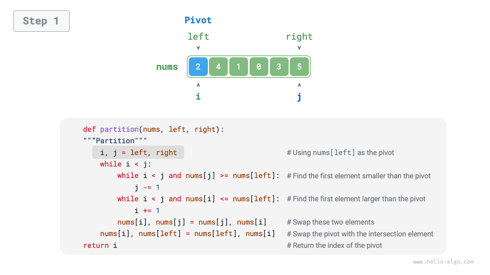

# Quick sort

<u>Quick sort</u> is an efficient, widely used sorting algorithm based on divide and conquer.

Its core operation is “partitioning”: choose an array element as the “pivot,” move all smaller elements to its left, and move all larger elements to its right. The partitioning process is shown below.

1. Choose the leftmost element as the pivot and initialize pointers `i` and `j` at the two ends of the array.
2. In a loop, use `i` to find the first element greater than the pivot and `j` to find the first element smaller than it, then swap those elements.
3. Repeat step `2.` until `i` and `j` meet. Finally, swap the pivot into the boundary between the two subarrays.

=== "<1>"
    

=== "<2>"
    

=== "<3>"
    

=== "<4>"
    

=== "<5>"
    

=== "<6>"
    

=== "<7>"
    

=== "<8>"
    

=== "<9>"
    

After partitioning, the original array has three parts: the left subarray, the pivot, and the right subarray. Every element in the left subarray is $\leq$ the pivot, which is $\leq$ every element in the right subarray. We now need only sort the two subarrays.

!!! note "Quick sort's divide-and-conquer strategy"

    Partitioning reduces the problem of sorting one long array to sorting two shorter arrays.

```src
[file]{quick_sort}-[class]{quick_sort}-[func]{partition}
```

## Algorithm steps

The overall quick sort process is shown below.

1. Partition the original array to obtain unsorted left and right subarrays.
2. Recursively partition the left and right subarrays.
3. Continue until each subarray has length 1, completing the sort.


```src
[file]{quick_sort}-[class]{quick_sort}-[func]{quick_sort}
```

## Algorithm properties

- **Time complexity: $O(n \log n)$; not adaptive**. On average, partitioning produces $\log n$ recursive levels, with $n$ loop iterations in total at each level, giving $O(n \log n)$ time. In the worst case, each partition splits an array of length $n$ into subarrays of lengths $0$ and $n - 1$. The recursion reaches $n$ levels, each involving up to $n$ iterations, for $O(n^2)$ time overall.
- **Space complexity: $O(n)$; in-place**. A fully reverse-sorted input reaches the worst-case recursion depth of $n$, requiring $O(n)$ space for stack frames. Sorting takes place in the original array without an auxiliary array.
- **Not stable**. In the final partitioning step, the pivot may be swapped to the right of an equal element.

## Why is quick sort quick?

As its name suggests, quick sort has an efficiency advantage. Although its average time complexity matches that of merge sort and heap sort, it is usually faster, mainly for the following reasons.

- **The worst case is unlikely**. Quick sort's worst-case time complexity is $O(n^2)$, making its performance less predictable than merge sort's, but it runs in $O(n \log n)$ time in the vast majority of cases.
- **Efficient cache use**. During partitioning, the system can load the whole subarray into cache, making element access efficient. Algorithms such as heap sort jump between elements and do not share this advantage.
- **Small constant factors**. Of these three algorithms, quick sort performs the fewest comparisons, assignments, swaps, and similar operations overall. This resembles the reason insertion sort is faster than bubble sort.

## Improving pivot selection

**Quick sort can become slower on certain inputs**. Consider a fully reverse-sorted array. Because the leftmost element is chosen as the pivot, partitioning moves it to the far right, leaving subarrays of lengths $n - 1$ and $0$. Continuing recursively produces a subarray of length $0$ after every partition. Divide and conquer becomes ineffective, and quick sort degenerates into a process resembling bubble sort.

To reduce this risk, **we can improve how the pivot is selected**. For example, choose a random element as the pivot. With bad luck, however, every pivot may still be poor, leading to disappointing performance.

Programming languages generally produce pseudorandom numbers. A test case constructed specifically for a pseudorandom sequence can still degrade quick sort's performance.

For further improvement, choose three candidate elements, usually the first, last, and middle elements, **and use their median as the pivot**. This greatly increases the chance that the pivot is neither too small nor too large. We can use more candidates to improve robustness further. This approach greatly reduces the likelihood of degradation to $O(n^2)$.

An implementation follows:

```src
[file]{quick_sort}-[class]{quick_sort_median}-[func]{partition}
```

## Reducing recursion depth

**Quick sort may use considerable space on certain inputs**. For a fully sorted input, let the current subarray have length $m$. Each partition produces a left subarray of length $0$ and a right subarray of length $m - 1$. Each recursive call therefore reduces the problem size by only one element, producing a recursion tree of height $n - 1$ and requiring $O(n)$ space for stack frames.

To prevent stack frames from accumulating, compare the two subarray lengths after each partition and **recurse only on the shorter one**. Since that subarray has length at most $n / 2$, the recursion depth is at most $\log n$, reducing the worst-case space complexity to $O(\log n)$. The code is as follows:

```src
[file]{quick_sort}-[class]{quick_sort_tail_call}-[func]{quick_sort}
```
