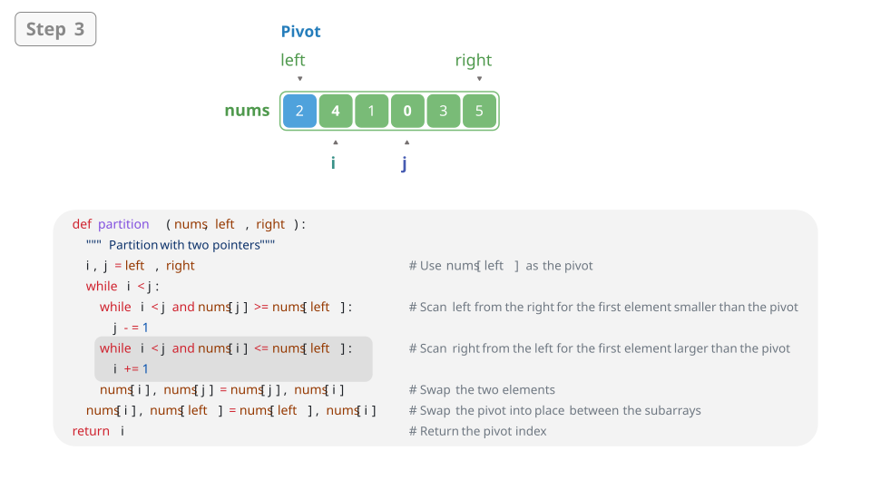
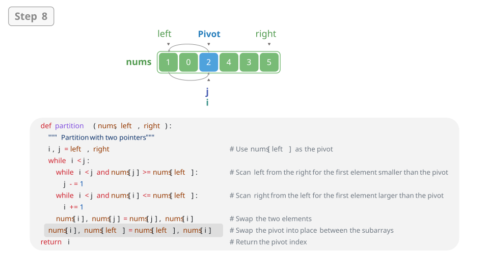
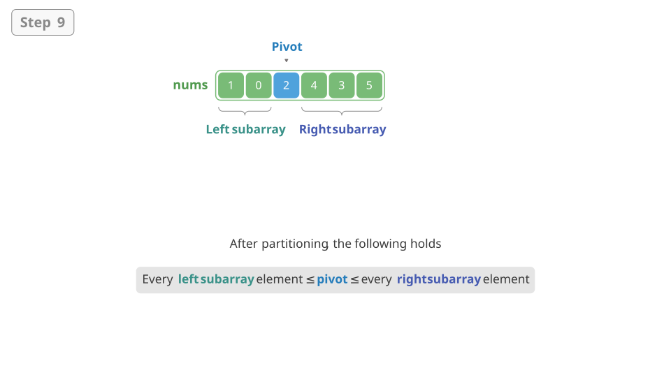
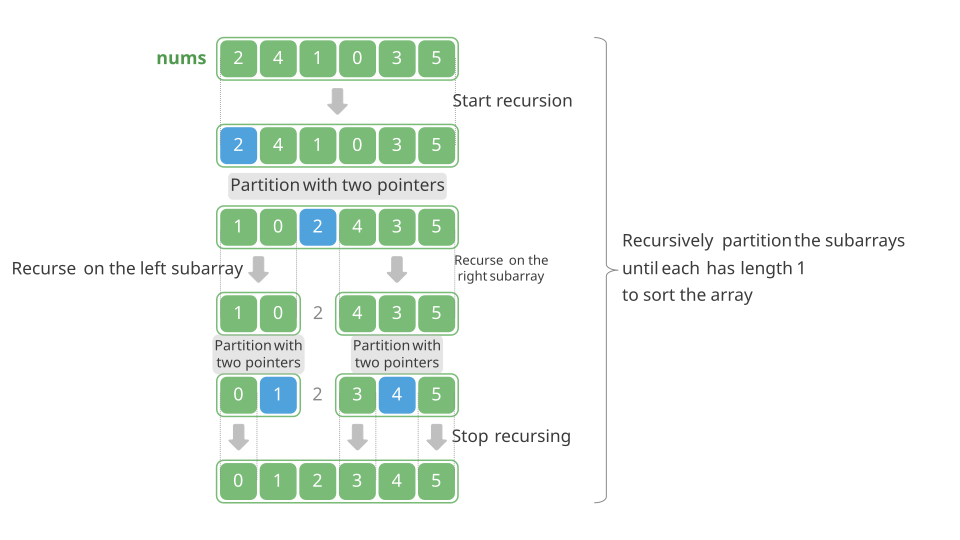

# Quicksort

<u>Quicksort</u> is an efficient, widely used divide-and-conquer sorting algorithm.

The core operation in quicksort is two-pointer partitioning. Choose an array element as the pivot, then move all elements smaller than the pivot to its left and all larger elements to its right. The figure below shows the process.

1. Choose the leftmost element as the pivot. Initialize pointers `i` and `j` at the left and right ends of the array, respectively.
2. In each iteration, use `i` to find the first element greater than the pivot and `j` to find the first element smaller than the pivot. Swap the two elements.
3. Repeat step `2.` until `i` and `j` meet. Finally, swap the pivot into place between the two subarrays.

=== "<1>"
    

=== "<2>"
    

=== "<3>"
    

=== "<4>"
    

=== "<5>"
    

=== "<6>"
    

=== "<7>"
    

=== "<8>"
    

=== "<9>"
    

Partitioning splits the original array into three parts: a left subarray, the pivot, and a right subarray. Every element on the left $\leq$ the pivot $\leq$ every element on the right. All that remains is to sort the two subarrays.

!!! note "Divide and conquer in quicksort"

    Partitioning turns the problem of sorting one long array into two smaller problems, one for each shorter array.

```src
[file]{quick_sort}-[class]{quick_sort}-[func]{partition}
```

## How the algorithm works

The figure below shows the full quicksort procedure.

1. First, partition the original array to obtain an unsorted left subarray and an unsorted right subarray.
2. Then recursively partition the left and right subarrays.
3. Continue recursively, stopping when a subarray has length 1. This sorts the entire array.



```src
[file]{quick_sort}-[class]{quick_sort}-[func]{quick_sort}
```

## Algorithm properties

- **Time complexity: $O(n \log n)$, nonadaptive**. On average, partitioning takes $\log n$ levels of recursion, with a total of $n$ loop iterations per level, for an overall time of $O(n \log n)$. In the worst case, every partition splits an array of length $n$ into subarrays of lengths $0$ and $n - 1$. The recursion reaches $n$ levels with up to $n$ iterations per level, taking $O(n^2)$ time overall.
- **Space complexity: $O(n)$, in-place**. A fully reverse-sorted input gives the worst-case recursion depth of $n$, requiring $O(n)$ space for stack frames. The sort operates on the original array without an auxiliary array.
- **Unstable**. The last swap in partitioning may move the pivot to the right of an equal element.

## What makes quicksort fast?

As its name suggests, quicksort has some advantages in practice. It has the same average time complexity as merge sort and heap sort, but it usually runs faster for the following reasons.

- **The worst case is unlikely**. Quicksort's worst-case time complexity is $O(n^2)$, making its performance less predictable than merge sort's. In the vast majority of cases, however, quicksort runs in $O(n \log n)$ time.
- **Good cache utilization**. During partitioning, the system can load an entire subarray into the cache, making its elements efficient to access. Heap sort, in contrast, jumps between positions and lacks this advantage.
- **A small constant factor**. Of the three algorithms, quicksort performs the fewest comparisons, assignments, and swaps in total. This is similar to the reason insertion sort is faster than bubble sort.

## Improving pivot selection

**Quicksort can slow down on certain inputs**. For an extreme example, consider an array in descending order. If we choose the leftmost element as the pivot, partitioning swaps it to the far right, leaving a left subarray of length $n - 1$ and a right subarray of length $0$. As the recursion continues, every partition leaves one subarray of length $0$. The divide-and-conquer strategy breaks down, and quicksort starts to resemble bubble sort.

To reduce the likelihood of this case, **we can change how we choose the pivot for partitioning**. For example, we can choose it at random. With bad luck, though, we might still choose a poor pivot every time and get disappointing performance.

Programming languages typically generate pseudorandom numbers. A test case constructed for a particular pseudorandom sequence can still cause quicksort's performance to deteriorate.

A further improvement is to select three candidates, usually the first, last, and middle elements, and **use their median as the pivot**. This makes it much more likely that the pivot is neither too small nor too large. We can use more candidates to make the algorithm even more robust. This approach greatly reduces the chance that the time complexity will deteriorate to $O(n^2)$.

Here is an implementation:

```src
[file]{quick_sort}-[class]{quick_sort_median}-[func]{partition}
```

## Reducing recursion depth

**Quicksort can use considerable space on certain inputs**. Consider an already sorted array. If the current subarray has length $m$, partitioning produces a left subarray of length $0$ and a right subarray of length $m - 1$. Each recursive call reduces the problem by just one element. The recursion tree reaches height $n - 1$, requiring $O(n)$ space for stack frames.

To limit stack growth, compare the lengths of the two subarrays after each partition and **recurse only on the shorter subarray**. Its length is at most $n / 2$, so the recursion depth is at most $\log n$. This reduces the worst-case space complexity to $O(\log n)$, as shown in the code below:

```src
[file]{quick_sort}-[class]{quick_sort_tail_call}-[func]{quick_sort}
```
