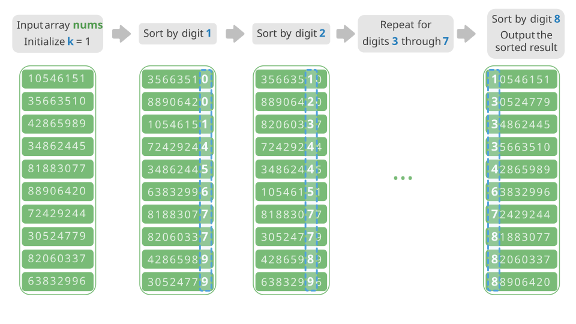

# Radix sort

The previous section introduced counting sort, which works well when the number of elements $n$ is large but the range of values $m$ is small. Suppose we need to sort $n = 10^6$ student IDs, each $8$ digits long. The range of values, $m = 10^8$, is so large that counting sort would require a great deal of memory. Radix sort avoids this problem.

<u>Radix sort</u> shares counting sort's basic idea of using counts to order elements. It also takes advantage of place value: sorting by one digit at a time, in succession, produces the final sorted order.

## How the algorithm works

For the student IDs, number the digits from $1$ at the least significant end to $8$ at the most significant end. The figure below shows how radix sort proceeds.

1. Initialize the digit position $k = 1$.
2. Apply counting sort to digit $k$ of the student IDs. The IDs are now in ascending order by digit $k$.
3. Increase $k$ by $1$ and return to step `2.`. Stop after sorting by every digit.



Let's look at the implementation. For a base-$d$ number $x$, we can obtain digit $k$, denoted by $x_k$, with the following formula:

$$
x_k = \lfloor\frac{x}{d^{k-1}}\rfloor \bmod d
$$

Here $\lfloor a \rfloor$ rounds the floating-point number $a$ down to an integer, and $\bmod \: d$ takes the remainder after division by $d$. For the student IDs, $d = 10$ and $k \in [1, 8]$.

We also need to adapt counting sort slightly so that it sorts numbers by digit $k$:

```src
[file]{radix_sort}-[class]{}-[func]{radix_sort}
```

!!! question "Why start with the least significant digit?"

    Each pass takes precedence over the one before it. For example, if the first pass orders two elements as $a < b$ but the second orders them as $a > b$, the second order prevails. Since more significant digits have higher priority, sort by the less significant digits first.

## Algorithm properties

Compared with counting sort, radix sort handles a larger range of values, **provided that the data can be represented with a fixed number of digits and that this number is not too large**. For example, floating-point numbers are a poor fit here because their digit count $k$ can be so large that the time complexity satisfies $O(nk) \gg O(n^2)$.

- **Time complexity: $O(nk)$, nonadaptive**. Suppose there are $n$ elements in base $d$, each with at most $k$ digits. Counting sort takes $O(n + d)$ time for one digit, so sorting by all $k$ digits takes $O((n + d)k)$ time. Typically, $d$ and $k$ are both small and the time complexity approaches $O(n)$.
- **Space complexity: $O(n + d)$, out-of-place**. As in counting sort, radix sort uses an array `res` of length $n$ and an array `counter` of length $d$.
- **Stable**. If the counting sort used for each digit is stable, radix sort is stable too. If counting sort is unstable, radix sort may produce an incorrect result.
