# Selection sort

<u>Selection sort</u> uses a simple loop. On each pass, it selects the smallest element in the unsorted range and places it at the end of the sorted range.

For an array of length $n$, selection sort proceeds as shown below.

1. Initially, all elements are unsorted, so the unsorted indices span the closed interval $[0, n-1]$.
2. Find the smallest element in $[0, n-1]$ and swap it with the element at index $0$. The first element is now in its final position.
3. Find the smallest element in $[1, n-1]$ and swap it with the element at index $1$. The first two elements are now in their final positions.
4. Continue in the same way. After $n - 1$ rounds of selection and swapping, the first $n - 1$ elements are in their final positions.
5. The only remaining element must be the largest. It is already in place, so the array is sorted.

=== "<1>"
    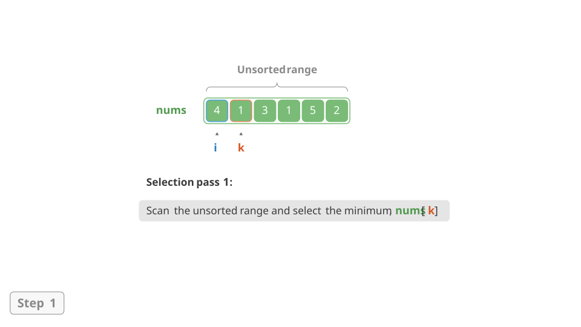

=== "<2>"
    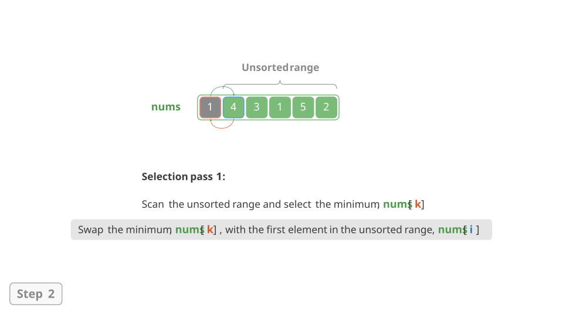

=== "<3>"
    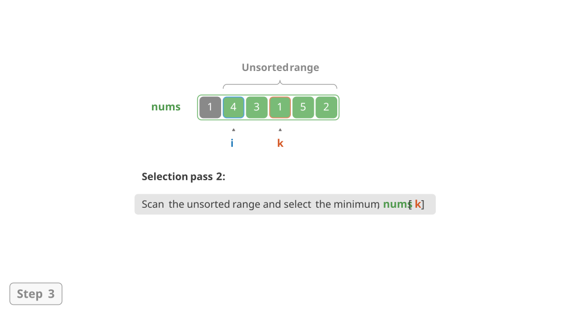

=== "<4>"
    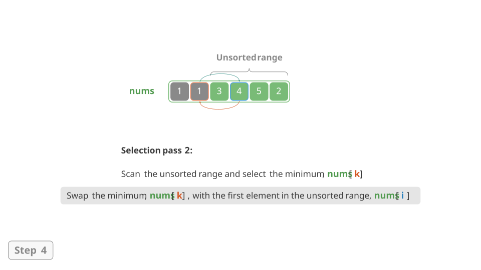

=== "<5>"
    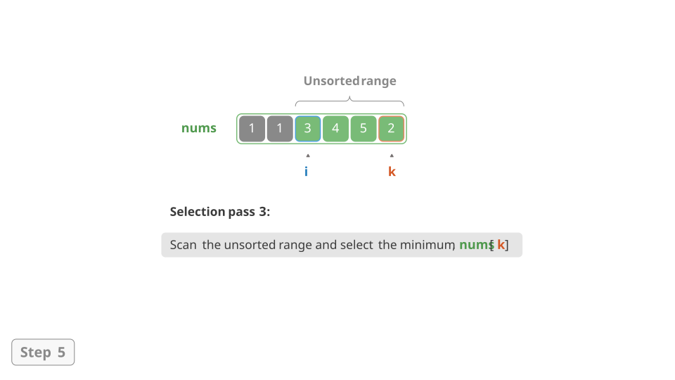

=== "<6>"
    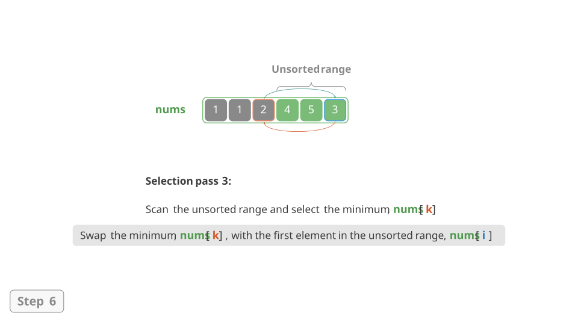

=== "<7>"
    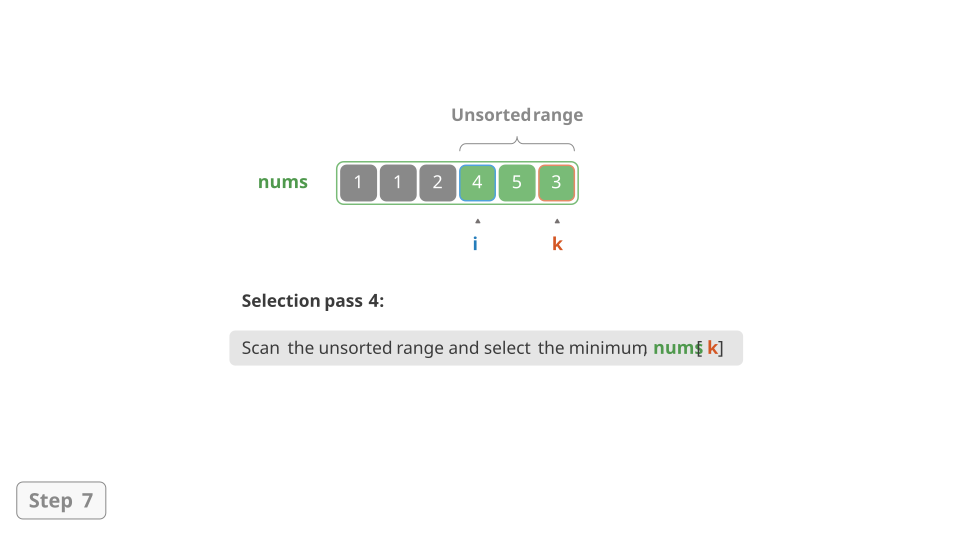

=== "<8>"
    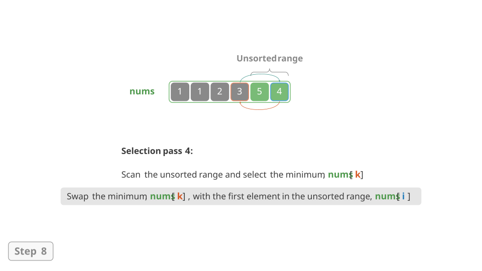

=== "<9>"
    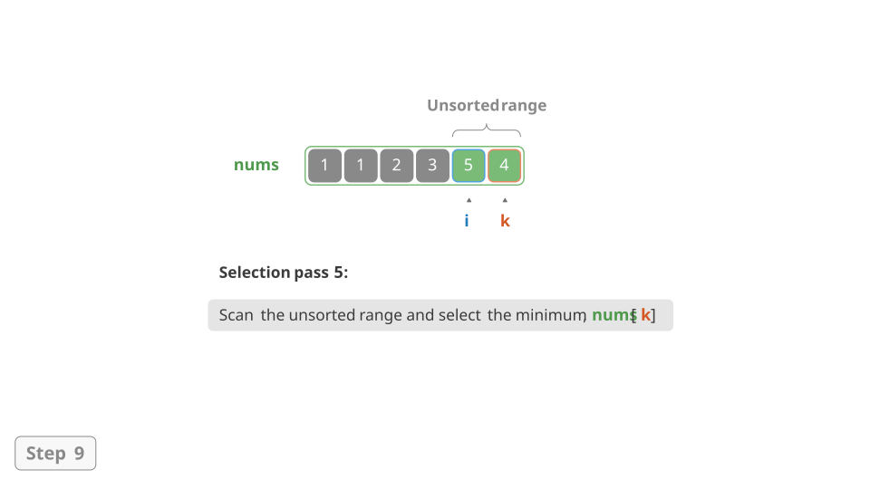

=== "<10>"
    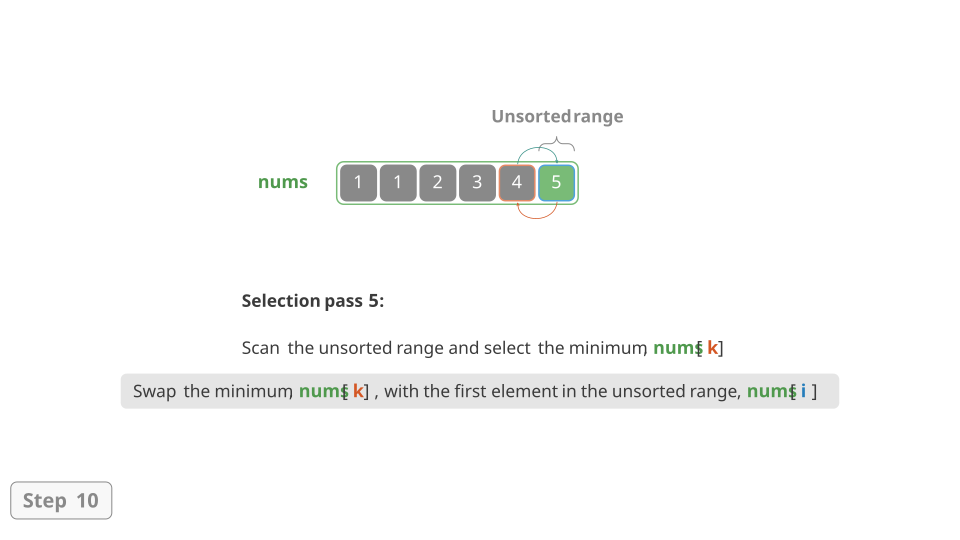

=== "<11>"
    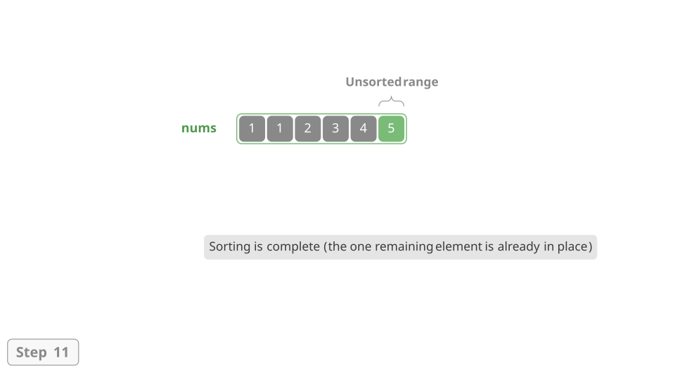

In the code, $k$ tracks the index of the smallest element in the unsorted range:

```src
[file]{selection_sort}-[class]{}-[func]{selection_sort}
```

## Algorithm properties

- **Time complexity: $O(n^2)$, nonadaptive**. The outer loop runs $n - 1$ times. The inner loop runs $n - 1$ times on the first pass and $1$ time on the last. The counts for successive passes are $n - 1$, $n - 2$, $\dots$, $2$, and $1$, adding up to $\frac{n(n - 1)}{2}$.
- **Space complexity: $O(1)$, in-place**. The two indices $i$ and $j$ use a constant amount of extra space.
- **Unstable**. As shown below, a swap can move `nums[i]` to the right of an equal element, reversing their relative order.

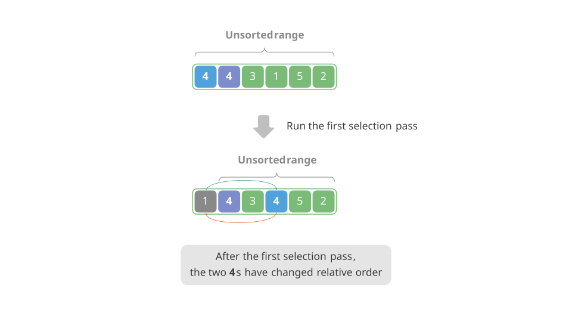
