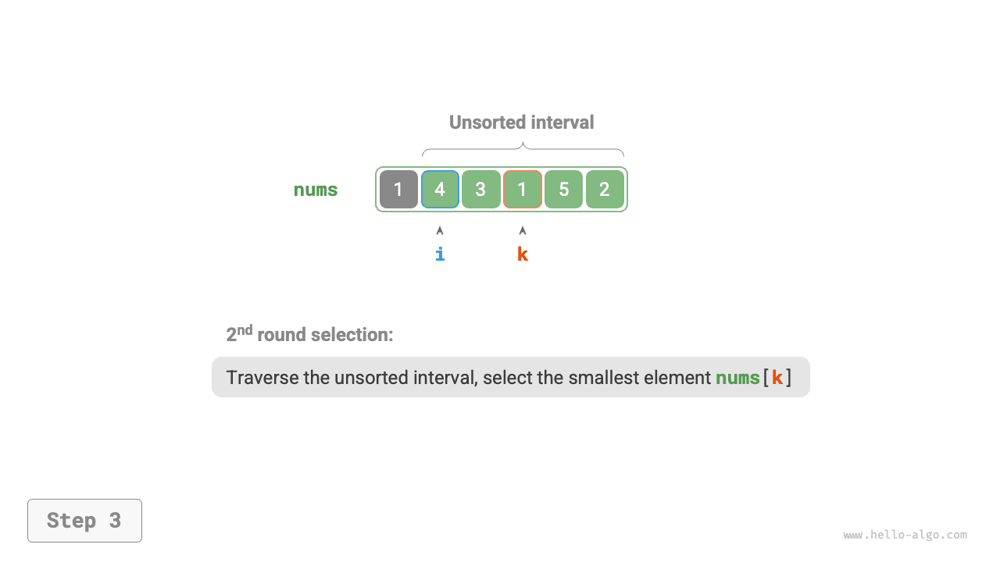

# Selection sort

<u>Selection sort</u> works very simply: in each round, select the smallest element from the unsorted section and place it at the end of the sorted section.

For an array of length $n$, the algorithm proceeds as shown below.

1. Initially, all elements are unsorted, so the unsorted index interval is $[0, n-1]$.
2. Select the smallest element in $[0, n-1]$ and swap it with the element at index $0$. The first element is now sorted.
3. Select the smallest element in $[1, n-1]$ and swap it with the element at index $1$. The first two elements are now sorted.
4. Continue in this way. After $n - 1$ rounds of selection and swapping, the first $n - 1$ elements are sorted.
5. The remaining element must be the largest and needs no sorting. The array is now sorted.

=== "<1>"
    

=== "<2>"
    

=== "<3>"
    

=== "<4>"
    

=== "<5>"
    

=== "<6>"
    

=== "<7>"
    

=== "<8>"
    

=== "<9>"
    

=== "<10>"
    

=== "<11>"
    

In the code, $k$ tracks the smallest element in the unsorted section:

```src
[file]{selection_sort}-[class]{}-[func]{selection_sort}
```

## Algorithm properties

- **Time complexity: $O(n^2)$; not adaptive**. The outer loop runs $n - 1$ times. The inner loop runs $n - 1$ times in the first round and $1$ time in the last, giving successive counts of $n - 1$, $n - 2$, $\dots$, $2$, and $1$, which sum to $\frac{n(n - 1)}{2}$.
- **Space complexity: $O(1)$; in-place**. Pointers $i$ and $j$ use constant extra space.
- **Not stable**. As shown below, `nums[i]` may be swapped to the right of an equal element, changing their relative order.


