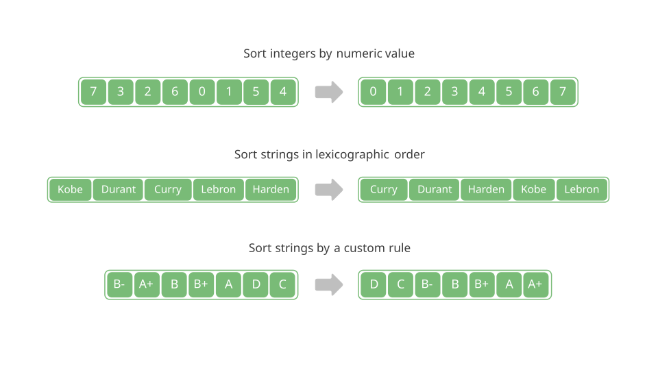

# 11.1 &nbsp; Sorting algorithms

A <u>sorting algorithm</u> arranges data in a specified order. Sorting is widely used because ordered data is usually easier to search, analyze, and process efficiently.

As Figure 11-1 shows, we can sort integers, floating-point numbers, characters, strings, and other types of data. We choose the ordering rule to suit the task, whether it uses numeric value, ASCII character codes, or a custom rule.

{ class="animation-figure" }

<p align="center"> Figure 11-1 &nbsp; Examples of data types and ordering rules </p>

## 11.1.1 &nbsp; Criteria for comparing sorting algorithms

**Running time**. We want low time complexity and a small total number of operations (a small constant factor in the running time). Speed is especially important for large datasets.

**In-place operation**. An <u>in-place sort</u> works directly on the original array, saving memory by avoiding an auxiliary array. In-place sorts usually move data less and run faster.

**Stability**. A <u>stable sort</u> preserves the relative order of equal elements in the array.

Stability is essential when sorting successively by multiple keys. Suppose a table of students contains names in the first column and ages in the second. An <u>unstable sort</u> can discard ordering information from the input:

```shell
# The input is sorted by name
# (name, age)
  ('A', 19)
  ('B', 18)
  ('C', 21)
  ('D', 19)
  ('E', 23)

# Suppose we sort the list by age using an unstable algorithm
# The relative order of ('D', 19) and ('A', 19) changes
# Students of the same age are no longer sorted by name
  ('B', 18)
  ('D', 19)
  ('A', 19)
  ('C', 21)
  ('E', 23)
```

**Adaptivity**. An <u>adaptive sort</u> takes advantage of existing order in the input to do less work and run faster. Its best-case time complexity is usually better than its average time complexity.

**Use of comparisons**. A <u>comparison sort</u> uses comparison operators ($<$, $=$, $>$) to establish the relative order of elements and sort the array. Its worst-case time complexity has a lower bound of $\Omega(n \log n)$. A <u>non-comparison sort</u> does not rely on these comparisons and can run in $O(n)$ time, but it applies to a narrower range of inputs.

## 11.1.2 &nbsp; The ideal sorting algorithm

**Fast, in-place, stable, adaptive, and broadly applicable**. So far, no known sorting algorithm has all these properties. The choice therefore depends on the data and the requirements of the problem.

In the following sections, we will study several sorting algorithms and use these criteria to analyze their strengths and weaknesses.
