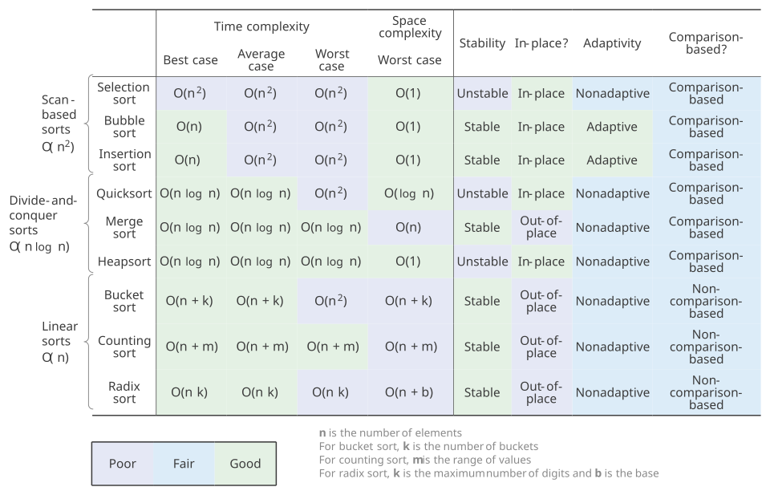

# 11.11 &nbsp; Summary

### 1. &nbsp; Key takeaways

- Bubble sort swaps adjacent elements. Adding a flag that lets it return early improves its best-case time complexity to $O(n)$.
- On each pass, insertion sort takes an element from the unsorted range and inserts it at the correct position in the sorted range. Although it takes $O(n^2)$ time, it performs relatively few elementary operations, making it a popular choice for small inputs.
- Quicksort sorts by partitioning with two pointers. Choosing the worst possible pivot at every partition can degrade its running time to $O(n^2)$. A median-of-three or random pivot makes this less likely. Recursing on the shorter subarray limits recursion depth and reduces space complexity to $O(\log n)$.
- Merge sort illustrates divide and conquer in two phases: divide and merge. Sorting an array requires an auxiliary array and takes $O(n)$ space. For a linked list, the space complexity can be reduced to $O(1)$.
- Bucket sort has three steps: distribute the data among buckets, sort each bucket, and combine the results. It also uses divide and conquer and is suitable for very large datasets. Its efficiency depends on distributing the data evenly.
- Counting sort is a special case of bucket sort that sorts values by counting their occurrences. It works well with large datasets whose values cover a limited range and can be converted to positive integers.
- Radix sort sorts data one digit at a time. It requires values that can be represented with a fixed number of digits.
- Ideally, a sorting algorithm would be efficient, stable, in-place, and adaptive. As with other data structures and algorithms, no single sort satisfies all these requirements. In practice, we choose an algorithm that suits the data.
- Figure 11-19 compares common sorting algorithms in terms of efficiency, stability, in-place operation, and adaptivity.

{ class="animation-figure" }

 Figure 11-19 &nbsp; Comparison of sorting algorithms 

### 2. &nbsp; Q & A

**Q**: When does a sorting algorithm need to be stable?

In practice, we often sort objects by an attribute. Suppose each student has a name and a height, and we want to sort by multiple keys. First we sort by name, obtaining `(A, 180) (B, 185) (C, 170) (D, 170)`. Then we sort by height. An unstable sort might produce `(D, 170) (C, 170) (A, 180) (B, 185)`.

Students D and C have switched places. They are no longer in name order within their height group, which is precisely the ordering we wanted to preserve.

**Q**: In two-pointer partitioning, can we reverse the order of the right-to-left and left-to-right scans?

No. With the leftmost element as the pivot, we must scan from right to left first, then from left to right. Let's examine why this seemingly counterintuitive order matters.

The last step in `partition()` swaps `nums[left]` and `nums[i]`. After the swap, every element to the left of the pivot must be `<=` the pivot, **so `nums[left] >= nums[i]` must hold before the swap**. Suppose we scan from left to right first. If we find no larger element before the pointers meet, **the loop exits at `i == j`, and we may have `nums[j] == nums[i] > nums[left]`**. The final swap would then move an element larger than the pivot to the far left, breaking the partition.

For example, given `[0, 0, 0, 0, 1]`, scanning from left to right first leaves the array as `[1, 0, 0, 0, 0]` after partitioning, which is incorrect.

The argument works in reverse if we choose `nums[right]` as the pivot: in that case, we must scan from left to right first.

**Q**: In quicksort, why does recursing on the shorter subarray limit recursion depth to $\log n$?

Recursion depth is the number of recursive calls that have not yet returned. Each partition splits the array into two subarrays. With the depth optimization, the subarray passed to the next recursive call is at most half the length of the current array. Even in the worst case, where the length is halved every time, the recursion depth is $\log n$.

In the original quicksort, successive calls may keep taking the longer subarray. In the worst case, their lengths are $n$, $n - 1$, $\dots$, $2$, and $1$, giving a recursion depth of $n$. The depth optimization prevents this.

**Q**: Does quicksort take $O(n^2)$ time when all the elements are equal? How can we handle this case?

Yes. We can handle it by partitioning the array into three parts: elements smaller than the pivot, elements equal to it, and elements larger than it. Recurse only on the smaller and larger groups. When all elements are equal, a single partition then sorts the entire array.

**Q**: Why is the worst-case time complexity of bucket sort $O(n^2)$?

In the worst case, all elements land in the same bucket. If we sort its contents with an $O(n^2)$ algorithm, the time complexity is $O(n^2)$.
