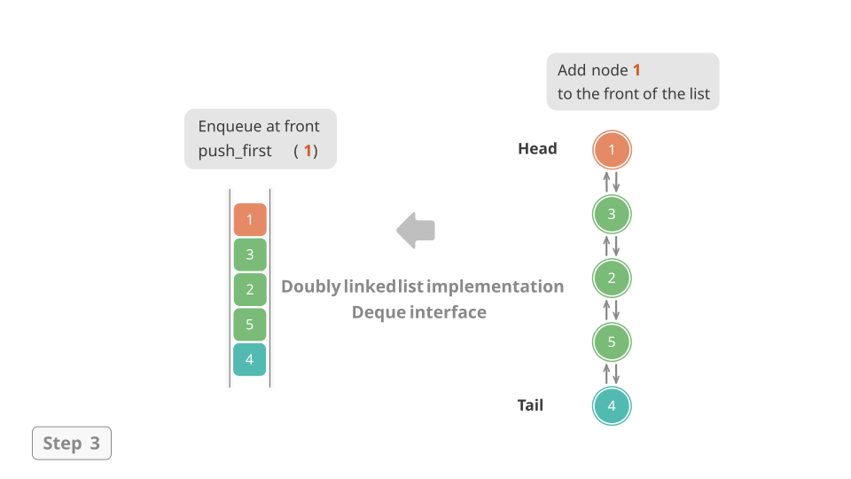
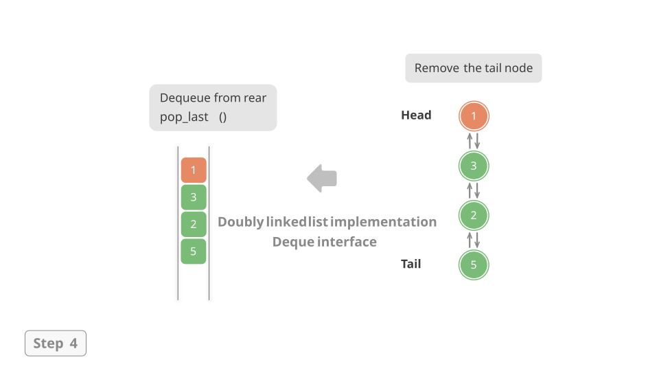
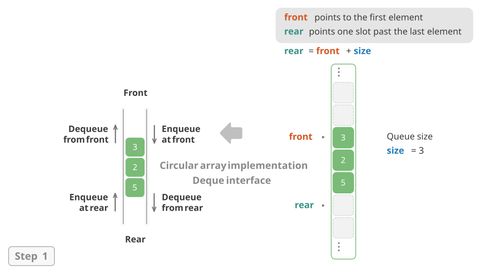

# 5.3 &nbsp; Deques

An ordinary queue allows removal only at the front and insertion only at the rear. A <u>double-ended queue (deque)</u> is more flexible: as shown below, it allows insertion and removal at either end.

{ class="animation-figure" }

<p align="center"> Figure 5-7 &nbsp; Deque operations </p>

## 5.3.1 &nbsp; Common deque operations

Table 5-3 lists common deque operations. The method names depend on the programming language.

<p align="center"> Table 5-3 &nbsp; Time complexity of deque operations </p>

<div class="center-table" markdown>

| Method name         | Description             | Time complexity |
| -------------- | ---------------- | ---------- |
| `push_first()` | Add an element at the front | $O(1)$     |
| `push_last()`  | Add an element at the rear | $O(1)$     |
| `pop_first()`  | Remove the front element     | $O(1)$     |
| `pop_last()`   | Remove the rear element     | $O(1)$     |
| `peek_first()` | Access the front element     | $O(1)$     |
| `peek_last()`  | Access the rear element     | $O(1)$     |

</div>

As with an ordinary queue, you can use the deque class your programming language provides:

=== "Python"

    ```python title="deque.py"
    from collections import deque

    # Initialize the deque
    deq: deque[int] = deque()

    # Add elements to the deque
    deq.append(2)  # Add at the rear
    deq.append(5)
    deq.append(4)
    deq.appendleft(3)  # Add at the front
    deq.appendleft(1)

    # Peek at the front and rear elements
    front: int = deq[0]  # Front element
    rear: int = deq[-1]  # Rear element

    # Remove elements from both ends
    pop_front: int = deq.popleft()  # Remove and return the front element
    pop_rear: int = deq.pop()  # Remove and return the rear element

    # Get the deque size
    size: int = len(deq)

    # Check whether the deque is empty
    is_empty: bool = len(deq) == 0
    ```

=== "C++"

    ```cpp title="deque.cpp"
    /* Initialize the deque */
    deque<int> deque;

    /* Add elements to the deque */
    deque.push_back(2); // Add at the rear
    deque.push_back(5);
    deque.push_back(4);
    deque.push_front(3); // Add at the front
    deque.push_front(1);

    /* Peek at the front and rear elements */
    int front = deque.front(); // Front element
    int back = deque.back(); // Rear element

    /* Remove elements from both ends */
    deque.pop_front(); // Remove the front element
    deque.pop_back(); // Remove the rear element

    /* Get the deque size */
    int size = deque.size();

    /* Check whether the deque is empty */
    bool empty = deque.empty();
    ```

=== "Java"

    ```java title="deque.java"
    /* Initialize the deque */
    Deque<Integer> deque = new LinkedList<>();

    /* Add elements to the deque */
    deque.offerLast(2); // Add at the rear
    deque.offerLast(5);
    deque.offerLast(4);
    deque.offerFirst(3); // Add at the front
    deque.offerFirst(1);

    /* Peek at the front and rear elements */
    int peekFirst = deque.peekFirst(); // Front element
    int peekLast = deque.peekLast(); // Rear element

    /* Remove elements from both ends */
    int popFirst = deque.pollFirst(); // Remove and return the front element
    int popLast = deque.pollLast(); // Remove and return the rear element

    /* Get the deque size */
    int size = deque.size();

    /* Check whether the deque is empty */
    boolean isEmpty = deque.isEmpty();
    ```

=== "C#"

    ```csharp title="deque.cs"
    /* Initialize the deque */
    // Use a LinkedList as a deque in C#
    LinkedList<int> deque = new();

    /* Add elements to the deque */
    deque.AddLast(2);   // Add at the rear
    deque.AddLast(5);
    deque.AddLast(4);
    deque.AddFirst(3);  // Add at the front
    deque.AddFirst(1);

    /* Peek at the front and rear elements */
    int? peekFirst = deque.First?.Value;  // Front element
    int? peekLast = deque.Last?.Value;    // Rear element

    /* Remove elements from both ends */
    deque.RemoveFirst();  // Remove the front element
    deque.RemoveLast();   // Remove the rear element

    /* Get the deque size */
    int size = deque.Count;

    /* Check whether the deque is empty */
    bool isEmpty = deque.Count == 0;
    ```

=== "Go"

    ```go title="deque_test.go"
    /* Initialize the deque */
    // Use Go's list.List as a deque
    deque := list.New()

    /* Add elements to the deque */
    deque.PushBack(2) // Add at the rear
    deque.PushBack(5)
    deque.PushBack(4)
    deque.PushFront(3) // Add at the front
    deque.PushFront(1)

    /* Peek at the front and rear elements */
    front := deque.Front() // Front element
    rear := deque.Back() // Rear element

    /* Remove elements from both ends */
    deque.Remove(front) // Remove the front element
    deque.Remove(rear) // Remove the rear element

    /* Get the deque size */
    size := deque.Len()

    /* Check whether the deque is empty */
    isEmpty := deque.Len() == 0
    ```

=== "Swift"

    ```swift title="deque.swift"
    /* Initialize the deque */
    // Swift has no built-in deque class, so use an Array as a deque
    var deque: [Int] = []

    /* Add elements to the deque */
    deque.append(2) // Add at the rear
    deque.append(5)
    deque.append(4)
    deque.insert(3, at: 0) // Add at the front
    deque.insert(1, at: 0)

    /* Peek at the front and rear elements */
    let peekFirst = deque.first! // Front element
    let peekLast = deque.last! // Rear element

    /* Remove elements from both ends */
    // With an Array, removeFirst takes O(n) time
    let popFirst = deque.removeFirst() // Remove and return the front element
    let popLast = deque.removeLast() // Remove and return the rear element

    /* Get the deque size */
    let size = deque.count

    /* Check whether the deque is empty */
    let isEmpty = deque.isEmpty
    ```

=== "JS"

    ```javascript title="deque.js"
    /* Initialize the deque */
    // JavaScript has no built-in deque, so use an Array as a deque
    const deque = [];

    /* Add elements to the deque */
    deque.push(2);
    deque.push(5);
    deque.push(4);
    // unshift() takes O(n) time because the deque uses an array
    deque.unshift(3);
    deque.unshift(1);

    /* Peek at the front and rear elements */
    const peekFirst = deque[0];
    const peekLast = deque[deque.length - 1];

    /* Remove elements from both ends */
    // shift() takes O(n) time because the deque uses an array
    const popFront = deque.shift();
    const popBack = deque.pop();

    /* Get the deque size */
    const size = deque.length;

    /* Check whether the deque is empty */
    const isEmpty = size === 0;
    ```

=== "TS"

    ```typescript title="deque.ts"
    /* Initialize the deque */
    // TypeScript has no built-in deque, so use an Array as a deque
    const deque: number[] = [];

    /* Add elements to the deque */
    deque.push(2);
    deque.push(5);
    deque.push(4);
    // unshift() takes O(n) time because the deque uses an array
    deque.unshift(3);
    deque.unshift(1);

    /* Peek at the front and rear elements */
    const peekFirst: number = deque[0];
    const peekLast: number = deque[deque.length - 1];

    /* Remove elements from both ends */
    // shift() takes O(n) time because the deque uses an array
    const popFront: number = deque.shift() as number;
    const popBack: number = deque.pop() as number;

    /* Get the deque size */
    const size: number = deque.length;

    /* Check whether the deque is empty */
    const isEmpty: boolean = size === 0;
    ```

=== "Dart"

    ```dart title="deque.dart"
    /* Initialize the deque */
    // Dart defines Queue as a double-ended queue
    final Queue<int> deque = Queue();

    /* Add elements to the deque */
    deque.addLast(2); // Add at the rear
    deque.addLast(5);
    deque.addLast(4);
    deque.addFirst(3); // Add at the front
    deque.addFirst(1);

    /* Peek at the front and rear elements */
    final int peekFirst = deque.first; // Front element
    final int peekLast = deque.last; // Rear element

    /* Remove elements from both ends */
    final int popFirst = deque.removeFirst(); // Remove and return the front element
    final int popLast = deque.removeLast(); // Remove and return the rear element

    /* Get the deque size */
    final int size = deque.length;

    /* Check whether the deque is empty */
    final bool isEmpty = deque.isEmpty;
    ```

=== "Rust"

    ```rust title="deque.rs"
    // Initialize the deque
    let mut deque: VecDeque<i32> = VecDeque::new();

    /* Add elements to the deque */
    deque.push_back(2); // Add at the rear
    deque.push_back(5);
    deque.push_back(4);
    deque.push_front(3); // Add at the front
    deque.push_front(1);

    // Peek at the front and rear elements
    let peek_first = deque.front().unwrap(); // Front element
    let peek_last = deque.back().unwrap(); // Rear element

    // Remove elements from both ends
    let pop_first = deque.pop_front().unwrap(); // Remove and return the front element
    let pop_last = deque.pop_back().unwrap(); // Remove and return the rear element

    // Get the deque size
    let size = deque.len();

    // Check whether the deque is empty
    let is_empty = deque.is_empty();
    ```

=== "C"

    ```c title="deque.c"
    // C has no built-in deque
    ```

=== "Kotlin"

    ```kotlin title="deque.kt"
    /* Initialize the deque */
    val deque = LinkedList<Int>()

    /* Add elements to the deque */
    deque.offerLast(2) // Add at the rear
    deque.offerLast(5)
    deque.offerLast(4)
    deque.offerFirst(3) // Add at the front
    deque.offerFirst(1)

    /* Peek at the front and rear elements */
    val peekFirst = deque.peekFirst() // Front element
    val peekLast = deque.peekLast() // Rear element

    /* Remove elements from both ends */
    val popFirst = deque.pollFirst() // Remove and return the front element
    val popLast = deque.pollLast() // Remove and return the rear element

    /* Get the deque size */
    val size = deque.size

    /* Check whether the deque is empty */
    val isEmpty = deque.isEmpty()
    ```

=== "Ruby"

    ```ruby title="deque.rb"
    # Initialize the deque
    # Ruby has no built-in deque, so use an Array as a deque
    deque = []

    # Add elements to the deque
    deque << 2
    deque << 5
    deque << 4
    # Array#unshift takes O(n) time because the deque uses an array
    deque.unshift(3)
    deque.unshift(1)

    # Peek at the front and rear elements
    peek_first = deque.first
    peek_last = deque.last

    # Remove elements from both ends
    # Array#shift takes O(n) time because the deque uses an array
    pop_front = deque.shift
    pop_back = deque.pop

    # Get the deque size
    size = deque.length

    # Check whether the deque is empty
    is_empty = size.zero?
    ```

??? pythontutor "Visualize execution"

    <div style="height: 549px; width: 100%;"><iframe class="pythontutor-iframe" title="Visualize execution" src="https://pythontutor.com/iframe-embed.html#code=from%20collections%20import%20deque%0A%0A%22%22%22Driver%20Code%22%22%22%0Aif%20__name__%20%3D%3D%20%22__main__%22%3A%0A%20%20%20%20%23%20Initialize%20the%20deque%0A%20%20%20%20deq%20%3D%20deque%28%29%0A%0A%20%20%20%20%23%20Add%20elements%20to%20the%20deque%0A%20%20%20%20deq.append%282%29%20%20%23%20Add%20to%20the%20rear%0A%20%20%20%20deq.append%285%29%0A%20%20%20%20deq.append%284%29%0A%20%20%20%20deq.appendleft%283%29%20%20%23%20Add%20to%20the%20front%0A%20%20%20%20deq.appendleft%281%29%0A%20%20%20%20print%28%22deque%20%3D%22,%20deq%29%0A%0A%20%20%20%20%23%20Access%20elements%0A%20%20%20%20front%20%3D%20deq%5B0%5D%20%20%23%20Front%20element%0A%20%20%20%20print%28%22Front%20element%20%28front%29%20%3D%22,%20front%29%0A%20%20%20%20rear%20%3D%20deq%5B-1%5D%20%20%23%20Rear%20element%0A%20%20%20%20print%28%22Rear%20element%20%28rear%29%20%3D%22,%20rear%29%0A%0A%20%20%20%20%23%20Remove%20elements%20from%20the%20deque%0A%20%20%20%20pop_front%20%3D%20deq.popleft%28%29%20%20%23%20Remove%20the%20front%20element%0A%20%20%20%20print%28%22Removed%20from%20front%20%28pop_front%29%20%3D%22,%20pop_front%29%0A%20%20%20%20print%28%22deque%20after%20front%20removal%20%3D%22,%20deq%29%0A%20%20%20%20pop_rear%20%3D%20deq.pop%28%29%20%20%23%20Remove%20the%20rear%20element%0A%20%20%20%20print%28%22Removed%20from%20rear%20%28pop_rear%29%20%3D%22,%20pop_rear%29%0A%20%20%20%20print%28%22deque%20after%20rear%20removal%20%3D%22,%20deq%29%0A%0A%20%20%20%20%23%20Get%20the%20length%20of%20the%20deque%0A%20%20%20%20size%20%3D%20len%28deq%29%0A%20%20%20%20print%28%22Deque%20length%20%28size%29%20%3D%22,%20size%29%0A%0A%20%20%20%20%23%20Check%20whether%20the%20deque%20is%20empty%0A%20%20%20%20is_empty%20%3D%20len%28deq%29%20%3D%3D%200%0A%20%20%20%20print%28%22Deque%20is%20empty%20%3D%22,%20is_empty%29&codeDivHeight=472&codeDivWidth=350&cumulative=false&curInstr=3&heapPrimitives=nevernest&origin=opt-frontend.js&py=311&rawInputLstJSON=%5B%5D&textReferences=false"> </iframe></div>
    <div style="margin-top: 5px;"><a href="https://pythontutor.com/iframe-embed.html#code=from%20collections%20import%20deque%0A%0A%22%22%22Driver%20Code%22%22%22%0Aif%20__name__%20%3D%3D%20%22__main__%22%3A%0A%20%20%20%20%23%20Initialize%20the%20deque%0A%20%20%20%20deq%20%3D%20deque%28%29%0A%0A%20%20%20%20%23%20Add%20elements%20to%20the%20deque%0A%20%20%20%20deq.append%282%29%20%20%23%20Add%20to%20the%20rear%0A%20%20%20%20deq.append%285%29%0A%20%20%20%20deq.append%284%29%0A%20%20%20%20deq.appendleft%283%29%20%20%23%20Add%20to%20the%20front%0A%20%20%20%20deq.appendleft%281%29%0A%20%20%20%20print%28%22deque%20%3D%22,%20deq%29%0A%0A%20%20%20%20%23%20Access%20elements%0A%20%20%20%20front%20%3D%20deq%5B0%5D%20%20%23%20Front%20element%0A%20%20%20%20print%28%22Front%20element%20%28front%29%20%3D%22,%20front%29%0A%20%20%20%20rear%20%3D%20deq%5B-1%5D%20%20%23%20Rear%20element%0A%20%20%20%20print%28%22Rear%20element%20%28rear%29%20%3D%22,%20rear%29%0A%0A%20%20%20%20%23%20Remove%20elements%20from%20the%20deque%0A%20%20%20%20pop_front%20%3D%20deq.popleft%28%29%20%20%23%20Remove%20the%20front%20element%0A%20%20%20%20print%28%22Removed%20from%20front%20%28pop_front%29%20%3D%22,%20pop_front%29%0A%20%20%20%20print%28%22deque%20after%20front%20removal%20%3D%22,%20deq%29%0A%20%20%20%20pop_rear%20%3D%20deq.pop%28%29%20%20%23%20Remove%20the%20rear%20element%0A%20%20%20%20print%28%22Removed%20from%20rear%20%28pop_rear%29%20%3D%22,%20pop_rear%29%0A%20%20%20%20print%28%22deque%20after%20rear%20removal%20%3D%22,%20deq%29%0A%0A%20%20%20%20%23%20Get%20the%20length%20of%20the%20deque%0A%20%20%20%20size%20%3D%20len%28deq%29%0A%20%20%20%20print%28%22Deque%20length%20%28size%29%20%3D%22,%20size%29%0A%0A%20%20%20%20%23%20Check%20whether%20the%20deque%20is%20empty%0A%20%20%20%20is_empty%20%3D%20len%28deq%29%20%3D%3D%200%0A%20%20%20%20print%28%22Deque%20is%20empty%20%3D%22,%20is_empty%29&codeDivHeight=800&codeDivWidth=600&cumulative=false&curInstr=3&heapPrimitives=nevernest&origin=opt-frontend.js&py=311&rawInputLstJSON=%5B%5D&textReferences=false" target="_blank" rel="noopener noreferrer">View full screen ></a></div>

## 5.3.2 &nbsp; Implementing a deque *

Like an ordinary queue, a deque can use either a linked list or an array as its underlying data structure.

### 1. &nbsp; Doubly linked list implementation

In the previous section, we used a singly linked list for a queue because it makes it easy to remove the head node when dequeueing and to add a new node after the tail when enqueueing.

A deque supports enqueueing and dequeueing at both ends, so it also needs the mirror image of each queue operation. To support these operations, we use a doubly linked list.

As shown below, the head and tail of the doubly linked list serve as the front and rear of the deque. We implement insertion and removal at both ends.

=== "<1>"
    { class="animation-figure" }

=== "<2>"
    { class="animation-figure" }

=== "<3>"
    { class="animation-figure" }

=== "<4>"
    { class="animation-figure" }

=== "<5>"
    { class="animation-figure" }

<p align="center"> Figure 5-8 &nbsp; Enqueueing and dequeueing at either end of a linked list </p>

The following code implements the deque:

=== "Python"

    ```python title="linkedlist_deque.py"
    class ListNode:
        """Doubly linked list node."""

        def __init__(self, val: int):
            """Initialize the node."""
            self.val: int = val
            self.next: ListNode | None = None  # Reference to the next node
            self.prev: ListNode | None = None  # Reference to the previous node

    class LinkedListDeque:
        """Deque backed by a doubly linked list."""

        def __init__(self):
            """Initialize the deque."""
            self._front: ListNode | None = None  # Head node (_front)
            self._rear: ListNode | None = None  # Tail node (_rear)
            self._size: int = 0  # Deque size

        def size(self) -> int:
            """Get the deque size."""
            return self._size

        def is_empty(self) -> bool:
            """Check whether the deque is empty."""
            return self._size == 0

        def push(self, num: int, is_front: bool):
            """Add an element at either end."""
            node = ListNode(num)
            # If the list is empty, point both _front and _rear at node
            if self.is_empty():
                self._front = self._rear = node
            # Add at the front
            elif is_front:
                # Link node at the head of the list
                self._front.prev = node
                node.next = self._front
                self._front = node  # Update the head
            # Add at the rear
            else:
                # Link node at the tail of the list
                self._rear.next = node
                node.prev = self._rear
                self._rear = node  # Update the tail
            self._size += 1  # Update the deque size

        def push_first(self, num: int):
            """Add an element at the front."""
            self.push(num, True)

        def push_last(self, num: int):
            """Add an element at the rear."""
            self.push(num, False)

        def pop(self, is_front: bool) -> int:
            """Remove an element from either end."""
            if self.is_empty():
                raise IndexError("Deque is empty")
            # When the deque contains one element, the head and tail point to the same node
            if self._size == 1:
                val: int = self._front.val
                self._front = None
                self._rear = None
            # Remove from the front
            elif is_front:
                val: int = self._front.val  # Save the head node's value
                # Remove the head node
                fnext: ListNode | None = self._front.next
                fnext.prev = None
                self._front.next = None
                self._front = fnext  # Update the head
            # Remove from the rear
            else:
                val: int = self._rear.val  # Save the tail node's value
                # Remove the tail node
                rprev: ListNode | None = self._rear.prev
                rprev.next = None
                self._rear.prev = None
                self._rear = rprev  # Update the tail
            self._size -= 1  # Update the deque size
            return val

        def pop_first(self) -> int:
            """Remove and return the front element."""
            return self.pop(True)

        def pop_last(self) -> int:
            """Remove and return the rear element."""
            return self.pop(False)

        def peek_first(self) -> int:
            """Peek at the front element."""
            if self.is_empty():
                raise IndexError("Deque is empty")
            return self._front.val

        def peek_last(self) -> int:
            """Peek at the rear element."""
            if self.is_empty():
                raise IndexError("Deque is empty")
            return self._rear.val

        def to_array(self) -> list[int]:
            """Return a list for printing."""
            node = self._front
            res = [0] * self.size()
            for i in range(self.size()):
                res[i] = node.val
                node = node.next
            return res
    ```

=== "C++"

    ```cpp title="linkedlist_deque.cpp"
    /* Doubly linked list node */
    struct DoublyListNode {
        int val;              // Node value
        DoublyListNode *next; // Pointer to the next node
        DoublyListNode *prev; // Pointer to the previous node
        DoublyListNode(int val) : val(val), prev(nullptr), next(nullptr) {
        }
    };

    /* Deque backed by a doubly linked list */
    class LinkedListDeque {
      private:
        DoublyListNode *front, *rear; // front points to the head node and rear to the tail node
        int queSize = 0;              // Deque size

      public:
        /* Constructor */
        LinkedListDeque() : front(nullptr), rear(nullptr) {
        }

        /* Destructor */
        ~LinkedListDeque() {
            // Walk the list and delete each node to free its memory
            DoublyListNode *pre, *cur = front;
            while (cur != nullptr) {
                pre = cur;
                cur = cur->next;
                delete pre;
            }
        }

        /* Get the deque size */
        int size() {
            return queSize;
        }

        /* Check whether the deque is empty */
        bool isEmpty() {
            return size() == 0;
        }

        /* Add an element at either end */
        void push(int num, bool isFront) {
            DoublyListNode *node = new DoublyListNode(num);
            // If the list is empty, point both front and rear at node
            if (isEmpty())
                front = rear = node;
            // Add at the front
            else if (isFront) {
                // Link node at the head of the list
                front->prev = node;
                node->next = front;
                front = node; // Update the head
            // Add at the rear
            } else {
                // Link node at the tail of the list
                rear->next = node;
                node->prev = rear;
                rear = node; // Update the tail
            }
            queSize++; // Update the deque size
        }

        /* Add an element at the front */
        void pushFirst(int num) {
            push(num, true);
        }

        /* Add an element at the rear */
        void pushLast(int num) {
            push(num, false);
        }

        /* Remove an element from either end */
        int pop(bool isFront) {
            if (isEmpty())
                throw out_of_range("Queue is empty");
            int val;
            // When the deque contains one element, the head and tail point to the same node
            if (queSize == 1) {
                val = front->val;
                delete front; // Both point to the same node, so free it only once
                front = nullptr;
                rear = nullptr;
            }
            // Remove from the front
            else if (isFront) {
                val = front->val; // Save the head node's value
                // Remove the head node
                DoublyListNode *fNext = front->next;
                fNext->prev = nullptr;
                front->next = nullptr;
                delete front;
                front = fNext; // Update the head
            // Remove from the rear
            } else {
                val = rear->val; // Save the tail node's value
                // Remove the tail node
                DoublyListNode *rPrev = rear->prev;
                rPrev->next = nullptr;
                rear->prev = nullptr;
                delete rear;
                rear = rPrev; // Update the tail
            }
            queSize--; // Update the deque size
            return val;
        }

        /* Remove and return the front element */
        int popFirst() {
            return pop(true);
        }

        /* Remove and return the rear element */
        int popLast() {
            return pop(false);
        }

        /* Peek at the front element */
        int peekFirst() {
            if (isEmpty())
                throw out_of_range("Deque is empty");
            return front->val;
        }

        /* Peek at the rear element */
        int peekLast() {
            if (isEmpty())
                throw out_of_range("Deque is empty");
            return rear->val;
        }

        /* Return a vector for printing */
        vector<int> toVector() {
            DoublyListNode *node = front;
            vector<int> res(size());
            for (int i = 0; i < res.size(); i++) {
                res[i] = node->val;
                node = node->next;
            }
            return res;
        }
    };
    ```

=== "Java"

    ```java title="linkedlist_deque.java"
    /* Doubly linked list node */
    class ListNode {
        int val; // Node value
        ListNode next; // Reference to the next node
        ListNode prev; // Reference to the previous node

        ListNode(int val) {
            this.val = val;
            prev = next = null;
        }
    }

    /* Deque backed by a doubly linked list */
    class LinkedListDeque {
        private ListNode front, rear; // front points to the head node and rear to the tail node
        private int queSize = 0; // Deque size

        public LinkedListDeque() {
            front = rear = null;
        }

        /* Get the deque size */
        public int size() {
            return queSize;
        }

        /* Check whether the deque is empty */
        public boolean isEmpty() {
            return size() == 0;
        }

        /* Add an element at either end */
        private void push(int num, boolean isFront) {
            ListNode node = new ListNode(num);
            // If the list is empty, point both front and rear at node
            if (isEmpty())
                front = rear = node;
            // Add at the front
            else if (isFront) {
                // Link node at the head of the list
                front.prev = node;
                node.next = front;
                front = node; // Update the head
            // Add at the rear
            } else {
                // Link node at the tail of the list
                rear.next = node;
                node.prev = rear;
                rear = node; // Update the tail
            }
            queSize++; // Update the deque size
        }

        /* Add an element at the front */
        public void pushFirst(int num) {
            push(num, true);
        }

        /* Add an element at the rear */
        public void pushLast(int num) {
            push(num, false);
        }

        /* Remove an element from either end */
        private int pop(boolean isFront) {
            if (isEmpty())
                throw new IndexOutOfBoundsException();
            int val;
            // When the deque contains one element, the head and tail point to the same node
            if (queSize == 1) {
                val = front.val;
                front = null;
                rear = null;
            }
            // Remove from the front
            else if (isFront) {
                val = front.val; // Save the head node's value
                // Remove the head node
                ListNode fNext = front.next;
                fNext.prev = null;
                front.next = null;
                front = fNext; // Update the head
            // Remove from the rear
            } else {
                val = rear.val; // Save the tail node's value
                // Remove the tail node
                ListNode rPrev = rear.prev;
                rPrev.next = null;
                rear.prev = null;
                rear = rPrev; // Update the tail
            }
            queSize--; // Update the deque size
            return val;
        }

        /* Remove and return the front element */
        public int popFirst() {
            return pop(true);
        }

        /* Remove and return the rear element */
        public int popLast() {
            return pop(false);
        }

        /* Peek at the front element */
        public int peekFirst() {
            if (isEmpty())
                throw new IndexOutOfBoundsException();
            return front.val;
        }

        /* Peek at the rear element */
        public int peekLast() {
            if (isEmpty())
                throw new IndexOutOfBoundsException();
            return rear.val;
        }

        /* Return an array for printing */
        public int[] toArray() {
            ListNode node = front;
            int[] res = new int[size()];
            for (int i = 0; i < res.length; i++) {
                res[i] = node.val;
                node = node.next;
            }
            return res;
        }
    }
    ```

=== "C#"

    ```csharp title="linkedlist_deque.cs"
    /* Doubly linked list node */
    class ListNode(int val) {
        public int val = val;       // Node value
        public ListNode? next = null; // Reference to the next node
        public ListNode? prev = null; // Reference to the previous node
    }

    /* Deque backed by a doubly linked list */
    class LinkedListDeque {
        ListNode? front, rear; // front points to the head node and rear to the tail node
        int queSize = 0;      // Deque size

        public LinkedListDeque() {
            front = null;
            rear = null;
        }

        /* Get the deque size */
        public int Size() {
            return queSize;
        }

        /* Check whether the deque is empty */
        public bool IsEmpty() {
            return Size() == 0;
        }

        /* Add an element at either end */
        void Push(int num, bool isFront) {
            ListNode node = new(num);
            // If the list is empty, point both front and rear at node
            if (IsEmpty()) {
                front = node;
                rear = node;
            }
            // Add at the front
            else if (isFront) {
                // Link node at the head of the list
                front!.prev = node;
                node.next = front;
                front = node; // Update the head                           
            }
            // Add at the rear
            else {
                // Link node at the tail of the list
                rear!.next = node;
                node.prev = rear;
                rear = node;  // Update the tail
            }

            queSize++; // Update the deque size
        }

        /* Add an element at the front */
        public void PushFirst(int num) {
            Push(num, true);
        }

        /* Add an element at the rear */
        public void PushLast(int num) {
            Push(num, false);
        }

        /* Remove an element from either end */
        int? Pop(bool isFront) {
            if (IsEmpty())
                throw new Exception();
            int? val;
            // When the deque contains one element, the head and tail point to the same node
            if (queSize == 1) {
                val = front!.val;
                front = null;
                rear = null;
            }
            // Remove from the front
            else if (isFront) {
                val = front!.val; // Save the head node's value
                // Remove the head node
                ListNode? fNext = front?.next;
                fNext!.prev = null;
                front.next = null;
                front = fNext;   // Update the head
            }
            // Remove from the rear
            else {
                val = rear!.val;  // Save the tail node's value
                // Remove the tail node
                ListNode? rPrev = rear?.prev;
                rPrev!.next = null;
                rear.prev = null;
                rear = rPrev;    // Update the tail
            }

            queSize--; // Update the deque size
            return val;
        }

        /* Remove and return the front element */
        public int? PopFirst() {
            return Pop(true);
        }

        /* Remove and return the rear element */
        public int? PopLast() {
            return Pop(false);
        }

        /* Peek at the front element */
        public int? PeekFirst() {
            if (IsEmpty())
                throw new Exception();
            return front?.val;
        }

        /* Peek at the rear element */
        public int? PeekLast() {
            if (IsEmpty())
                throw new Exception();
            return rear?.val;
        }

        /* Return an array for printing */
        public int?[] ToArray() {
            ListNode? node = front;
            int?[] res = new int?[Size()];
            for (int i = 0; i < res.Length; i++) {
                res[i] = node?.val;
                node = node?.next;
            }

            return res;
        }
    }
    ```

=== "Go"

    ```go title="linkedlist_deque.go"
    /* Deque backed by a doubly linked list */
    type linkedListDeque struct {
        // Use the standard list package
        data *list.List
    }

    /* Initialize the deque */
    func newLinkedListDeque() *linkedListDeque {
        return &linkedListDeque{
            data: list.New(),
        }
    }

    /* Add an element at the front */
    func (s *linkedListDeque) pushFirst(value any) {
        s.data.PushFront(value)
    }

    /* Add an element at the rear */
    func (s *linkedListDeque) pushLast(value any) {
        s.data.PushBack(value)
    }

    /* Remove and return the front element */
    func (s *linkedListDeque) popFirst() any {
        if s.isEmpty() {
            return nil
        }
        e := s.data.Front()
        s.data.Remove(e)
        return e.Value
    }

    /* Remove and return the rear element */
    func (s *linkedListDeque) popLast() any {
        if s.isEmpty() {
            return nil
        }
        e := s.data.Back()
        s.data.Remove(e)
        return e.Value
    }

    /* Peek at the front element */
    func (s *linkedListDeque) peekFirst() any {
        if s.isEmpty() {
            return nil
        }
        e := s.data.Front()
        return e.Value
    }

    /* Peek at the rear element */
    func (s *linkedListDeque) peekLast() any {
        if s.isEmpty() {
            return nil
        }
        e := s.data.Back()
        return e.Value
    }

    /* Get the deque size */
    func (s *linkedListDeque) size() int {
        return s.data.Len()
    }

    /* Check whether the deque is empty */
    func (s *linkedListDeque) isEmpty() bool {
        return s.data.Len() == 0
    }

    /* Return the list for printing */
    func (s *linkedListDeque) toList() *list.List {
        return s.data
    }
    ```

=== "Swift"

    ```swift title="linkedlist_deque.swift"
    /* Doubly linked list node */
    class ListNode {
        var val: Int // Node value
        var next: ListNode? // Reference to the next node
        weak var prev: ListNode? // Reference to the previous node

        init(val: Int) {
            self.val = val
        }
    }

    /* Deque backed by a doubly linked list */
    class LinkedListDeque {
        private var front: ListNode? // Head node (front)
        private var rear: ListNode? // Tail node (rear)
        private var _size: Int // Deque size

        init() {
            _size = 0
        }

        /* Get the deque size */
        func size() -> Int {
            _size
        }

        /* Check whether the deque is empty */
        func isEmpty() -> Bool {
            size() == 0
        }

        /* Add an element at either end */
        private func push(num: Int, isFront: Bool) {
            let node = ListNode(val: num)
            // If the list is empty, point both front and rear at node
            if isEmpty() {
                front = node
                rear = node
            }
            // Add at the front
            else if isFront {
                // Link node at the head of the list
                front?.prev = node
                node.next = front
                front = node // Update the head
            }
            // Add at the rear
            else {
                // Link node at the tail of the list
                rear?.next = node
                node.prev = rear
                rear = node // Update the tail
            }
            _size += 1 // Update the deque size
        }

        /* Add an element at the front */
        func pushFirst(num: Int) {
            push(num: num, isFront: true)
        }

        /* Add an element at the rear */
        func pushLast(num: Int) {
            push(num: num, isFront: false)
        }

        /* Remove an element from either end */
        private func pop(isFront: Bool) -> Int {
            if isEmpty() {
                fatalError("Deque is empty")
            }
            let val: Int
            // When the deque contains one element, the head and tail point to the same node
            if _size == 1 {
                val = front!.val
                front = nil
                rear = nil
            }
            // Remove from the front
            else if isFront {
                val = front!.val // Save the head node's value
                // Remove the head node
                let fNext = front?.next
                fNext?.prev = nil
                front?.next = nil
                front = fNext // Update the head
            }
            // Remove from the rear
            else {
                val = rear!.val // Save the tail node's value
                // Remove the tail node
                let rPrev = rear?.prev
                rPrev?.next = nil
                rear?.prev = nil
                rear = rPrev // Update the tail
            }
            _size -= 1 // Update the deque size
            return val
        }

        /* Remove and return the front element */
        func popFirst() -> Int {
            pop(isFront: true)
        }

        /* Remove and return the rear element */
        func popLast() -> Int {
            pop(isFront: false)
        }

        /* Peek at the front element */
        func peekFirst() -> Int {
            if isEmpty() {
                fatalError("Deque is empty")
            }
            return front!.val
        }

        /* Peek at the rear element */
        func peekLast() -> Int {
            if isEmpty() {
                fatalError("Deque is empty")
            }
            return rear!.val
        }

        /* Return an array for printing */
        func toArray() -> [Int] {
            var node = front
            var res = Array(repeating: 0, count: size())
            for i in res.indices {
                res[i] = node!.val
                node = node?.next
            }
            return res
        }
    }
    ```

=== "JS"

    ```javascript title="linkedlist_deque.js"
    /* Doubly linked list node */
    class ListNode {
        prev; // Reference to the previous node
        next; // Reference to the next node
        val; // Node value

        constructor(val) {
            this.val = val;
            this.next = null;
            this.prev = null;
        }
    }

    /* Deque backed by a doubly linked list */
    class LinkedListDeque {
        #front; // Head node (front)
        #rear; // Tail node (rear)
        #queSize; // Deque size

        constructor() {
            this.#front = null;
            this.#rear = null;
            this.#queSize = 0;
        }

        /* Add at the rear */
        pushLast(val) {
            const node = new ListNode(val);
            // If the list is empty, point both #front and #rear at node
            if (this.#queSize === 0) {
                this.#front = node;
                this.#rear = node;
            } else {
                // Link node at the tail of the list
                this.#rear.next = node;
                node.prev = this.#rear;
                this.#rear = node; // Update the tail
            }
            this.#queSize++;
        }

        /* Add at the front */
        pushFirst(val) {
            const node = new ListNode(val);
            // If the list is empty, point both #front and #rear at node
            if (this.#queSize === 0) {
                this.#front = node;
                this.#rear = node;
            } else {
                // Link node at the head of the list
                this.#front.prev = node;
                node.next = this.#front;
                this.#front = node; // Update the head
            }
            this.#queSize++;
        }

        /* Remove from the rear */
        popLast() {
            if (this.#queSize === 0) {
                return null;
            }
            const value = this.#rear.val; // Save the tail node's value
            // When the deque contains one element, the head and tail point to the same node
            if (this.#queSize === 1) {
                this.#front = null;
                this.#rear = null;
            }
            // Remove the tail node
            else {
                let temp = this.#rear.prev;
                temp.next = null;
                this.#rear.prev = null;
                this.#rear = temp; // Update the tail
            }
            this.#queSize--;
            return value;
        }

        /* Remove from the front */
        popFirst() {
            if (this.#queSize === 0) {
                return null;
            }
            const value = this.#front.val; // Save the head node's value
            // When the deque contains one element, the head and tail point to the same node
            if (this.#queSize === 1) {
                this.#front = null;
                this.#rear = null;
            }
            // Remove the head node
            else {
                let temp = this.#front.next;
                temp.prev = null;
                this.#front.next = null;
                this.#front = temp; // Update the head
            }
            this.#queSize--;
            return value;
        }

        /* Peek at the rear element */
        peekLast() {
            return this.#queSize === 0 ? null : this.#rear.val;
        }

        /* Peek at the front element */
        peekFirst() {
            return this.#queSize === 0 ? null : this.#front.val;
        }

        /* Get the deque size */
        size() {
            return this.#queSize;
        }

        /* Check whether the deque is empty */
        isEmpty() {
            return this.#queSize === 0;
        }

        /* Print the deque */
        print() {
            const arr = [];
            let temp = this.#front;
            while (temp !== null) {
                arr.push(temp.val);
                temp = temp.next;
            }
            console.log('[' + arr.join(', ') + ']');
        }
    }
    ```

=== "TS"

    ```typescript title="linkedlist_deque.ts"
    /* Doubly linked list node */
    class ListNode {
        prev: ListNode | null; // Reference to the previous node
        next: ListNode | null; // Reference to the next node
        val: number; // Node value

        constructor(val: number) {
            this.val = val;
            this.next = null;
            this.prev = null;
        }
    }

    /* Deque backed by a doubly linked list */
    class LinkedListDeque {
        private front: ListNode; // Head node (front)
        private rear: ListNode; // Tail node (rear)
        private queSize: number; // Deque size

        constructor() {
            this.front = null;
            this.rear = null;
            this.queSize = 0;
        }

        /* Add at the rear */
        pushLast(val: number): void {
            const node: ListNode = new ListNode(val);
            // If the list is empty, point both front and rear at node
            if (this.queSize === 0) {
                this.front = node;
                this.rear = node;
            } else {
                // Link node at the tail of the list
                this.rear.next = node;
                node.prev = this.rear;
                this.rear = node; // Update the tail
            }
            this.queSize++;
        }

        /* Add at the front */
        pushFirst(val: number): void {
            const node: ListNode = new ListNode(val);
            // If the list is empty, point both front and rear at node
            if (this.queSize === 0) {
                this.front = node;
                this.rear = node;
            } else {
                // Link node at the head of the list
                this.front.prev = node;
                node.next = this.front;
                this.front = node; // Update the head
            }
            this.queSize++;
        }

        /* Remove from the rear */
        popLast(): number {
            if (this.queSize === 0) {
                return null;
            }
            const value: number = this.rear!.val; // Save the tail node's value
            // When the deque contains one element, the head and tail point to the same node
            if (this.queSize === 1) {
                this.front = null;
                this.rear = null;
            }
            // Remove the tail node
            else {
                let temp: ListNode = this.rear!.prev;
                temp!.next = null;
                this.rear!.prev = null;
                this.rear = temp; // Update the tail
            }
            this.queSize--;
            return value;
        }

        /* Remove from the front */
        popFirst(): number {
            if (this.queSize === 0) {
                return null;
            }
            const value: number = this.front.val; // Save the head node's value
            // When the deque contains one element, the head and tail point to the same node
            if (this.queSize === 1) {
                this.front = null;
                this.rear = null;
            }
            // Remove the head node
            else {
                let temp: ListNode = this.front!.next;
                temp!.prev = null;
                this.front!.next = null;
                this.front = temp; // Update the head
            }
            this.queSize--;
            return value;
        }

        /* Peek at the rear element */
        peekLast(): number {
            return this.queSize === 0 ? null : this.rear.val;
        }

        /* Peek at the front element */
        peekFirst(): number {
            return this.queSize === 0 ? null : this.front.val;
        }

        /* Get the deque size */
        size(): number {
            return this.queSize;
        }

        /* Check whether the deque is empty */
        isEmpty(): boolean {
            return this.queSize === 0;
        }

        /* Print the deque */
        print(): void {
            const arr: number[] = [];
            let temp: ListNode = this.front;
            while (temp !== null) {
                arr.push(temp.val);
                temp = temp.next;
            }
            console.log('[' + arr.join(', ') + ']');
        }
    }
    ```

=== "Dart"

    ```dart title="linkedlist_deque.dart"
    /* Doubly linked list node */
    class ListNode {
      int val; // Node value
      ListNode? next; // Reference to the next node
      ListNode? prev; // Reference to the previous node

      ListNode(this.val, {this.next, this.prev});
    }

    /* Deque backed by a doubly linked list */
    class LinkedListDeque {
      late ListNode? _front; // Head node (_front)
      late ListNode? _rear; // Tail node (_rear)
      int _queSize = 0; // Deque size

      LinkedListDeque() {
        this._front = null;
        this._rear = null;
      }

      /* Get the deque size */
      int size() {
        return this._queSize;
      }

      /* Check whether the deque is empty */
      bool isEmpty() {
        return size() == 0;
      }

      /* Add an element at either end */
      void push(int _num, bool isFront) {
        final ListNode node = ListNode(_num);
        if (isEmpty()) {
          // If the list is empty, point both _front and _rear at node
          _front = _rear = node;
        } else if (isFront) {
          // Add at the front
          // Link node at the head of the list
          _front!.prev = node;
          node.next = _front;
          _front = node; // Update the head
        } else {
          // Add at the rear
          // Link node at the tail of the list
          _rear!.next = node;
          node.prev = _rear;
          _rear = node; // Update the tail
        }
        _queSize++; // Update the deque size
      }

      /* Add an element at the front */
      void pushFirst(int _num) {
        push(_num, true);
      }

      /* Add an element at the rear */
      void pushLast(int _num) {
        push(_num, false);
      }

      /* Remove an element from either end */
      int? pop(bool isFront) {
        // If the deque is empty, return null immediately
        if (isEmpty()) {
          return null;
        }
        final int val;
        // When the deque contains one element, the head and tail point to the same node
        if (_queSize == 1) {
          val = _front!.val;
          _front = null;
          _rear = null;
        }
        // Remove from the front
        else if (isFront) {
          val = _front!.val; // Save the head node's value
          // Remove the head node
          ListNode? fNext = _front!.next;
          fNext!.prev = null;
          _front!.next = null;
          _front = fNext; // Update the head
        // Remove from the rear
        } else {
          val = _rear!.val; // Save the tail node's value
          // Remove the tail node
          ListNode? rPrev = _rear!.prev;
          rPrev!.next = null;
          _rear!.prev = null;
          _rear = rPrev; // Update the tail
        }
        _queSize--; // Update the deque size
        return val;
      }

      /* Remove and return the front element */
      int? popFirst() {
        return pop(true);
      }

      /* Remove and return the rear element */
      int? popLast() {
        return pop(false);
      }

      /* Peek at the front element */
      int? peekFirst() {
        return _front?.val;
      }

      /* Peek at the rear element */
      int? peekLast() {
        return _rear?.val;
      }

      /* Return a List for printing */
      List<int> toArray() {
        ListNode? node = _front;
        final List<int> res = [];
        for (int i = 0; i < _queSize; i++) {
          res.add(node!.val);
          node = node.next;
        }
        return res;
      }
    }
    ```

=== "Rust"

    ```rust title="linkedlist_deque.rs"
    /* Doubly linked list node */
    pub struct ListNode<T> {
        pub val: T,                                 // Node value
        pub next: Option<Rc<RefCell<ListNode<T>>>>, // Shared pointer to the next node
        pub prev: Option<Rc<RefCell<ListNode<T>>>>, // Shared pointer to the previous node
    }

    impl<T> ListNode<T> {
        pub fn new(val: T) -> Rc<RefCell<ListNode<T>>> {
            Rc::new(RefCell::new(ListNode {
                val,
                next: None,
                prev: None,
            }))
        }
    }

    /* Deque backed by a doubly linked list */
    #[allow(dead_code)]
    pub struct LinkedListDeque<T> {
        front: Option<Rc<RefCell<ListNode<T>>>>, // Head node (front)
        rear: Option<Rc<RefCell<ListNode<T>>>>,  // Tail node (rear)
        que_size: usize,                         // Deque size
    }

    impl<T: Copy> LinkedListDeque<T> {
        pub fn new() -> Self {
            Self {
                front: None,
                rear: None,
                que_size: 0,
            }
        }

        /* Get the deque size */
        pub fn size(&self) -> usize {
            return self.que_size;
        }

        /* Check whether the deque is empty */
        pub fn is_empty(&self) -> bool {
            return self.que_size == 0;
        }

        /* Add an element at either end */
        fn push(&mut self, num: T, is_front: bool) {
            let node = ListNode::new(num);
            // Add at the front
            if is_front {
                match self.front.take() {
                    // If the list is empty, point both front and rear at node
                    None => {
                        self.rear = Some(node.clone());
                        self.front = Some(node);
                    }
                    // Link node at the head of the list
                    Some(old_front) => {
                        old_front.borrow_mut().prev = Some(node.clone());
                        node.borrow_mut().next = Some(old_front);
                        self.front = Some(node); // Update the head
                    }
                }
            }
            // Add at the rear
            else {
                match self.rear.take() {
                    // If the list is empty, point both front and rear at node
                    None => {
                        self.front = Some(node.clone());
                        self.rear = Some(node);
                    }
                    // Link node at the tail of the list
                    Some(old_rear) => {
                        old_rear.borrow_mut().next = Some(node.clone());
                        node.borrow_mut().prev = Some(old_rear);
                        self.rear = Some(node); // Update the tail
                    }
                }
            }
            self.que_size += 1; // Update the deque size
        }

        /* Add an element at the front */
        pub fn push_first(&mut self, num: T) {
            self.push(num, true);
        }

        /* Add an element at the rear */
        pub fn push_last(&mut self, num: T) {
            self.push(num, false);
        }

        /* Remove an element from either end */
        fn pop(&mut self, is_front: bool) -> Option<T> {
            // If the deque is empty, return None immediately
            if self.is_empty() {
                return None;
            };
            // Remove from the front
            if is_front {
                self.front.take().map(|old_front| {
                    match old_front.borrow_mut().next.take() {
                        Some(new_front) => {
                            new_front.borrow_mut().prev.take();
                            self.front = Some(new_front); // Update the head
                        }
                        None => {
                            self.rear.take();
                        }
                    }
                    self.que_size -= 1; // Update the deque size
                    old_front.borrow().val
                })
            }
            // Remove from the rear
            else {
                self.rear.take().map(|old_rear| {
                    match old_rear.borrow_mut().prev.take() {
                        Some(new_rear) => {
                            new_rear.borrow_mut().next.take();
                            self.rear = Some(new_rear); // Update the tail
                        }
                        None => {
                            self.front.take();
                        }
                    }
                    self.que_size -= 1; // Update the deque size
                    old_rear.borrow().val
                })
            }
        }

        /* Remove and return the front element */
        pub fn pop_first(&mut self) -> Option<T> {
            return self.pop(true);
        }

        /* Remove and return the rear element */
        pub fn pop_last(&mut self) -> Option<T> {
            return self.pop(false);
        }

        /* Get a reference to the front node */
        pub fn peek_first(&self) -> Option<&Rc<RefCell<ListNode<T>>>> {
            self.front.as_ref()
        }

        /* Get a reference to the rear node */
        pub fn peek_last(&self) -> Option<&Rc<RefCell<ListNode<T>>>> {
            self.rear.as_ref()
        }

        /* Return a vector for printing */
        pub fn to_array(&self, head: Option<&Rc<RefCell<ListNode<T>>>>) -> Vec<T> {
            let mut res: Vec<T> = Vec::new();
            fn recur<T: Copy>(cur: Option<&Rc<RefCell<ListNode<T>>>>, res: &mut Vec<T>) {
                if let Some(cur) = cur {
                    res.push(cur.borrow().val);
                    recur(cur.borrow().next.as_ref(), res);
                }
            }

            recur(head, &mut res);
            res
        }
    }
    ```

=== "C"

    ```c title="linkedlist_deque.c"
    /* Doubly linked list node */
    typedef struct DoublyListNode {
        int val;                     // Node value
        struct DoublyListNode *next; // Next node
        struct DoublyListNode *prev; // Previous node
    } DoublyListNode;

    /* Constructor */
    DoublyListNode *newDoublyListNode(int num) {
        DoublyListNode *new = (DoublyListNode *)malloc(sizeof(DoublyListNode));
        new->val = num;
        new->next = NULL;
        new->prev = NULL;
        return new;
    }

    /* Destructor */
    void delDoublyListNode(DoublyListNode *node) {
        free(node);
    }

    /* Deque backed by a doubly linked list */
    typedef struct {
        DoublyListNode *front, *rear; // front points to the head node and rear to the tail node
        int queSize;                  // Deque size
    } LinkedListDeque;

    /* Constructor */
    LinkedListDeque *newLinkedListDeque() {
        LinkedListDeque *deque = (LinkedListDeque *)malloc(sizeof(LinkedListDeque));
        deque->front = NULL;
        deque->rear = NULL;
        deque->queSize = 0;
        return deque;
    }

    /* Destructor */
    void delLinkedListdeque(LinkedListDeque *deque) {
        // Free all the nodes
        for (int i = 0; i < deque->queSize && deque->front != NULL; i++) {
            DoublyListNode *tmp = deque->front;
            deque->front = deque->front->next;
            free(tmp);
        }
        // Free the deque structure
        free(deque);
    }

    /* Get the deque size */
    int size(LinkedListDeque *deque) {
        return deque->queSize;
    }

    /* Check whether the deque is empty */
    bool empty(LinkedListDeque *deque) {
        return (size(deque) == 0);
    }

    /* Enqueue an element */
    void push(LinkedListDeque *deque, int num, bool isFront) {
        DoublyListNode *node = newDoublyListNode(num);
        // If the list is empty, point both front and rear at node
        if (empty(deque)) {
            deque->front = deque->rear = node;
        }
        // Add at the front
        else if (isFront) {
            // Link node at the head of the list
            deque->front->prev = node;
            node->next = deque->front;
            deque->front = node; // Update the head
        }
        // Add at the rear
        else {
            // Link node at the tail of the list
            deque->rear->next = node;
            node->prev = deque->rear;
            deque->rear = node;
        }
        deque->queSize++; // Update the deque size
    }

    /* Add an element at the front */
    void pushFirst(LinkedListDeque *deque, int num) {
        push(deque, num, true);
    }

    /* Add an element at the rear */
    void pushLast(LinkedListDeque *deque, int num) {
        push(deque, num, false);
    }

    /* Peek at the front element */
    int peekFirst(LinkedListDeque *deque) {
        assert(size(deque) && deque->front);
        return deque->front->val;
    }

    /* Peek at the rear element */
    int peekLast(LinkedListDeque *deque) {
        assert(size(deque) && deque->rear);
        return deque->rear->val;
    }

    /* Remove and return an element from either end of the deque */
    int pop(LinkedListDeque *deque, bool isFront) {
        if (empty(deque))
            return -1;
        int val;
        // When the deque contains one element, the head and tail point to the same node
        if (deque->queSize == 1) {
            val = deque->front->val;
            delDoublyListNode(deque->front); // Both point to the same node, so free it only once
            deque->front = NULL;
            deque->rear = NULL;
        }
        // Remove from the front
        else if (isFront) {
            val = peekFirst(deque); // Save the head node's value
            DoublyListNode *fNext = deque->front->next;
            fNext->prev = NULL;
            deque->front->next = NULL;
            delDoublyListNode(deque->front);
            deque->front = fNext; // Update the head
        }
        // Remove from the rear
        else {
            val = peekLast(deque); // Save the tail node's value
            DoublyListNode *rPrev = deque->rear->prev;
            rPrev->next = NULL;
            deque->rear->prev = NULL;
            delDoublyListNode(deque->rear);
            deque->rear = rPrev; // Update the tail
        }
        deque->queSize--; // Update the deque size
        return val;
    }

    /* Remove and return the front element */
    int popFirst(LinkedListDeque *deque) {
        return pop(deque, true);
    }

    /* Remove and return the rear element */
    int popLast(LinkedListDeque *deque) {
        return pop(deque, false);
    }

    /* Print the deque */
    void printLinkedListDeque(LinkedListDeque *deque) {
        int *arr = malloc(sizeof(int) * deque->queSize);
        // Copy the values from the linked list into an array
        int i;
        DoublyListNode *node;
        for (i = 0, node = deque->front; i < deque->queSize; i++) {
            arr[i] = node->val;
            node = node->next;
        }
        printArray(arr, deque->queSize);
        free(arr);
    }
    ```

=== "Kotlin"

    ```kotlin title="linkedlist_deque.kt"
    /* Doubly linked list node */
    class ListNode(var _val: Int) {
        // Node value
        var next: ListNode? = null // Reference to the next node
        var prev: ListNode? = null // Reference to the previous node
    }

    /* Deque backed by a doubly linked list */
    class LinkedListDeque {
        private var front: ListNode? = null // Head node (front)
        private var rear: ListNode? = null // Tail node (rear)
        private var queSize: Int = 0 // Deque size

        /* Get the deque size */
        fun size(): Int {
            return queSize
        }

        /* Check whether the deque is empty */
        fun isEmpty(): Boolean {
            return size() == 0
        }

        /* Add an element at either end */
        fun push(num: Int, isFront: Boolean) {
            val node = ListNode(num)
            // If the list is empty, point both front and rear at node
            if (isEmpty()) {
                rear = node
                front = rear
                // Add at the front
            } else if (isFront) {
                // Link node at the head of the list
                front?.prev = node
                node.next = front
                front = node // Update the head
                // Add at the rear
            } else {
                // Link node at the tail of the list
                rear?.next = node
                node.prev = rear
                rear = node // Update the tail
            }
            queSize++ // Update the deque size
        }

        /* Add an element at the front */
        fun pushFirst(num: Int) {
            push(num, true)
        }

        /* Add an element at the rear */
        fun pushLast(num: Int) {
            push(num, false)
        }

        /* Remove an element from either end */
        fun pop(isFront: Boolean): Int {
            if (isEmpty()) 
                throw IndexOutOfBoundsException()
            val _val: Int
            // When the deque contains one element, the head and tail point to the same node
            if (queSize == 1) {
                _val = front!!._val
                front = null
                rear = null
            }
            // Remove from the front
            else if (isFront) {
                _val = front!!._val // Save the head node's value
                // Remove the head node
                val fNext = front!!.next
                fNext!!.prev = null
                front!!.next = null
                front = fNext // Update the head
                // Remove from the rear
            } else {
                _val = rear!!._val // Save the tail node's value
                // Remove the tail node
                val rPrev = rear!!.prev
                rPrev!!.next = null
                rear!!.prev = null
                rear = rPrev // Update the tail
            }
            queSize-- // Update the deque size
            return _val
        }

        /* Remove and return the front element */
        fun popFirst(): Int {
            return pop(true)
        }

        /* Remove and return the rear element */
        fun popLast(): Int {
            return pop(false)
        }

        /* Peek at the front element */
        fun peekFirst(): Int {
            if (isEmpty()) throw IndexOutOfBoundsException()
            return front!!._val
        }

        /* Peek at the rear element */
        fun peekLast(): Int {
            if (isEmpty()) throw IndexOutOfBoundsException()
            return rear!!._val
        }

        /* Return an array for printing */
        fun toArray(): IntArray {
            var node = front
            val res = IntArray(size())
            for (i in res.indices) {
                res[i] = node!!._val
                node = node.next
            }
            return res
        }
    }
    ```

=== "Ruby"

    ```ruby title="linkedlist_deque.rb"
    ### Doubly linked list node ###
    class ListNode
      attr_accessor :val
      attr_accessor :next # Reference to the next node
      attr_accessor :prev # Reference to the previous node

      ### Constructor ###
      def initialize(val)
        @val = val
      end
    end

    ### Deque backed by a doubly linked list ###
    class LinkedListDeque
      ### Get the deque size ###
      attr_reader :size

      ### Constructor ###
      def initialize
        @front = nil  # Head node (@front)
        @rear = nil   # Tail node (@rear)
        @size = 0     # Deque size
      end

      ### Check whether the deque is empty ###
      def is_empty?
        size.zero?
      end

      ### Add an element at either end ###
      def push(num, is_front)
        node = ListNode.new(num)
        # If the list is empty, point both @front and @rear at node
        if is_empty?
          @front = @rear = node
        # Add at the front
        elsif is_front
          # Link node at the head of the list
          @front.prev = node
          node.next = @front
          @front = node # Update the head
        # Add at the rear
        else
          # Link node at the tail of the list
          @rear.next = node
          node.prev = @rear
          @rear = node # Update the tail
        end
        @size += 1 # Update the deque size
      end

      ### Add an element at the front ###
      def push_first(num)
        push(num, true)
      end

      ### Add an element at the rear ###
      def push_last(num)
        push(num, false)
      end

      ### Remove an element from either end ###
      def pop(is_front)
        raise IndexError, 'Deque is empty' if is_empty?

        # When the deque contains one element, the head and tail point to the same node
        if @size == 1
          val = @front.val
          @front = nil
          @rear = nil
        # Remove from the front
        elsif is_front
          val = @front.val # Save the head node's value
          # Remove the head node
          fnext = @front.next
          fnext.prev = nil
          @front.next = nil
          @front = fnext # Update the head
        # Remove from the rear
        else
          val = @rear.val # Save the tail node's value
          # Remove the tail node
          rprev = @rear.prev
          rprev.next = nil
          @rear.prev = nil
          @rear = rprev # Update the tail
        end
        @size -= 1 # Update the deque size

        val
      end

      ### Remove and return the front element ###
      def pop_first
        pop(true)
      end

      ### Remove and return the rear element ###
      def pop_last
        pop(false)
      end

      ### Peek at the front element ###
      def peek_first
        raise IndexError, 'Deque is empty' if is_empty?

        @front.val
      end

      ### Peek at the rear element ###
      def peek_last
        raise IndexError, 'Deque is empty' if is_empty?

        @rear.val
      end

      ### Return an array for printing ###
      def to_array
        node = @front
        res = Array.new(size, 0)
        for i in 0...size
          res[i] = node.val
          node = node.next
        end
        res
      end
    end
    ```

### 2. &nbsp; Array implementation

As with an array-based queue, we can use a circular array to implement a deque, as shown below.

=== "<1>"
    { class="animation-figure" }

=== "<2>"
    { class="animation-figure" }

=== "<3>"
    { class="animation-figure" }

=== "<4>"
    { class="animation-figure" }

=== "<5>"
    { class="animation-figure" }

<p align="center"> Figure 5-9 &nbsp; Enqueueing and dequeueing at either end of an array-based deque </p>

Starting with the queue implementation, we need only add methods to enqueue at the front and dequeue from the rear:

=== "Python"

    ```python title="array_deque.py"
    class ArrayDeque:
        """Deque backed by a circular array."""

        def __init__(self, capacity: int):
            """Initialize the deque."""
            self._nums: list[int] = [0] * capacity
            self._front: int = 0
            self._size: int = 0

        def capacity(self) -> int:
            """Get the deque capacity."""
            return len(self._nums)

        def size(self) -> int:
            """Get the deque size."""
            return self._size

        def is_empty(self) -> bool:
            """Check whether the deque is empty."""
            return self._size == 0

        def index(self, i: int) -> int:
            """Compute the circular array index."""
            # Use the remainder to wrap indices around the array
            # When i goes past the end, wrap it back to the start
            # When i goes before the start, wrap it around to the end
            return (i + self.capacity()) % self.capacity()

        def push_first(self, num: int):
            """Add an element at the front."""
            if self._size == self.capacity():
                print("Deque is full")
                return
            # Move the front index one slot to the left
            # Use the remainder to wrap front to the end if it goes before the start
            self._front = self.index(self._front - 1)
            # Add num at the front
            self._nums[self._front] = num
            self._size += 1

        def push_last(self, num: int):
            """Add an element at the rear."""
            if self._size == self.capacity():
                print("Deque is full")
                return
            # Compute the index one slot past the rear element
            rear = self.index(self._front + self._size)
            # Add num at the rear
            self._nums[rear] = num
            self._size += 1

        def pop_first(self) -> int:
            """Remove and return the front element."""
            num = self.peek_first()
            # Advance the front index by one
            self._front = self.index(self._front + 1)
            self._size -= 1
            return num

        def pop_last(self) -> int:
            """Remove and return the rear element."""
            num = self.peek_last()
            self._size -= 1
            return num

        def peek_first(self) -> int:
            """Peek at the front element."""
            if self.is_empty():
                raise IndexError("Deque is empty")
            return self._nums[self._front]

        def peek_last(self) -> int:
            """Peek at the rear element."""
            if self.is_empty():
                raise IndexError("Deque is empty")
            # Compute the index of the rear element
            last = self.index(self._front + self._size - 1)
            return self._nums[last]

        def to_array(self) -> list[int]:
            """Return a list for printing."""
            # Copy only the elements currently in the deque
            res = []
            for i in range(self._size):
                res.append(self._nums[self.index(self._front + i)])
            return res
    ```

=== "C++"

    ```cpp title="array_deque.cpp"
    /* Deque backed by a circular array */
    class ArrayDeque {
      private:
        vector<int> nums; // Array that stores the deque elements
        int front;        // Index of the front element
        int queSize;      // Deque size

      public:
        /* Constructor */
        ArrayDeque(int capacity) {
            nums.resize(capacity);
            front = queSize = 0;
        }

        /* Get the deque capacity */
        int capacity() {
            return nums.size();
        }

        /* Get the deque size */
        int size() {
            return queSize;
        }

        /* Check whether the deque is empty */
        bool isEmpty() {
            return queSize == 0;
        }

        /* Compute the circular array index */
        int index(int i) {
            // Use the remainder to wrap indices around the array
            // When i goes past the end, wrap it back to the start
            // When i goes before the start, wrap it around to the end
            return (i + capacity()) % capacity();
        }

        /* Add an element at the front */
        void pushFirst(int num) {
            if (queSize == capacity()) {
                cout << "Deque is full" << endl;
                return;
            }
            // Move the front index one slot to the left
            // Use the remainder to wrap front to the end if it goes before the start
            front = index(front - 1);
            // Add num at the front
            nums[front] = num;
            queSize++;
        }

        /* Add an element at the rear */
        void pushLast(int num) {
            if (queSize == capacity()) {
                cout << "Deque is full" << endl;
                return;
            }
            // Compute the index one slot past the rear element
            int rear = index(front + queSize);
            // Add num at the rear
            nums[rear] = num;
            queSize++;
        }

        /* Remove and return the front element */
        int popFirst() {
            int num = peekFirst();
            // Advance the front index by one
            front = index(front + 1);
            queSize--;
            return num;
        }

        /* Remove and return the rear element */
        int popLast() {
            int num = peekLast();
            queSize--;
            return num;
        }

        /* Peek at the front element */
        int peekFirst() {
            if (isEmpty())
                throw out_of_range("Deque is empty");
            return nums[front];
        }

        /* Peek at the rear element */
        int peekLast() {
            if (isEmpty())
                throw out_of_range("Deque is empty");
            // Compute the index of the rear element
            int last = index(front + queSize - 1);
            return nums[last];
        }

        /* Return a vector for printing */
        vector<int> toVector() {
            // Copy only the elements currently in the deque
            vector<int> res(queSize);
            for (int i = 0, j = front; i < queSize; i++, j++) {
                res[i] = nums[index(j)];
            }
            return res;
        }
    };
    ```

=== "Java"

    ```java title="array_deque.java"
    /* Deque backed by a circular array */
    class ArrayDeque {
        private int[] nums; // Array that stores the deque elements
        private int front; // Index of the front element
        private int queSize; // Deque size

        /* Constructor */
        public ArrayDeque(int capacity) {
            this.nums = new int[capacity];
            front = queSize = 0;
        }

        /* Get the deque capacity */
        public int capacity() {
            return nums.length;
        }

        /* Get the deque size */
        public int size() {
            return queSize;
        }

        /* Check whether the deque is empty */
        public boolean isEmpty() {
            return queSize == 0;
        }

        /* Compute the circular array index */
        private int index(int i) {
            // Use the remainder to wrap indices around the array
            // When i goes past the end, wrap it back to the start
            // When i goes before the start, wrap it around to the end
            return (i + capacity()) % capacity();
        }

        /* Add an element at the front */
        public void pushFirst(int num) {
            if (queSize == capacity()) {
                System.out.println("Deque is full");
                return;
            }
            // Move the front index one slot to the left
            // Use the remainder to wrap front to the end if it goes before the start
            front = index(front - 1);
            // Add num at the front
            nums[front] = num;
            queSize++;
        }

        /* Add an element at the rear */
        public void pushLast(int num) {
            if (queSize == capacity()) {
                System.out.println("Deque is full");
                return;
            }
            // Compute the index one slot past the rear element
            int rear = index(front + queSize);
            // Add num at the rear
            nums[rear] = num;
            queSize++;
        }

        /* Remove and return the front element */
        public int popFirst() {
            int num = peekFirst();
            // Advance the front index by one
            front = index(front + 1);
            queSize--;
            return num;
        }

        /* Remove and return the rear element */
        public int popLast() {
            int num = peekLast();
            queSize--;
            return num;
        }

        /* Peek at the front element */
        public int peekFirst() {
            if (isEmpty())
                throw new IndexOutOfBoundsException();
            return nums[front];
        }

        /* Peek at the rear element */
        public int peekLast() {
            if (isEmpty())
                throw new IndexOutOfBoundsException();
            // Compute the index of the rear element
            int last = index(front + queSize - 1);
            return nums[last];
        }

        /* Return an array for printing */
        public int[] toArray() {
            // Copy only the elements currently in the deque
            int[] res = new int[queSize];
            for (int i = 0, j = front; i < queSize; i++, j++) {
                res[i] = nums[index(j)];
            }
            return res;
        }
    }
    ```

=== "C#"

    ```csharp title="array_deque.cs"
    /* Deque backed by a circular array */
    class ArrayDeque {
        int[] nums;  // Array that stores the deque elements
        int front;   // Index of the front element
        int queSize; // Deque size

        /* Constructor */
        public ArrayDeque(int capacity) {
            nums = new int[capacity];
            front = queSize = 0;
        }

        /* Get the deque capacity */
        int Capacity() {
            return nums.Length;
        }

        /* Get the deque size */
        public int Size() {
            return queSize;
        }

        /* Check whether the deque is empty */
        public bool IsEmpty() {
            return queSize == 0;
        }

        /* Compute the circular array index */
        int Index(int i) {
            // Use the remainder to wrap indices around the array
            // When i goes past the end, wrap it back to the start
            // When i goes before the start, wrap it around to the end
            return (i + Capacity()) % Capacity();
        }

        /* Add an element at the front */
        public void PushFirst(int num) {
            if (queSize == Capacity()) {
                Console.WriteLine("Deque is full");
                return;
            }
            // Move the front index one slot to the left
            // Use the remainder to wrap front to the end if it goes before the start
            front = Index(front - 1);
            // Add num at the front
            nums[front] = num;
            queSize++;
        }

        /* Add an element at the rear */
        public void PushLast(int num) {
            if (queSize == Capacity()) {
                Console.WriteLine("Deque is full");
                return;
            }
            // Compute the index one slot past the rear element
            int rear = Index(front + queSize);
            // Add num at the rear
            nums[rear] = num;
            queSize++;
        }

        /* Remove and return the front element */
        public int PopFirst() {
            int num = PeekFirst();
            // Advance the front index by one
            front = Index(front + 1);
            queSize--;
            return num;
        }

        /* Remove and return the rear element */
        public int PopLast() {
            int num = PeekLast();
            queSize--;
            return num;
        }

        /* Peek at the front element */
        public int PeekFirst() {
            if (IsEmpty()) {
                throw new InvalidOperationException();
            }
            return nums[front];
        }

        /* Peek at the rear element */
        public int PeekLast() {
            if (IsEmpty()) {
                throw new InvalidOperationException();
            }
            // Compute the index of the rear element
            int last = Index(front + queSize - 1);
            return nums[last];
        }

        /* Return an array for printing */
        public int[] ToArray() {
            // Copy only the elements currently in the deque
            int[] res = new int[queSize];
            for (int i = 0, j = front; i < queSize; i++, j++) {
                res[i] = nums[Index(j)];
            }
            return res;
        }
    }
    ```

=== "Go"

    ```go title="array_deque.go"
    /* Deque backed by a circular array */
    type arrayDeque struct {
        nums        []int // Array that stores the deque elements
        front       int   // Index of the front element
        queSize     int   // Deque size
        queCapacity int   // Deque capacity (the maximum number of elements it can hold)
    }

    /* Initialize the deque */
    func newArrayDeque(queCapacity int) *arrayDeque {
        return &arrayDeque{
            nums:        make([]int, queCapacity),
            queCapacity: queCapacity,
            front:       0,
            queSize:     0,
        }
    }

    /* Get the deque size */
    func (q *arrayDeque) size() int {
        return q.queSize
    }

    /* Check whether the deque is empty */
    func (q *arrayDeque) isEmpty() bool {
        return q.queSize == 0
    }

    /* Compute the circular array index */
    func (q *arrayDeque) index(i int) int {
        // Use the remainder to wrap indices around the array
        // When i goes past the end, wrap it back to the start
        // When i goes before the start, wrap it around to the end
        return (i + q.queCapacity) % q.queCapacity
    }

    /* Add an element at the front */
    func (q *arrayDeque) pushFirst(num int) {
        if q.queSize == q.queCapacity {
            fmt.Println("Deque is full")
            return
        }
        // Move the front index one slot to the left
        // Use the remainder to wrap front to the end if it goes before the start
        q.front = q.index(q.front - 1)
        // Add num at the front
        q.nums[q.front] = num
        q.queSize++
    }

    /* Add an element at the rear */
    func (q *arrayDeque) pushLast(num int) {
        if q.queSize == q.queCapacity {
            fmt.Println("Deque is full")
            return
        }
        // Compute the index one slot past the rear element
        rear := q.index(q.front + q.queSize)
        // Add num at the rear
        q.nums[rear] = num
        q.queSize++
    }

    /* Remove and return the front element */
    func (q *arrayDeque) popFirst() any {
        num := q.peekFirst()
        if num == nil {
            return nil
        }
        // Advance the front index by one
        q.front = q.index(q.front + 1)
        q.queSize--
        return num
    }

    /* Remove and return the rear element */
    func (q *arrayDeque) popLast() any {
        num := q.peekLast()
        if num == nil {
            return nil
        }
        q.queSize--
        return num
    }

    /* Peek at the front element */
    func (q *arrayDeque) peekFirst() any {
        if q.isEmpty() {
            return nil
        }
        return q.nums[q.front]
    }

    /* Peek at the rear element */
    func (q *arrayDeque) peekLast() any {
        if q.isEmpty() {
            return nil
        }
        // Compute the index of the rear element
        last := q.index(q.front + q.queSize - 1)
        return q.nums[last]
    }

    /* Return a slice for printing */
    func (q *arrayDeque) toSlice() []int {
        // Copy only the elements currently in the deque
        res := make([]int, q.queSize)
        for i, j := 0, q.front; i < q.queSize; i++ {
            res[i] = q.nums[q.index(j)]
            j++
        }
        return res
    }
    ```

=== "Swift"

    ```swift title="array_deque.swift"
    /* Deque backed by a circular array */
    class ArrayDeque {
        private var nums: [Int] // Array that stores the deque elements
        private var front: Int // Index of the front element
        private var _size: Int // Deque size

        /* Constructor */
        init(capacity: Int) {
            nums = Array(repeating: 0, count: capacity)
            front = 0
            _size = 0
        }

        /* Get the deque capacity */
        func capacity() -> Int {
            nums.count
        }

        /* Get the deque size */
        func size() -> Int {
            _size
        }

        /* Check whether the deque is empty */
        func isEmpty() -> Bool {
            size() == 0
        }

        /* Compute the circular array index */
        private func index(i: Int) -> Int {
            // Use the remainder to wrap indices around the array
            // When i goes past the end, wrap it back to the start
            // When i goes before the start, wrap it around to the end
            (i + capacity()) % capacity()
        }

        /* Add an element at the front */
        func pushFirst(num: Int) {
            if size() == capacity() {
                print("Deque is full")
                return
            }
            // Move the front index one slot to the left
            // Use the remainder to wrap front to the end if it goes before the start
            front = index(i: front - 1)
            // Add num at the front
            nums[front] = num
            _size += 1
        }

        /* Add an element at the rear */
        func pushLast(num: Int) {
            if size() == capacity() {
                print("Deque is full")
                return
            }
            // Compute the index one slot past the rear element
            let rear = index(i: front + size())
            // Add num at the rear
            nums[rear] = num
            _size += 1
        }

        /* Remove and return the front element */
        func popFirst() -> Int {
            let num = peekFirst()
            // Advance the front index by one
            front = index(i: front + 1)
            _size -= 1
            return num
        }

        /* Remove and return the rear element */
        func popLast() -> Int {
            let num = peekLast()
            _size -= 1
            return num
        }

        /* Peek at the front element */
        func peekFirst() -> Int {
            if isEmpty() {
                fatalError("Deque is empty")
            }
            return nums[front]
        }

        /* Peek at the rear element */
        func peekLast() -> Int {
            if isEmpty() {
                fatalError("Deque is empty")
            }
            // Compute the index of the rear element
            let last = index(i: front + size() - 1)
            return nums[last]
        }

        /* Return an array for printing */
        func toArray() -> [Int] {
            // Copy only the elements currently in the deque
            (front ..< front + size()).map { nums[index(i: $0)] }
        }
    }
    ```

=== "JS"

    ```javascript title="array_deque.js"
    /* Deque backed by a circular array */
    class ArrayDeque {
        #nums; // Array that stores the deque elements
        #front; // Index of the front element
        #queSize; // Deque size

        /* Constructor */
        constructor(capacity) {
            this.#nums = new Array(capacity);
            this.#front = 0;
            this.#queSize = 0;
        }

        /* Get the deque capacity */
        capacity() {
            return this.#nums.length;
        }

        /* Get the deque size */
        size() {
            return this.#queSize;
        }

        /* Check whether the deque is empty */
        isEmpty() {
            return this.#queSize === 0;
        }

        /* Compute the circular array index */
        index(i) {
            // Use the remainder to wrap indices around the array
            // When i goes past the end, wrap it back to the start
            // When i goes before the start, wrap it around to the end
            return (i + this.capacity()) % this.capacity();
        }

        /* Add an element at the front */
        pushFirst(num) {
            if (this.#queSize === this.capacity()) {
                console.log('Deque is full');
                return;
            }
            // Move the front index one slot to the left
            // Use the remainder to wrap front to the end if it goes before the start
            this.#front = this.index(this.#front - 1);
            // Add num at the front
            this.#nums[this.#front] = num;
            this.#queSize++;
        }

        /* Add an element at the rear */
        pushLast(num) {
            if (this.#queSize === this.capacity()) {
                console.log('Deque is full');
                return;
            }
            // Compute the index one slot past the rear element
            const rear = this.index(this.#front + this.#queSize);
            // Add num at the rear
            this.#nums[rear] = num;
            this.#queSize++;
        }

        /* Remove and return the front element */
        popFirst() {
            const num = this.peekFirst();
            // Advance the front index by one
            this.#front = this.index(this.#front + 1);
            this.#queSize--;
            return num;
        }

        /* Remove and return the rear element */
        popLast() {
            const num = this.peekLast();
            this.#queSize--;
            return num;
        }

        /* Peek at the front element */
        peekFirst() {
            if (this.isEmpty()) throw new Error('The Deque Is Empty.');
            return this.#nums[this.#front];
        }

        /* Peek at the rear element */
        peekLast() {
            if (this.isEmpty()) throw new Error('The Deque Is Empty.');
            // Compute the index of the rear element
            const last = this.index(this.#front + this.#queSize - 1);
            return this.#nums[last];
        }

        /* Return an array for printing */
        toArray() {
            // Copy only the elements currently in the deque
            const res = [];
            for (let i = 0, j = this.#front; i < this.#queSize; i++, j++) {
                res[i] = this.#nums[this.index(j)];
            }
            return res;
        }
    }
    ```

=== "TS"

    ```typescript title="array_deque.ts"
    /* Deque backed by a circular array */
    class ArrayDeque {
        private nums: number[]; // Array that stores the deque elements
        private front: number; // Index of the front element
        private queSize: number; // Deque size

        /* Constructor */
        constructor(capacity: number) {
            this.nums = new Array(capacity);
            this.front = 0;
            this.queSize = 0;
        }

        /* Get the deque capacity */
        capacity(): number {
            return this.nums.length;
        }

        /* Get the deque size */
        size(): number {
            return this.queSize;
        }

        /* Check whether the deque is empty */
        isEmpty(): boolean {
            return this.queSize === 0;
        }

        /* Compute the circular array index */
        index(i: number): number {
            // Use the remainder to wrap indices around the array
            // When i goes past the end, wrap it back to the start
            // When i goes before the start, wrap it around to the end
            return (i + this.capacity()) % this.capacity();
        }

        /* Add an element at the front */
        pushFirst(num: number): void {
            if (this.queSize === this.capacity()) {
                console.log('Deque is full');
                return;
            }
            // Move the front index one slot to the left
            // Use the remainder to wrap front to the end if it goes before the start
            this.front = this.index(this.front - 1);
            // Add num at the front
            this.nums[this.front] = num;
            this.queSize++;
        }

        /* Add an element at the rear */
        pushLast(num: number): void {
            if (this.queSize === this.capacity()) {
                console.log('Deque is full');
                return;
            }
            // Compute the index one slot past the rear element
            const rear: number = this.index(this.front + this.queSize);
            // Add num at the rear
            this.nums[rear] = num;
            this.queSize++;
        }

        /* Remove and return the front element */
        popFirst(): number {
            const num: number = this.peekFirst();
            // Advance the front index by one
            this.front = this.index(this.front + 1);
            this.queSize--;
            return num;
        }

        /* Remove and return the rear element */
        popLast(): number {
            const num: number = this.peekLast();
            this.queSize--;
            return num;
        }

        /* Peek at the front element */
        peekFirst(): number {
            if (this.isEmpty()) throw new Error('The Deque Is Empty.');
            return this.nums[this.front];
        }

        /* Peek at the rear element */
        peekLast(): number {
            if (this.isEmpty()) throw new Error('The Deque Is Empty.');
            // Compute the index of the rear element
            const last = this.index(this.front + this.queSize - 1);
            return this.nums[last];
        }

        /* Return an array for printing */
        toArray(): number[] {
            // Copy only the elements currently in the deque
            const res: number[] = [];
            for (let i = 0, j = this.front; i < this.queSize; i++, j++) {
                res[i] = this.nums[this.index(j)];
            }
            return res;
        }
    }
    ```

=== "Dart"

    ```dart title="array_deque.dart"
    /* Deque backed by a circular array */
    class ArrayDeque {
      late List<int> _nums; // Array that stores the deque elements
      late int _front; // Index of the front element
      late int _queSize; // Deque size

      /* Constructor */
      ArrayDeque(int capacity) {
        this._nums = List.filled(capacity, 0);
        this._front = this._queSize = 0;
      }

      /* Get the deque capacity */
      int capacity() {
        return _nums.length;
      }

      /* Get the deque size */
      int size() {
        return _queSize;
      }

      /* Check whether the deque is empty */
      bool isEmpty() {
        return _queSize == 0;
      }

      /* Compute the circular array index */
      int index(int i) {
        // Use the remainder to wrap indices around the array
        // When i goes past the end, wrap it back to the start
        // When i goes before the start, wrap it around to the end
        return (i + capacity()) % capacity();
      }

      /* Add an element at the front */
      void pushFirst(int _num) {
        if (_queSize == capacity()) {
          throw Exception("Deque is full");
        }
        // Move the front index one slot to the left
        // Use the remainder to wrap _front to the end if it goes before the start
        _front = index(_front - 1);
        // Add _num at the front
        _nums[_front] = _num;
        _queSize++;
      }

      /* Add an element at the rear */
      void pushLast(int _num) {
        if (_queSize == capacity()) {
          throw Exception("Deque is full");
        }
        // Compute the index one slot past the rear element
        int rear = index(_front + _queSize);
        // Add _num at the rear
        _nums[rear] = _num;
        _queSize++;
      }

      /* Remove and return the front element */
      int popFirst() {
        int _num = peekFirst();
        // Move the front index one slot to the right
        _front = index(_front + 1);
        _queSize--;
        return _num;
      }

      /* Remove and return the rear element */
      int popLast() {
        int _num = peekLast();
        _queSize--;
        return _num;
      }

      /* Peek at the front element */
      int peekFirst() {
        if (isEmpty()) {
          throw Exception("Deque is empty");
        }
        return _nums[_front];
      }

      /* Peek at the rear element */
      int peekLast() {
        if (isEmpty()) {
          throw Exception("Deque is empty");
        }
        // Compute the index of the rear element
        int last = index(_front + _queSize - 1);
        return _nums[last];
      }

      /* Return a List for printing */
      List<int> toArray() {
        // Copy only the elements currently in the deque
        List<int> res = List.filled(_queSize, 0);
        for (int i = 0, j = _front; i < _queSize; i++, j++) {
          res[i] = _nums[index(j)];
        }
        return res;
      }
    }
    ```

=== "Rust"

    ```rust title="array_deque.rs"
    /* Deque backed by a circular array */
    struct ArrayDeque<T> {
        nums: Vec<T>,    // Array that stores the deque elements
        front: usize,    // Index of the front element
        que_size: usize, // Deque size
    }

    impl<T: Copy + Default> ArrayDeque<T> {
        /* Constructor */
        pub fn new(capacity: usize) -> Self {
            Self {
                nums: vec![T::default(); capacity],
                front: 0,
                que_size: 0,
            }
        }

        /* Get the deque capacity */
        pub fn capacity(&self) -> usize {
            self.nums.len()
        }

        /* Get the deque size */
        pub fn size(&self) -> usize {
            self.que_size
        }

        /* Check whether the deque is empty */
        pub fn is_empty(&self) -> bool {
            self.que_size == 0
        }

        /* Compute the circular array index */
        fn index(&self, i: i32) -> usize {
            // Use the remainder to wrap indices around the array
            // When i goes past the end, wrap it back to the start
            // When i goes before the start, wrap it around to the end
            ((i + self.capacity() as i32) % self.capacity() as i32) as usize
        }

        /* Add an element at the front */
        pub fn push_first(&mut self, num: T) {
            if self.que_size == self.capacity() {
                println!("Deque is full");
                return;
            }
            // Move the front index one slot to the left
            // Use the remainder to wrap front to the end if it goes before the start
            self.front = self.index(self.front as i32 - 1);
            // Add num at the front
            self.nums[self.front] = num;
            self.que_size += 1;
        }

        /* Add an element at the rear */
        pub fn push_last(&mut self, num: T) {
            if self.que_size == self.capacity() {
                println!("Deque is full");
                return;
            }
            // Compute the index one slot past the rear element
            let rear = self.index(self.front as i32 + self.que_size as i32);
            // Add num at the rear
            self.nums[rear] = num;
            self.que_size += 1;
        }

        /* Remove and return the front element */
        fn pop_first(&mut self) -> T {
            let num = self.peek_first();
            // Advance the front index by one
            self.front = self.index(self.front as i32 + 1);
            self.que_size -= 1;
            num
        }

        /* Remove and return the rear element */
        fn pop_last(&mut self) -> T {
            let num = self.peek_last();
            self.que_size -= 1;
            num
        }

        /* Peek at the front element */
        fn peek_first(&self) -> T {
            if self.is_empty() {
                panic!("Deque is empty")
            };
            self.nums[self.front]
        }

        /* Peek at the rear element */
        fn peek_last(&self) -> T {
            if self.is_empty() {
                panic!("Deque is empty")
            };
            // Compute the index of the rear element
            let last = self.index(self.front as i32 + self.que_size as i32 - 1);
            self.nums[last]
        }

        /* Return a vector for printing */
        fn to_array(&self) -> Vec<T> {
            // Copy only the elements currently in the deque
            let mut res = vec![T::default(); self.que_size];
            let mut j = self.front;
            for i in 0..self.que_size {
                res[i] = self.nums[self.index(j as i32)];
                j += 1;
            }
            res
        }
    }
    ```

=== "C"

    ```c title="array_deque.c"
    /* Deque backed by a circular array */
    typedef struct {
        int *nums;       // Array that stores the deque elements
        int front;       // Index of the front element
        int queSize;     // Number of elements in the deque
        int queCapacity; // Deque capacity
    } ArrayDeque;

    /* Constructor */
    ArrayDeque *newArrayDeque(int capacity) {
        ArrayDeque *deque = (ArrayDeque *)malloc(sizeof(ArrayDeque));
        // Initialize the array
        deque->queCapacity = capacity;
        deque->nums = (int *)malloc(sizeof(int) * deque->queCapacity);
        deque->front = deque->queSize = 0;
        return deque;
    }

    /* Destructor */
    void delArrayDeque(ArrayDeque *deque) {
        free(deque->nums);
        free(deque);
    }

    /* Get the deque capacity */
    int capacity(ArrayDeque *deque) {
        return deque->queCapacity;
    }

    /* Get the deque size */
    int size(ArrayDeque *deque) {
        return deque->queSize;
    }

    /* Check whether the deque is empty */
    bool empty(ArrayDeque *deque) {
        return deque->queSize == 0;
    }

    /* Compute the circular array index */
    int dequeIndex(ArrayDeque *deque, int i) {
        // Use the remainder to wrap indices around the array
        // When i goes past the end, wrap it back to the start
        // When i goes before the start, wrap it around to the end
        return ((i + capacity(deque)) % capacity(deque));
    }

    /* Add an element at the front */
    void pushFirst(ArrayDeque *deque, int num) {
        if (deque->queSize == capacity(deque)) {
            printf("Deque is full\r\n");
            return;
        }
        // Move the front index one slot to the left
        // Use the remainder to wrap front to the end if it goes before the start
        deque->front = dequeIndex(deque, deque->front - 1);
        // Add num at the front
        deque->nums[deque->front] = num;
        deque->queSize++;
    }

    /* Add an element at the rear */
    void pushLast(ArrayDeque *deque, int num) {
        if (deque->queSize == capacity(deque)) {
            printf("Deque is full\r\n");
            return;
        }
        // Compute the index one slot past the rear element
        int rear = dequeIndex(deque, deque->front + deque->queSize);
        // Add num at the rear
        deque->nums[rear] = num;
        deque->queSize++;
    }

    /* Peek at the front element */
    int peekFirst(ArrayDeque *deque) {
        // Cannot access an element in an empty deque
        assert(empty(deque) == 0);
        return deque->nums[deque->front];
    }

    /* Peek at the rear element */
    int peekLast(ArrayDeque *deque) {
        // Cannot access an element in an empty deque
        assert(empty(deque) == 0);
        int last = dequeIndex(deque, deque->front + deque->queSize - 1);
        return deque->nums[last];
    }

    /* Remove and return the front element */
    int popFirst(ArrayDeque *deque) {
        int num = peekFirst(deque);
        // Advance the front index by one
        deque->front = dequeIndex(deque, deque->front + 1);
        deque->queSize--;
        return num;
    }

    /* Remove and return the rear element */
    int popLast(ArrayDeque *deque) {
        int num = peekLast(deque);
        deque->queSize--;
        return num;
    }

    /* Return an array for printing */
    int *toArray(ArrayDeque *deque, int *queSize) {
        *queSize = deque->queSize;
        int *res = (int *)calloc(deque->queSize, sizeof(int));
        int j = deque->front;
        for (int i = 0; i < deque->queSize; i++) {
            res[i] = deque->nums[j % deque->queCapacity];
            j++;
        }
        return res;
    }
    ```

=== "Kotlin"

    ```kotlin title="array_deque.kt"
    /* Constructor */
    class ArrayDeque(capacity: Int) {
        private var nums: IntArray = IntArray(capacity) // Array that stores the deque elements
        private var front: Int = 0 // Index of the front element
        private var queSize: Int = 0 // Deque size

        /* Get the deque capacity */
        fun capacity(): Int {
            return nums.size
        }

        /* Get the deque size */
        fun size(): Int {
            return queSize
        }

        /* Check whether the deque is empty */
        fun isEmpty(): Boolean {
            return queSize == 0
        }

        /* Compute the circular array index */
        private fun index(i: Int): Int {
            // Use the remainder to wrap indices around the array
            // When i goes past the end, wrap it back to the start
            // When i goes before the start, wrap it around to the end
            return (i + capacity()) % capacity()
        }

        /* Add an element at the front */
        fun pushFirst(num: Int) {
            if (queSize == capacity()) {
                println("Deque is full")
                return
            }
            // Move the front index one slot to the left
            // Use the remainder to wrap front to the end if it goes before the start
            front = index(front - 1)
            // Add num at the front
            nums[front] = num
            queSize++
        }

        /* Add an element at the rear */
        fun pushLast(num: Int) {
            if (queSize == capacity()) {
                println("Deque is full")
                return
            }
            // Compute the index one slot past the rear element
            val rear = index(front + queSize)
            // Add num at the rear
            nums[rear] = num
            queSize++
        }

        /* Remove and return the front element */
        fun popFirst(): Int {
            val num = peekFirst()
            // Advance the front index by one
            front = index(front + 1)
            queSize--
            return num
        }

        /* Remove and return the rear element */
        fun popLast(): Int {
            val num = peekLast()
            queSize--
            return num
        }

        /* Peek at the front element */
        fun peekFirst(): Int {
            if (isEmpty()) throw IndexOutOfBoundsException()
            return nums[front]
        }

        /* Peek at the rear element */
        fun peekLast(): Int {
            if (isEmpty()) throw IndexOutOfBoundsException()
            // Compute the index of the rear element
            val last = index(front + queSize - 1)
            return nums[last]
        }

        /* Return an array for printing */
        fun toArray(): IntArray {
            // Copy only the elements currently in the deque
            val res = IntArray(queSize)
            var i = 0
            var j = front
            while (i < queSize) {
                res[i] = nums[index(j)]
                i++
                j++
            }
            return res
        }
    }
    ```

=== "Ruby"

    ```ruby title="array_deque.rb"
    ### Deque backed by a circular array ###
    class ArrayDeque
      ### Get the deque size ###
      attr_reader :size

      ### Constructor ###
      def initialize(capacity)
        @nums = Array.new(capacity, 0)
        @front = 0
        @size = 0
      end

      ### Get the deque capacity ###
      def capacity
        @nums.length
      end

      ### Check whether the deque is empty ###
      def is_empty?
        size.zero?
      end

      ### Add an element at the front ###
      def push_first(num)
        if size == capacity
          puts 'Deque is full'
          return
        end

        # Move the front index one slot to the left
        # Use the remainder to wrap front to the end if it goes before the start
        @front = index(@front - 1)
        # Add num at the front
        @nums[@front] = num
        @size += 1
      end

      ### Add an element at the rear ###
      def push_last(num)
        if size == capacity
          puts 'Deque is full'
          return
        end

        # Compute the index one slot past the rear element
        rear = index(@front + size)
        # Add num at the rear
        @nums[rear] = num
        @size += 1
      end

      ### Remove and return the front element ###
      def pop_first
        num = peek_first
        # Advance the front index by one
        @front = index(@front + 1)
        @size -= 1
        num
      end

      ### Remove and return the rear element ###
      def pop_last
        num = peek_last
        @size -= 1
        num
      end

      ### Peek at the front element ###
      def peek_first
        raise IndexError, 'Deque is empty' if is_empty?

        @nums[@front]
      end

      ### Peek at the rear element ###
      def peek_last
        raise IndexError, 'Deque is empty' if is_empty?

        # Compute the index of the rear element
        last = index(@front + size - 1)
        @nums[last]
      end

      ### Return an array for printing ###
      def to_array
        # Copy only the elements currently in the deque
        res = []
        for i in 0...size
          res << @nums[index(@front + i)]
        end
        res
      end

      private

      ### Compute the circular array index ###
      def index(i)
        # Use the remainder to wrap indices around the array
        # When i goes past the end, wrap it back to the start
        # When i goes before the start, wrap it around to the end
        (i + capacity) % capacity
      end
    end
    ```

## 5.3.3 &nbsp; Uses of deques

A deque supports the behavior of both a stack and a queue, so **it can serve all the same purposes while offering more flexibility**.

Software typically uses a stack for undo: the system uses `push` to add each change to the stack, then uses `pop` to undo it. Because system resources are limited, software often caps the number of undo steps it keeps, for example at $50$. When the stack grows beyond $50$ steps, the software needs to remove the oldest step from the bottom of the stack (the front of the queue). **A stack does not support this operation, so we need a deque in its place**. Undo still follows the last-in, first-out rule. The deque gives us the flexibility to handle the additional operation.
