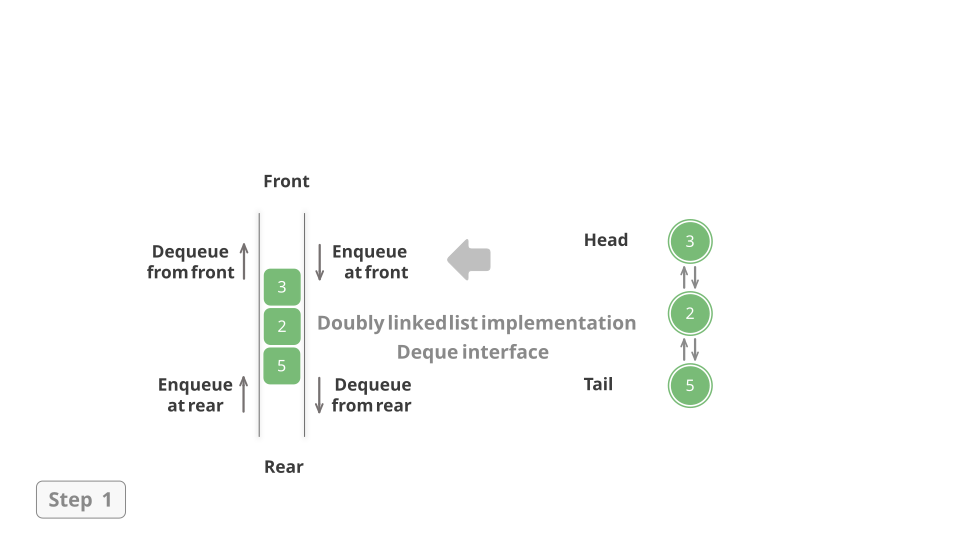
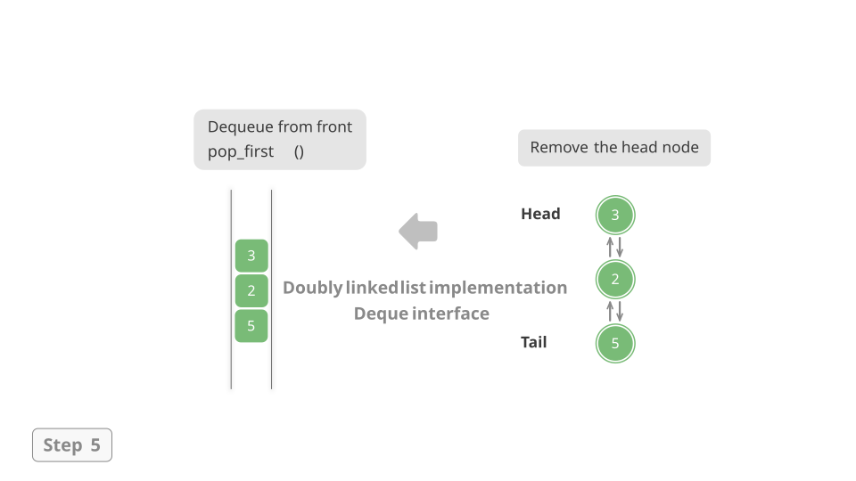
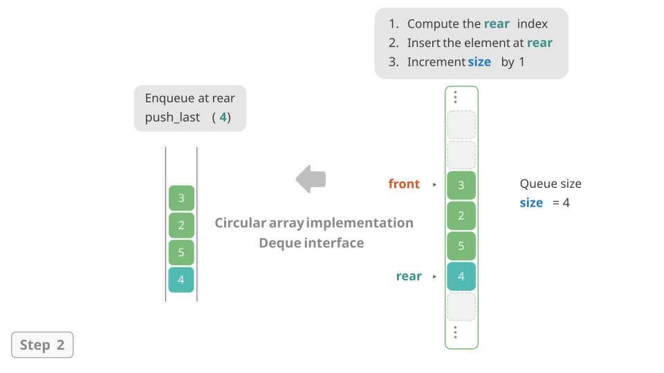
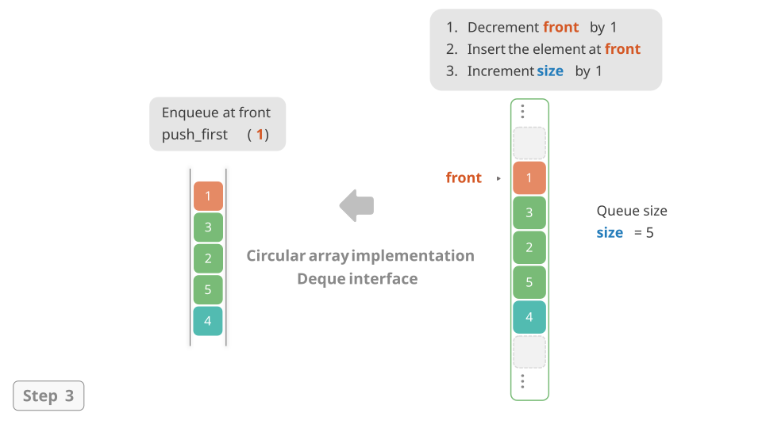
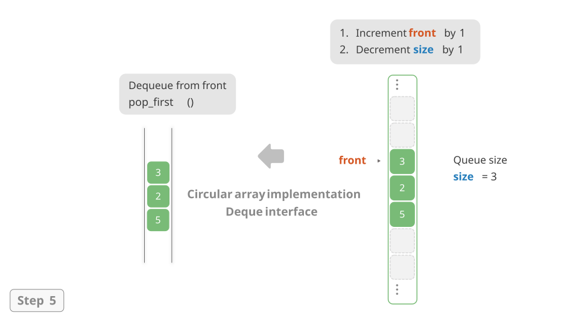

# Deques

A queue allows removal only at the front and insertion only at the rear. As shown below, a <u>double-ended queue</u>, or deque, is more flexible: elements can be added or removed at either end.


## Common deque operations

The table below lists common operations. Actual method names depend on the programming language.

<p align="center"> Table <id> &nbsp; Efficiency of deque operations </p>

| Method         | Description             | Time complexity |
| -------------- | ---------------- | ---------- |
| `push_first()` | Add an element at the front | $O(1)$     |
| `push_last()`  | Add an element at the rear | $O(1)$     |
| `pop_first()`  | Remove the front element     | $O(1)$     |
| `pop_last()`   | Remove the rear element     | $O(1)$     |
| `peek_first()` | Access the front element     | $O(1)$     |
| `peek_last()`  | Access the rear element     | $O(1)$     |

Again, we can use a deque class already provided by the programming language:

```snippet
deque_operations
```

??? pythontutor "Visualize execution"

    @tutor deque_operations_tutor

## Implementing a deque *

A deque is implemented much like a queue, using either a linked list or an array as the underlying structure.

### Implementation with a doubly linked list

In the previous section, we used a singly linked list for a queue because it easily supports removing the head for dequeueing and adding after the tail for enqueueing.

A deque supports both insertion and removal at both ends. It therefore needs the symmetric operations in the other direction as well. For this reason, we use a doubly linked list.

As shown below, treat the list's head and tail as the deque's front and rear, and support adding and removing nodes at both ends.

=== "<1>"
    

=== "<2>"
    

=== "<3>"
    

=== "<4>"
    

=== "<5>"
    

The implementation is as follows:

```src
[file]{linkedlist_deque}-[class]{linked_list_deque}-[func]{}
```

### Implementation with an array

As with an array-based queue, we can use a circular array to implement a deque, as shown below.

=== "<1>"
    

=== "<2>"
    

=== "<3>"
    

=== "<4>"
    

=== "<5>"
    

Starting with the queue implementation, we need only add methods for insertion at the front and removal at the rear:

```src
[file]{array_deque}-[class]{array_deque}-[func]{}
```

## Applications

A deque combines stack and queue behavior, **so it supports all their applications while offering greater flexibility**.

Software undo is usually implemented with a stack: the system uses `push` to record each change and `pop` to undo it. Because resources are limited, software often restricts the history to a fixed number of steps, such as $50$. When the stack grows beyond $50$, the oldest entry must be removed from the bottom, the front of the deque. **A stack cannot provide this operation, so a deque is needed instead**. The core undo behavior still follows last-in, first-out order; the deque simply provides flexibility for the additional logic.
