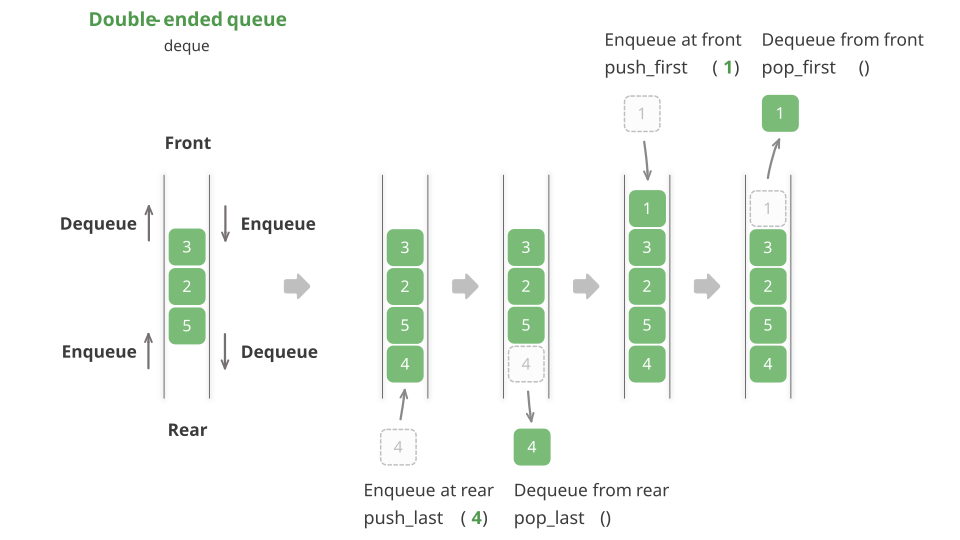
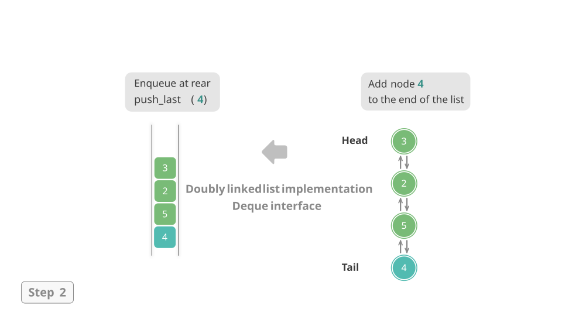
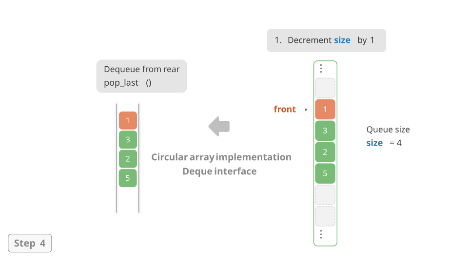

# Deques

An ordinary queue allows removal only at the front and insertion only at the rear. A <u>double-ended queue (deque)</u> is more flexible: as shown below, it allows insertion and removal at either end.



## Common deque operations

The table below lists common deque operations. The method names depend on the programming language.

<p align="center"> Table <id> &nbsp; Time complexity of deque operations </p>

| Method name         | Description             | Time complexity |
| -------------- | ---------------- | ---------- |
| `push_first()` | Add an element at the front | $O(1)$     |
| `push_last()`  | Add an element at the rear | $O(1)$     |
| `pop_first()`  | Remove the front element     | $O(1)$     |
| `pop_last()`   | Remove the rear element     | $O(1)$     |
| `peek_first()` | Access the front element     | $O(1)$     |
| `peek_last()`  | Access the rear element     | $O(1)$     |

As with an ordinary queue, you can use the deque class your programming language provides:

```snippet
deque_operations
```

??? pythontutor "Visualize execution"

    @tutor deque_operations_tutor

## Implementing a deque *

Like an ordinary queue, a deque can use either a linked list or an array as its underlying data structure.

### Doubly linked list implementation

In the previous section, we used a singly linked list for a queue because it makes it easy to remove the head node when dequeueing and to add a new node after the tail when enqueueing.

A deque supports enqueueing and dequeueing at both ends, so it also needs the mirror image of each queue operation. To support these operations, we use a doubly linked list.

As shown below, the head and tail of the doubly linked list serve as the front and rear of the deque. We implement insertion and removal at both ends.

=== "<1>"
    

=== "<2>"
    

=== "<3>"
    

=== "<4>"
    

=== "<5>"
    

The following code implements the deque:

```src
[file]{linkedlist_deque}-[class]{linked_list_deque}-[func]{}
```

### Array implementation

As with an array-based queue, we can use a circular array to implement a deque, as shown below.

=== "<1>"
    

=== "<2>"
    

=== "<3>"
    

=== "<4>"
    

=== "<5>"
    

Starting with the queue implementation, we need only add methods to enqueue at the front and dequeue from the rear:

```src
[file]{array_deque}-[class]{array_deque}-[func]{}
```

## Uses of deques

A deque supports the behavior of both a stack and a queue, so **it can serve all the same purposes while offering more flexibility**.

Software typically uses a stack for undo: the system uses `push` to add each change to the stack, then uses `pop` to undo it. Because system resources are limited, software often caps the number of undo steps it keeps, for example at $50$. When the stack grows beyond $50$ steps, the software needs to remove the oldest step from the bottom of the stack (the front of the queue). **A stack does not support this operation, so we need a deque in its place**. Undo still follows the last-in, first-out rule. The deque gives us the flexibility to handle the additional operation.
