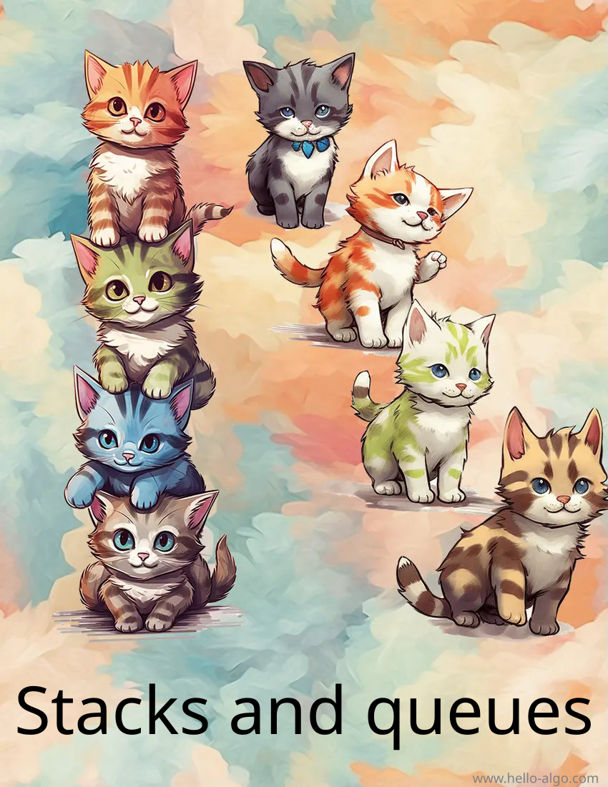

# Chapter 5. &nbsp; Stacks and queues

{ class="cover-image" }

!!! abstract

    Picture cats piled on top of one another for a stack, and cats standing in line for a queue.
    
    A stack follows the last-in, first-out rule, and a queue follows the first-in, first-out rule.

## In this chapter

- [5.1 &nbsp; Stacks](stack.md)
- [5.2 &nbsp; Queues](queue.md)
- [5.3 &nbsp; Deques](deque.md)
- [5.4 &nbsp; Summary](summary.md)
- [5.5 &nbsp; Exercises](exercises.md)
