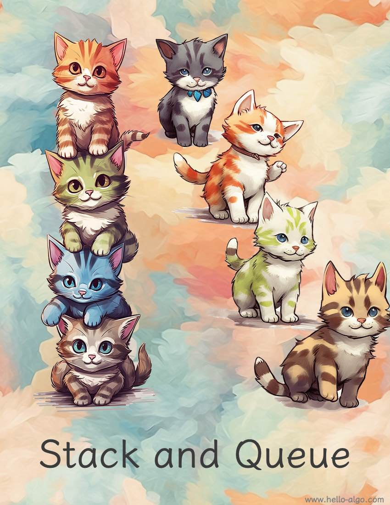

# Stacks and queues

!!! abstract

    Picture cats piled on top of one another for a stack, and cats standing in line for a queue.
    
    A stack follows the last-in, first-out rule, and a queue follows the first-in, first-out rule.
