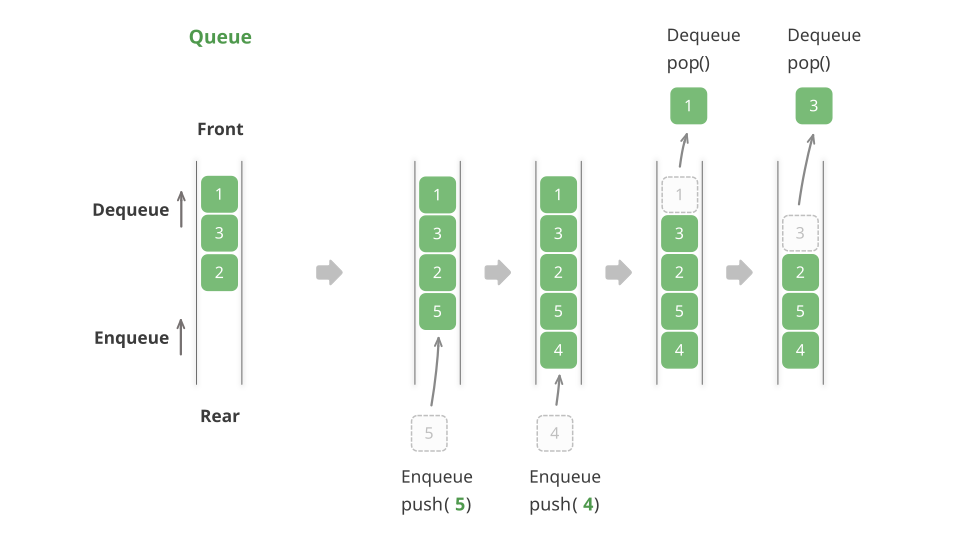
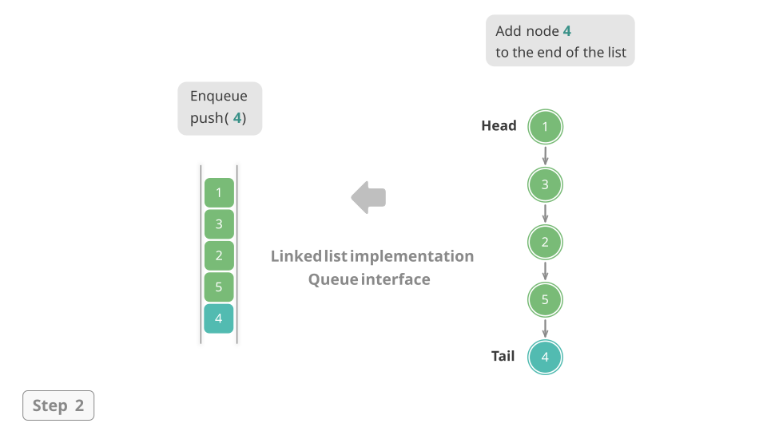
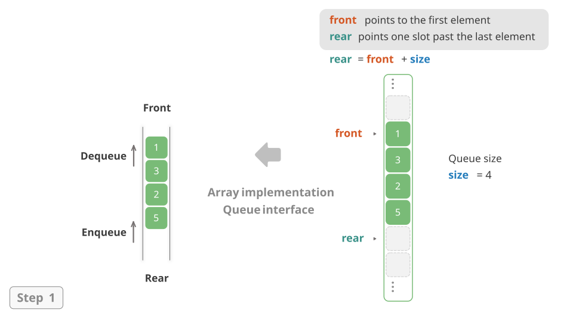
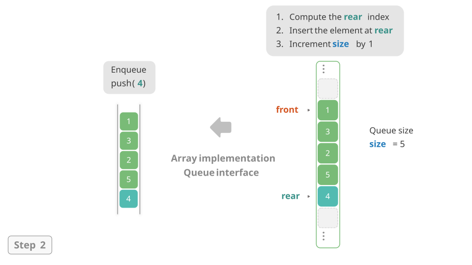
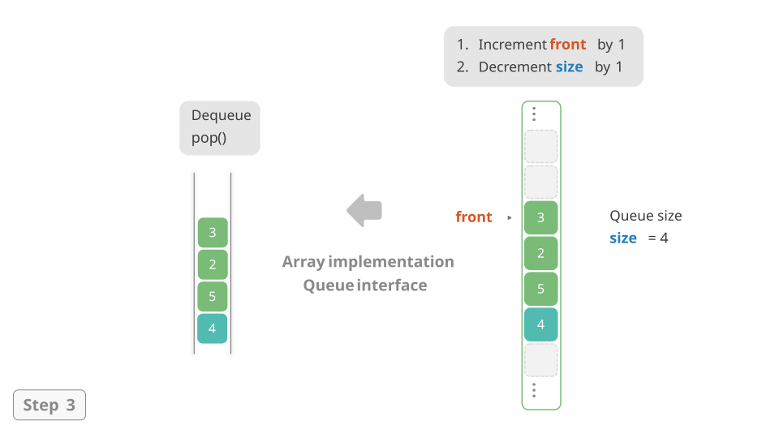

# Queues

A <u>queue</u> is a linear data structure that follows a first-in, first-out rule. It models a line of people: newcomers join at the back, while those at the front leave one by one.

As shown below, the two ends are called the “front” and the “rear.” Adding an element at the rear is called “enqueueing,” and removing an element from the front is called “dequeueing.”



## Common queue operations

The table below lists common operations. Method names vary between programming languages; here we use the same names as for stacks.

<p align="center"> Table <id> &nbsp; Efficiency of queue operations </p>

| Method   | Description                         | Time complexity |
| -------- | ---------------------------- | ---------- |
| `push()` | Enqueue an element at the rear | $O(1)$     |
| `pop()`  | Dequeue the front element                 | $O(1)$     |
| `peek()` | Access the front element                 | $O(1)$     |

We can use a queue class already provided by the programming language:

```snippet
queue_operations
```

??? pythontutor "Visualize execution"

    @tutor queue_operations_tutor

## Implementing a queue

A queue needs a data structure that allows insertion at one end and deletion at the other. Both linked lists and arrays can meet this requirement.

### Implementation with a linked list

As shown below, treat the linked list's head and tail as the queue's front and rear. Nodes may be added only at the rear and removed only from the front.

=== "<1>"
    

=== "<2>"
    

=== "<3>"
    

Here is an implementation using a linked list:

```src
[file]{linkedlist_queue}-[class]{linked_list_queue}-[func]{}
```

### Implementation with an array

Removing the first element of an array takes $O(n)$ time, which would make dequeueing inefficient. A useful technique avoids this problem.

Use a variable `front` for the index of the front element and a variable `size` for the queue's length. Define `rear = front + size`, so `rear` points to the position immediately after the last element.

With this design, **the occupied interval is `[front, rear - 1]`**. Operations work as shown below.

- Enqueue: assign the new element to index `rear` and increase `size` by 1.
- Dequeue: increase `front` by 1 and decrease `size` by 1.

Both operations require only a constant amount of work and take $O(1)$ time.

=== "<1>"
    

=== "<2>"
    

=== "<3>"
    

There is a problem: repeated enqueueing and dequeueing move both `front` and `rear` to the right, **and they cannot continue once they reach the end of the array**. To solve this, treat the array as circular, with its end connected to its beginning.

When `front` or `rear` passes the array's end, wrap it back to the beginning. The remainder operation implements this cyclic behavior:

```src
[file]{array_queue}-[class]{array_queue}-[func]{}
```

This queue still has a limitation: its capacity is fixed. We can address it by replacing the array with a dynamic array and adding resizing. Interested readers can try implementing this themselves.

The comparison between these two implementations is the same as for stacks, so we will not repeat it here.

## Typical applications

- **Taobao orders**. When a shopper places an order, it enters a queue, and the system processes orders in sequence. During the Singles' Day shopping festival, enormous numbers of orders arrive in a short time, making high concurrency a major engineering challenge.
- **Tasks awaiting processing**. Queues preserve processing order wherever first-come, first-served behavior is needed, such as printer jobs or restaurant orders.
