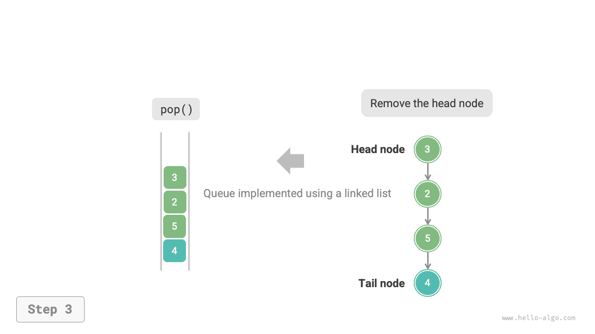
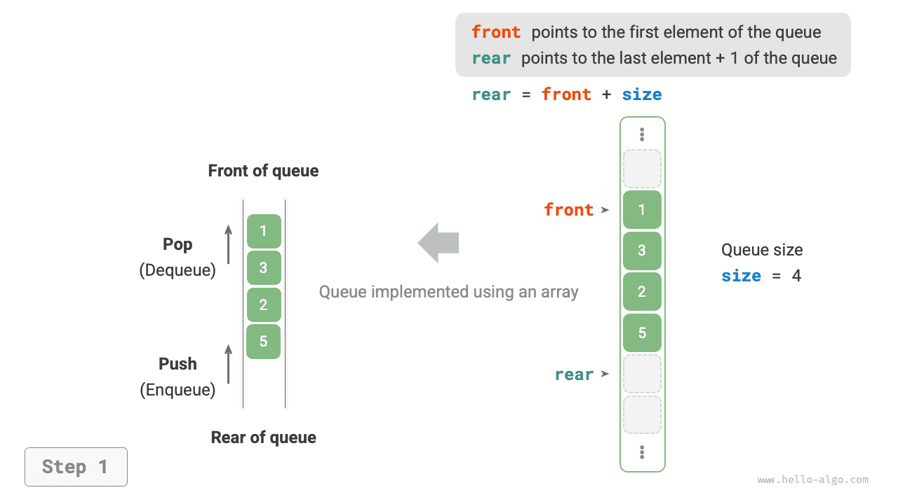

# 5.2 &nbsp; Queues

A <u>queue</u> is a linear data structure that follows a first-in, first-out rule. It models a line of people: newcomers join at the back, while those at the front leave one by one.

As shown below, the two ends are called the “front” and the “rear.” Adding an element at the rear is called “enqueueing,” and removing an element from the front is called “dequeueing.”

{ class="animation-figure" }

<p align="center"> Figure 5-4 &nbsp; The first-in, first-out rule of a queue </p>

## 5.2.1 &nbsp; Common queue operations

Table 5-2 lists common operations. Method names vary between programming languages; here we use the same names as for stacks.

<p align="center"> Table 5-2 &nbsp; Efficiency of queue operations </p>

<div class="center-table" markdown>

| Method   | Description                         | Time complexity |
| -------- | ---------------------------- | ---------- |
| `push()` | Enqueue an element at the rear | $O(1)$     |
| `pop()`  | Dequeue the front element                 | $O(1)$     |
| `peek()` | Access the front element                 | $O(1)$     |

</div>

We can use a queue class already provided by the programming language:

=== "Python"

    ```python title="queue.py"
    from collections import deque

    # Initialize a queue
    # In Python, we usually use the deque class as a queue
    # Although queue.Queue() is a dedicated queue class, it is less convenient and is not recommended here
    que: deque[int] = deque()

    # Enqueue elements
    que.append(1)
    que.append(3)
    que.append(2)
    que.append(5)
    que.append(4)

    # Access the front element
    front: int = que[0]

    # Dequeue an element
    pop: int = que.popleft()

    # Get the queue size
    size: int = len(que)

    # Check whether the queue is empty
    is_empty: bool = len(que) == 0
    ```

=== "C++"

    ```cpp title="queue.cpp"
    /* Initialize a queue */
    queue<int> queue;

    /* Enqueue elements */
    queue.push(1);
    queue.push(3);
    queue.push(2);
    queue.push(5);
    queue.push(4);

    /* Access the front element */
    int front = queue.front();

    /* Dequeue an element */
    queue.pop();

    /* Get the queue size */
    int size = queue.size();

    /* Check whether the queue is empty */
    bool empty = queue.empty();
    ```

=== "Java"

    ```java title="queue.java"
    /* Initialize a queue */
    Queue<Integer> queue = new LinkedList<>();

    /* Enqueue elements */
    queue.offer(1);
    queue.offer(3);
    queue.offer(2);
    queue.offer(5);
    queue.offer(4);

    /* Access the front element */
    int peek = queue.peek();

    /* Dequeue an element */
    int pop = queue.poll();

    /* Get the queue size */
    int size = queue.size();

    /* Check whether the queue is empty */
    boolean isEmpty = queue.isEmpty();
    ```

=== "C#"

    ```csharp title="queue.cs"
    /* Initialize a queue */
    Queue<int> queue = new();

    /* Enqueue elements */
    queue.Enqueue(1);
    queue.Enqueue(3);
    queue.Enqueue(2);
    queue.Enqueue(5);
    queue.Enqueue(4);

    /* Access the front element */
    int peek = queue.Peek();

    /* Dequeue an element */
    int pop = queue.Dequeue();

    /* Get the queue size */
    int size = queue.Count;

    /* Check whether the queue is empty */
    bool isEmpty = queue.Count == 0;
    ```

=== "Go"

    ```go title="queue_test.go"
    /* Initialize a queue */
    // In Go, use a list as a queue
    queue := list.New()

    /* Enqueue elements */
    queue.PushBack(1)
    queue.PushBack(3)
    queue.PushBack(2)
    queue.PushBack(5)
    queue.PushBack(4)

    /* Access the front element */
    peek := queue.Front()

    /* Dequeue an element */
    pop := queue.Front()
    queue.Remove(pop)

    /* Get the queue size */
    size := queue.Len()

    /* Check whether the queue is empty */
    isEmpty := queue.Len() == 0
    ```

=== "Swift"

    ```swift title="queue.swift"
    /* Initialize a queue */
    // Swift has no built-in queue class; use an Array as a queue
    var queue: [Int] = []

    /* Enqueue elements */
    queue.append(1)
    queue.append(3)
    queue.append(2)
    queue.append(5)
    queue.append(4)

    /* Access the front element */
    let peek = queue.first!

    /* Dequeue an element */
    // Because this is an array, removeFirst takes O(n) time
    let pop = queue.removeFirst()

    /* Get the queue size */
    let size = queue.count

    /* Check whether the queue is empty */
    let isEmpty = queue.isEmpty
    ```

=== "JS"

    ```javascript title="queue.js"
    /* Initialize a queue */
    // JavaScript has no built-in queue; use an Array as a queue
    const queue = [];

    /* Enqueue elements */
    queue.push(1);
    queue.push(3);
    queue.push(2);
    queue.push(5);
    queue.push(4);

    /* Access the front element */
    const peek = queue[0];

    /* Dequeue an element */
    // The underlying structure is an array, so shift() takes O(n) time
    const pop = queue.shift();

    /* Get the queue size */
    const size = queue.length;

    /* Check whether the queue is empty */
    const empty = queue.length === 0;
    ```

=== "TS"

    ```typescript title="queue.ts"
    /* Initialize a queue */
    // TypeScript has no built-in queue; use an Array as a queue
    const queue: number[] = [];

    /* Enqueue elements */
    queue.push(1);
    queue.push(3);
    queue.push(2);
    queue.push(5);
    queue.push(4);

    /* Access the front element */
    const peek = queue[0];

    /* Dequeue an element */
    // The underlying structure is an array, so shift() takes O(n) time
    const pop = queue.shift();

    /* Get the queue size */
    const size = queue.length;

    /* Check whether the queue is empty */
    const empty = queue.length === 0;
    ```

=== "Dart"

    ```dart title="queue.dart"
    /* Initialize a queue */
    // In Dart, Queue is a deque and can also be used as a queue
    Queue<int> queue = Queue();

    /* Enqueue elements */
    queue.add(1);
    queue.add(3);
    queue.add(2);
    queue.add(5);
    queue.add(4);

    /* Access the front element */
    int peek = queue.first;

    /* Dequeue an element */
    int pop = queue.removeFirst();

    /* Get the queue size */
    int size = queue.length;

    /* Check whether the queue is empty */
    bool isEmpty = queue.isEmpty;
    ```

=== "Rust"

    ```rust title="queue.rs"
    /* Initialize a deque */
    // In Rust, use a deque as an ordinary queue
    let mut deque: VecDeque<u32> = VecDeque::new();

    /* Enqueue elements */
    deque.push_back(1);
    deque.push_back(3);
    deque.push_back(2);
    deque.push_back(5);
    deque.push_back(4);

    /* Access the front element */
    if let Some(front) = deque.front() {
    }

    /* Dequeue an element */
    if let Some(pop) = deque.pop_front() {
    }

    /* Get the queue size */
    let size = deque.len();

    /* Check whether the queue is empty */
    let is_empty = deque.is_empty();
    ```

=== "C"

    ```c title="queue.c"
    // C provides no built-in queue
    ```

=== "Kotlin"

    ```kotlin title="queue.kt"
    /* Initialize a queue */
    val queue = LinkedList<Int>()

    /* Enqueue elements */
    queue.offer(1)
    queue.offer(3)
    queue.offer(2)
    queue.offer(5)
    queue.offer(4)

    /* Access the front element */
    val peek = queue.peek()

    /* Dequeue an element */
    val pop = queue.poll()

    /* Get the queue size */
    val size = queue.size

    /* Check whether the queue is empty */
    val isEmpty = queue.isEmpty()
    ```

=== "Ruby"

    ```ruby title="queue.rb"
    # Initialize a queue
    # Ruby's built-in Thread::Queue has no peek or traversal methods; use an Array as a queue
    queue = []

    # Enqueue elements
    queue.push(1)
    queue.push(3)
    queue.push(2)
    queue.push(5)
    queue.push(4)

    # Access the front element of the queue
    peek = queue.first

    # Dequeue an element
    # Note that this is an array, so Array#shift takes O(n) time
    pop = queue.shift

    # Get the queue size
    size = queue.length

    # Check whether the queue is empty
    is_empty = queue.empty?
    ```

??? pythontutor "Visualize execution"

    <div style="height: 549px; width: 100%;"><iframe class="pythontutor-iframe" title="Visualize execution" src="https://pythontutor.com/iframe-embed.html#code=from%20collections%20import%20deque%0A%0A%22%22%22Driver%20Code%22%22%22%0Aif%20__name__%20%3D%3D%20%22__main__%22%3A%0A%20%20%20%20%23%20Initialize%20a%20queue%0A%20%20%20%20%23%20In%20Python%2C%20we%20usually%20use%20the%20deque%20class%20as%20a%20queue%0A%20%20%20%20%23%20Although%20queue.Queue%28%29%20is%20a%20dedicated%20queue%20class%2C%20it%20is%20less%20convenient%0A%20%20%20%20que%20%3D%20deque%28%29%0A%0A%20%20%20%20%23%20Enqueue%20elements%0A%20%20%20%20que.append%281%29%0A%20%20%20%20que.append%283%29%0A%20%20%20%20que.append%282%29%0A%20%20%20%20que.append%285%29%0A%20%20%20%20que.append%284%29%0A%20%20%20%20print%28%22Queue%3A%20que%20%3D%22%2C%20que%29%0A%0A%20%20%20%20%23%20Access%20the%20front%20element%0A%20%20%20%20front%20%3D%20que%5B0%5D%0A%20%20%20%20print%28%22Front%20element%3A%20front%20%3D%22%2C%20front%29%0A%0A%20%20%20%20%23%20Dequeue%20an%20element%0A%20%20%20%20pop%20%3D%20que.popleft%28%29%0A%20%20%20%20print%28%22Dequeued%20element%3A%20pop%20%3D%22%2C%20pop%29%0A%20%20%20%20print%28%22After%20dequeuing%3A%20que%20%3D%22%2C%20que%29%0A%0A%20%20%20%20%23%20Get%20the%20queue%20size%0A%20%20%20%20size%20%3D%20len%28que%29%0A%20%20%20%20print%28%22Queue%20size%3A%20size%20%3D%22%2C%20size%29%0A%0A%20%20%20%20%23%20Check%20whether%20the%20queue%20is%20empty%0A%20%20%20%20is_empty%20%3D%20len%28que%29%20%3D%3D%200%0A%20%20%20%20print%28%22Is%20the%20queue%20empty%20%3D%22%2C%20is_empty%29&codeDivHeight=472&codeDivWidth=350&cumulative=false&curInstr=3&heapPrimitives=nevernest&origin=opt-frontend.js&py=311&rawInputLstJSON=%5B%5D&textReferences=false"> </iframe></div>
    <div style="margin-top: 5px;"><a href="https://pythontutor.com/iframe-embed.html#code=from%20collections%20import%20deque%0A%0A%22%22%22Driver%20Code%22%22%22%0Aif%20__name__%20%3D%3D%20%22__main__%22%3A%0A%20%20%20%20%23%20Initialize%20a%20queue%0A%20%20%20%20%23%20In%20Python%2C%20we%20usually%20use%20the%20deque%20class%20as%20a%20queue%0A%20%20%20%20%23%20Although%20queue.Queue%28%29%20is%20a%20dedicated%20queue%20class%2C%20it%20is%20less%20convenient%0A%20%20%20%20que%20%3D%20deque%28%29%0A%0A%20%20%20%20%23%20Enqueue%20elements%0A%20%20%20%20que.append%281%29%0A%20%20%20%20que.append%283%29%0A%20%20%20%20que.append%282%29%0A%20%20%20%20que.append%285%29%0A%20%20%20%20que.append%284%29%0A%20%20%20%20print%28%22Queue%3A%20que%20%3D%22%2C%20que%29%0A%0A%20%20%20%20%23%20Access%20the%20front%20element%0A%20%20%20%20front%20%3D%20que%5B0%5D%0A%20%20%20%20print%28%22Front%20element%3A%20front%20%3D%22%2C%20front%29%0A%0A%20%20%20%20%23%20Dequeue%20an%20element%0A%20%20%20%20pop%20%3D%20que.popleft%28%29%0A%20%20%20%20print%28%22Dequeued%20element%3A%20pop%20%3D%22%2C%20pop%29%0A%20%20%20%20print%28%22After%20dequeuing%3A%20que%20%3D%22%2C%20que%29%0A%0A%20%20%20%20%23%20Get%20the%20queue%20size%0A%20%20%20%20size%20%3D%20len%28que%29%0A%20%20%20%20print%28%22Queue%20size%3A%20size%20%3D%22%2C%20size%29%0A%0A%20%20%20%20%23%20Check%20whether%20the%20queue%20is%20empty%0A%20%20%20%20is_empty%20%3D%20len%28que%29%20%3D%3D%200%0A%20%20%20%20print%28%22Is%20the%20queue%20empty%20%3D%22%2C%20is_empty%29&codeDivHeight=800&codeDivWidth=600&cumulative=false&curInstr=3&heapPrimitives=nevernest&origin=opt-frontend.js&py=311&rawInputLstJSON=%5B%5D&textReferences=false" target="_blank" rel="noopener noreferrer">View full screen ></a></div>

## 5.2.2 &nbsp; Implementing a queue

A queue needs a data structure that allows insertion at one end and deletion at the other. Both linked lists and arrays can meet this requirement.

### 1. &nbsp; Implementation with a linked list

As shown below, treat the linked list's head and tail as the queue's front and rear. Nodes may be added only at the rear and removed only from the front.

=== "<1>"
    { class="animation-figure" }

=== "<2>"
    { class="animation-figure" }

=== "<3>"
    { class="animation-figure" }

<p align="center"> Figure 5-5 &nbsp; Enqueue and dequeue in a linked-list queue </p>

Here is an implementation using a linked list:

=== "Python"

    ```python title="linkedlist_queue.py"
    class LinkedListQueue:
        """Queue implemented with a linked list"""

        def __init__(self):
            """Constructor"""
            self._front: ListNode | None = None  # Head node front
            self._rear: ListNode | None = None  # Tail node rear
            self._size: int = 0

        def size(self) -> int:
            """Get the queue size"""
            return self._size

        def is_empty(self) -> bool:
            """Check whether the queue is empty"""
            return self._size == 0

        def push(self, num: int):
            """Enqueue"""
            # Add num after the tail node
            node = ListNode(num)
            # If the queue is empty, make both the head and tail point to this node
            if self._front is None:
                self._front = node
                self._rear = node
            # If the queue is not empty, add this node after the tail node
            else:
                self._rear.next = node
                self._rear = node
            self._size += 1

        def pop(self) -> int:
            """Dequeue"""
            num = self.peek()
            # Remove the head node
            self._front = self._front.next
            self._size -= 1
            return num

        def peek(self) -> int:
            """Access the front element"""
            if self.is_empty():
                raise IndexError("Queue is empty")
            return self._front.val

        def to_list(self) -> list[int]:
            """Convert to a list for printing"""
            queue = []
            temp = self._front
            while temp:
                queue.append(temp.val)
                temp = temp.next
            return queue
    ```

=== "C++"

    ```cpp title="linkedlist_queue.cpp"
    /* Queue implemented with a linked list */
    class LinkedListQueue {
      private:
        ListNode *front, *rear; // Head node front and tail node rear
        int queSize;

      public:
        LinkedListQueue() {
            front = nullptr;
            rear = nullptr;
            queSize = 0;
        }

        ~LinkedListQueue() {
            // Traverse the linked list and delete each node to free its memory
            freeMemoryLinkedList(front);
        }

        /* Get the queue size */
        int size() {
            return queSize;
        }

        /* Check whether the queue is empty */
        bool isEmpty() {
            return queSize == 0;
        }

        /* Enqueue */
        void push(int num) {
            // Add num after the tail node
            ListNode *node = new ListNode(num);
            // If the queue is empty, make both the head and tail point to this node
            if (front == nullptr) {
                front = node;
                rear = node;
            }
            // If the queue is not empty, add this node after the tail node
            else {
                rear->next = node;
                rear = node;
            }
            queSize++;
        }

        /* Dequeue */
        int pop() {
            int num = peek();
            // Remove the head node
            ListNode *tmp = front;
            front = front->next;
            // Free memory
            delete tmp;
            queSize--;
            return num;
        }

        /* Access the front element */
        int peek() {
            if (size() == 0)
                throw out_of_range("Queue is empty");
            return front->val;
        }

        /* Convert the linked list to a vector and return it */
        vector<int> toVector() {
            ListNode *node = front;
            vector<int> res(size());
            for (int i = 0; i < res.size(); i++) {
                res[i] = node->val;
                node = node->next;
            }
            return res;
        }
    };
    ```

=== "Java"

    ```java title="linkedlist_queue.java"
    /* Queue implemented with a linked list */
    class LinkedListQueue {
        private ListNode front, rear; // Head node front and tail node rear
        private int queSize = 0;

        public LinkedListQueue() {
            front = null;
            rear = null;
        }

        /* Get the queue size */
        public int size() {
            return queSize;
        }

        /* Check whether the queue is empty */
        public boolean isEmpty() {
            return size() == 0;
        }

        /* Enqueue */
        public void push(int num) {
            // Add num after the tail node
            ListNode node = new ListNode(num);
            // If the queue is empty, make both the head and tail point to this node
            if (front == null) {
                front = node;
                rear = node;
            // If the queue is not empty, add this node after the tail node
            } else {
                rear.next = node;
                rear = node;
            }
            queSize++;
        }

        /* Dequeue */
        public int pop() {
            int num = peek();
            // Remove the head node
            front = front.next;
            queSize--;
            return num;
        }

        /* Access the front element */
        public int peek() {
            if (isEmpty())
                throw new IndexOutOfBoundsException();
            return front.val;
        }

        /* Convert the linked list to an array and return it */
        public int[] toArray() {
            ListNode node = front;
            int[] res = new int[size()];
            for (int i = 0; i < res.length; i++) {
                res[i] = node.val;
                node = node.next;
            }
            return res;
        }
    }
    ```

=== "C#"

    ```csharp title="linkedlist_queue.cs"
    /* Queue implemented with a linked list */
    class LinkedListQueue {
        ListNode? front, rear;  // Head node front and tail node rear 
        int queSize = 0;

        public LinkedListQueue() {
            front = null;
            rear = null;
        }

        /* Get the queue size */
        public int Size() {
            return queSize;
        }

        /* Check whether the queue is empty */
        public bool IsEmpty() {
            return Size() == 0;
        }

        /* Enqueue */
        public void Push(int num) {
            // Add num after the tail node
            ListNode node = new(num);
            // If the queue is empty, make both the head and tail point to this node
            if (front == null) {
                front = node;
                rear = node;
                // If the queue is not empty, add this node after the tail node
            } else if (rear != null) {
                rear.next = node;
                rear = node;
            }
            queSize++;
        }

        /* Dequeue */
        public int Pop() {
            int num = Peek();
            // Remove the head node
            front = front?.next;
            queSize--;
            return num;
        }

        /* Access the front element */
        public int Peek() {
            if (IsEmpty())
                throw new Exception();
            return front!.val;
        }

        /* Convert the linked list to an array and return it */
        public int[] ToArray() {
            if (front == null)
                return [];

            ListNode? node = front;
            int[] res = new int[Size()];
            for (int i = 0; i < res.Length; i++) {
                res[i] = node!.val;
                node = node.next;
            }
            return res;
        }
    }
    ```

=== "Go"

    ```go title="linkedlist_queue.go"
    /* Queue implemented with a linked list */
    type linkedListQueue struct {
        // Use the standard library list package to implement the queue
        data *list.List
    }

    /* Initialize the queue */
    func newLinkedListQueue() *linkedListQueue {
        return &linkedListQueue{
            data: list.New(),
        }
    }

    /* Enqueue */
    func (s *linkedListQueue) push(value any) {
        s.data.PushBack(value)
    }

    /* Dequeue */
    func (s *linkedListQueue) pop() any {
        if s.isEmpty() {
            return nil
        }
        e := s.data.Front()
        s.data.Remove(e)
        return e.Value
    }

    /* Access the front element */
    func (s *linkedListQueue) peek() any {
        if s.isEmpty() {
            return nil
        }
        e := s.data.Front()
        return e.Value
    }

    /* Get the queue size */
    func (s *linkedListQueue) size() int {
        return s.data.Len()
    }

    /* Check whether the queue is empty */
    func (s *linkedListQueue) isEmpty() bool {
        return s.data.Len() == 0
    }

    /* Get the list for printing */
    func (s *linkedListQueue) toList() *list.List {
        return s.data
    }
    ```

=== "Swift"

    ```swift title="linkedlist_queue.swift"
    /* Queue implemented with a linked list */
    class LinkedListQueue {
        private var front: ListNode? // Head node
        private var rear: ListNode? // Tail node
        private var _size: Int

        init() {
            _size = 0
        }

        /* Get the queue size */
        func size() -> Int {
            _size
        }

        /* Check whether the queue is empty */
        func isEmpty() -> Bool {
            size() == 0
        }

        /* Enqueue */
        func push(num: Int) {
            // Add num after the tail node
            let node = ListNode(x: num)
            // If the queue is empty, make both the head and tail point to this node
            if front == nil {
                front = node
                rear = node
            }
            // If the queue is not empty, add this node after the tail node
            else {
                rear?.next = node
                rear = node
            }
            _size += 1
        }

        /* Dequeue */
        @discardableResult
        func pop() -> Int {
            let num = peek()
            // Remove the head node
            front = front?.next
            _size -= 1
            return num
        }

        /* Access the front element */
        func peek() -> Int {
            if isEmpty() {
                fatalError("Queue is empty")
            }
            return front!.val
        }

        /* Convert the linked list to an array and return it */
        func toArray() -> [Int] {
            var node = front
            var res = Array(repeating: 0, count: size())
            for i in res.indices {
                res[i] = node!.val
                node = node?.next
            }
            return res
        }
    }
    ```

=== "JS"

    ```javascript title="linkedlist_queue.js"
    /* Queue implemented with a linked list */
    class LinkedListQueue {
        #front; // Head node #front
        #rear; // Tail node #rear
        #queSize = 0;

        constructor() {
            this.#front = null;
            this.#rear = null;
        }

        /* Get the queue size */
        get size() {
            return this.#queSize;
        }

        /* Check whether the queue is empty */
        isEmpty() {
            return this.size === 0;
        }

        /* Enqueue */
        push(num) {
            // Add num after the tail node
            const node = new ListNode(num);
            // If the queue is empty, make both the head and tail point to this node
            if (!this.#front) {
                this.#front = node;
                this.#rear = node;
                // If the queue is not empty, add this node after the tail node
            } else {
                this.#rear.next = node;
                this.#rear = node;
            }
            this.#queSize++;
        }

        /* Dequeue */
        pop() {
            const num = this.peek();
            // Remove the head node
            this.#front = this.#front.next;
            this.#queSize--;
            return num;
        }

        /* Access the front element */
        peek() {
            if (this.size === 0) throw new Error('Queue is empty');
            return this.#front.val;
        }

        /* Convert the linked list to an Array and return it */
        toArray() {
            let node = this.#front;
            const res = new Array(this.size);
            for (let i = 0; i < res.length; i++) {
                res[i] = node.val;
                node = node.next;
            }
            return res;
        }
    }
    ```

=== "TS"

    ```typescript title="linkedlist_queue.ts"
    /* Queue implemented with a linked list */
    class LinkedListQueue {
        private front: ListNode | null; // Head node front
        private rear: ListNode | null; // Tail node rear
        private queSize: number = 0;

        constructor() {
            this.front = null;
            this.rear = null;
        }

        /* Get the queue size */
        get size(): number {
            return this.queSize;
        }

        /* Check whether the queue is empty */
        isEmpty(): boolean {
            return this.size === 0;
        }

        /* Enqueue */
        push(num: number): void {
            // Add num after the tail node
            const node = new ListNode(num);
            // If the queue is empty, make both the head and tail point to this node
            if (!this.front) {
                this.front = node;
                this.rear = node;
                // If the queue is not empty, add this node after the tail node
            } else {
                this.rear!.next = node;
                this.rear = node;
            }
            this.queSize++;
        }

        /* Dequeue */
        pop(): number {
            const num = this.peek();
            if (!this.front) throw new Error('Queue is empty');
            // Remove the head node
            this.front = this.front.next;
            this.queSize--;
            return num;
        }

        /* Access the front element */
        peek(): number {
            if (this.size === 0) throw new Error('Queue is empty');
            return this.front!.val;
        }

        /* Convert the linked list to an Array and return it */
        toArray(): number[] {
            let node = this.front;
            const res = new Array<number>(this.size);
            for (let i = 0; i < res.length; i++) {
                res[i] = node!.val;
                node = node!.next;
            }
            return res;
        }
    }
    ```

=== "Dart"

    ```dart title="linkedlist_queue.dart"
    /* Queue implemented with a linked list */
    class LinkedListQueue {
      ListNode? _front; // Head node _front
      ListNode? _rear; // Tail node _rear
      int _queSize = 0; // Queue size

      LinkedListQueue() {
        _front = null;
        _rear = null;
      }

      /* Get the queue size */
      int size() {
        return _queSize;
      }

      /* Check whether the queue is empty */
      bool isEmpty() {
        return _queSize == 0;
      }

      /* Enqueue */
      void push(int _num) {
        // Add _num after the tail node
        final node = ListNode(_num);
        // If the queue is empty, make both the head and tail point to this node
        if (_front == null) {
          _front = node;
          _rear = node;
        } else {
          // If the queue is not empty, add this node after the tail node
          _rear!.next = node;
          _rear = node;
        }
        _queSize++;
      }

      /* Dequeue */
      int pop() {
        final int _num = peek();
        // Remove the head node
        _front = _front!.next;
        _queSize--;
        return _num;
      }

      /* Access the front element */
      int peek() {
        if (_queSize == 0) {
          throw Exception('Queue is empty');
        }
        return _front!.val;
      }

      /* Convert the linked list to an array and return it */
      List<int> toArray() {
        ListNode? node = _front;
        final List<int> queue = [];
        while (node != null) {
          queue.add(node.val);
          node = node.next;
        }
        return queue;
      }
    }
    ```

=== "Rust"

    ```rust title="linkedlist_queue.rs"
    /* Queue implemented with a linked list */
    #[allow(dead_code)]
    pub struct LinkedListQueue<T> {
        front: Option<Rc<RefCell<ListNode<T>>>>, // Head node front
        rear: Option<Rc<RefCell<ListNode<T>>>>,  // Tail node rear
        que_size: usize,                         // Queue size
    }

    impl<T: Copy> LinkedListQueue<T> {
        pub fn new() -> Self {
            Self {
                front: None,
                rear: None,
                que_size: 0,
            }
        }

        /* Get the queue size */
        pub fn size(&self) -> usize {
            return self.que_size;
        }

        /* Check whether the queue is empty */
        pub fn is_empty(&self) -> bool {
            return self.que_size == 0;
        }

        /* Enqueue */
        pub fn push(&mut self, num: T) {
            // Add num after the tail node
            let new_rear = ListNode::new(num);
            match self.rear.take() {
                // If the queue is not empty, add this node after the tail node
                Some(old_rear) => {
                    old_rear.borrow_mut().next = Some(new_rear.clone());
                    self.rear = Some(new_rear);
                }
                // If the queue is empty, make both the head and tail point to this node
                None => {
                    self.front = Some(new_rear.clone());
                    self.rear = Some(new_rear);
                }
            }
            self.que_size += 1;
        }

        /* Dequeue */
        pub fn pop(&mut self) -> Option<T> {
            self.front.take().map(|old_front| {
                match old_front.borrow_mut().next.take() {
                    Some(new_front) => {
                        self.front = Some(new_front);
                    }
                    None => {
                        self.rear.take();
                    }
                }
                self.que_size -= 1;
                old_front.borrow().val
            })
        }

        /* Access the front element */
        pub fn peek(&self) -> Option<&Rc<RefCell<ListNode<T>>>> {
            self.front.as_ref()
        }

        /* Convert the linked list to a vector and return it */
        pub fn to_array(&self, head: Option<&Rc<RefCell<ListNode<T>>>>) -> Vec<T> {
            let mut res: Vec<T> = Vec::new();

            fn recur<T: Copy>(cur: Option<&Rc<RefCell<ListNode<T>>>>, res: &mut Vec<T>) {
                if let Some(cur) = cur {
                    res.push(cur.borrow().val);
                    recur(cur.borrow().next.as_ref(), res);
                }
            }

            recur(head, &mut res);

            res
        }
    }
    ```

=== "C"

    ```c title="linkedlist_queue.c"
    /* Queue implemented with a linked list */
    typedef struct {
        ListNode *front, *rear;
        int queSize;
    } LinkedListQueue;

    /* Constructor */
    LinkedListQueue *newLinkedListQueue() {
        LinkedListQueue *queue = (LinkedListQueue *)malloc(sizeof(LinkedListQueue));
        queue->front = NULL;
        queue->rear = NULL;
        queue->queSize = 0;
        return queue;
    }

    /* Destructor */
    void delLinkedListQueue(LinkedListQueue *queue) {
        // Free all nodes
        while (queue->front != NULL) {
            ListNode *tmp = queue->front;
            queue->front = queue->front->next;
            free(tmp);
        }
        // Free the queue structure
        free(queue);
    }

    /* Get the queue size */
    int size(LinkedListQueue *queue) {
        return queue->queSize;
    }

    /* Check whether the queue is empty */
    bool empty(LinkedListQueue *queue) {
        return (size(queue) == 0);
    }

    /* Enqueue */
    void push(LinkedListQueue *queue, int num) {
        // Add node at the tail
        ListNode *node = newListNode(num);
        // If the queue is empty, make both the head and tail point to this node
        if (queue->front == NULL) {
            queue->front = node;
            queue->rear = node;
        }
        // If the queue is not empty, add this node after the tail node
        else {
            queue->rear->next = node;
            queue->rear = node;
        }
        queue->queSize++;
    }

    /* Access the front element */
    int peek(LinkedListQueue *queue) {
        assert(size(queue) && queue->front);
        return queue->front->val;
    }

    /* Dequeue */
    int pop(LinkedListQueue *queue) {
        int num = peek(queue);
        ListNode *tmp = queue->front;
        queue->front = queue->front->next;
        free(tmp);
        queue->queSize--;
        return num;
    }

    /* Print the queue */
    void printLinkedListQueue(LinkedListQueue *queue) {
        int *arr = malloc(sizeof(int) * queue->queSize);
        // Copy the linked list data into an array
        int i;
        ListNode *node;
        for (i = 0, node = queue->front; i < queue->queSize; i++) {
            arr[i] = node->val;
            node = node->next;
        }
        printArray(arr, queue->queSize);
        free(arr);
    }
    ```

=== "Kotlin"

    ```kotlin title="linkedlist_queue.kt"
    /* Queue implemented with a linked list */
    class LinkedListQueue(
        // Head node front and tail node rear
        private var front: ListNode? = null,
        private var rear: ListNode? = null,
        private var queSize: Int = 0
    ) {

        /* Get the queue size */
        fun size(): Int {
            return queSize
        }

        /* Check whether the queue is empty */
        fun isEmpty(): Boolean {
            return size() == 0
        }

        /* Enqueue */
        fun push(num: Int) {
            // Add num after the tail node
            val node = ListNode(num)
            // If the queue is empty, make both the head and tail point to this node
            if (front == null) {
                front = node
                rear = node
                // If the queue is not empty, add this node after the tail node
            } else {
                rear?.next = node
                rear = node
            }
            queSize++
        }

        /* Dequeue */
        fun pop(): Int {
            val num = peek()
            // Remove the head node
            front = front?.next
            queSize--
            return num
        }

        /* Access the front element */
        fun peek(): Int {
            if (isEmpty()) throw IndexOutOfBoundsException()
            return front!!._val
        }

        /* Convert the linked list to an array and return it */
        fun toArray(): IntArray {
            var node = front
            val res = IntArray(size())
            for (i in res.indices) {
                res[i] = node!!._val
                node = node.next
            }
            return res
        }
    }
    ```

=== "Ruby"

    ```ruby title="linkedlist_queue.rb"
    ### Queue implemented with a linked list ###
    class LinkedListQueue
      ### Get the queue size ###
      attr_reader :size

      ### Constructor ###
      def initialize
        @front = nil  # Head node front
        @rear = nil   # Tail node rear
        @size = 0
      end

      ### Check whether the queue is empty ###
      def is_empty?
        @front.nil?
      end

      ### Enqueue ###
      def push(num)
        # Add num after the tail node
        node = ListNode.new(num)

        # If the queue is empty, point both the head and tail to this node
        if @front.nil?
          @front = node
          @rear = node
        # If the queue is not empty, append this node after the tail
        else
          @rear.next = node
          @rear = node
        end

        @size += 1
      end

      ### Dequeue ###
      def pop
        num = peek
        # Remove the head node
        @front = @front.next
        @size -= 1
        num
      end

      ### Access the front element ###
      def peek
        raise IndexError, 'Queue is empty' if is_empty?

        @front.val
      end

      ### Convert the linked list to an Array and return it ###
      def to_array
        queue = []
        temp = @front
        while temp
          queue << temp.val
          temp = temp.next
        end
        queue
      end
    end
    ```

??? pythontutor "Visualize execution"

    <div style="height: 549px; width: 100%;"><iframe class="pythontutor-iframe" title="Visualize execution" src="https://pythontutor.com/iframe-embed.html#code=class%20ListNode%3A%0A%20%20%20%20%22%22%22Linked%20list%20node%20class%22%22%22%0A%20%20%20%20def%20__init__%28self,%20val%3A%20int%29%3A%0A%20%20%20%20%20%20%20%20self.val%3A%20int%20%3D%20val%20%20%23%20Node%20value%0A%20%20%20%20%20%20%20%20self.next%3A%20ListNode%20%7C%20None%20%3D%20None%20%20%23%20Reference%20to%20the%20next%20node%0A%0A%0Aclass%20LinkedListQueue%3A%0A%20%20%20%20%22%22%22Queue%20implemented%20with%20a%20linked%20list%22%22%22%0A%0A%20%20%20%20def%20__init__%28self%29%3A%0A%20%20%20%20%20%20%20%20%22%22%22Constructor%22%22%22%0A%20%20%20%20%20%20%20%20self._front%3A%20ListNode%20%7C%20None%20%3D%20None%20%20%23%20Head%20node%20front%0A%20%20%20%20%20%20%20%20self._rear%3A%20ListNode%20%7C%20None%20%3D%20None%20%20%23%20Tail%20node%20rear%0A%20%20%20%20%20%20%20%20self._size%3A%20int%20%3D%200%0A%0A%20%20%20%20def%20size%28self%29%20-%3E%20int%3A%0A%20%20%20%20%20%20%20%20%22%22%22Get%20the%20queue%20size%22%22%22%0A%20%20%20%20%20%20%20%20return%20self._size%0A%0A%20%20%20%20def%20is_empty%28self%29%20-%3E%20bool%3A%0A%20%20%20%20%20%20%20%20%22%22%22Check%20whether%20the%20queue%20is%20empty%22%22%22%0A%20%20%20%20%20%20%20%20return%20not%20self._front%0A%0A%20%20%20%20def%20push%28self,%20num%3A%20int%29%3A%0A%20%20%20%20%20%20%20%20%22%22%22Enqueue%22%22%22%0A%20%20%20%20%20%20%20%20%23%20Add%20num%20after%20the%20tail%20node%0A%20%20%20%20%20%20%20%20node%20%3D%20ListNode%28num%29%0A%20%20%20%20%20%20%20%20%23%20If%20the%20queue%20is%20empty,%20make%20both%20the%20head%20and%20tail%20point%20to%20this%20node%0A%20%20%20%20%20%20%20%20if%20self._front%20is%20None%3A%0A%20%20%20%20%20%20%20%20%20%20%20%20self._front%20%3D%20node%0A%20%20%20%20%20%20%20%20%20%20%20%20self._rear%20%3D%20node%0A%20%20%20%20%20%20%20%20%23%20If%20the%20queue%20is%20not%20empty,%20add%20this%20node%20after%20the%20tail%20node%0A%20%20%20%20%20%20%20%20else%3A%0A%20%20%20%20%20%20%20%20%20%20%20%20self._rear.next%20%3D%20node%0A%20%20%20%20%20%20%20%20%20%20%20%20self._rear%20%3D%20node%0A%20%20%20%20%20%20%20%20self._size%20%2B%3D%201%0A%0A%20%20%20%20def%20pop%28self%29%20-%3E%20int%3A%0A%20%20%20%20%20%20%20%20%22%22%22Dequeue%22%22%22%0A%20%20%20%20%20%20%20%20num%20%3D%20self.peek%28%29%0A%20%20%20%20%20%20%20%20%23%20Remove%20the%20head%20node%0A%20%20%20%20%20%20%20%20self._front%20%3D%20self._front.next%0A%20%20%20%20%20%20%20%20self._size%20-%3D%201%0A%20%20%20%20%20%20%20%20return%20num%0A%0A%20%20%20%20def%20peek%28self%29%20-%3E%20int%3A%0A%20%20%20%20%20%20%20%20%22%22%22Access%20the%20front%20element%22%22%22%0A%20%20%20%20%20%20%20%20if%20self.is_empty%28%29%3A%0A%20%20%20%20%20%20%20%20%20%20%20%20raise%20IndexError%28%22Queue%20is%20empty%22%29%0A%20%20%20%20%20%20%20%20return%20self._front.val%0A%0A%20%20%20%20def%20to_list%28self%29%20-%3E%20list%5Bint%5D%3A%0A%20%20%20%20%20%20%20%20%22%22%22Convert%20to%20a%20list%20for%20printing%22%22%22%0A%20%20%20%20%20%20%20%20queue%20%3D%20%5B%5D%0A%20%20%20%20%20%20%20%20temp%20%3D%20self._front%0A%20%20%20%20%20%20%20%20while%20temp%3A%0A%20%20%20%20%20%20%20%20%20%20%20%20queue.append%28temp.val%29%0A%20%20%20%20%20%20%20%20%20%20%20%20temp%20%3D%20temp.next%0A%20%20%20%20%20%20%20%20return%20queue%0A%0A%0A%22%22%22Driver%20code%22%22%22%0Aif%20__name__%20%3D%3D%20%22__main__%22%3A%0A%20%20%20%20%23%20Initialize%20the%20queue%0A%20%20%20%20queue%20%3D%20LinkedListQueue%28%29%0A%0A%20%20%20%20%23%20Enqueue%20elements%0A%20%20%20%20queue.push%281%29%0A%20%20%20%20queue.push%283%29%0A%20%20%20%20queue.push%282%29%0A%20%20%20%20queue.push%285%29%0A%20%20%20%20queue.push%284%29%0A%20%20%20%20print%28%22Queue%20queue%20%3D%22,%20queue.to_list%28%29%29%0A%0A%20%20%20%20%23%20Access%20the%20front%20element%0A%20%20%20%20peek%20%3D%20queue.peek%28%29%0A%20%20%20%20print%28%22Front%20element%20peek%20%3D%22,%20peek%29%0A%0A%20%20%20%20%23%20Dequeue%20an%20element%0A%20%20%20%20pop_front%20%3D%20queue.pop%28%29%0A%20%20%20%20print%28%22Dequeued%20element%20pop_front%20%3D%22,%20pop_front%29%0A%20%20%20%20print%28%22After%20dequeuing,%20queue%20%3D%22,%20queue.to_list%28%29%29%0A%0A%20%20%20%20%23%20Get%20the%20queue%20size%0A%20%20%20%20size%20%3D%20queue.size%28%29%0A%20%20%20%20print%28%22Queue%20size%20%3D%22,%20size%29%0A%0A%20%20%20%20%23%20Check%20whether%20the%20queue%20is%20empty%0A%20%20%20%20is_empty%20%3D%20queue.is_empty%28%29%0A%20%20%20%20print%28%22Is%20the%20queue%20empty%20%3D%22,%20is_empty%29&codeDivHeight=472&codeDivWidth=350&cumulative=false&curInstr=4&heapPrimitives=nevernest&origin=opt-frontend.js&py=311&rawInputLstJSON=%5B%5D&textReferences=false"> </iframe></div>
    <div style="margin-top: 5px;"><a href="https://pythontutor.com/iframe-embed.html#code=class%20ListNode%3A%0A%20%20%20%20%22%22%22Linked%20list%20node%20class%22%22%22%0A%20%20%20%20def%20__init__%28self,%20val%3A%20int%29%3A%0A%20%20%20%20%20%20%20%20self.val%3A%20int%20%3D%20val%20%20%23%20Node%20value%0A%20%20%20%20%20%20%20%20self.next%3A%20ListNode%20%7C%20None%20%3D%20None%20%20%23%20Reference%20to%20the%20next%20node%0A%0A%0Aclass%20LinkedListQueue%3A%0A%20%20%20%20%22%22%22Queue%20implemented%20with%20a%20linked%20list%22%22%22%0A%0A%20%20%20%20def%20__init__%28self%29%3A%0A%20%20%20%20%20%20%20%20%22%22%22Constructor%22%22%22%0A%20%20%20%20%20%20%20%20self._front%3A%20ListNode%20%7C%20None%20%3D%20None%20%20%23%20Head%20node%20front%0A%20%20%20%20%20%20%20%20self._rear%3A%20ListNode%20%7C%20None%20%3D%20None%20%20%23%20Tail%20node%20rear%0A%20%20%20%20%20%20%20%20self._size%3A%20int%20%3D%200%0A%0A%20%20%20%20def%20size%28self%29%20-%3E%20int%3A%0A%20%20%20%20%20%20%20%20%22%22%22Get%20the%20queue%20size%22%22%22%0A%20%20%20%20%20%20%20%20return%20self._size%0A%0A%20%20%20%20def%20is_empty%28self%29%20-%3E%20bool%3A%0A%20%20%20%20%20%20%20%20%22%22%22Check%20whether%20the%20queue%20is%20empty%22%22%22%0A%20%20%20%20%20%20%20%20return%20not%20self._front%0A%0A%20%20%20%20def%20push%28self,%20num%3A%20int%29%3A%0A%20%20%20%20%20%20%20%20%22%22%22Enqueue%22%22%22%0A%20%20%20%20%20%20%20%20%23%20Add%20num%20after%20the%20tail%20node%0A%20%20%20%20%20%20%20%20node%20%3D%20ListNode%28num%29%0A%20%20%20%20%20%20%20%20%23%20If%20the%20queue%20is%20empty,%20make%20both%20the%20head%20and%20tail%20point%20to%20this%20node%0A%20%20%20%20%20%20%20%20if%20self._front%20is%20None%3A%0A%20%20%20%20%20%20%20%20%20%20%20%20self._front%20%3D%20node%0A%20%20%20%20%20%20%20%20%20%20%20%20self._rear%20%3D%20node%0A%20%20%20%20%20%20%20%20%23%20If%20the%20queue%20is%20not%20empty,%20add%20this%20node%20after%20the%20tail%20node%0A%20%20%20%20%20%20%20%20else%3A%0A%20%20%20%20%20%20%20%20%20%20%20%20self._rear.next%20%3D%20node%0A%20%20%20%20%20%20%20%20%20%20%20%20self._rear%20%3D%20node%0A%20%20%20%20%20%20%20%20self._size%20%2B%3D%201%0A%0A%20%20%20%20def%20pop%28self%29%20-%3E%20int%3A%0A%20%20%20%20%20%20%20%20%22%22%22Dequeue%22%22%22%0A%20%20%20%20%20%20%20%20num%20%3D%20self.peek%28%29%0A%20%20%20%20%20%20%20%20%23%20Remove%20the%20head%20node%0A%20%20%20%20%20%20%20%20self._front%20%3D%20self._front.next%0A%20%20%20%20%20%20%20%20self._size%20-%3D%201%0A%20%20%20%20%20%20%20%20return%20num%0A%0A%20%20%20%20def%20peek%28self%29%20-%3E%20int%3A%0A%20%20%20%20%20%20%20%20%22%22%22Access%20the%20front%20element%22%22%22%0A%20%20%20%20%20%20%20%20if%20self.is_empty%28%29%3A%0A%20%20%20%20%20%20%20%20%20%20%20%20raise%20IndexError%28%22Queue%20is%20empty%22%29%0A%20%20%20%20%20%20%20%20return%20self._front.val%0A%0A%20%20%20%20def%20to_list%28self%29%20-%3E%20list%5Bint%5D%3A%0A%20%20%20%20%20%20%20%20%22%22%22Convert%20to%20a%20list%20for%20printing%22%22%22%0A%20%20%20%20%20%20%20%20queue%20%3D%20%5B%5D%0A%20%20%20%20%20%20%20%20temp%20%3D%20self._front%0A%20%20%20%20%20%20%20%20while%20temp%3A%0A%20%20%20%20%20%20%20%20%20%20%20%20queue.append%28temp.val%29%0A%20%20%20%20%20%20%20%20%20%20%20%20temp%20%3D%20temp.next%0A%20%20%20%20%20%20%20%20return%20queue%0A%0A%0A%22%22%22Driver%20code%22%22%22%0Aif%20__name__%20%3D%3D%20%22__main__%22%3A%0A%20%20%20%20%23%20Initialize%20the%20queue%0A%20%20%20%20queue%20%3D%20LinkedListQueue%28%29%0A%0A%20%20%20%20%23%20Enqueue%20elements%0A%20%20%20%20queue.push%281%29%0A%20%20%20%20queue.push%283%29%0A%20%20%20%20queue.push%282%29%0A%20%20%20%20queue.push%285%29%0A%20%20%20%20queue.push%284%29%0A%20%20%20%20print%28%22Queue%20queue%20%3D%22,%20queue.to_list%28%29%29%0A%0A%20%20%20%20%23%20Access%20the%20front%20element%0A%20%20%20%20peek%20%3D%20queue.peek%28%29%0A%20%20%20%20print%28%22Front%20element%20peek%20%3D%22,%20peek%29%0A%0A%20%20%20%20%23%20Dequeue%20an%20element%0A%20%20%20%20pop_front%20%3D%20queue.pop%28%29%0A%20%20%20%20print%28%22Dequeued%20element%20pop_front%20%3D%22,%20pop_front%29%0A%20%20%20%20print%28%22After%20dequeuing,%20queue%20%3D%22,%20queue.to_list%28%29%29%0A%0A%20%20%20%20%23%20Get%20the%20queue%20size%0A%20%20%20%20size%20%3D%20queue.size%28%29%0A%20%20%20%20print%28%22Queue%20size%20%3D%22,%20size%29%0A%0A%20%20%20%20%23%20Check%20whether%20the%20queue%20is%20empty%0A%20%20%20%20is_empty%20%3D%20queue.is_empty%28%29%0A%20%20%20%20print%28%22Is%20the%20queue%20empty%20%3D%22,%20is_empty%29&codeDivHeight=800&codeDivWidth=600&cumulative=false&curInstr=4&heapPrimitives=nevernest&origin=opt-frontend.js&py=311&rawInputLstJSON=%5B%5D&textReferences=false" target="_blank" rel="noopener noreferrer">View full screen ></a></div>

### 2. &nbsp; Implementation with an array

Removing the first element of an array takes $O(n)$ time, which would make dequeueing inefficient. A useful technique avoids this problem.

Use a variable `front` for the index of the front element and a variable `size` for the queue's length. Define `rear = front + size`, so `rear` points to the position immediately after the last element.

With this design, **the occupied interval is `[front, rear - 1]`**. Operations work as shown below.

- Enqueue: assign the new element to index `rear` and increase `size` by 1.
- Dequeue: increase `front` by 1 and decrease `size` by 1.

Both operations require only a constant amount of work and take $O(1)$ time.

=== "<1>"
    { class="animation-figure" }

=== "<2>"
    { class="animation-figure" }

=== "<3>"
    { class="animation-figure" }

<p align="center"> Figure 5-6 &nbsp; Enqueue and dequeue in an array-based queue </p>

There is a problem: repeated enqueueing and dequeueing move both `front` and `rear` to the right, **and they cannot continue once they reach the end of the array**. To solve this, treat the array as circular, with its end connected to its beginning.

When `front` or `rear` passes the array's end, wrap it back to the beginning. The remainder operation implements this cyclic behavior:

=== "Python"

    ```python title="array_queue.py"
    class ArrayQueue:
        """Queue implemented with a circular array"""

        def __init__(self, size: int):
            """Constructor"""
            self._nums: list[int] = [0] * size  # Array that stores the queue elements
            self._front: int = 0  # Front pointer, pointing to the first element
            self._size: int = 0  # Queue size

        def capacity(self) -> int:
            """Get the queue capacity"""
            return len(self._nums)

        def size(self) -> int:
            """Get the queue size"""
            return self._size

        def is_empty(self) -> bool:
            """Check whether the queue is empty"""
            return self._size == 0

        def push(self, num: int):
            """Enqueue"""
            if self._size == self.capacity():
                raise IndexError("Queue is full")
            # Calculate the rear pointer, which points one position past the last element
            # Use modulo to wrap rear to the beginning when it passes the end of the array
            rear: int = (self._front + self._size) % self.capacity()
            # Add num to the rear
            self._nums[rear] = num
            self._size += 1

        def pop(self) -> int:
            """Dequeue"""
            num: int = self.peek()
            # Advance the front pointer by one position, wrapping to the beginning if it passes the end
            self._front = (self._front + 1) % self.capacity()
            self._size -= 1
            return num

        def peek(self) -> int:
            """Access the front element"""
            if self.is_empty():
                raise IndexError("Queue is empty")
            return self._nums[self._front]

        def to_list(self) -> list[int]:
            """Return a list for printing"""
            res = [0] * self.size()
            j: int = self._front
            for i in range(self.size()):
                res[i] = self._nums[(j % self.capacity())]
                j += 1
            return res
    ```

=== "C++"

    ```cpp title="array_queue.cpp"
    /* Queue implemented with a circular array */
    class ArrayQueue {
      private:
        int *nums;       // Array that stores the queue elements
        int front;       // Front index, identifying the first element
        int queSize;     // Queue size
        int queCapacity; // Queue capacity

      public:
        ArrayQueue(int capacity) {
            // Initialize the array
            nums = new int[capacity];
            queCapacity = capacity;
            front = queSize = 0;
        }

        ~ArrayQueue() {
            delete[] nums;
        }

        /* Get the queue capacity */
        int capacity() {
            return queCapacity;
        }

        /* Get the queue size */
        int size() {
            return queSize;
        }

        /* Check whether the queue is empty */
        bool isEmpty() {
            return size() == 0;
        }

        /* Enqueue */
        void push(int num) {
            if (queSize == queCapacity) {
                cout << "Queue is full" << endl;
                return;
            }
            // Calculate the rear index, one position past the last element
            // Use modulo to wrap rear to the beginning when it passes the end of the array
            int rear = (front + queSize) % queCapacity;
            // Add num to the rear
            nums[rear] = num;
            queSize++;
        }

        /* Dequeue */
        int pop() {
            int num = peek();
            // Advance the front index by one position, wrapping to the beginning if it passes the end
            front = (front + 1) % queCapacity;
            queSize--;
            return num;
        }

        /* Access the front element */
        int peek() {
            if (isEmpty())
                throw out_of_range("Queue is empty");
            return nums[front];
        }

        /* Convert the array to a vector and return it */
        vector<int> toVector() {
            // Copy only the elements in the occupied range
            vector<int> arr(queSize);
            for (int i = 0, j = front; i < queSize; i++, j++) {
                arr[i] = nums[j % queCapacity];
            }
            return arr;
        }
    };
    ```

=== "Java"

    ```java title="array_queue.java"
    /* Queue implemented with a circular array */
    class ArrayQueue {
        private int[] nums; // Array that stores the queue elements
        private int front; // Front pointer, pointing to the first element
        private int queSize; // Queue size

        public ArrayQueue(int capacity) {
            nums = new int[capacity];
            front = queSize = 0;
        }

        /* Get the queue capacity */
        public int capacity() {
            return nums.length;
        }

        /* Get the queue size */
        public int size() {
            return queSize;
        }

        /* Check whether the queue is empty */
        public boolean isEmpty() {
            return queSize == 0;
        }

        /* Enqueue */
        public void push(int num) {
            if (queSize == capacity()) {
                System.out.println("Queue is full");
                return;
            }
            // Calculate the rear pointer, which points one position past the last element
            // Use modulo to wrap rear to the beginning when it passes the end of the array
            int rear = (front + queSize) % capacity();
            // Add num to the rear
            nums[rear] = num;
            queSize++;
        }

        /* Dequeue */
        public int pop() {
            int num = peek();
            // Advance the front pointer by one position, wrapping to the beginning if it passes the end
            front = (front + 1) % capacity();
            queSize--;
            return num;
        }

        /* Access the front element */
        public int peek() {
            if (isEmpty())
                throw new IndexOutOfBoundsException();
            return nums[front];
        }

        /* Return an array */
        public int[] toArray() {
            // Convert only the list elements within the occupied range
            int[] res = new int[queSize];
            for (int i = 0, j = front; i < queSize; i++, j++) {
                res[i] = nums[j % capacity()];
            }
            return res;
        }
    }
    ```

=== "C#"

    ```csharp title="array_queue.cs"
    /* Queue implemented with a circular array */
    class ArrayQueue {
        int[] nums;  // Array that stores the queue elements
        int front;   // Front pointer, pointing to the first element
        int queSize; // Queue size

        public ArrayQueue(int capacity) {
            nums = new int[capacity];
            front = queSize = 0;
        }

        /* Get the queue capacity */
        int Capacity() {
            return nums.Length;
        }

        /* Get the queue size */
        public int Size() {
            return queSize;
        }

        /* Check whether the queue is empty */
        public bool IsEmpty() {
            return queSize == 0;
        }

        /* Enqueue */
        public void Push(int num) {
            if (queSize == Capacity()) {
                Console.WriteLine("Queue is full");
                return;
            }
            // Calculate the rear pointer, which points one position past the last element
            // Use modulo to wrap rear to the beginning when it passes the end of the array
            int rear = (front + queSize) % Capacity();
            // Add num to the rear
            nums[rear] = num;
            queSize++;
        }

        /* Dequeue */
        public int Pop() {
            int num = Peek();
            // Advance the front pointer by one position, wrapping to the beginning if it passes the end
            front = (front + 1) % Capacity();
            queSize--;
            return num;
        }

        /* Access the front element */
        public int Peek() {
            if (IsEmpty())
                throw new Exception();
            return nums[front];
        }

        /* Return an array */
        public int[] ToArray() {
            // Copy only the elements within the occupied range
            int[] res = new int[queSize];
            for (int i = 0, j = front; i < queSize; i++, j++) {
                res[i] = nums[j % this.Capacity()];
            }
            return res;
        }
    }
    ```

=== "Go"

    ```go title="array_queue.go"
    /* Queue implemented with a circular array */
    type arrayQueue struct {
        nums        []int // Array that stores the queue elements
        front       int   // Front pointer, pointing to the first element
        queSize     int   // Queue size
        queCapacity int   // Queue capacity (the maximum number of elements)
    }

    /* Initialize the queue */
    func newArrayQueue(queCapacity int) *arrayQueue {
        return &arrayQueue{
            nums:        make([]int, queCapacity),
            queCapacity: queCapacity,
            front:       0,
            queSize:     0,
        }
    }

    /* Get the queue size */
    func (q *arrayQueue) size() int {
        return q.queSize
    }

    /* Check whether the queue is empty */
    func (q *arrayQueue) isEmpty() bool {
        return q.queSize == 0
    }

    /* Enqueue */
    func (q *arrayQueue) push(num int) {
        // The queue is full when queSize == queCapacity
        if q.queSize == q.queCapacity {
            return
        }
        // Calculate the rear pointer, which points one position past the last element
        // Use modulo to wrap rear to the beginning when it passes the end of the array
        rear := (q.front + q.queSize) % q.queCapacity
        // Add num to the rear
        q.nums[rear] = num
        q.queSize++
    }

    /* Dequeue */
    func (q *arrayQueue) pop() any {
        num := q.peek()
        if num == nil {
            return nil
        }

        // Advance the front pointer by one position, wrapping to the beginning if it passes the end
        q.front = (q.front + 1) % q.queCapacity
        q.queSize--
        return num
    }

    /* Access the front element */
    func (q *arrayQueue) peek() any {
        if q.isEmpty() {
            return nil
        }
        return q.nums[q.front]
    }

    /* Get a slice for printing */
    func (q *arrayQueue) toSlice() []int {
        rear := (q.front + q.queSize)
        if rear >= q.queCapacity {
            rear %= q.queCapacity
            return append(q.nums[q.front:], q.nums[:rear]...)
        }
        return q.nums[q.front:rear]
    }
    ```

=== "Swift"

    ```swift title="array_queue.swift"
    /* Queue implemented with a circular array */
    class ArrayQueue {
        private var nums: [Int] // Array that stores the queue elements
        private var front: Int // Front index, identifying the first element
        private var _size: Int // Queue size

        init(capacity: Int) {
            // Initialize the array
            nums = Array(repeating: 0, count: capacity)
            front = 0
            _size = 0
        }

        /* Get the queue capacity */
        func capacity() -> Int {
            nums.count
        }

        /* Get the queue size */
        func size() -> Int {
            _size
        }

        /* Check whether the queue is empty */
        func isEmpty() -> Bool {
            size() == 0
        }

        /* Enqueue */
        func push(num: Int) {
            if size() == capacity() {
                print("Queue is full")
                return
            }
            // Calculate the rear index, one position past the last element
            // Use modulo to wrap rear to the beginning when it passes the end of the array
            let rear = (front + size()) % capacity()
            // Add num to the rear
            nums[rear] = num
            _size += 1
        }

        /* Dequeue */
        @discardableResult
        func pop() -> Int {
            let num = peek()
            // Advance the front index by one position, wrapping to the beginning if it passes the end
            front = (front + 1) % capacity()
            _size -= 1
            return num
        }

        /* Access the front element */
        func peek() -> Int {
            if isEmpty() {
                fatalError("Queue is empty")
            }
            return nums[front]
        }

        /* Return an array */
        func toArray() -> [Int] {
            // Include only the elements in the occupied range
            (front ..< front + size()).map { nums[$0 % capacity()] }
        }
    }
    ```

=== "JS"

    ```javascript title="array_queue.js"
    /* Queue implemented with a circular array */
    class ArrayQueue {
        #nums; // Array that stores the queue elements
        #front = 0; // Front pointer, pointing to the first element
        #queSize = 0; // Queue size

        constructor(capacity) {
            this.#nums = new Array(capacity);
        }

        /* Get the queue capacity */
        get capacity() {
            return this.#nums.length;
        }

        /* Get the queue size */
        get size() {
            return this.#queSize;
        }

        /* Check whether the queue is empty */
        isEmpty() {
            return this.#queSize === 0;
        }

        /* Enqueue */
        push(num) {
            if (this.size === this.capacity) {
                console.log('Queue is full');
                return;
            }
            // Calculate the rear pointer, which points one position past the last element
            // Use modulo to wrap rear to the beginning when it passes the end of the array
            const rear = (this.#front + this.size) % this.capacity;
            // Add num to the rear
            this.#nums[rear] = num;
            this.#queSize++;
        }

        /* Dequeue */
        pop() {
            const num = this.peek();
            // Advance the front pointer by one position, wrapping to the beginning if it passes the end
            this.#front = (this.#front + 1) % this.capacity;
            this.#queSize--;
            return num;
        }

        /* Access the front element */
        peek() {
            if (this.isEmpty()) throw new Error('Queue is empty');
            return this.#nums[this.#front];
        }

        /* Return an Array */
        toArray() {
            // Convert only the list elements within the occupied range
            const arr = new Array(this.size);
            for (let i = 0, j = this.#front; i < this.size; i++, j++) {
                arr[i] = this.#nums[j % this.capacity];
            }
            return arr;
        }
    }
    ```

=== "TS"

    ```typescript title="array_queue.ts"
    /* Queue implemented with a circular array */
    class ArrayQueue {
        private nums: number[]; // Array that stores the queue elements
        private front: number; // Front pointer, pointing to the first element
        private queSize: number; // Queue size

        constructor(capacity: number) {
            this.nums = new Array(capacity);
            this.front = this.queSize = 0;
        }

        /* Get the queue capacity */
        get capacity(): number {
            return this.nums.length;
        }

        /* Get the queue size */
        get size(): number {
            return this.queSize;
        }

        /* Check whether the queue is empty */
        isEmpty(): boolean {
            return this.queSize === 0;
        }

        /* Enqueue */
        push(num: number): void {
            if (this.size === this.capacity) {
                console.log('Queue is full');
                return;
            }
            // Calculate the rear pointer, which points one position past the last element
            // Use modulo to wrap rear to the beginning when it passes the end of the array
            const rear = (this.front + this.queSize) % this.capacity;
            // Add num to the rear
            this.nums[rear] = num;
            this.queSize++;
        }

        /* Dequeue */
        pop(): number {
            const num = this.peek();
            // Advance the front pointer by one position, wrapping to the beginning if it passes the end
            this.front = (this.front + 1) % this.capacity;
            this.queSize--;
            return num;
        }

        /* Access the front element */
        peek(): number {
            if (this.isEmpty()) throw new Error('Queue is empty');
            return this.nums[this.front];
        }

        /* Return an Array */
        toArray(): number[] {
            // Convert only the list elements within the occupied range
            const arr = new Array(this.size);
            for (let i = 0, j = this.front; i < this.size; i++, j++) {
                arr[i] = this.nums[j % this.capacity];
            }
            return arr;
        }
    }
    ```

=== "Dart"

    ```dart title="array_queue.dart"
    /* Queue implemented with a circular array */
    class ArrayQueue {
      late List<int> _nums; // Array that stores the queue elements
      late int _front; // Front pointer, pointing to the first element
      late int _queSize; // Queue size

      ArrayQueue(int capacity) {
        _nums = List.filled(capacity, 0);
        _front = _queSize = 0;
      }

      /* Get the queue capacity */
      int capaCity() {
        return _nums.length;
      }

      /* Get the queue size */
      int size() {
        return _queSize;
      }

      /* Check whether the queue is empty */
      bool isEmpty() {
        return _queSize == 0;
      }

      /* Enqueue */
      void push(int _num) {
        if (_queSize == capaCity()) {
          throw Exception("Queue is full");
        }
        // Calculate the rear pointer, which points one position past the last element
        // Use modulo to wrap rear to the beginning when it passes the end of the array
        int rear = (_front + _queSize) % capaCity();
        // Add _num to the rear
        _nums[rear] = _num;
        _queSize++;
      }

      /* Dequeue */
      int pop() {
        int _num = peek();
        // Advance the front pointer by one position, wrapping to the beginning if it passes the end
        _front = (_front + 1) % capaCity();
        _queSize--;
        return _num;
      }

      /* Access the front element */
      int peek() {
        if (isEmpty()) {
          throw Exception("Queue is empty");
        }
        return _nums[_front];
      }

      /* Return an array */
      List<int> toArray() {
        // Convert only the list elements within the occupied range
        final List<int> res = List.filled(_queSize, 0);
        for (int i = 0, j = _front; i < _queSize; i++, j++) {
          res[i] = _nums[j % capaCity()];
        }
        return res;
      }
    }
    ```

=== "Rust"

    ```rust title="array_queue.rs"
    /* Queue implemented with a circular array */
    struct ArrayQueue<T> {
        nums: Vec<T>,      // Array that stores the queue elements
        front: i32,        // Front index, identifying the first element
        que_size: i32,     // Queue size
        que_capacity: i32, // Queue capacity
    }

    impl<T: Copy + Default> ArrayQueue<T> {
        /* Constructor */
        fn new(capacity: i32) -> ArrayQueue<T> {
            ArrayQueue {
                nums: vec![T::default(); capacity as usize],
                front: 0,
                que_size: 0,
                que_capacity: capacity,
            }
        }

        /* Get the queue capacity */
        fn capacity(&self) -> i32 {
            self.que_capacity
        }

        /* Get the queue size */
        fn size(&self) -> i32 {
            self.que_size
        }

        /* Check whether the queue is empty */
        fn is_empty(&self) -> bool {
            self.que_size == 0
        }

        /* Enqueue */
        fn push(&mut self, num: T) {
            if self.que_size == self.capacity() {
                println!("Queue is full");
                return;
            }
            // Calculate the rear index, one position past the last element
            // Use modulo to wrap rear to the beginning when it passes the end of the array
            let rear = (self.front + self.que_size) % self.que_capacity;
            // Add num to the rear
            self.nums[rear as usize] = num;
            self.que_size += 1;
        }

        /* Dequeue */
        fn pop(&mut self) -> T {
            let num = self.peek();
            // Advance the front index by one position, wrapping to the beginning if it passes the end
            self.front = (self.front + 1) % self.que_capacity;
            self.que_size -= 1;
            num
        }

        /* Access the front element */
        fn peek(&self) -> T {
            if self.is_empty() {
                panic!("Index out of bounds");
            }
            self.nums[self.front as usize]
        }

        /* Return a vector */
        fn to_vector(&self) -> Vec<T> {
            let cap = self.que_capacity;
            let mut j = self.front;
            let mut arr = vec![T::default(); cap as usize];
            for i in 0..self.que_size {
                arr[i as usize] = self.nums[(j % cap) as usize];
                j += 1;
            }
            arr
        }
    }
    ```

=== "C"

    ```c title="array_queue.c"
    /* Queue implemented with a circular array */
    typedef struct {
        int *nums;       // Array that stores the queue elements
        int front;       // Front pointer, pointing to the first element
        int queSize;     // Current number of elements in the queue
        int queCapacity; // Queue capacity
    } ArrayQueue;

    /* Constructor */
    ArrayQueue *newArrayQueue(int capacity) {
        ArrayQueue *queue = (ArrayQueue *)malloc(sizeof(ArrayQueue));
        // Initialize the array
        queue->queCapacity = capacity;
        queue->nums = (int *)malloc(sizeof(int) * queue->queCapacity);
        queue->front = queue->queSize = 0;
        return queue;
    }

    /* Destructor */
    void delArrayQueue(ArrayQueue *queue) {
        free(queue->nums);
        free(queue);
    }

    /* Get the queue capacity */
    int capacity(ArrayQueue *queue) {
        return queue->queCapacity;
    }

    /* Get the queue size */
    int size(ArrayQueue *queue) {
        return queue->queSize;
    }

    /* Check whether the queue is empty */
    bool empty(ArrayQueue *queue) {
        return queue->queSize == 0;
    }

    /* Access the front element */
    int peek(ArrayQueue *queue) {
        assert(size(queue) != 0);
        return queue->nums[queue->front];
    }

    /* Enqueue */
    void push(ArrayQueue *queue, int num) {
        if (size(queue) == capacity(queue)) {
            printf("Queue is full\r\n");
            return;
        }
        // Calculate the rear pointer, which points one position past the last element
        // Use modulo to wrap rear to the beginning when it passes the end of the array
        int rear = (queue->front + queue->queSize) % queue->queCapacity;
        // Add num to the rear
        queue->nums[rear] = num;
        queue->queSize++;
    }

    /* Dequeue */
    int pop(ArrayQueue *queue) {
        int num = peek(queue);
        // Advance the front pointer by one position, wrapping to the beginning if it passes the end
        queue->front = (queue->front + 1) % queue->queCapacity;
        queue->queSize--;
        return num;
    }

    /* Return an array for printing */
    int *toArray(ArrayQueue *queue, int *queSize) {
        *queSize = queue->queSize;
        int *res = (int *)calloc(queue->queSize, sizeof(int));
        int j = queue->front;
        for (int i = 0; i < queue->queSize; i++) {
            res[i] = queue->nums[j % queue->queCapacity];
            j++;
        }
        return res;
    }
    ```

=== "Kotlin"

    ```kotlin title="array_queue.kt"
    /* Queue implemented with a circular array */
    class ArrayQueue(capacity: Int) {
        private val nums: IntArray = IntArray(capacity) // Array that stores the queue elements
        private var front: Int = 0 // Front pointer, pointing to the first element
        private var queSize: Int = 0 // Queue size

        /* Get the queue capacity */
        fun capacity(): Int {
            return nums.size
        }

        /* Get the queue size */
        fun size(): Int {
            return queSize
        }

        /* Check whether the queue is empty */
        fun isEmpty(): Boolean {
            return queSize == 0
        }

        /* Enqueue */
        fun push(num: Int) {
            if (queSize == capacity()) {
                println("Queue is full")
                return
            }
            // Calculate the rear pointer, which points one position past the last element
            // Use modulo to wrap rear to the beginning when it passes the end of the array
            val rear = (front + queSize) % capacity()
            // Add num to the rear
            nums[rear] = num
            queSize++
        }

        /* Dequeue */
        fun pop(): Int {
            val num = peek()
            // Advance the front pointer by one position, wrapping to the beginning if it passes the end
            front = (front + 1) % capacity()
            queSize--
            return num
        }

        /* Access the front element */
        fun peek(): Int {
            if (isEmpty()) throw IndexOutOfBoundsException()
            return nums[front]
        }

        /* Return an array */
        fun toArray(): IntArray {
            // Copy only the elements within the occupied range
            val res = IntArray(queSize)
            var i = 0
            var j = front
            while (i < queSize) {
                res[i] = nums[j % capacity()]
                i++
                j++
            }
            return res
        }
    }
    ```

=== "Ruby"

    ```ruby title="array_queue.rb"
    ### Queue implemented with a circular array ###
    class ArrayQueue
      ### Get the queue size ###
      attr_reader :size

      ### Constructor ###
      def initialize(size)
        @nums = Array.new(size, 0) # Array that stores the queue elements
        @front = 0 # Front pointer, pointing to the first element
        @size = 0 # Queue size
      end

      ### Get the queue capacity ###
      def capacity
        @nums.length
      end

      ### Check whether the queue is empty ###
      def is_empty?
        size.zero?
      end

      ### Enqueue ###
      def push(num)
        raise IndexError, 'Queue is full' if size == capacity

        # Calculate the rear pointer, which points one position past the last element
        # Use modulo to wrap rear to the beginning when it passes the end of the array
        rear = (@front + size) % capacity
        # Add num to the rear
        @nums[rear] = num
        @size += 1
      end

      ### Dequeue ###
      def pop
        num = peek
        # Advance the front pointer by one position, wrapping to the beginning if it passes the end
        @front = (@front + 1) % capacity
        @size -= 1
        num
      end

      ### Access the front element ###
      def peek
        raise IndexError, 'Queue is empty' if is_empty?

        @nums[@front]
      end

      ### Return a list for printing ###
      def to_array
        res = Array.new(size, 0)
        j = @front

        for i in 0...size
          res[i] = @nums[j % capacity]
          j += 1
        end

        res
      end
    end
    ```

??? pythontutor "Visualize execution"

    <div style="height: 549px; width: 100%;"><iframe class="pythontutor-iframe" title="Visualize execution" src="https://pythontutor.com/iframe-embed.html#code=class%20ArrayQueue%3A%0A%20%20%20%20%22%22%22Queue%20implemented%20with%20a%20circular%20array%22%22%22%0A%0A%20%20%20%20def%20__init__%28self,%20size%3A%20int%29%3A%0A%20%20%20%20%20%20%20%20%22%22%22Constructor%22%22%22%0A%20%20%20%20%20%20%20%20self._nums%3A%20list%5Bint%5D%20%3D%20%5B0%5D%20%2A%20size%20%20%23%20Array%20that%20stores%20the%20queue%20elements%0A%20%20%20%20%20%20%20%20self._front%3A%20int%20%3D%200%20%20%23%20Front%20pointer,%20pointing%20to%20the%20first%20element%0A%20%20%20%20%20%20%20%20self._size%3A%20int%20%3D%200%20%20%23%20Queue%20size%0A%0A%20%20%20%20def%20capacity%28self%29%20-%3E%20int%3A%0A%20%20%20%20%20%20%20%20%22%22%22Get%20the%20queue%20capacity%22%22%22%0A%20%20%20%20%20%20%20%20return%20len%28self._nums%29%0A%0A%20%20%20%20def%20size%28self%29%20-%3E%20int%3A%0A%20%20%20%20%20%20%20%20%22%22%22Get%20the%20queue%20size%22%22%22%0A%20%20%20%20%20%20%20%20return%20self._size%0A%0A%20%20%20%20def%20is_empty%28self%29%20-%3E%20bool%3A%0A%20%20%20%20%20%20%20%20%22%22%22Check%20whether%20the%20queue%20is%20empty%22%22%22%0A%20%20%20%20%20%20%20%20return%20self._size%20%3D%3D%200%0A%0A%20%20%20%20def%20push%28self,%20num%3A%20int%29%3A%0A%20%20%20%20%20%20%20%20%22%22%22Enqueue%22%22%22%0A%20%20%20%20%20%20%20%20if%20self._size%20%3D%3D%20self.capacity%28%29%3A%0A%20%20%20%20%20%20%20%20%20%20%20%20raise%20IndexError%28%22Queue%20is%20full%22%29%0A%20%20%20%20%20%20%20%20%23%20Calculate%20the%20rear%20pointer,%20which%20points%20one%20position%20past%20the%20last%20element%0A%20%20%20%20%20%20%20%20%23%20Use%20modulo%20to%20wrap%20rear%20to%20the%20beginning%20when%20it%20passes%20the%20end%20of%20the%20array%0A%20%20%20%20%20%20%20%20rear%3A%20int%20%3D%20%28self._front%20%2B%20self._size%29%20%25%20self.capacity%28%29%0A%20%20%20%20%20%20%20%20%23%20Add%20num%20to%20the%20rear%0A%20%20%20%20%20%20%20%20self._nums%5Brear%5D%20%3D%20num%0A%20%20%20%20%20%20%20%20self._size%20%2B%3D%201%0A%0A%20%20%20%20def%20pop%28self%29%20-%3E%20int%3A%0A%20%20%20%20%20%20%20%20%22%22%22Dequeue%22%22%22%0A%20%20%20%20%20%20%20%20num%3A%20int%20%3D%20self.peek%28%29%0A%20%20%20%20%20%20%20%20%23%20Advance%20the%20front%20pointer%20by%20one%20position,%20wrapping%20to%20the%20beginning%20if%20it%20passes%20the%20end%0A%20%20%20%20%20%20%20%20self._front%20%3D%20%28self._front%20%2B%201%29%20%25%20self.capacity%28%29%0A%20%20%20%20%20%20%20%20self._size%20-%3D%201%0A%20%20%20%20%20%20%20%20return%20num%0A%0A%20%20%20%20def%20peek%28self%29%20-%3E%20int%3A%0A%20%20%20%20%20%20%20%20%22%22%22Access%20the%20front%20element%22%22%22%0A%20%20%20%20%20%20%20%20if%20self.is_empty%28%29%3A%0A%20%20%20%20%20%20%20%20%20%20%20%20raise%20IndexError%28%22Queue%20is%20empty%22%29%0A%20%20%20%20%20%20%20%20return%20self._nums%5Bself._front%5D%0A%0A%20%20%20%20def%20to_list%28self%29%20-%3E%20list%5Bint%5D%3A%0A%20%20%20%20%20%20%20%20%22%22%22Return%20a%20list%20for%20printing%22%22%22%0A%20%20%20%20%20%20%20%20res%20%3D%20%5B0%5D%20%2A%20self.size%28%29%0A%20%20%20%20%20%20%20%20j%3A%20int%20%3D%20self._front%0A%20%20%20%20%20%20%20%20for%20i%20in%20range%28self.size%28%29%29%3A%0A%20%20%20%20%20%20%20%20%20%20%20%20res%5Bi%5D%20%3D%20self._nums%5B%28j%20%25%20self.capacity%28%29%29%5D%0A%20%20%20%20%20%20%20%20%20%20%20%20j%20%2B%3D%201%0A%20%20%20%20%20%20%20%20return%20res%0A%0A%0A%22%22%22Driver%20code%22%22%22%0Aif%20__name__%20%3D%3D%20%22__main__%22%3A%0A%20%20%20%20%23%20Initialize%20the%20queue%0A%20%20%20%20queue%20%3D%20ArrayQueue%2810%29%0A%0A%20%20%20%20%23%20Enqueue%20elements%0A%20%20%20%20queue.push%281%29%0A%20%20%20%20queue.push%283%29%0A%20%20%20%20queue.push%282%29%0A%20%20%20%20queue.push%285%29%0A%20%20%20%20queue.push%284%29%0A%0A%20%20%20%20%23%20Access%20the%20front%20element%0A%20%20%20%20peek%20%3D%20queue.peek%28%29%0A%20%20%20%20print%28%22Front%20element%20peek%20%3D%22,%20peek%29%0A%0A%20%20%20%20%23%20Dequeue%20an%20element%0A%20%20%20%20pop%20%3D%20queue.pop%28%29%0A%20%20%20%20print%28%22Dequeued%20element%20pop%20%3D%22,%20pop%29%0A%0A%20%20%20%20%23%20Get%20the%20queue%20size%0A%20%20%20%20size%20%3D%20queue.size%28%29%0A%20%20%20%20print%28%22Queue%20size%20%3D%22,%20size%29%0A%0A%20%20%20%20%23%20Check%20whether%20the%20queue%20is%20empty%0A%20%20%20%20is_empty%20%3D%20queue.is_empty%28%29%0A%20%20%20%20print%28%22Is%20the%20queue%20empty%20%3D%22,%20is_empty%29&codeDivHeight=472&codeDivWidth=350&cumulative=false&curInstr=3&heapPrimitives=nevernest&origin=opt-frontend.js&py=311&rawInputLstJSON=%5B%5D&textReferences=false"> </iframe></div>
    <div style="margin-top: 5px;"><a href="https://pythontutor.com/iframe-embed.html#code=class%20ArrayQueue%3A%0A%20%20%20%20%22%22%22Queue%20implemented%20with%20a%20circular%20array%22%22%22%0A%0A%20%20%20%20def%20__init__%28self,%20size%3A%20int%29%3A%0A%20%20%20%20%20%20%20%20%22%22%22Constructor%22%22%22%0A%20%20%20%20%20%20%20%20self._nums%3A%20list%5Bint%5D%20%3D%20%5B0%5D%20%2A%20size%20%20%23%20Array%20that%20stores%20the%20queue%20elements%0A%20%20%20%20%20%20%20%20self._front%3A%20int%20%3D%200%20%20%23%20Front%20pointer,%20pointing%20to%20the%20first%20element%0A%20%20%20%20%20%20%20%20self._size%3A%20int%20%3D%200%20%20%23%20Queue%20size%0A%0A%20%20%20%20def%20capacity%28self%29%20-%3E%20int%3A%0A%20%20%20%20%20%20%20%20%22%22%22Get%20the%20queue%20capacity%22%22%22%0A%20%20%20%20%20%20%20%20return%20len%28self._nums%29%0A%0A%20%20%20%20def%20size%28self%29%20-%3E%20int%3A%0A%20%20%20%20%20%20%20%20%22%22%22Get%20the%20queue%20size%22%22%22%0A%20%20%20%20%20%20%20%20return%20self._size%0A%0A%20%20%20%20def%20is_empty%28self%29%20-%3E%20bool%3A%0A%20%20%20%20%20%20%20%20%22%22%22Check%20whether%20the%20queue%20is%20empty%22%22%22%0A%20%20%20%20%20%20%20%20return%20self._size%20%3D%3D%200%0A%0A%20%20%20%20def%20push%28self,%20num%3A%20int%29%3A%0A%20%20%20%20%20%20%20%20%22%22%22Enqueue%22%22%22%0A%20%20%20%20%20%20%20%20if%20self._size%20%3D%3D%20self.capacity%28%29%3A%0A%20%20%20%20%20%20%20%20%20%20%20%20raise%20IndexError%28%22Queue%20is%20full%22%29%0A%20%20%20%20%20%20%20%20%23%20Calculate%20the%20rear%20pointer,%20which%20points%20one%20position%20past%20the%20last%20element%0A%20%20%20%20%20%20%20%20%23%20Use%20modulo%20to%20wrap%20rear%20to%20the%20beginning%20when%20it%20passes%20the%20end%20of%20the%20array%0A%20%20%20%20%20%20%20%20rear%3A%20int%20%3D%20%28self._front%20%2B%20self._size%29%20%25%20self.capacity%28%29%0A%20%20%20%20%20%20%20%20%23%20Add%20num%20to%20the%20rear%0A%20%20%20%20%20%20%20%20self._nums%5Brear%5D%20%3D%20num%0A%20%20%20%20%20%20%20%20self._size%20%2B%3D%201%0A%0A%20%20%20%20def%20pop%28self%29%20-%3E%20int%3A%0A%20%20%20%20%20%20%20%20%22%22%22Dequeue%22%22%22%0A%20%20%20%20%20%20%20%20num%3A%20int%20%3D%20self.peek%28%29%0A%20%20%20%20%20%20%20%20%23%20Advance%20the%20front%20pointer%20by%20one%20position,%20wrapping%20to%20the%20beginning%20if%20it%20passes%20the%20end%0A%20%20%20%20%20%20%20%20self._front%20%3D%20%28self._front%20%2B%201%29%20%25%20self.capacity%28%29%0A%20%20%20%20%20%20%20%20self._size%20-%3D%201%0A%20%20%20%20%20%20%20%20return%20num%0A%0A%20%20%20%20def%20peek%28self%29%20-%3E%20int%3A%0A%20%20%20%20%20%20%20%20%22%22%22Access%20the%20front%20element%22%22%22%0A%20%20%20%20%20%20%20%20if%20self.is_empty%28%29%3A%0A%20%20%20%20%20%20%20%20%20%20%20%20raise%20IndexError%28%22Queue%20is%20empty%22%29%0A%20%20%20%20%20%20%20%20return%20self._nums%5Bself._front%5D%0A%0A%20%20%20%20def%20to_list%28self%29%20-%3E%20list%5Bint%5D%3A%0A%20%20%20%20%20%20%20%20%22%22%22Return%20a%20list%20for%20printing%22%22%22%0A%20%20%20%20%20%20%20%20res%20%3D%20%5B0%5D%20%2A%20self.size%28%29%0A%20%20%20%20%20%20%20%20j%3A%20int%20%3D%20self._front%0A%20%20%20%20%20%20%20%20for%20i%20in%20range%28self.size%28%29%29%3A%0A%20%20%20%20%20%20%20%20%20%20%20%20res%5Bi%5D%20%3D%20self._nums%5B%28j%20%25%20self.capacity%28%29%29%5D%0A%20%20%20%20%20%20%20%20%20%20%20%20j%20%2B%3D%201%0A%20%20%20%20%20%20%20%20return%20res%0A%0A%0A%22%22%22Driver%20code%22%22%22%0Aif%20__name__%20%3D%3D%20%22__main__%22%3A%0A%20%20%20%20%23%20Initialize%20the%20queue%0A%20%20%20%20queue%20%3D%20ArrayQueue%2810%29%0A%0A%20%20%20%20%23%20Enqueue%20elements%0A%20%20%20%20queue.push%281%29%0A%20%20%20%20queue.push%283%29%0A%20%20%20%20queue.push%282%29%0A%20%20%20%20queue.push%285%29%0A%20%20%20%20queue.push%284%29%0A%0A%20%20%20%20%23%20Access%20the%20front%20element%0A%20%20%20%20peek%20%3D%20queue.peek%28%29%0A%20%20%20%20print%28%22Front%20element%20peek%20%3D%22,%20peek%29%0A%0A%20%20%20%20%23%20Dequeue%20an%20element%0A%20%20%20%20pop%20%3D%20queue.pop%28%29%0A%20%20%20%20print%28%22Dequeued%20element%20pop%20%3D%22,%20pop%29%0A%0A%20%20%20%20%23%20Get%20the%20queue%20size%0A%20%20%20%20size%20%3D%20queue.size%28%29%0A%20%20%20%20print%28%22Queue%20size%20%3D%22,%20size%29%0A%0A%20%20%20%20%23%20Check%20whether%20the%20queue%20is%20empty%0A%20%20%20%20is_empty%20%3D%20queue.is_empty%28%29%0A%20%20%20%20print%28%22Is%20the%20queue%20empty%20%3D%22,%20is_empty%29&codeDivHeight=800&codeDivWidth=600&cumulative=false&curInstr=3&heapPrimitives=nevernest&origin=opt-frontend.js&py=311&rawInputLstJSON=%5B%5D&textReferences=false" target="_blank" rel="noopener noreferrer">View full screen ></a></div>

This queue still has a limitation: its capacity is fixed. We can address it by replacing the array with a dynamic array and adding resizing. Interested readers can try implementing this themselves.

The comparison between these two implementations is the same as for stacks, so we will not repeat it here.

## 5.2.3 &nbsp; Typical applications

- **Taobao orders**. When a shopper places an order, it enters a queue, and the system processes orders in sequence. During the Singles' Day shopping festival, enormous numbers of orders arrive in a short time, making high concurrency a major engineering challenge.
- **Tasks awaiting processing**. Queues preserve processing order wherever first-come, first-served behavior is needed, such as printer jobs or restaurant orders.
