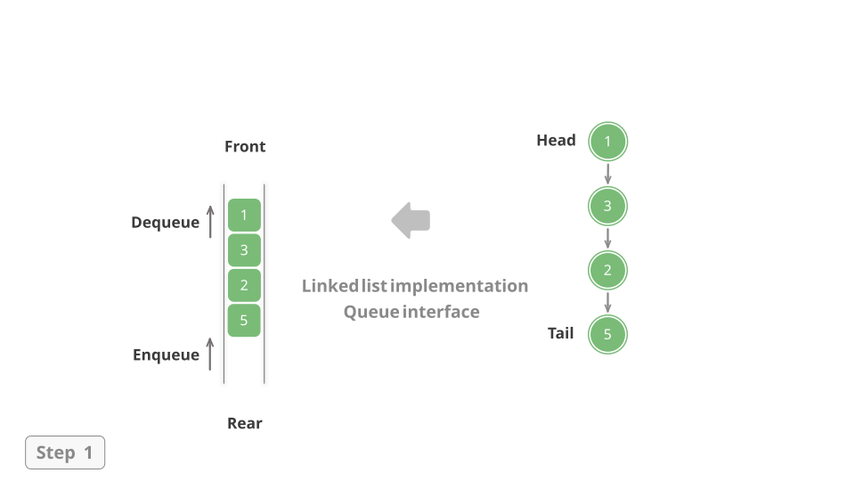
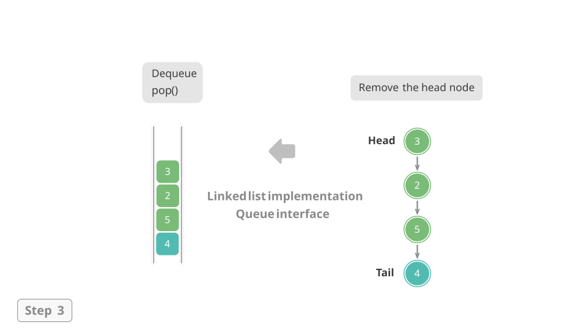

# Queues

A <u>queue</u> is a linear data structure that follows the first-in, first-out rule. Picture a line of people: newcomers join at the back, and people leave one at a time from the front.

The two ends of a queue are called the front and the rear, as shown below. Adding an element at the rear is called enqueueing, and removing the element at the front is called dequeueing.


## Common queue operations

The table below lists common queue operations. Method names vary across programming languages. Here we use the same names as for stacks.

<p align="center"> Table <id> &nbsp; Time complexity of queue operations </p>

| Method name   | Description                         | Time complexity |
| -------- | ---------------------------- | ---------- |
| `push()` | Enqueue an element by adding it at the rear | $O(1)$     |
| `pop()`  | Dequeue the front element                 | $O(1)$     |
| `peek()` | Access the front element                 | $O(1)$     |

You can use the queue class your programming language provides:

```snippet
queue_operations
```

??? pythontutor "Visualize execution"

    @tutor queue_operations_tutor

## Implementing a queue

A queue needs a data structure that lets us add elements at one end and remove them from the other. Both linked lists and arrays meet this requirement.

### Linked list implementation

As shown below, we can use the head of a linked list as the front of the queue and the tail as the rear. We add nodes only at the rear and remove them only from the front.

=== "<1>"
    

=== "<2>"
    

=== "<3>"
    

The following code implements a queue with a linked list:

```src
[file]{linkedlist_queue}-[class]{linked_list_queue}-[func]{}
```

### Array implementation

Removing the first element of an array takes $O(n)$ time, which would make dequeueing inefficient. We can avoid this cost by changing how we keep track of the front.

Let `front` hold the index of the front element and `size` track the number of elements in the queue. With `rear = front + size`, the resulting index `rear` points one slot past the last element.

With this design, **the queue elements occupy the closed interval `[front, rear - 1]` in the array**. The figure below shows how the operations work.

- To enqueue, store the new element at index `rear` and increase `size` by 1.
- To dequeue, simply increase `front` by 1 and decrease `size` by 1.

Enqueueing and dequeueing each take a fixed number of steps without shifting any elements, so both run in $O(1)$ time.

=== "<1>"
    

=== "<2>"
    

=== "<3>"
    

There is a catch. As we repeatedly enqueue and dequeue, `front` and `rear` move to the right. **Once they reach the end of the array, they can go no farther**. To solve this problem, we can treat the array as a circular array whose ends connect.

In a circular array, whenever `front` or `rear` goes past the end, it wraps around to the beginning and continues from there. The following code uses the remainder operation to implement this wraparound:

```src
[file]{array_queue}-[class]{array_queue}-[func]{}
```

This queue still has a fixed capacity. We can let it grow by replacing the underlying array with a dynamic array. If you’re interested, try implementing this yourself.

The trade-offs between these two implementations are the same as for stacks.

## Common uses of queues

- **Orders on Taobao**. When a shopper places an order, it joins a queue. The system then processes orders in the order they arrived. During the Singles’ Day shopping festival, huge numbers of orders arrive in a short time, making high concurrency a major challenge for engineers.
- **Tasks waiting their turn**. A queue keeps tasks in order wherever they need to be handled on a first-come, first-served basis. Examples include print jobs and orders waiting to be served at a restaurant.
