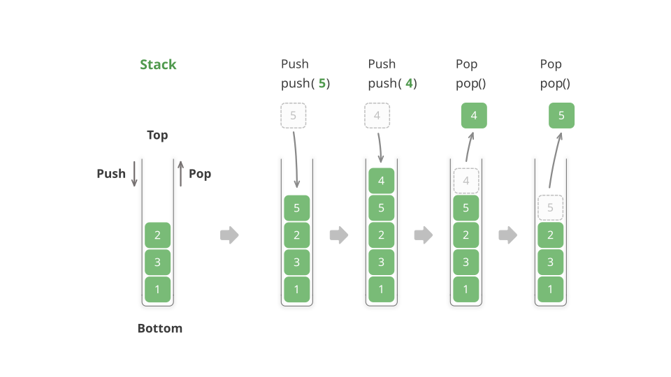
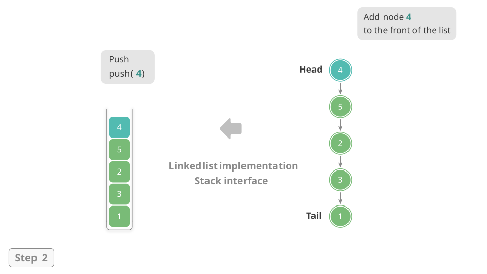
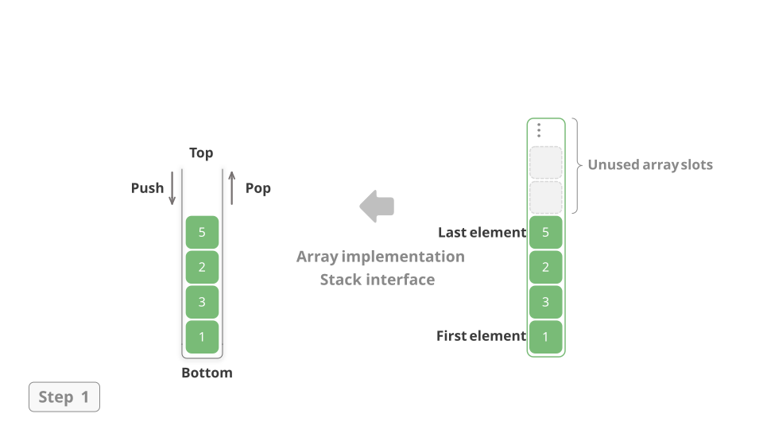

# Stacks

A <u>stack</u> is a linear data structure that follows the last-in, first-out rule.

Imagine a stack of plates on a table. If you can move only one plate at a time, to reach the bottom plate you must first remove each plate above it in turn. Replace the plates with elements such as integers, characters, or objects, and you have a stack.

As shown below, the two ends are called the top and the bottom of the stack. Adding an element to the top is called pushing, and removing the top element is called popping.



## Common stack operations

The table below lists common stack operations. Method names depend on the programming language. Here we use the familiar names `push()`, `pop()`, and `peek()`.

<p align="center"> Table <id> &nbsp; Time complexity of stack operations </p>

| Method     | Description                   | Time complexity |
| -------- | ---------------------- | ---------- |
| `push()` | Push an element onto the top | $O(1)$     |
| `pop()`  | Pop the top element           | $O(1)$     |
| `peek()` | Access the top element           | $O(1)$     |

You can usually use the stack class your programming language provides. If the language has no dedicated stack class, you can use an array or a linked list as a stack and simply ignore operations that fall outside the stack interface.

```snippet
stack_operations
```

??? pythontutor "Visualize execution"

    @tutor stack_operations_tutor

## Implementing a stack

To see how a stack works, let’s implement a stack class ourselves.

The last-in, first-out rule allows us to add or remove elements only at the top. Arrays and linked lists allow insertion and removal at any position, so **we can think of a stack as a restricted array or linked list**. By hiding the operations a stack does not use, we can give the array or linked list the behavior of a stack.

### Linked list implementation

In a linked-list stack, we can use the head node as the top and the tail node as the bottom.

To push, insert the element at the head of the list, as shown below. This is called head insertion. To pop, simply remove the head node.

=== "<1>"
    

=== "<2>"
    

=== "<3>"
    

The following code implements a stack with a linked list:

```src
[file]{linkedlist_stack}-[class]{linked_list_stack}-[func]{}
```

### Array implementation

In an array-based stack, we can use the end of the array as the top. As shown below, a push adds an element at the end, and a pop removes the last element. Both take $O(1)$ time.

=== "<1>"
    

=== "<2>"
    

=== "<3>"
    

As more and more elements are pushed, the stack may outgrow its array. A dynamic array handles resizing for us, as in the following example:

```src
[file]{array_stack}-[class]{array_stack}-[func]{}
```

## Comparing the two implementations

**Supported operations**

Both implementations support every operation in the definition of a stack. An array also supports random access, but that falls outside the stack interface and is generally unused here.

**Time efficiency**

In an array-based stack, pushes and pops use preallocated, contiguous memory. This gives them good cache locality and makes them fast. However, pushing an element beyond the array’s capacity triggers a resize, so that particular push takes $O(n)$ time.

A linked list grows one node at a time and avoids the slowdown of resizing an array. However, a push needs to initialize a node object and update pointers, which makes it comparatively slow. If the element being pushed is already a node object, we can skip initialization and make the push faster.

For pushes and pops involving primitive types such as `int` or `double`, we can draw the following conclusions.

- An array-based stack slows down when it resizes, but resizing is infrequent, so its operations are faster on average.
- A linked-list stack offers more consistent operation times.

**Space efficiency**

When a list is initialized, the system allocates an initial capacity that may exceed what the list actually needs. Later, it typically grows by a fixed factor, for example by doubling, which can again leave capacity unused. As a result, **an array-based stack may waste some space**.

A linked list node, however, also needs to store a pointer, so **each node takes up more space than an array element**.

Which implementation uses less memory depends on the circumstances.

## Common uses of stacks

- **Back and forward in a browser, undo and redo in software**. Whenever you open a new page, the browser pushes the previous page onto a stack. Going back pops that page off the stack so you can return to it. In this approach, supporting both back and forward requires two stacks working together.
- **Program memory management**. Each time a function is called, the system pushes a stack frame that records the function’s context. In a recursive function, the system pushes a frame for each successive call and pops the frames as the calls return.
