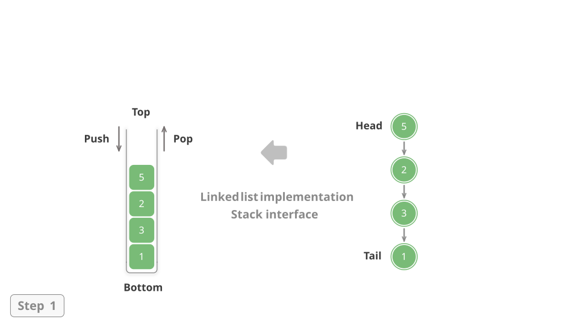
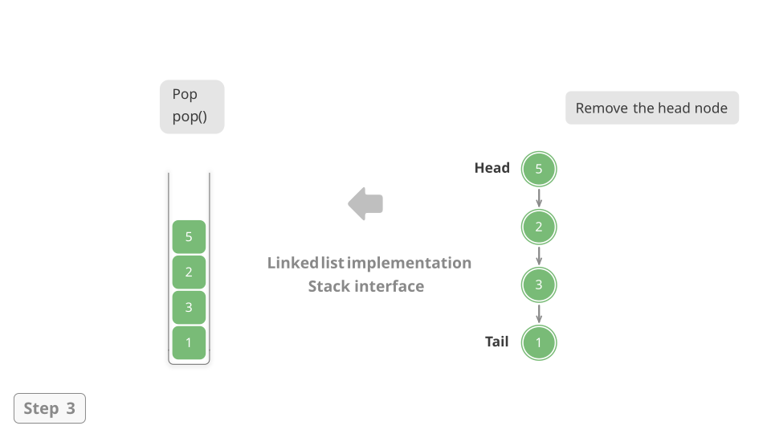
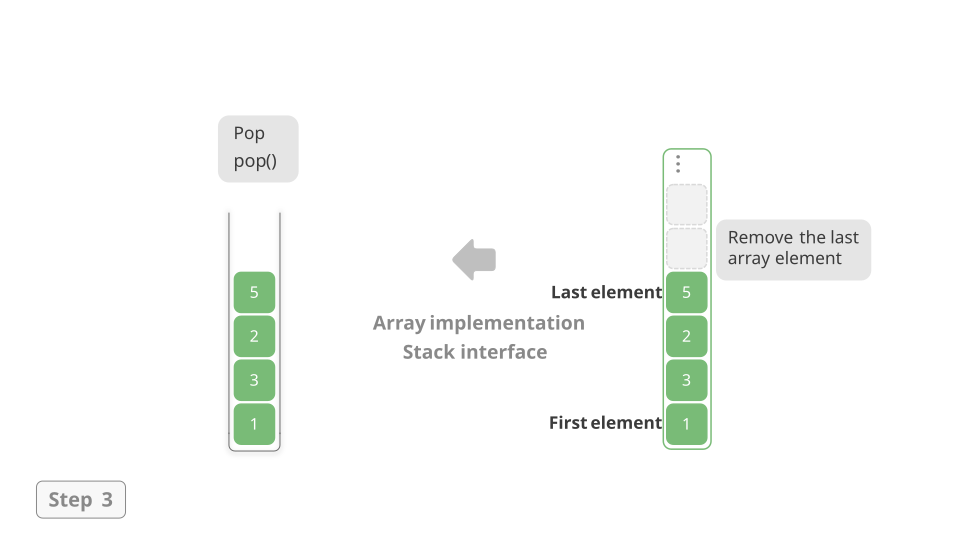

# Stacks

A <u>stack</u> is a linear data structure that follows a last-in, first-out rule.

Think of a stack of plates on a table. If we can move only one plate at a time, reaching the bottom plate requires removing all the plates above it first. Replace the plates with elements such as integers, characters, or objects, and we have a stack.

As shown below, the upper end is the “top” of the stack and the lower end is the “bottom.” Adding an element to the top is called “pushing,” and removing the top element is called “popping.”


## Common stack operations

The table below lists common operations. Actual method names depend on the programming language; here we use the familiar names `push()`, `pop()`, and `peek()`.

<p align="center"> Table <id> &nbsp; Efficiency of stack operations </p>

| Method     | Description                   | Time complexity |
| -------- | ---------------------- | ---------- |
| `push()` | Push an element onto the top | $O(1)$     |
| `pop()`  | Remove the top element           | $O(1)$     |
| `peek()` | Access the top element           | $O(1)$     |

We can usually use a language's built-in stack class. If no dedicated class is provided, use an array or linked list as a stack and avoid operations unrelated to stack behavior.

```snippet
stack_operations
```

??? pythontutor "Visualize execution"

    @tutor stack_operations_tutor

## Implementing a stack

To understand how a stack works more deeply, let us implement a stack class ourselves.

A stack follows last-in, first-out order, so elements can be added or removed only at the top. Arrays and linked lists allow insertion and deletion at arbitrary positions, **so a stack can be viewed as a restricted array or linked list**. By hiding irrelevant operations, we make its public behavior conform to the stack's rules.

### Implementation with a linked list

When implementing a stack with a linked list, treat the head as the top and the tail as the bottom.

As shown below, pushing simply inserts a node at the head, an operation called “head insertion.” Popping removes the head node.

=== "<1>"
    

=== "<2>"
    

=== "<3>"
    

Here is an implementation using a linked list:

```src
[file]{linkedlist_stack}-[class]{linked_list_stack}-[func]{}
```

### Implementation with an array

For an array-based stack, use the end of the array as the top. As shown below, pushing and popping correspond to adding and removing the last element, both taking $O(1)$ time.

=== "<1>"
    

=== "<2>"
    

=== "<3>"
    

Since elements may keep arriving, use a dynamic array so that resizing is handled for us. An implementation follows:

```src
[file]{array_stack}-[class]{array_stack}-[func]{}
```

## Comparing the implementations

**Supported operations**

Both implementations support all stack operations. An array also allows random access, but that is outside the stack abstraction and is generally not used.

**Time efficiency**

In an array-based stack, pushes and pops operate in preallocated contiguous memory, giving good cache locality and high efficiency. However, a push that exceeds the array's capacity triggers expansion, making that particular push an $O(n)$ operation.

A linked list grows flexibly and avoids the slowdown associated with array expansion. However, pushing requires creating a node object and updating pointers, so it is relatively slower. If the element is already a node object, the creation step can be skipped to improve efficiency.

For elements of primitive types such as `int` or `double`, we can therefore draw the following conclusions.

- An array-based stack slows down when expansion is triggered, but expansion is infrequent, so average efficiency is higher.
- A linked-list stack provides more consistent performance.

**Space efficiency**

When a dynamic array is initialized, its initial capacity may exceed actual needs. Expansion typically multiplies the capacity by a fixed factor, such as 2, which may again leave excess space. **An array-based stack can therefore waste some space**.

However, linked-list nodes also store pointers, **so each node occupies relatively more space**.

We cannot say universally which implementation uses less memory; the answer depends on the situation.

## Typical applications

- **Browser back and forward navigation, and software undo and redo**. When a new web page is opened, the browser pushes the previous page onto a stack. Going back pops that page. Supporting both back and forward requires two stacks working together.
- **Program memory management**. Each function call adds a stack frame containing the function's context. During recursion, frames are pushed as calls descend and popped as they return.
