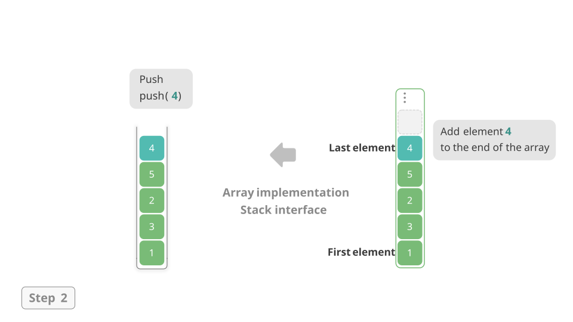

# 5.1 &nbsp; Stacks

A <u>stack</u> is a linear data structure that follows the last-in, first-out rule.

Imagine a stack of plates on a table. If you can move only one plate at a time, to reach the bottom plate you must first remove each plate above it in turn. Replace the plates with elements such as integers, characters, or objects, and you have a stack.

As shown below, the two ends are called the top and the bottom of the stack. Adding an element to the top is called pushing, and removing the top element is called popping.

{ class="animation-figure" }

<p align="center"> Figure 5-1 &nbsp; The last-in, first-out rule for stacks </p>

## 5.1.1 &nbsp; Common stack operations

Table 5-1 lists common stack operations. Method names depend on the programming language. Here we use the familiar names `push()`, `pop()`, and `peek()`.

<p align="center"> Table 5-1 &nbsp; Time complexity of stack operations </p>

<div class="center-table" markdown>

| Method     | Description                   | Time complexity |
| -------- | ---------------------- | ---------- |
| `push()` | Push an element onto the top | $O(1)$     |
| `pop()`  | Pop the top element           | $O(1)$     |
| `peek()` | Access the top element           | $O(1)$     |

</div>

You can usually use the stack class your programming language provides. If the language has no dedicated stack class, you can use an array or a linked list as a stack and simply ignore operations that fall outside the stack interface.

=== "Python"

    ```python title="stack.py"
    # Initialize the stack
    # Python has no built-in stack class, so use a list as a stack
    stack: list[int] = []

    # Push elements onto the stack
    stack.append(1)
    stack.append(3)
    stack.append(2)
    stack.append(5)
    stack.append(4)

    # Peek at the top element
    peek: int = stack[-1]

    # Pop the top element
    pop: int = stack.pop()

    # Get the stack size
    size: int = len(stack)

    # Check whether the stack is empty
    is_empty: bool = len(stack) == 0
    ```

=== "C++"

    ```cpp title="stack.cpp"
    /* Initialize the stack */
    stack<int> stack;

    /* Push elements onto the stack */
    stack.push(1);
    stack.push(3);
    stack.push(2);
    stack.push(5);
    stack.push(4);

    /* Peek at the top element */
    int top = stack.top();

    /* Pop the top element */
    stack.pop(); // Returns no value

    /* Get the stack size */
    int size = stack.size();

    /* Check whether the stack is empty */
    bool empty = stack.empty();
    ```

=== "Java"

    ```java title="stack.java"
    /* Initialize the stack */
    Stack<Integer> stack = new Stack<>();

    /* Push elements onto the stack */
    stack.push(1);
    stack.push(3);
    stack.push(2);
    stack.push(5);
    stack.push(4);

    /* Peek at the top element */
    int peek = stack.peek();

    /* Pop the top element */
    int pop = stack.pop();

    /* Get the stack size */
    int size = stack.size();

    /* Check whether the stack is empty */
    boolean isEmpty = stack.isEmpty();
    ```

=== "C#"

    ```csharp title="stack.cs"
    /* Initialize the stack */
    Stack<int> stack = new();

    /* Push elements onto the stack */
    stack.Push(1);
    stack.Push(3);
    stack.Push(2);
    stack.Push(5);
    stack.Push(4);

    /* Peek at the top element */
    int peek = stack.Peek();

    /* Pop the top element */
    int pop = stack.Pop();

    /* Get the stack size */
    int size = stack.Count;

    /* Check whether the stack is empty */
    bool isEmpty = stack.Count == 0;
    ```

=== "Go"

    ```go title="stack_test.go"
    /* Initialize the stack */
    // In Go, a slice is the recommended choice for a stack
    var stack []int

    /* Push elements onto the stack */
    stack = append(stack, 1)
    stack = append(stack, 3)
    stack = append(stack, 2)
    stack = append(stack, 5)
    stack = append(stack, 4)

    /* Peek at the top element */
    peek := stack[len(stack)-1]

    /* Pop the top element */
    pop := stack[len(stack)-1]
    stack = stack[:len(stack)-1]

    /* Get the stack size */
    size := len(stack)

    /* Check whether the stack is empty */
    isEmpty := len(stack) == 0
    ```

=== "Swift"

    ```swift title="stack.swift"
    /* Initialize the stack */
    // Swift has no built-in stack class, so use an Array as a stack
    var stack: [Int] = []

    /* Push elements onto the stack */
    stack.append(1)
    stack.append(3)
    stack.append(2)
    stack.append(5)
    stack.append(4)

    /* Peek at the top element */
    let peek = stack.last!

    /* Pop the top element */
    let pop = stack.removeLast()

    /* Get the stack size */
    let size = stack.count

    /* Check whether the stack is empty */
    let isEmpty = stack.isEmpty
    ```

=== "JS"

    ```javascript title="stack.js"
    /* Initialize the stack */
    // JavaScript has no built-in stack class, so use an Array as a stack
    const stack = [];

    /* Push elements onto the stack */
    stack.push(1);
    stack.push(3);
    stack.push(2);
    stack.push(5);
    stack.push(4);

    /* Peek at the top element */
    const peek = stack[stack.length - 1];

    /* Pop the top element */
    const pop = stack.pop();

    /* Get the stack size */
    const size = stack.length;

    /* Check whether the stack is empty */
    const isEmpty = stack.length === 0;
    ```

=== "TS"

    ```typescript title="stack.ts"
    /* Initialize the stack */
    // TypeScript has no built-in stack class, so use an Array as a stack
    const stack: number[] = [];

    /* Push elements onto the stack */
    stack.push(1);
    stack.push(3);
    stack.push(2);
    stack.push(5);
    stack.push(4);

    /* Peek at the top element */
    const peek = stack[stack.length - 1];

    /* Pop the top element */
    const pop = stack.pop();

    /* Get the stack size */
    const size = stack.length;

    /* Check whether the stack is empty */
    const isEmpty = stack.length === 0;
    ```

=== "Dart"

    ```dart title="stack.dart"
    /* Initialize the stack */
    // Dart has no built-in stack class, so use a List as a stack
    final List<int> stack = [];

    /* Push elements onto the stack */
    stack.add(1);
    stack.add(3);
    stack.add(2);
    stack.add(5);
    stack.add(4);

    /* Peek at the top element */
    final int peek = stack.last;

    /* Pop the top element */
    final int pop = stack.removeLast();

    /* Get the stack size */
    final int size = stack.length;

    /* Check whether the stack is empty */
    final bool isEmpty = stack.isEmpty;
    ```

=== "Rust"

    ```rust title="stack.rs"
    // Initialize the stack
    // In Rust, Vec is the recommended choice for a stack
    let mut stack: Vec<i32> = Vec::new();

    // Push elements onto the stack
    stack.push(1);
    stack.push(3);
    stack.push(2);
    stack.push(5);
    stack.push(4);

    // Peek at the top element
    let peek = stack.last().unwrap();

    // Pop the top element
    let pop = stack.pop().unwrap();

    // Get the stack size
    let size = stack.len();

    // Check whether the stack is empty
    let is_empty = stack.is_empty();
    ```

=== "C"

    ```c title="stack.c"
    // C has no built-in stack
    ```

=== "Kotlin"

    ```kotlin title="stack.kt"
    /* Initialize the stack */
    val stack = Stack<Int>()

    /* Push elements onto the stack */
    stack.push(1)
    stack.push(3)
    stack.push(2)
    stack.push(5)
    stack.push(4)

    /* Peek at the top element */
    val peek = stack.peek()

    /* Pop the top element */
    val pop = stack.pop()

    /* Get the stack size */
    val size = stack.size

    /* Check whether the stack is empty */
    val isEmpty = stack.isEmpty()
    ```

=== "Ruby"

    ```ruby title="stack.rb"
    # Initialize the stack
    # Ruby has no built-in stack class, so use an Array as a stack
    stack = []

    # Push elements onto the stack
    stack << 1
    stack << 3
    stack << 2
    stack << 5
    stack << 4

    # Peek at the top element
    peek = stack.last

    # Pop the top element
    pop = stack.pop

    # Get the stack size
    size = stack.length

    # Check whether the stack is empty
    is_empty = stack.empty?
    ```

??? pythontutor "Visualize execution"

    <div style="height: 549px; width: 100%;"><iframe class="pythontutor-iframe" title="Visualize execution" src="https://pythontutor.com/iframe-embed.html#code=%22%22%22Driver%20Code%22%22%22%0Aif%20__name__%20%3D%3D%20%22__main__%22%3A%0A%20%20%20%20%23%20Initialize%20the%20stack%0A%20%20%20%20%23%20Python%20has%20no%20built-in%20stack%20class,%20so%20we%20can%20use%20a%20list%20as%20a%20stack%0A%20%20%20%20stack%20%3D%20%5B%5D%0A%0A%20%20%20%20%23%20Push%20elements%20onto%20the%20stack%0A%20%20%20%20stack.append%281%29%0A%20%20%20%20stack.append%283%29%0A%20%20%20%20stack.append%282%29%0A%20%20%20%20stack.append%285%29%0A%20%20%20%20stack.append%284%29%0A%20%20%20%20print%28%22stack%20%3D%22,%20stack%29%0A%0A%20%20%20%20%23%20Read%20the%20top%20element%0A%20%20%20%20peek%20%3D%20stack%5B-1%5D%0A%20%20%20%20print%28%22Top%20element%20%28peek%29%20%3D%22,%20peek%29%0A%0A%20%20%20%20%23%20Pop%20an%20element%20off%20the%20stack%0A%20%20%20%20pop%20%3D%20stack.pop%28%29%0A%20%20%20%20print%28%22Popped%20element%20%28pop%29%20%3D%22,%20pop%29%0A%20%20%20%20print%28%22stack%20after%20pop%20%3D%22,%20stack%29%0A%0A%20%20%20%20%23%20Get%20the%20stack%20size%0A%20%20%20%20size%20%3D%20len%28stack%29%0A%20%20%20%20print%28%22Stack%20length%20%28size%29%20%3D%22,%20size%29%0A%0A%20%20%20%20%23%20Check%20whether%20the%20stack%20is%20empty%0A%20%20%20%20is_empty%20%3D%20len%28stack%29%20%3D%3D%200%0A%20%20%20%20print%28%22Stack%20is%20empty%20%3D%22,%20is_empty%29&codeDivHeight=472&codeDivWidth=350&cumulative=false&curInstr=2&heapPrimitives=nevernest&origin=opt-frontend.js&py=311&rawInputLstJSON=%5B%5D&textReferences=false"> </iframe></div>
    <div style="margin-top: 5px;"><a href="https://pythontutor.com/iframe-embed.html#code=%22%22%22Driver%20Code%22%22%22%0Aif%20__name__%20%3D%3D%20%22__main__%22%3A%0A%20%20%20%20%23%20Initialize%20the%20stack%0A%20%20%20%20%23%20Python%20has%20no%20built-in%20stack%20class,%20so%20we%20can%20use%20a%20list%20as%20a%20stack%0A%20%20%20%20stack%20%3D%20%5B%5D%0A%0A%20%20%20%20%23%20Push%20elements%20onto%20the%20stack%0A%20%20%20%20stack.append%281%29%0A%20%20%20%20stack.append%283%29%0A%20%20%20%20stack.append%282%29%0A%20%20%20%20stack.append%285%29%0A%20%20%20%20stack.append%284%29%0A%20%20%20%20print%28%22stack%20%3D%22,%20stack%29%0A%0A%20%20%20%20%23%20Read%20the%20top%20element%0A%20%20%20%20peek%20%3D%20stack%5B-1%5D%0A%20%20%20%20print%28%22Top%20element%20%28peek%29%20%3D%22,%20peek%29%0A%0A%20%20%20%20%23%20Pop%20an%20element%20off%20the%20stack%0A%20%20%20%20pop%20%3D%20stack.pop%28%29%0A%20%20%20%20print%28%22Popped%20element%20%28pop%29%20%3D%22,%20pop%29%0A%20%20%20%20print%28%22stack%20after%20pop%20%3D%22,%20stack%29%0A%0A%20%20%20%20%23%20Get%20the%20stack%20size%0A%20%20%20%20size%20%3D%20len%28stack%29%0A%20%20%20%20print%28%22Stack%20length%20%28size%29%20%3D%22,%20size%29%0A%0A%20%20%20%20%23%20Check%20whether%20the%20stack%20is%20empty%0A%20%20%20%20is_empty%20%3D%20len%28stack%29%20%3D%3D%200%0A%20%20%20%20print%28%22Stack%20is%20empty%20%3D%22,%20is_empty%29&codeDivHeight=800&codeDivWidth=600&cumulative=false&curInstr=2&heapPrimitives=nevernest&origin=opt-frontend.js&py=311&rawInputLstJSON=%5B%5D&textReferences=false" target="_blank" rel="noopener noreferrer">View full screen ></a></div>

## 5.1.2 &nbsp; Implementing a stack

To see how a stack works, let’s implement a stack class ourselves.

The last-in, first-out rule allows us to add or remove elements only at the top. Arrays and linked lists allow insertion and removal at any position, so **we can think of a stack as a restricted array or linked list**. By hiding the operations a stack does not use, we can give the array or linked list the behavior of a stack.

### 1. &nbsp; Linked list implementation

In a linked-list stack, we can use the head node as the top and the tail node as the bottom.

To push, insert the element at the head of the list, as shown below. This is called head insertion. To pop, simply remove the head node.

=== "<1>"
    { class="animation-figure" }

=== "<2>"
    { class="animation-figure" }

=== "<3>"
    { class="animation-figure" }

<p align="center"> Figure 5-2 &nbsp; Pushing and popping with a linked list </p>

The following code implements a stack with a linked list:

=== "Python"

    ```python title="linkedlist_stack.py"
    class LinkedListStack:
        """Stack backed by a linked list."""

        def __init__(self):
            """Initialize the stack."""
            self._peek: ListNode | None = None
            self._size: int = 0

        def size(self) -> int:
            """Get the stack size."""
            return self._size

        def is_empty(self) -> bool:
            """Check whether the stack is empty."""
            return self._size == 0

        def push(self, val: int):
            """Push an element onto the stack."""
            node = ListNode(val)
            node.next = self._peek
            self._peek = node
            self._size += 1

        def pop(self) -> int:
            """Remove and return the top element."""
            num = self.peek()
            self._peek = self._peek.next
            self._size -= 1
            return num

        def peek(self) -> int:
            """Peek at the top element."""
            if self.is_empty():
                raise IndexError("Stack is empty")
            return self._peek.val

        def to_list(self) -> list[int]:
            """Convert to a list for printing."""
            arr = []
            node = self._peek
            while node:
                arr.append(node.val)
                node = node.next
            arr.reverse()
            return arr
    ```

=== "C++"

    ```cpp title="linkedlist_stack.cpp"
    /* Stack backed by a linked list */
    class LinkedListStack {
      private:
        ListNode *stackTop; // Use the head node as the top of the stack
        int stkSize;        // Stack size

      public:
        LinkedListStack() {
            stackTop = nullptr;
            stkSize = 0;
        }

        ~LinkedListStack() {
            // Walk the list and delete each node to free its memory
            freeMemoryLinkedList(stackTop);
        }

        /* Get the stack size */
        int size() {
            return stkSize;
        }

        /* Check whether the stack is empty */
        bool isEmpty() {
            return size() == 0;
        }

        /* Push an element onto the stack */
        void push(int num) {
            ListNode *node = new ListNode(num);
            node->next = stackTop;
            stackTop = node;
            stkSize++;
        }

        /* Remove and return the top element */
        int pop() {
            int num = top();
            ListNode *tmp = stackTop;
            stackTop = stackTop->next;
            // Free the allocated memory
            delete tmp;
            stkSize--;
            return num;
        }

        /* Peek at the top element */
        int top() {
            if (isEmpty())
                throw out_of_range("Stack is empty");
            return stackTop->val;
        }

        /* Return the linked list elements as a vector */
        vector<int> toVector() {
            ListNode *node = stackTop;
            vector<int> res(size());
            for (int i = res.size() - 1; i >= 0; i--) {
                res[i] = node->val;
                node = node->next;
            }
            return res;
        }
    };
    ```

=== "Java"

    ```java title="linkedlist_stack.java"
    /* Stack backed by a linked list */
    class LinkedListStack {
        private ListNode stackPeek; // Use the head node as the top of the stack
        private int stkSize = 0; // Stack size

        public LinkedListStack() {
            stackPeek = null;
        }

        /* Get the stack size */
        public int size() {
            return stkSize;
        }

        /* Check whether the stack is empty */
        public boolean isEmpty() {
            return size() == 0;
        }

        /* Push an element onto the stack */
        public void push(int num) {
            ListNode node = new ListNode(num);
            node.next = stackPeek;
            stackPeek = node;
            stkSize++;
        }

        /* Remove and return the top element */
        public int pop() {
            int num = peek();
            stackPeek = stackPeek.next;
            stkSize--;
            return num;
        }

        /* Peek at the top element */
        public int peek() {
            if (isEmpty())
                throw new IndexOutOfBoundsException();
            return stackPeek.val;
        }

        /* Return the linked list elements as an array */
        public int[] toArray() {
            ListNode node = stackPeek;
            int[] res = new int[size()];
            for (int i = res.length - 1; i >= 0; i--) {
                res[i] = node.val;
                node = node.next;
            }
            return res;
        }
    }
    ```

=== "C#"

    ```csharp title="linkedlist_stack.cs"
    /* Stack backed by a linked list */
    class LinkedListStack {
        ListNode? stackPeek;  // Use the head node as the top of the stack
        int stkSize = 0;   // Stack size

        public LinkedListStack() {
            stackPeek = null;
        }

        /* Get the stack size */
        public int Size() {
            return stkSize;
        }

        /* Check whether the stack is empty */
        public bool IsEmpty() {
            return Size() == 0;
        }

        /* Push an element onto the stack */
        public void Push(int num) {
            ListNode node = new(num) {
                next = stackPeek
            };
            stackPeek = node;
            stkSize++;
        }

        /* Remove and return the top element */
        public int Pop() {
            int num = Peek();
            stackPeek = stackPeek!.next;
            stkSize--;
            return num;
        }

        /* Peek at the top element */
        public int Peek() {
            if (IsEmpty())
                throw new Exception();
            return stackPeek!.val;
        }

        /* Return the linked list elements as an array */
        public int[] ToArray() {
            if (stackPeek == null)
                return [];

            ListNode? node = stackPeek;
            int[] res = new int[Size()];
            for (int i = res.Length - 1; i >= 0; i--) {
                res[i] = node!.val;
                node = node.next;
            }
            return res;
        }
    }
    ```

=== "Go"

    ```go title="linkedlist_stack.go"
    /* Stack backed by a linked list */
    type linkedListStack struct {
        // Use the standard list package to implement the stack
        data *list.List
    }

    /* Initialize the stack */
    func newLinkedListStack() *linkedListStack {
        return &linkedListStack{
            data: list.New(),
        }
    }

    /* Push an element onto the stack */
    func (s *linkedListStack) push(value int) {
        s.data.PushBack(value)
    }

    /* Remove and return the top element */
    func (s *linkedListStack) pop() any {
        if s.isEmpty() {
            return nil
        }
        e := s.data.Back()
        s.data.Remove(e)
        return e.Value
    }

    /* Peek at the top element */
    func (s *linkedListStack) peek() any {
        if s.isEmpty() {
            return nil
        }
        e := s.data.Back()
        return e.Value
    }

    /* Get the stack size */
    func (s *linkedListStack) size() int {
        return s.data.Len()
    }

    /* Check whether the stack is empty */
    func (s *linkedListStack) isEmpty() bool {
        return s.data.Len() == 0
    }

    /* Return the list for printing */
    func (s *linkedListStack) toList() *list.List {
        return s.data
    }
    ```

=== "Swift"

    ```swift title="linkedlist_stack.swift"
    /* Stack backed by a linked list */
    class LinkedListStack {
        private var _peek: ListNode? // Use the head node as the top of the stack
        private var _size: Int // Stack size

        init() {
            _size = 0
        }

        /* Get the stack size */
        func size() -> Int {
            _size
        }

        /* Check whether the stack is empty */
        func isEmpty() -> Bool {
            size() == 0
        }

        /* Push an element onto the stack */
        func push(num: Int) {
            let node = ListNode(x: num)
            node.next = _peek
            _peek = node
            _size += 1
        }

        /* Remove and return the top element */
        @discardableResult
        func pop() -> Int {
            let num = peek()
            _peek = _peek?.next
            _size -= 1
            return num
        }

        /* Peek at the top element */
        func peek() -> Int {
            if isEmpty() {
                fatalError("Stack is empty")
            }
            return _peek!.val
        }

        /* Return the linked list elements as an array */
        func toArray() -> [Int] {
            var node = _peek
            var res = Array(repeating: 0, count: size())
            for i in res.indices.reversed() {
                res[i] = node!.val
                node = node?.next
            }
            return res
        }
    }
    ```

=== "JS"

    ```javascript title="linkedlist_stack.js"
    /* Stack backed by a linked list */
    class LinkedListStack {
        #stackPeek; // Use the head node as the top of the stack
        #stkSize = 0; // Stack size

        constructor() {
            this.#stackPeek = null;
        }

        /* Get the stack size */
        get size() {
            return this.#stkSize;
        }

        /* Check whether the stack is empty */
        isEmpty() {
            return this.size === 0;
        }

        /* Push an element onto the stack */
        push(num) {
            const node = new ListNode(num);
            node.next = this.#stackPeek;
            this.#stackPeek = node;
            this.#stkSize++;
        }

        /* Remove and return the top element */
        pop() {
            const num = this.peek();
            this.#stackPeek = this.#stackPeek.next;
            this.#stkSize--;
            return num;
        }

        /* Peek at the top element */
        peek() {
            if (!this.#stackPeek) throw new Error('Stack is empty');
            return this.#stackPeek.val;
        }

        /* Return the linked list elements as an array */
        toArray() {
            let node = this.#stackPeek;
            const res = new Array(this.size);
            for (let i = res.length - 1; i >= 0; i--) {
                res[i] = node.val;
                node = node.next;
            }
            return res;
        }
    }
    ```

=== "TS"

    ```typescript title="linkedlist_stack.ts"
    /* Stack backed by a linked list */
    class LinkedListStack {
        private stackPeek: ListNode | null; // Use the head node as the top of the stack
        private stkSize: number = 0; // Stack size

        constructor() {
            this.stackPeek = null;
        }

        /* Get the stack size */
        get size(): number {
            return this.stkSize;
        }

        /* Check whether the stack is empty */
        isEmpty(): boolean {
            return this.size === 0;
        }

        /* Push an element onto the stack */
        push(num: number): void {
            const node = new ListNode(num);
            node.next = this.stackPeek;
            this.stackPeek = node;
            this.stkSize++;
        }

        /* Remove and return the top element */
        pop(): number {
            const num = this.peek();
            if (!this.stackPeek) throw new Error('Stack is empty');
            this.stackPeek = this.stackPeek.next;
            this.stkSize--;
            return num;
        }

        /* Peek at the top element */
        peek(): number {
            if (!this.stackPeek) throw new Error('Stack is empty');
            return this.stackPeek.val;
        }

        /* Return the linked list elements as an array */
        toArray(): number[] {
            let node = this.stackPeek;
            const res = new Array<number>(this.size);
            for (let i = res.length - 1; i >= 0; i--) {
                res[i] = node!.val;
                node = node!.next;
            }
            return res;
        }
    }
    ```

=== "Dart"

    ```dart title="linkedlist_stack.dart"
    /* Stack backed by a linked list */
    class LinkedListStack {
      ListNode? _stackPeek; // Use the head node as the top of the stack
      int _stkSize = 0; // Stack size

      LinkedListStack() {
        _stackPeek = null;
      }

      /* Get the stack size */
      int size() {
        return _stkSize;
      }

      /* Check whether the stack is empty */
      bool isEmpty() {
        return _stkSize == 0;
      }

      /* Push an element onto the stack */
      void push(int _num) {
        final ListNode node = ListNode(_num);
        node.next = _stackPeek;
        _stackPeek = node;
        _stkSize++;
      }

      /* Remove and return the top element */
      int pop() {
        final int _num = peek();
        _stackPeek = _stackPeek!.next;
        _stkSize--;
        return _num;
      }

      /* Peek at the top element */
      int peek() {
        if (_stackPeek == null) {
          throw Exception("Stack is empty");
        }
        return _stackPeek!.val;
      }

      /* Return the linked list elements as a List */
      List<int> toList() {
        ListNode? node = _stackPeek;
        List<int> list = [];
        while (node != null) {
          list.add(node.val);
          node = node.next;
        }
        list = list.reversed.toList();
        return list;
      }
    }
    ```

=== "Rust"

    ```rust title="linkedlist_stack.rs"
    /* Stack backed by a linked list */
    #[allow(dead_code)]
    pub struct LinkedListStack<T> {
        stack_peek: Option<Rc<RefCell<ListNode<T>>>>, // Use the head node as the top of the stack
        stk_size: usize,                              // Stack size
    }

    impl<T: Copy> LinkedListStack<T> {
        pub fn new() -> Self {
            Self {
                stack_peek: None,
                stk_size: 0,
            }
        }

        /* Get the stack size */
        pub fn size(&self) -> usize {
            return self.stk_size;
        }

        /* Check whether the stack is empty */
        pub fn is_empty(&self) -> bool {
            return self.size() == 0;
        }

        /* Push an element onto the stack */
        pub fn push(&mut self, num: T) {
            let node = ListNode::new(num);
            node.borrow_mut().next = self.stack_peek.take();
            self.stack_peek = Some(node);
            self.stk_size += 1;
        }

        /* Remove and return the top element */
        pub fn pop(&mut self) -> Option<T> {
            self.stack_peek.take().map(|old_head| {
                self.stack_peek = old_head.borrow_mut().next.take();
                self.stk_size -= 1;

                old_head.borrow().val
            })
        }

        /* Get a reference to the top node */
        pub fn peek(&self) -> Option<&Rc<RefCell<ListNode<T>>>> {
            self.stack_peek.as_ref()
        }

        /* Return the linked list elements as a vector */
        pub fn to_array(&self) -> Vec<T> {
            fn _to_array<T: Sized + Copy>(head: Option<&Rc<RefCell<ListNode<T>>>>) -> Vec<T> {
                if let Some(node) = head {
                    let mut nums = _to_array(node.borrow().next.as_ref());
                    nums.push(node.borrow().val);
                    return nums;
                }
                return Vec::new();
            }

            _to_array(self.peek())
        }
    }
    ```

=== "C"

    ```c title="linkedlist_stack.c"
    /* Stack backed by a linked list */
    typedef struct {
        ListNode *top; // Use the head node as the top of the stack
        int size;      // Stack size
    } LinkedListStack;

    /* Constructor */
    LinkedListStack *newLinkedListStack() {
        LinkedListStack *s = malloc(sizeof(LinkedListStack));
        s->top = NULL;
        s->size = 0;
        return s;
    }

    /* Destructor */
    void delLinkedListStack(LinkedListStack *s) {
        while (s->top) {
            ListNode *n = s->top->next;
            free(s->top);
            s->top = n;
        }
        free(s);
    }

    /* Get the stack size */
    int size(LinkedListStack *s) {
        return s->size;
    }

    /* Check whether the stack is empty */
    bool isEmpty(LinkedListStack *s) {
        return size(s) == 0;
    }

    /* Push an element onto the stack */
    void push(LinkedListStack *s, int num) {
        ListNode *node = (ListNode *)malloc(sizeof(ListNode));
        node->next = s->top; // Link the new node to the current top
        node->val = num;     // Set the value of the new node
        s->top = node;       // Update the top of the stack
        s->size++;           // Update the stack size
    }

    /* Peek at the top element */
    int peek(LinkedListStack *s) {
        if (s->size == 0) {
            printf("Stack is empty\n");
            return INT_MAX;
        }
        return s->top->val;
    }

    /* Remove and return the top element */
    int pop(LinkedListStack *s) {
        int val = peek(s);
        ListNode *tmp = s->top;
        s->top = s->top->next;
        // Free the allocated memory
        free(tmp);
        s->size--;
        return val;
    }
    ```

=== "Kotlin"

    ```kotlin title="linkedlist_stack.kt"
    /* Stack backed by a linked list */
    class LinkedListStack(
        private var stackPeek: ListNode? = null, // Use the head node as the top of the stack
        private var stkSize: Int = 0 // Stack size
    ) {

        /* Get the stack size */
        fun size(): Int {
            return stkSize
        }

        /* Check whether the stack is empty */
        fun isEmpty(): Boolean {
            return size() == 0
        }

        /* Push an element onto the stack */
        fun push(num: Int) {
            val node = ListNode(num)
            node.next = stackPeek
            stackPeek = node
            stkSize++
        }

        /* Remove and return the top element */
        fun pop(): Int? {
            val num = peek()
            stackPeek = stackPeek?.next
            stkSize--
            return num
        }

        /* Peek at the top element */
        fun peek(): Int? {
            if (isEmpty()) throw IndexOutOfBoundsException()
            return stackPeek?._val
        }

        /* Return the linked list elements as an array */
        fun toArray(): IntArray {
            var node = stackPeek
            val res = IntArray(size())
            for (i in res.size - 1 downTo 0) {
                res[i] = node?._val!!
                node = node.next
            }
            return res
        }
    }
    ```

=== "Ruby"

    ```ruby title="linkedlist_stack.rb"
    ### Stack backed by a linked list ###
    class LinkedListStack
      attr_reader :size

      ### Constructor ###
      def initialize
        @size = 0
      end

      ### Check whether the stack is empty ###
      def is_empty?
        @peek.nil?
      end

      ### Push an element onto the stack ###
      def push(val)
        node = ListNode.new(val)
        node.next = @peek
        @peek = node
        @size += 1
      end

      ### Remove and return the top element ###
      def pop
        num = peek
        @peek = @peek.next
        @size -= 1
        num
      end

      ### Peek at the top element ###
      def peek
        raise IndexError, 'Stack is empty' if is_empty?

        @peek.val
      end

      ### Return the linked list elements as an array ###
      def to_array
        arr = []
        node = @peek
        while node
          arr << node.val
          node = node.next
        end
        arr.reverse
      end
    end
    ```

??? pythontutor "Visualize execution"

    <div style="height: 549px; width: 100%;"><iframe class="pythontutor-iframe" title="Visualize execution" src="https://pythontutor.com/iframe-embed.html#code=class%20ListNode%3A%0A%20%20%20%20%22%22%22Linked%20list%20node.%22%22%22%0A%20%20%20%20def%20__init__%28self,%20val%3A%20int%29%3A%0A%20%20%20%20%20%20%20%20self.val%3A%20int%20%3D%20val%20%20%23%20Node%20value%0A%20%20%20%20%20%20%20%20self.next%3A%20ListNode%20%7C%20None%20%3D%20None%20%20%23%20Reference%20to%20the%20next%20node%0A%0A%0Aclass%20LinkedListStack%3A%0A%20%20%20%20%22%22%22Stack%20backed%20by%20a%20linked%20list.%22%22%22%0A%0A%20%20%20%20def%20__init__%28self%29%3A%0A%20%20%20%20%20%20%20%20%22%22%22Initialize%20the%20stack.%22%22%22%0A%20%20%20%20%20%20%20%20self._peek%3A%20ListNode%20%7C%20None%20%3D%20None%0A%20%20%20%20%20%20%20%20self._size%3A%20int%20%3D%200%0A%0A%20%20%20%20def%20size%28self%29%20-%3E%20int%3A%0A%20%20%20%20%20%20%20%20%22%22%22Get%20the%20stack%20size.%22%22%22%0A%20%20%20%20%20%20%20%20return%20self._size%0A%0A%20%20%20%20def%20is_empty%28self%29%20-%3E%20bool%3A%0A%20%20%20%20%20%20%20%20%22%22%22Check%20whether%20the%20stack%20is%20empty.%22%22%22%0A%20%20%20%20%20%20%20%20return%20not%20self._peek%0A%0A%20%20%20%20def%20push%28self,%20val%3A%20int%29%3A%0A%20%20%20%20%20%20%20%20%22%22%22Push%20an%20element%20onto%20the%20stack.%22%22%22%0A%20%20%20%20%20%20%20%20node%20%3D%20ListNode%28val%29%0A%20%20%20%20%20%20%20%20node.next%20%3D%20self._peek%0A%20%20%20%20%20%20%20%20self._peek%20%3D%20node%0A%20%20%20%20%20%20%20%20self._size%20%2B%3D%201%0A%0A%20%20%20%20def%20pop%28self%29%20-%3E%20int%3A%0A%20%20%20%20%20%20%20%20%22%22%22Remove%20and%20return%20the%20top%20element.%22%22%22%0A%20%20%20%20%20%20%20%20num%20%3D%20self.peek%28%29%0A%20%20%20%20%20%20%20%20self._peek%20%3D%20self._peek.next%0A%20%20%20%20%20%20%20%20self._size%20-%3D%201%0A%20%20%20%20%20%20%20%20return%20num%0A%0A%20%20%20%20def%20peek%28self%29%20-%3E%20int%3A%0A%20%20%20%20%20%20%20%20%22%22%22Peek%20at%20the%20top%20element.%22%22%22%0A%20%20%20%20%20%20%20%20if%20self.is_empty%28%29%3A%0A%20%20%20%20%20%20%20%20%20%20%20%20raise%20IndexError%28%22Stack%20is%20empty%22%29%0A%20%20%20%20%20%20%20%20return%20self._peek.val%0A%0A%20%20%20%20def%20to_list%28self%29%20-%3E%20list%5Bint%5D%3A%0A%20%20%20%20%20%20%20%20%22%22%22Convert%20to%20a%20list%20for%20printing.%22%22%22%0A%20%20%20%20%20%20%20%20arr%20%3D%20%5B%5D%0A%20%20%20%20%20%20%20%20node%20%3D%20self._peek%0A%20%20%20%20%20%20%20%20while%20node%3A%0A%20%20%20%20%20%20%20%20%20%20%20%20arr.append%28node.val%29%0A%20%20%20%20%20%20%20%20%20%20%20%20node%20%3D%20node.next%0A%20%20%20%20%20%20%20%20arr.reverse%28%29%0A%20%20%20%20%20%20%20%20return%20arr%0A%0A%0A%22%22%22Driver%20Code%22%22%22%0Aif%20__name__%20%3D%3D%20%22__main__%22%3A%0A%20%20%20%20%23%20Initialize%20the%20stack%0A%20%20%20%20stack%20%3D%20LinkedListStack%28%29%0A%0A%20%20%20%20%23%20Push%20elements%20onto%20the%20stack%0A%20%20%20%20stack.push%281%29%0A%20%20%20%20stack.push%283%29%0A%20%20%20%20stack.push%282%29%0A%20%20%20%20stack.push%285%29%0A%20%20%20%20stack.push%284%29%0A%20%20%20%20print%28%22stack%20%3D%22,%20stack.to_list%28%29%29%0A%0A%20%20%20%20%23%20Peek%20at%20the%20top%20element%0A%20%20%20%20peek%20%3D%20stack.peek%28%29%0A%20%20%20%20print%28%22Top%20element%20%28peek%29%20%3D%22,%20peek%29%0A%0A%20%20%20%20%23%20Pop%20the%20top%20element%0A%20%20%20%20pop%20%3D%20stack.pop%28%29%0A%20%20%20%20print%28%22Popped%20element%20%28pop%29%20%3D%22,%20pop%29%0A%20%20%20%20print%28%22After%20the%20pop,%20stack%20%3D%22,%20stack.to_list%28%29%29%0A%0A%20%20%20%20%23%20Get%20the%20stack%20size%0A%20%20%20%20size%20%3D%20stack.size%28%29%0A%20%20%20%20print%28%22Stack%20size%20%3D%22,%20size%29%0A%0A%20%20%20%20%23%20Check%20whether%20the%20stack%20is%20empty%0A%20%20%20%20is_empty%20%3D%20stack.is_empty%28%29%0A%20%20%20%20print%28%22Stack%20is%20empty%20%3D%22,%20is_empty%29&codeDivHeight=472&codeDivWidth=350&cumulative=false&curInstr=4&heapPrimitives=nevernest&origin=opt-frontend.js&py=311&rawInputLstJSON=%5B%5D&textReferences=false"> </iframe></div>
    <div style="margin-top: 5px;"><a href="https://pythontutor.com/iframe-embed.html#code=class%20ListNode%3A%0A%20%20%20%20%22%22%22Linked%20list%20node.%22%22%22%0A%20%20%20%20def%20__init__%28self,%20val%3A%20int%29%3A%0A%20%20%20%20%20%20%20%20self.val%3A%20int%20%3D%20val%20%20%23%20Node%20value%0A%20%20%20%20%20%20%20%20self.next%3A%20ListNode%20%7C%20None%20%3D%20None%20%20%23%20Reference%20to%20the%20next%20node%0A%0A%0Aclass%20LinkedListStack%3A%0A%20%20%20%20%22%22%22Stack%20backed%20by%20a%20linked%20list.%22%22%22%0A%0A%20%20%20%20def%20__init__%28self%29%3A%0A%20%20%20%20%20%20%20%20%22%22%22Initialize%20the%20stack.%22%22%22%0A%20%20%20%20%20%20%20%20self._peek%3A%20ListNode%20%7C%20None%20%3D%20None%0A%20%20%20%20%20%20%20%20self._size%3A%20int%20%3D%200%0A%0A%20%20%20%20def%20size%28self%29%20-%3E%20int%3A%0A%20%20%20%20%20%20%20%20%22%22%22Get%20the%20stack%20size.%22%22%22%0A%20%20%20%20%20%20%20%20return%20self._size%0A%0A%20%20%20%20def%20is_empty%28self%29%20-%3E%20bool%3A%0A%20%20%20%20%20%20%20%20%22%22%22Check%20whether%20the%20stack%20is%20empty.%22%22%22%0A%20%20%20%20%20%20%20%20return%20not%20self._peek%0A%0A%20%20%20%20def%20push%28self,%20val%3A%20int%29%3A%0A%20%20%20%20%20%20%20%20%22%22%22Push%20an%20element%20onto%20the%20stack.%22%22%22%0A%20%20%20%20%20%20%20%20node%20%3D%20ListNode%28val%29%0A%20%20%20%20%20%20%20%20node.next%20%3D%20self._peek%0A%20%20%20%20%20%20%20%20self._peek%20%3D%20node%0A%20%20%20%20%20%20%20%20self._size%20%2B%3D%201%0A%0A%20%20%20%20def%20pop%28self%29%20-%3E%20int%3A%0A%20%20%20%20%20%20%20%20%22%22%22Remove%20and%20return%20the%20top%20element.%22%22%22%0A%20%20%20%20%20%20%20%20num%20%3D%20self.peek%28%29%0A%20%20%20%20%20%20%20%20self._peek%20%3D%20self._peek.next%0A%20%20%20%20%20%20%20%20self._size%20-%3D%201%0A%20%20%20%20%20%20%20%20return%20num%0A%0A%20%20%20%20def%20peek%28self%29%20-%3E%20int%3A%0A%20%20%20%20%20%20%20%20%22%22%22Peek%20at%20the%20top%20element.%22%22%22%0A%20%20%20%20%20%20%20%20if%20self.is_empty%28%29%3A%0A%20%20%20%20%20%20%20%20%20%20%20%20raise%20IndexError%28%22Stack%20is%20empty%22%29%0A%20%20%20%20%20%20%20%20return%20self._peek.val%0A%0A%20%20%20%20def%20to_list%28self%29%20-%3E%20list%5Bint%5D%3A%0A%20%20%20%20%20%20%20%20%22%22%22Convert%20to%20a%20list%20for%20printing.%22%22%22%0A%20%20%20%20%20%20%20%20arr%20%3D%20%5B%5D%0A%20%20%20%20%20%20%20%20node%20%3D%20self._peek%0A%20%20%20%20%20%20%20%20while%20node%3A%0A%20%20%20%20%20%20%20%20%20%20%20%20arr.append%28node.val%29%0A%20%20%20%20%20%20%20%20%20%20%20%20node%20%3D%20node.next%0A%20%20%20%20%20%20%20%20arr.reverse%28%29%0A%20%20%20%20%20%20%20%20return%20arr%0A%0A%0A%22%22%22Driver%20Code%22%22%22%0Aif%20__name__%20%3D%3D%20%22__main__%22%3A%0A%20%20%20%20%23%20Initialize%20the%20stack%0A%20%20%20%20stack%20%3D%20LinkedListStack%28%29%0A%0A%20%20%20%20%23%20Push%20elements%20onto%20the%20stack%0A%20%20%20%20stack.push%281%29%0A%20%20%20%20stack.push%283%29%0A%20%20%20%20stack.push%282%29%0A%20%20%20%20stack.push%285%29%0A%20%20%20%20stack.push%284%29%0A%20%20%20%20print%28%22stack%20%3D%22,%20stack.to_list%28%29%29%0A%0A%20%20%20%20%23%20Peek%20at%20the%20top%20element%0A%20%20%20%20peek%20%3D%20stack.peek%28%29%0A%20%20%20%20print%28%22Top%20element%20%28peek%29%20%3D%22,%20peek%29%0A%0A%20%20%20%20%23%20Pop%20the%20top%20element%0A%20%20%20%20pop%20%3D%20stack.pop%28%29%0A%20%20%20%20print%28%22Popped%20element%20%28pop%29%20%3D%22,%20pop%29%0A%20%20%20%20print%28%22After%20the%20pop,%20stack%20%3D%22,%20stack.to_list%28%29%29%0A%0A%20%20%20%20%23%20Get%20the%20stack%20size%0A%20%20%20%20size%20%3D%20stack.size%28%29%0A%20%20%20%20print%28%22Stack%20size%20%3D%22,%20size%29%0A%0A%20%20%20%20%23%20Check%20whether%20the%20stack%20is%20empty%0A%20%20%20%20is_empty%20%3D%20stack.is_empty%28%29%0A%20%20%20%20print%28%22Stack%20is%20empty%20%3D%22,%20is_empty%29&codeDivHeight=800&codeDivWidth=600&cumulative=false&curInstr=4&heapPrimitives=nevernest&origin=opt-frontend.js&py=311&rawInputLstJSON=%5B%5D&textReferences=false" target="_blank" rel="noopener noreferrer">View full screen ></a></div>

### 2. &nbsp; Array implementation

In an array-based stack, we can use the end of the array as the top. As shown below, a push adds an element at the end, and a pop removes the last element. Both take $O(1)$ time.

=== "<1>"
    { class="animation-figure" }

=== "<2>"
    { class="animation-figure" }

=== "<3>"
    { class="animation-figure" }

<p align="center"> Figure 5-3 &nbsp; Pushing and popping with an array </p>

As more and more elements are pushed, the stack may outgrow its array. A dynamic array handles resizing for us, as in the following example:

=== "Python"

    ```python title="array_stack.py"
    class ArrayStack:
        """Array-backed stack."""

        def __init__(self):
            """Initialize the stack."""
            self._stack: list[int] = []

        def size(self) -> int:
            """Get the stack size."""
            return len(self._stack)

        def is_empty(self) -> bool:
            """Check whether the stack is empty."""
            return self.size() == 0

        def push(self, item: int):
            """Push an element onto the stack."""
            self._stack.append(item)

        def pop(self) -> int:
            """Remove and return the top element."""
            if self.is_empty():
                raise IndexError("Stack is empty")
            return self._stack.pop()

        def peek(self) -> int:
            """Peek at the top element."""
            if self.is_empty():
                raise IndexError("Stack is empty")
            return self._stack[-1]

        def to_list(self) -> list[int]:
            """Return the backing list for printing."""
            return self._stack
    ```

=== "C++"

    ```cpp title="array_stack.cpp"
    /* Array-backed stack */
    class ArrayStack {
      private:
        vector<int> stack;

      public:
        /* Get the stack size */
        int size() {
            return stack.size();
        }

        /* Check whether the stack is empty */
        bool isEmpty() {
            return stack.size() == 0;
        }

        /* Push an element onto the stack */
        void push(int num) {
            stack.push_back(num);
        }

        /* Remove and return the top element */
        int pop() {
            int num = top();
            stack.pop_back();
            return num;
        }

        /* Peek at the top element */
        int top() {
            if (isEmpty())
                throw out_of_range("Stack is empty");
            return stack.back();
        }

        /* Return a copy of the backing vector */
        vector<int> toVector() {
            return stack;
        }
    };
    ```

=== "Java"

    ```java title="array_stack.java"
    /* Array-backed stack */
    class ArrayStack {
        private ArrayList<Integer> stack;

        public ArrayStack() {
            // Initialize the list (a dynamic array)
            stack = new ArrayList<>();
        }

        /* Get the stack size */
        public int size() {
            return stack.size();
        }

        /* Check whether the stack is empty */
        public boolean isEmpty() {
            return size() == 0;
        }

        /* Push an element onto the stack */
        public void push(int num) {
            stack.add(num);
        }

        /* Remove and return the top element */
        public int pop() {
            if (isEmpty())
                throw new IndexOutOfBoundsException();
            return stack.remove(size() - 1);
        }

        /* Peek at the top element */
        public int peek() {
            if (isEmpty())
                throw new IndexOutOfBoundsException();
            return stack.get(size() - 1);
        }

        /* Return the list elements as an array */
        public Object[] toArray() {
            return stack.toArray();
        }
    }
    ```

=== "C#"

    ```csharp title="array_stack.cs"
    /* Array-backed stack */
    class ArrayStack {
        List<int> stack;
        public ArrayStack() {
            // Initialize the list (a dynamic array)
            stack = [];
        }

        /* Get the stack size */
        public int Size() {
            return stack.Count;
        }

        /* Check whether the stack is empty */
        public bool IsEmpty() {
            return Size() == 0;
        }

        /* Push an element onto the stack */
        public void Push(int num) {
            stack.Add(num);
        }

        /* Remove and return the top element */
        public int Pop() {
            if (IsEmpty())
                throw new Exception();
            var val = Peek();
            stack.RemoveAt(Size() - 1);
            return val;
        }

        /* Peek at the top element */
        public int Peek() {
            if (IsEmpty())
                throw new Exception();
            return stack[Size() - 1];
        }

        /* Return the list elements as an array */
        public int[] ToArray() {
            return [.. stack];
        }
    }
    ```

=== "Go"

    ```go title="array_stack.go"
    /* Array-backed stack */
    type arrayStack struct {
        data []int // Stack elements
    }

    /* Initialize the stack */
    func newArrayStack() *arrayStack {
        return &arrayStack{
            // Set the stack size to 0 and the capacity to 16
            data: make([]int, 0, 16),
        }
    }

    /* Get the stack size */
    func (s *arrayStack) size() int {
        return len(s.data)
    }

    /* Check whether the stack is empty */
    func (s *arrayStack) isEmpty() bool {
        return s.size() == 0
    }

    /* Push an element onto the stack */
    func (s *arrayStack) push(v int) {
        // The slice grows automatically as needed
        s.data = append(s.data, v)
    }

    /* Remove and return the top element */
    func (s *arrayStack) pop() any {
        val := s.peek()
        s.data = s.data[:len(s.data)-1]
        return val
    }

    /* Peek at the top element */
    func (s *arrayStack) peek() any {
        if s.isEmpty() {
            return nil
        }
        val := s.data[len(s.data)-1]
        return val
    }

    /* Return a slice for printing */
    func (s *arrayStack) toSlice() []int {
        return s.data
    }
    ```

=== "Swift"

    ```swift title="array_stack.swift"
    /* Array-backed stack */
    class ArrayStack {
        private var stack: [Int]

        init() {
            // Initialize the dynamic array
            stack = []
        }

        /* Get the stack size */
        func size() -> Int {
            stack.count
        }

        /* Check whether the stack is empty */
        func isEmpty() -> Bool {
            stack.isEmpty
        }

        /* Push an element onto the stack */
        func push(num: Int) {
            stack.append(num)
        }

        /* Remove and return the top element */
        @discardableResult
        func pop() -> Int {
            if isEmpty() {
                fatalError("Stack is empty")
            }
            return stack.removeLast()
        }

        /* Peek at the top element */
        func peek() -> Int {
            if isEmpty() {
                fatalError("Stack is empty")
            }
            return stack.last!
        }

        /* Return the array that backs the stack */
        func toArray() -> [Int] {
            stack
        }
    }
    ```

=== "JS"

    ```javascript title="array_stack.js"
    /* Array-backed stack */
    class ArrayStack {
        #stack;
        constructor() {
            this.#stack = [];
        }

        /* Get the stack size */
        get size() {
            return this.#stack.length;
        }

        /* Check whether the stack is empty */
        isEmpty() {
            return this.#stack.length === 0;
        }

        /* Push an element onto the stack */
        push(num) {
            this.#stack.push(num);
        }

        /* Remove and return the top element */
        pop() {
            if (this.isEmpty()) throw new Error('Stack is empty');
            return this.#stack.pop();
        }

        /* Peek at the top element */
        top() {
            if (this.isEmpty()) throw new Error('Stack is empty');
            return this.#stack[this.#stack.length - 1];
        }

        /* Return the backing array */
        toArray() {
            return this.#stack;
        }
    }
    ```

=== "TS"

    ```typescript title="array_stack.ts"
    /* Array-backed stack */
    class ArrayStack {
        private stack: number[];
        constructor() {
            this.stack = [];
        }

        /* Get the stack size */
        get size(): number {
            return this.stack.length;
        }

        /* Check whether the stack is empty */
        isEmpty(): boolean {
            return this.stack.length === 0;
        }

        /* Push an element onto the stack */
        push(num: number): void {
            this.stack.push(num);
        }

        /* Remove and return the top element */
        pop(): number | undefined {
            if (this.isEmpty()) throw new Error('Stack is empty');
            return this.stack.pop();
        }

        /* Peek at the top element */
        top(): number | undefined {
            if (this.isEmpty()) throw new Error('Stack is empty');
            return this.stack[this.stack.length - 1];
        }

        /* Return the backing array */
        toArray() {
            return this.stack;
        }
    }
    ```

=== "Dart"

    ```dart title="array_stack.dart"
    /* Array-backed stack */
    class ArrayStack {
      late List<int> _stack;
      ArrayStack() {
        _stack = [];
      }

      /* Get the stack size */
      int size() {
        return _stack.length;
      }

      /* Check whether the stack is empty */
      bool isEmpty() {
        return _stack.isEmpty;
      }

      /* Push an element onto the stack */
      void push(int _num) {
        _stack.add(_num);
      }

      /* Remove and return the top element */
      int pop() {
        if (isEmpty()) {
          throw Exception("Stack is empty");
        }
        return _stack.removeLast();
      }

      /* Peek at the top element */
      int peek() {
        if (isEmpty()) {
          throw Exception("Stack is empty");
        }
        return _stack.last;
      }

      /* Return the list that backs the stack */
      List<int> toArray() => _stack;
    }
    ```

=== "Rust"

    ```rust title="array_stack.rs"
    /* Array-backed stack */
    struct ArrayStack<T> {
        stack: Vec<T>,
    }

    impl<T> ArrayStack<T> {
        /* Initialize the stack */
        fn new() -> ArrayStack<T> {
            ArrayStack::<T> {
                stack: Vec::<T>::new(),
            }
        }

        /* Get the stack size */
        fn size(&self) -> usize {
            self.stack.len()
        }

        /* Check whether the stack is empty */
        fn is_empty(&self) -> bool {
            self.size() == 0
        }

        /* Push an element onto the stack */
        fn push(&mut self, num: T) {
            self.stack.push(num);
        }

        /* Remove and return the top element */
        fn pop(&mut self) -> Option<T> {
            self.stack.pop()
        }

        /* Get a reference to the top element */
        fn peek(&self) -> Option<&T> {
            if self.is_empty() {
                panic!("Stack is empty")
            };
            self.stack.last()
        }

        /* Return a reference to the backing Vec */
        fn to_array(&self) -> &Vec<T> {
            &self.stack
        }
    }
    ```

=== "C"

    ```c title="array_stack.c"
    /* Array-backed stack */
    typedef struct {
        int *data;
        int size;
    } ArrayStack;

    /* Constructor */
    ArrayStack *newArrayStack() {
        ArrayStack *stack = malloc(sizeof(ArrayStack));
        // Allocate a large array up front to avoid resizing
        stack->data = malloc(sizeof(int) * MAX_SIZE);
        stack->size = 0;
        return stack;
    }

    /* Destructor */
    void delArrayStack(ArrayStack *stack) {
        free(stack->data);
        free(stack);
    }

    /* Get the stack size */
    int size(ArrayStack *stack) {
        return stack->size;
    }

    /* Check whether the stack is empty */
    bool isEmpty(ArrayStack *stack) {
        return stack->size == 0;
    }

    /* Push an element onto the stack */
    void push(ArrayStack *stack, int num) {
        if (stack->size == MAX_SIZE) {
            printf("Stack is full\n");
            return;
        }
        stack->data[stack->size] = num;
        stack->size++;
    }

    /* Peek at the top element */
    int peek(ArrayStack *stack) {
        if (stack->size == 0) {
            printf("Stack is empty\n");
            return INT_MAX;
        }
        return stack->data[stack->size - 1];
    }

    /* Remove and return the top element */
    int pop(ArrayStack *stack) {
        int val = peek(stack);
        stack->size--;
        return val;
    }
    ```

=== "Kotlin"

    ```kotlin title="array_stack.kt"
    /* Array-backed stack */
    class ArrayStack {
        // Initialize the list (a dynamic array)
        private val stack = mutableListOf<Int>()

        /* Get the stack size */
        fun size(): Int {
            return stack.size
        }

        /* Check whether the stack is empty */
        fun isEmpty(): Boolean {
            return size() == 0
        }

        /* Push an element onto the stack */
        fun push(num: Int) {
            stack.add(num)
        }

        /* Remove and return the top element */
        fun pop(): Int {
            if (isEmpty()) throw IndexOutOfBoundsException()
            return stack.removeAt(size() - 1)
        }

        /* Peek at the top element */
        fun peek(): Int {
            if (isEmpty()) throw IndexOutOfBoundsException()
            return stack[size() - 1]
        }

        /* Return the list elements as an array */
        fun toArray(): Array<Any> {
            return stack.toTypedArray()
        }
    }
    ```

=== "Ruby"

    ```ruby title="array_stack.rb"
    ### Array-backed stack ###
    class ArrayStack
      ### Constructor ###
      def initialize
        @stack = []
      end

      ### Get the stack size ###
      def size
        @stack.length
      end

      ### Check whether the stack is empty ###
      def is_empty?
        @stack.empty?
      end

      ### Push an element onto the stack ###
      def push(item)
        @stack << item
      end

      ### Remove and return the top element ###
      def pop
        raise IndexError, 'Stack is empty' if is_empty?

        @stack.pop
      end

      ### Peek at the top element ###
      def peek
        raise IndexError, 'Stack is empty' if is_empty?

        @stack.last
      end

      ### Return the backing array for printing ###
      def to_array
        @stack
      end
    end
    ```

??? pythontutor "Visualize execution"

    <div style="height: 549px; width: 100%;"><iframe class="pythontutor-iframe" title="Visualize execution" src="https://pythontutor.com/iframe-embed.html#code=class%20ArrayStack%3A%0A%20%20%20%20%22%22%22Array-backed%20stack.%22%22%22%0A%0A%20%20%20%20def%20__init__%28self%29%3A%0A%20%20%20%20%20%20%20%20%22%22%22Initialize%20the%20stack.%22%22%22%0A%20%20%20%20%20%20%20%20self._stack%3A%20list%5Bint%5D%20%3D%20%5B%5D%0A%0A%20%20%20%20def%20size%28self%29%20-%3E%20int%3A%0A%20%20%20%20%20%20%20%20%22%22%22Get%20the%20stack%20size.%22%22%22%0A%20%20%20%20%20%20%20%20return%20len%28self._stack%29%0A%0A%20%20%20%20def%20is_empty%28self%29%20-%3E%20bool%3A%0A%20%20%20%20%20%20%20%20%22%22%22Check%20whether%20the%20stack%20is%20empty.%22%22%22%0A%20%20%20%20%20%20%20%20return%20self._stack%20%3D%3D%20%5B%5D%0A%0A%20%20%20%20def%20push%28self,%20item%3A%20int%29%3A%0A%20%20%20%20%20%20%20%20%22%22%22Push%20an%20element%20onto%20the%20stack.%22%22%22%0A%20%20%20%20%20%20%20%20self._stack.append%28item%29%0A%0A%20%20%20%20def%20pop%28self%29%20-%3E%20int%3A%0A%20%20%20%20%20%20%20%20%22%22%22Remove%20and%20return%20the%20top%20element.%22%22%22%0A%20%20%20%20%20%20%20%20if%20self.is_empty%28%29%3A%0A%20%20%20%20%20%20%20%20%20%20%20%20raise%20IndexError%28%22Stack%20is%20empty%22%29%0A%20%20%20%20%20%20%20%20return%20self._stack.pop%28%29%0A%0A%20%20%20%20def%20peek%28self%29%20-%3E%20int%3A%0A%20%20%20%20%20%20%20%20%22%22%22Peek%20at%20the%20top%20element.%22%22%22%0A%20%20%20%20%20%20%20%20if%20self.is_empty%28%29%3A%0A%20%20%20%20%20%20%20%20%20%20%20%20raise%20IndexError%28%22Stack%20is%20empty%22%29%0A%20%20%20%20%20%20%20%20return%20self._stack%5B-1%5D%0A%0A%20%20%20%20def%20to_list%28self%29%20-%3E%20list%5Bint%5D%3A%0A%20%20%20%20%20%20%20%20%22%22%22Return%20the%20backing%20list%20for%20printing.%22%22%22%0A%20%20%20%20%20%20%20%20return%20self._stack%0A%0A%0A%22%22%22Driver%20Code%22%22%22%0Aif%20__name__%20%3D%3D%20%22__main__%22%3A%0A%20%20%20%20%23%20Initialize%20the%20stack%0A%20%20%20%20stack%20%3D%20ArrayStack%28%29%0A%0A%20%20%20%20%23%20Push%20elements%20onto%20the%20stack%0A%20%20%20%20stack.push%281%29%0A%20%20%20%20stack.push%283%29%0A%20%20%20%20stack.push%282%29%0A%20%20%20%20stack.push%285%29%0A%20%20%20%20stack.push%284%29%0A%20%20%20%20print%28%22stack%20%3D%22,%20stack.to_list%28%29%29%0A%0A%20%20%20%20%23%20Peek%20at%20the%20top%20element%0A%20%20%20%20peek%20%3D%20stack.peek%28%29%0A%20%20%20%20print%28%22Top%20element%20%28peek%29%20%3D%22,%20peek%29%0A%0A%20%20%20%20%23%20Pop%20the%20top%20element%0A%20%20%20%20pop%20%3D%20stack.pop%28%29%0A%20%20%20%20print%28%22Popped%20element%20%28pop%29%20%3D%22,%20pop%29%0A%20%20%20%20print%28%22After%20the%20pop,%20stack%20%3D%22,%20stack.to_list%28%29%29%0A%0A%20%20%20%20%23%20Get%20the%20stack%20size%0A%20%20%20%20size%20%3D%20stack.size%28%29%0A%20%20%20%20print%28%22Stack%20size%20%3D%22,%20size%29%0A%0A%20%20%20%20%23%20Check%20whether%20the%20stack%20is%20empty%0A%20%20%20%20is_empty%20%3D%20stack.is_empty%28%29%0A%20%20%20%20print%28%22Stack%20is%20empty%20%3D%22,%20is_empty%29&codeDivHeight=472&codeDivWidth=350&cumulative=false&curInstr=3&heapPrimitives=nevernest&origin=opt-frontend.js&py=311&rawInputLstJSON=%5B%5D&textReferences=false"> </iframe></div>
    <div style="margin-top: 5px;"><a href="https://pythontutor.com/iframe-embed.html#code=class%20ArrayStack%3A%0A%20%20%20%20%22%22%22Array-backed%20stack.%22%22%22%0A%0A%20%20%20%20def%20__init__%28self%29%3A%0A%20%20%20%20%20%20%20%20%22%22%22Initialize%20the%20stack.%22%22%22%0A%20%20%20%20%20%20%20%20self._stack%3A%20list%5Bint%5D%20%3D%20%5B%5D%0A%0A%20%20%20%20def%20size%28self%29%20-%3E%20int%3A%0A%20%20%20%20%20%20%20%20%22%22%22Get%20the%20stack%20size.%22%22%22%0A%20%20%20%20%20%20%20%20return%20len%28self._stack%29%0A%0A%20%20%20%20def%20is_empty%28self%29%20-%3E%20bool%3A%0A%20%20%20%20%20%20%20%20%22%22%22Check%20whether%20the%20stack%20is%20empty.%22%22%22%0A%20%20%20%20%20%20%20%20return%20self._stack%20%3D%3D%20%5B%5D%0A%0A%20%20%20%20def%20push%28self,%20item%3A%20int%29%3A%0A%20%20%20%20%20%20%20%20%22%22%22Push%20an%20element%20onto%20the%20stack.%22%22%22%0A%20%20%20%20%20%20%20%20self._stack.append%28item%29%0A%0A%20%20%20%20def%20pop%28self%29%20-%3E%20int%3A%0A%20%20%20%20%20%20%20%20%22%22%22Remove%20and%20return%20the%20top%20element.%22%22%22%0A%20%20%20%20%20%20%20%20if%20self.is_empty%28%29%3A%0A%20%20%20%20%20%20%20%20%20%20%20%20raise%20IndexError%28%22Stack%20is%20empty%22%29%0A%20%20%20%20%20%20%20%20return%20self._stack.pop%28%29%0A%0A%20%20%20%20def%20peek%28self%29%20-%3E%20int%3A%0A%20%20%20%20%20%20%20%20%22%22%22Peek%20at%20the%20top%20element.%22%22%22%0A%20%20%20%20%20%20%20%20if%20self.is_empty%28%29%3A%0A%20%20%20%20%20%20%20%20%20%20%20%20raise%20IndexError%28%22Stack%20is%20empty%22%29%0A%20%20%20%20%20%20%20%20return%20self._stack%5B-1%5D%0A%0A%20%20%20%20def%20to_list%28self%29%20-%3E%20list%5Bint%5D%3A%0A%20%20%20%20%20%20%20%20%22%22%22Return%20the%20backing%20list%20for%20printing.%22%22%22%0A%20%20%20%20%20%20%20%20return%20self._stack%0A%0A%0A%22%22%22Driver%20Code%22%22%22%0Aif%20__name__%20%3D%3D%20%22__main__%22%3A%0A%20%20%20%20%23%20Initialize%20the%20stack%0A%20%20%20%20stack%20%3D%20ArrayStack%28%29%0A%0A%20%20%20%20%23%20Push%20elements%20onto%20the%20stack%0A%20%20%20%20stack.push%281%29%0A%20%20%20%20stack.push%283%29%0A%20%20%20%20stack.push%282%29%0A%20%20%20%20stack.push%285%29%0A%20%20%20%20stack.push%284%29%0A%20%20%20%20print%28%22stack%20%3D%22,%20stack.to_list%28%29%29%0A%0A%20%20%20%20%23%20Peek%20at%20the%20top%20element%0A%20%20%20%20peek%20%3D%20stack.peek%28%29%0A%20%20%20%20print%28%22Top%20element%20%28peek%29%20%3D%22,%20peek%29%0A%0A%20%20%20%20%23%20Pop%20the%20top%20element%0A%20%20%20%20pop%20%3D%20stack.pop%28%29%0A%20%20%20%20print%28%22Popped%20element%20%28pop%29%20%3D%22,%20pop%29%0A%20%20%20%20print%28%22After%20the%20pop,%20stack%20%3D%22,%20stack.to_list%28%29%29%0A%0A%20%20%20%20%23%20Get%20the%20stack%20size%0A%20%20%20%20size%20%3D%20stack.size%28%29%0A%20%20%20%20print%28%22Stack%20size%20%3D%22,%20size%29%0A%0A%20%20%20%20%23%20Check%20whether%20the%20stack%20is%20empty%0A%20%20%20%20is_empty%20%3D%20stack.is_empty%28%29%0A%20%20%20%20print%28%22Stack%20is%20empty%20%3D%22,%20is_empty%29&codeDivHeight=800&codeDivWidth=600&cumulative=false&curInstr=3&heapPrimitives=nevernest&origin=opt-frontend.js&py=311&rawInputLstJSON=%5B%5D&textReferences=false" target="_blank" rel="noopener noreferrer">View full screen ></a></div>

## 5.1.3 &nbsp; Comparing the two implementations

**Supported operations**

Both implementations support every operation in the definition of a stack. An array also supports random access, but that falls outside the stack interface and is generally unused here.

**Time efficiency**

In an array-based stack, pushes and pops use preallocated, contiguous memory. This gives them good cache locality and makes them fast. However, pushing an element beyond the array’s capacity triggers a resize, so that particular push takes $O(n)$ time.

A linked list grows one node at a time and avoids the slowdown of resizing an array. However, a push needs to initialize a node object and update pointers, which makes it comparatively slow. If the element being pushed is already a node object, we can skip initialization and make the push faster.

For pushes and pops involving primitive types such as `int` or `double`, we can draw the following conclusions.

- An array-based stack slows down when it resizes, but resizing is infrequent, so its operations are faster on average.
- A linked-list stack offers more consistent operation times.

**Space efficiency**

When a list is initialized, the system allocates an initial capacity that may exceed what the list actually needs. Later, it typically grows by a fixed factor, for example by doubling, which can again leave capacity unused. As a result, **an array-based stack may waste some space**.

A linked list node, however, also needs to store a pointer, so **each node takes up more space than an array element**.

Which implementation uses less memory depends on the circumstances.

## 5.1.4 &nbsp; Common uses of stacks

- **Back and forward in a browser, undo and redo in software**. Whenever you open a new page, the browser pushes the previous page onto a stack. Going back pops that page off the stack so you can return to it. In this approach, supporting both back and forward requires two stacks working together.
- **Program memory management**. Each time a function is called, the system pushes a stack frame that records the function’s context. In a recursive function, the system pushes a frame for each successive call and pops the frames as the calls return.
