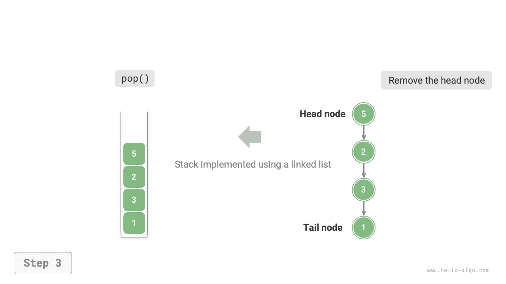
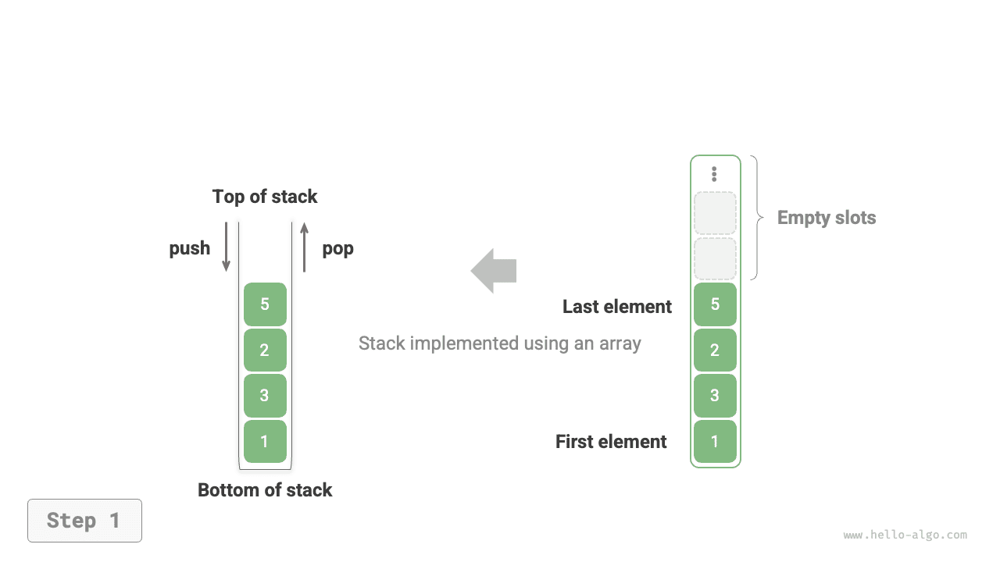

# Stacks

A <u>stack</u> is a linear data structure that follows a last-in, first-out rule.

Think of a stack of plates on a table. If we can move only one plate at a time, reaching the bottom plate requires removing all the plates above it first. Replace the plates with elements such as integers, characters, or objects, and we have a stack.

As shown below, the upper end is the “top” of the stack and the lower end is the “bottom.” Adding an element to the top is called “pushing,” and removing the top element is called “popping.”


## Common stack operations

The table below lists common operations. Actual method names depend on the programming language; here we use the familiar names `push()`, `pop()`, and `peek()`.

<p align="center"> Table <id> &nbsp; Efficiency of stack operations </p>

| Method     | Description                   | Time complexity |
| -------- | ---------------------- | ---------- |
| `push()` | Push an element onto the top | $O(1)$     |
| `pop()`  | Remove the top element           | $O(1)$     |
| `peek()` | Access the top element           | $O(1)$     |

We can usually use a language's built-in stack class. If no dedicated class is provided, use an array or linked list as a stack and avoid operations unrelated to stack behavior.

=== "Python"

    ```python title="stack.py"
    # Initialize a stack
    # Python has no built-in stack class; use a list as a stack
    stack: list[int] = []

    # Push elements
    stack.append(1)
    stack.append(3)
    stack.append(2)
    stack.append(5)
    stack.append(4)

    # Access the top element
    peek: int = stack[-1]

    # Pop an element
    pop: int = stack.pop()

    # Get the stack size
    size: int = len(stack)

    # Check whether the stack is empty
    is_empty: bool = len(stack) == 0
    ```

=== "C++"

    ```cpp title="stack.cpp"
    /* Initialize a stack */
    stack<int> stack;

    /* Push elements */
    stack.push(1);
    stack.push(3);
    stack.push(2);
    stack.push(5);
    stack.push(4);

    /* Access the top element */
    int top = stack.top();

    /* Pop an element */
    stack.pop(); // No return value

    /* Get the stack size */
    int size = stack.size();

    /* Check whether the stack is empty */
    bool empty = stack.empty();
    ```

=== "Java"

    ```java title="stack.java"
    /* Initialize a stack */
    Stack<Integer> stack = new Stack<>();

    /* Push elements */
    stack.push(1);
    stack.push(3);
    stack.push(2);
    stack.push(5);
    stack.push(4);

    /* Access the top element */
    int peek = stack.peek();

    /* Pop an element */
    int pop = stack.pop();

    /* Get the stack size */
    int size = stack.size();

    /* Check whether the stack is empty */
    boolean isEmpty = stack.isEmpty();
    ```

=== "C#"

    ```csharp title="stack.cs"
    /* Initialize a stack */
    Stack<int> stack = new();

    /* Push elements */
    stack.Push(1);
    stack.Push(3);
    stack.Push(2);
    stack.Push(5);
    stack.Push(4);

    /* Access the top element */
    int peek = stack.Peek();

    /* Pop an element */
    int pop = stack.Pop();

    /* Get the stack size */
    int size = stack.Count;

    /* Check whether the stack is empty */
    bool isEmpty = stack.Count == 0;
    ```

=== "Go"

    ```go title="stack_test.go"
    /* Initialize a stack */
    // In Go, a slice is recommended for use as a stack
    var stack []int

    /* Push elements */
    stack = append(stack, 1)
    stack = append(stack, 3)
    stack = append(stack, 2)
    stack = append(stack, 5)
    stack = append(stack, 4)

    /* Access the top element */
    peek := stack[len(stack)-1]

    /* Pop an element */
    pop := stack[len(stack)-1]
    stack = stack[:len(stack)-1]

    /* Get the stack size */
    size := len(stack)

    /* Check whether the stack is empty */
    isEmpty := len(stack) == 0
    ```

=== "Swift"

    ```swift title="stack.swift"
    /* Initialize a stack */
    // Swift has no built-in stack class; use an Array as a stack
    var stack: [Int] = []

    /* Push elements */
    stack.append(1)
    stack.append(3)
    stack.append(2)
    stack.append(5)
    stack.append(4)

    /* Access the top element */
    let peek = stack.last!

    /* Pop an element */
    let pop = stack.removeLast()

    /* Get the stack size */
    let size = stack.count

    /* Check whether the stack is empty */
    let isEmpty = stack.isEmpty
    ```

=== "JS"

    ```javascript title="stack.js"
    /* Initialize a stack */
    // JavaScript has no built-in stack class; use an Array as a stack
    const stack = [];

    /* Push elements */
    stack.push(1);
    stack.push(3);
    stack.push(2);
    stack.push(5);
    stack.push(4);

    /* Access the top element */
    const peek = stack[stack.length-1];

    /* Pop an element */
    const pop = stack.pop();

    /* Get the stack size */
    const size = stack.length;

    /* Check whether the stack is empty */
    const is_empty = stack.length === 0;
    ```

=== "TS"

    ```typescript title="stack.ts"
    /* Initialize a stack */
    // TypeScript has no built-in stack class; use an Array as a stack
    const stack: number[] = [];

    /* Push elements */
    stack.push(1);
    stack.push(3);
    stack.push(2);
    stack.push(5);
    stack.push(4);

    /* Access the top element */
    const peek = stack[stack.length - 1];

    /* Pop an element */
    const pop = stack.pop();

    /* Get the stack size */
    const size = stack.length;

    /* Check whether the stack is empty */
    const is_empty = stack.length === 0;
    ```

=== "Dart"

    ```dart title="stack.dart"
    /* Initialize a stack */
    // Dart has no built-in stack class; use a List as a stack
    List<int> stack = [];

    /* Push elements */
    stack.add(1);
    stack.add(3);
    stack.add(2);
    stack.add(5);
    stack.add(4);

    /* Access the top element */
    int peek = stack.last;

    /* Pop an element */
    int pop = stack.removeLast();

    /* Get the stack size */
    int size = stack.length;

    /* Check whether the stack is empty */
    bool isEmpty = stack.isEmpty;
    ```

=== "Rust"

    ```rust title="stack.rs"
    /* Initialize a stack */
    // Use a Vec as a stack
    let mut stack: Vec<i32> = Vec::new();

    /* Push elements */
    stack.push(1);
    stack.push(3);
    stack.push(2);
    stack.push(5);
    stack.push(4);

    /* Access the top element */
    let top = stack.last().unwrap();

    /* Pop an element */
    let pop = stack.pop().unwrap();

    /* Get the stack size */
    let size = stack.len();

    /* Check whether the stack is empty */
    let is_empty = stack.is_empty();
    ```

=== "C"

    ```c title="stack.c"
    // C provides no built-in stack
    ```

=== "Kotlin"

    ```kotlin title="stack.kt"
    /* Initialize a stack */
    val stack = Stack<Int>()

    /* Push elements */
    stack.push(1)
    stack.push(3)
    stack.push(2)
    stack.push(5)
    stack.push(4)

    /* Access the top element */
    val peek = stack.peek()

    /* Pop an element */
    val pop = stack.pop()

    /* Get the stack size */
    val size = stack.size

    /* Check whether the stack is empty */
    val isEmpty = stack.isEmpty()
    ```

=== "Ruby"

    ```ruby title="stack.rb"
    # Initialize a stack
    # Ruby has no built-in stack class; use an Array as a stack
    stack = []

    # Push elements
    stack << 1
    stack << 3
    stack << 2
    stack << 5
    stack << 4

    # Access the top element
    peek = stack.last

    # Pop an element
    pop = stack.pop

    # Get the stack size
    size = stack.length

    # Check whether the stack is empty
    is_empty = stack.empty?
    ```

??? pythontutor "Visualize execution"

    https://pythontutor.com/render.html#code=%22%22%22Driver%20Code%22%22%22%0Aif%20__name__%20%3D%3D%20%22__main__%22%3A%0A%20%20%20%20%23%20Initialize%20a%20stack%0A%20%20%20%20%23%20Python%20has%20no%20built-in%20stack%20class%3B%20use%20a%20list%20as%20a%20stack%0A%20%20%20%20stack%20%3D%20%5B%5D%0A%0A%20%20%20%20%23%20Push%20elements%0A%20%20%20%20stack.append%281%29%0A%20%20%20%20stack.append%283%29%0A%20%20%20%20stack.append%282%29%0A%20%20%20%20stack.append%285%29%0A%20%20%20%20stack.append%284%29%0A%20%20%20%20print%28%22Stack%3A%20stack%20%3D%22%2C%20stack%29%0A%0A%20%20%20%20%23%20Access%20the%20top%20element%0A%20%20%20%20peek%20%3D%20stack%5B-1%5D%0A%20%20%20%20print%28%22Top%20element%3A%20peek%20%3D%22%2C%20peek%29%0A%0A%20%20%20%20%23%20Pop%20an%20element%0A%20%20%20%20pop%20%3D%20stack.pop%28%29%0A%20%20%20%20print%28%22Popped%20element%3A%20pop%20%3D%22%2C%20pop%29%0A%20%20%20%20print%28%22After%20popping%3A%20stack%20%3D%22%2C%20stack%29%0A%0A%20%20%20%20%23%20Get%20the%20stack%20size%0A%20%20%20%20size%20%3D%20len%28stack%29%0A%20%20%20%20print%28%22Stack%20size%3A%20size%20%3D%22%2C%20size%29%0A%0A%20%20%20%20%23%20Check%20whether%20the%20stack%20is%20empty%0A%20%20%20%20is_empty%20%3D%20len%28stack%29%20%3D%3D%200%0A%20%20%20%20print%28%22Is%20the%20stack%20empty%20%3D%22%2C%20is_empty%29&cumulative=false&curInstr=2&heapPrimitives=nevernest&mode=display&origin=opt-frontend.js&py=311&rawInputLstJSON=%5B%5D&textReferences=false

## Implementing a stack

To understand how a stack works more deeply, let us implement a stack class ourselves.

A stack follows last-in, first-out order, so elements can be added or removed only at the top. Arrays and linked lists allow insertion and deletion at arbitrary positions, **so a stack can be viewed as a restricted array or linked list**. By hiding irrelevant operations, we make its public behavior conform to the stack's rules.

### Implementation with a linked list

When implementing a stack with a linked list, treat the head as the top and the tail as the bottom.

As shown below, pushing simply inserts a node at the head, an operation called “head insertion.” Popping removes the head node.

=== "<1>"
    

=== "<2>"
    

=== "<3>"
    

Here is an implementation using a linked list:

```src
[file]{linkedlist_stack}-[class]{linked_list_stack}-[func]{}
```

### Implementation with an array

For an array-based stack, use the end of the array as the top. As shown below, pushing and popping correspond to adding and removing the last element, both taking $O(1)$ time.

=== "<1>"
    

=== "<2>"
    

=== "<3>"
    

Since elements may keep arriving, use a dynamic array so that resizing is handled for us. An implementation follows:

```src
[file]{array_stack}-[class]{array_stack}-[func]{}
```

## Comparing the implementations

**Supported operations**

Both implementations support all stack operations. An array also allows random access, but that is outside the stack abstraction and is generally not used.

**Time efficiency**

In an array-based stack, pushes and pops operate in preallocated contiguous memory, giving good cache locality and high efficiency. However, a push that exceeds the array's capacity triggers expansion, making that particular push an $O(n)$ operation.

A linked list grows flexibly and avoids the slowdown associated with array expansion. However, pushing requires creating a node object and updating pointers, so it is relatively slower. If the element is already a node object, the creation step can be skipped to improve efficiency.

For elements of primitive types such as `int` or `double`, we can therefore draw the following conclusions.

- An array-based stack slows down when expansion is triggered, but expansion is infrequent, so average efficiency is higher.
- A linked-list stack provides more consistent performance.

**Space efficiency**

When a dynamic array is initialized, its initial capacity may exceed actual needs. Expansion typically multiplies the capacity by a fixed factor, such as 2, which may again leave excess space. **An array-based stack can therefore waste some space**.

However, linked-list nodes also store pointers, **so each node occupies relatively more space**.

We cannot say universally which implementation uses less memory; the answer depends on the situation.

## Typical applications

- **Browser back and forward navigation, and software undo and redo**. When a new web page is opened, the browser pushes the previous page onto a stack. Going back pops that page. Supporting both back and forward requires two stacks working together.
- **Program memory management**. Each function call adds a stack frame containing the function's context. During recursion, frames are pushed as calls descend and popped as they return.
