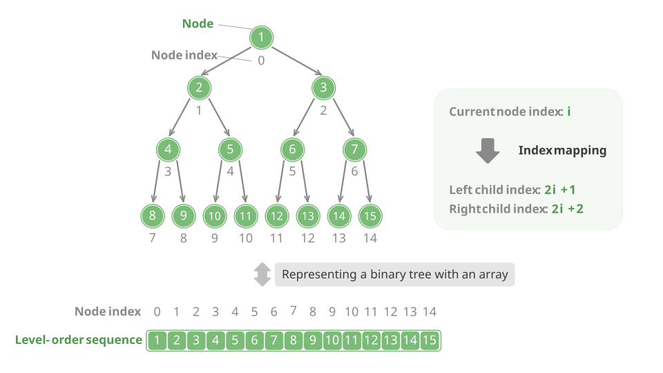

# Representing binary trees with arrays

In the linked representation of a binary tree, each `TreeNode` node is a unit of storage, and pointers connect the nodes. The previous section introduced basic binary tree operations using this representation.

Can we also represent a binary tree with an array? Yes.

## Representing a perfect binary tree

Start with a simple case: a perfect binary tree. If we store its nodes in an array in level order, each node has a unique array index.

Level order gives us a formula relating parent and child indices: **if a node has index $i$, its left child has index $2i + 1$ and its right child has index $2i + 2$**. The figure below shows how the indices correspond.



**The index formulas play the same role as node references (pointers) in the linked representation**. Given any node in the array, we can use the formulas to access its left or right child.

## Representing an arbitrary binary tree

A perfect binary tree is a special case. In general, a binary tree may have many `None` entries at intermediate levels. A level-order traversal skips these `None` entries, so the sequence alone tells us neither how many `None` entries there are nor where they belong. **Several tree shapes can therefore produce the same level-order sequence**.

As the figure below shows, the array representation we used above breaks down for a tree that is not perfect.


To solve this problem, **we can explicitly include every `None` in the level-order sequence**. As the figure below shows, the sequence then identifies the tree uniquely. Here is an example in code:

```snippet
tree_array_representation
```


**Complete binary trees are especially well suited to array representation**. Recall that in a complete binary tree, `None` entries occur only at the far right of the bottom level, **so all `None` entries come at the end of the level-order sequence**.

That means we can conveniently omit all `None` entries when storing a complete binary tree in an array. The figure below gives an example.


The following code implements an array-based binary tree with these operations:

- Given a node, get its value, its left or right child, or its parent.
- Get the preorder, inorder, postorder, and level-order traversal sequences.

```src
[file]{array_binary_tree}-[class]{array_binary_tree}-[func]{}
```

## Advantages and limitations

The array representation of a binary tree has several advantages.

- Arrays occupy contiguous memory. This makes them cache-friendly and allows fast access and traversal.
- There are no pointers to store, which saves space.
- Nodes support random access.

The array representation also has some limitations.

- Arrays need contiguous memory, which makes them unsuitable for very large trees.
- Adding and removing nodes requires array insertions and deletions, which are relatively inefficient.
- If a binary tree contains many `None` entries, only a small fraction of the array holds node data, so space utilization is low.
