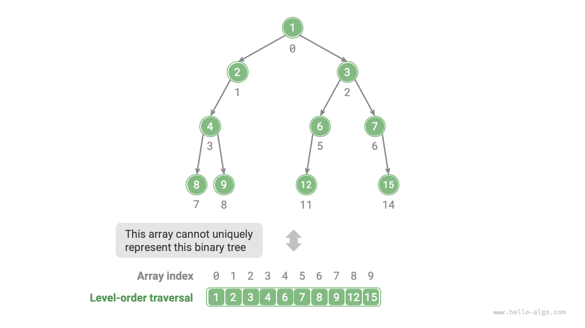
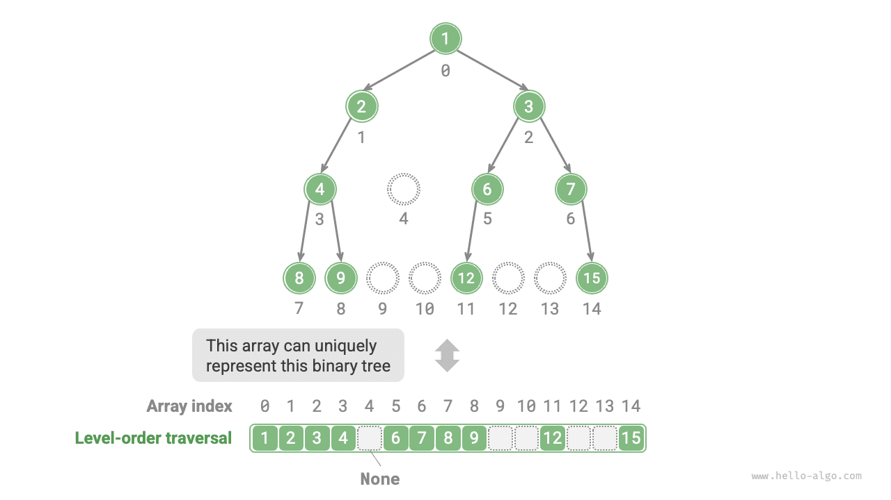

# Array representation of a binary tree

In a linked representation, a binary tree stores data in `TreeNode` nodes connected by pointers. The previous section introduced basic operations on binary trees in this form.

Can we represent a binary tree with an array instead? Yes.

## Representing a perfect binary tree

Start with a simple case. Store every node of a perfect binary tree in an array in level order. Each node then corresponds to a unique array index.

Level-order traversal gives us a mapping between parent and child indices: **if a node has index $i$, its left child has index $2i + 1$ and its right child has index $2i + 2$**. The figure below illustrates this relationship.


**The mapping formulas serve the same role as node references or pointers in a linked representation**. Given any node in the array, we can use them to access its left or right child.

## Representing an arbitrary binary tree

A perfect binary tree is a special case. Other binary trees often contain many missing nodes, `None`, at intermediate levels. Ordinary level-order traversal omits these positions, so its sequence alone cannot tell us their number or locations. **Multiple tree structures can therefore produce the same level-order sequence**.

As shown below, the array representation above no longer works for a non-perfect binary tree.



To solve this, **include every `None` position explicitly in the level-order sequence**. The sequence then represents the tree uniquely, as shown below. Example code follows:

=== "Python"

    ```python title=""
    # Array representation of a binary tree
    # Use None for empty positions
    tree = [1, 2, 3, 4, None, 6, 7, 8, 9, None, None, 12, None, None, 15]
    ```

=== "C++"

    ```cpp title=""
    /* Array representation of a binary tree */
    // Use INT_MAX, the maximum int value, for empty positions
    vector<int> tree = {1, 2, 3, 4, INT_MAX, 6, 7, 8, 9, INT_MAX, INT_MAX, 12, INT_MAX, INT_MAX, 15};
    ```

=== "Java"

    ```java title=""
    /* Array representation of a binary tree */
    // Use the wrapper class Integer so that null can mark empty positions
    Integer[] tree = { 1, 2, 3, 4, null, 6, 7, 8, 9, null, null, 12, null, null, 15 };
    ```

=== "C#"

    ```csharp title=""
    /* Array representation of a binary tree */
    // Use the nullable type int? so that null can mark empty positions
    int?[] tree = [1, 2, 3, 4, null, 6, 7, 8, 9, null, null, 12, null, null, 15];
    ```

=== "Go"

    ```go title=""
    /* Array representation of a binary tree */
    // Use a slice of any so that nil can mark empty positions
    tree := []any{1, 2, 3, 4, nil, 6, 7, 8, 9, nil, nil, 12, nil, nil, 15}
    ```

=== "Swift"

    ```swift title=""
    /* Array representation of a binary tree */
    // Use the optional type Int? so that nil can mark empty positions
    let tree: [Int?] = [1, 2, 3, 4, nil, 6, 7, 8, 9, nil, nil, 12, nil, nil, 15]
    ```

=== "JS"

    ```javascript title=""
    /* Array representation of a binary tree */
    // Use null for empty positions
    let tree = [1, 2, 3, 4, null, 6, 7, 8, 9, null, null, 12, null, null, 15];
    ```

=== "TS"

    ```typescript title=""
    /* Array representation of a binary tree */
    // Use null for empty positions
    let tree: (number | null)[] = [1, 2, 3, 4, null, 6, 7, 8, 9, null, null, 12, null, null, 15];
    ```

=== "Dart"

    ```dart title=""
    /* Array representation of a binary tree */
    // Use the nullable type int? so that null can mark empty positions
    List<int?> tree = [1, 2, 3, 4, null, 6, 7, 8, 9, null, null, 12, null, null, 15];
    ```

=== "Rust"

    ```rust title=""
    /* Array representation of a binary tree */
    // Use None for empty positions
    let tree = [Some(1), Some(2), Some(3), Some(4), None, Some(6), Some(7), Some(8), Some(9), None, None, Some(12), None, None, Some(15)];
    ```

=== "C"

    ```c title=""
    /* Array representation of a binary tree */
    // Use the maximum int value for empty positions, so node values must not equal INT_MAX
    int tree[] = {1, 2, 3, 4, INT_MAX, 6, 7, 8, 9, INT_MAX, INT_MAX, 12, INT_MAX, INT_MAX, 15};
    ```

=== "Kotlin"

    ```kotlin title=""
    /* Array representation of a binary tree */
    // Use null for empty positions
    val tree = arrayOf( 1, 2, 3, 4, null, 6, 7, 8, 9, null, null, 12, null, null, 15 )
    ```

=== "Ruby"

    ```ruby title=""
    ### Array representation of a binary tree ###
    # Use nil for empty positions
    tree = [1, 2, 3, 4, nil, 6, 7, 8, 9, nil, nil, 12, nil, nil, 15]
    ```



**Complete binary trees are particularly well suited to array representation**. By definition, missing positions occur only at the right end of the lowest level, **so all `None` entries appear at the end of the level-order sequence**.

We can therefore omit all `None` entries when storing a complete binary tree in an array. An example is shown below.


The following code implements an array-based binary tree with these operations.

- Given a node, get its value, left or right child, and parent.
- Obtain preorder, inorder, postorder, and level-order traversal sequences.

```src
[file]{array_binary_tree}-[class]{array_binary_tree}-[func]{}
```

## Strengths and limitations

Array representation offers the following advantages.

- Contiguous memory is cache-friendly, making access and traversal fast.
- No pointers need to be stored, saving space.
- Nodes can be accessed randomly by index.

However, it also has limitations.

- Arrays require contiguous memory, making them unsuitable for extremely large trees.
- Adding and removing nodes requires array insertion and deletion operations, which are inefficient.
- If the tree has many missing nodes, actual node data occupies only a small fraction of the array, wasting space.
