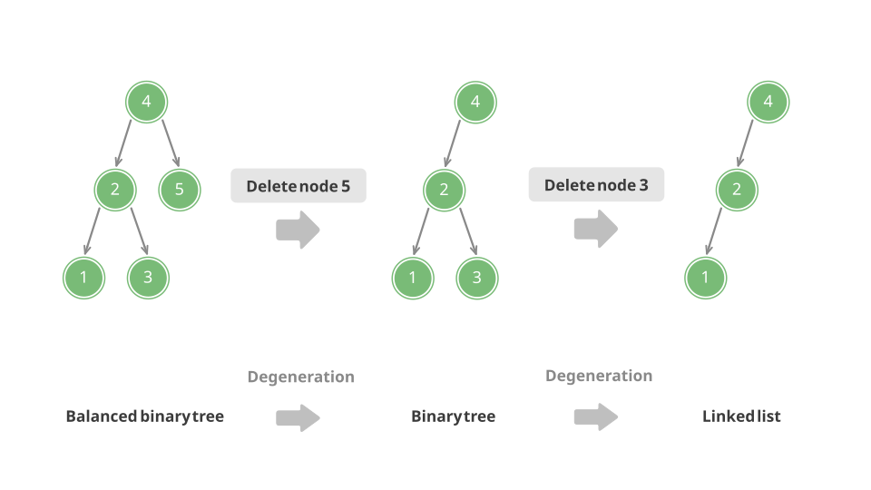
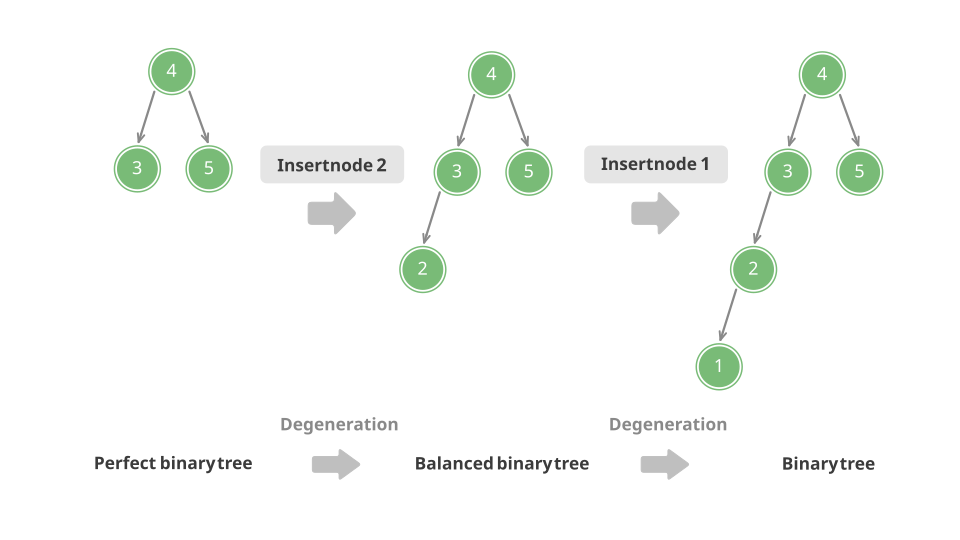
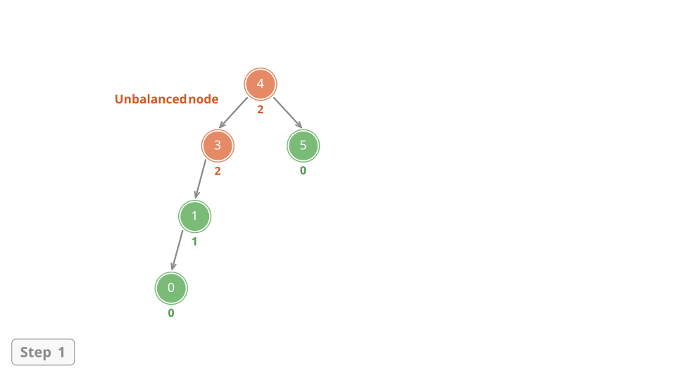
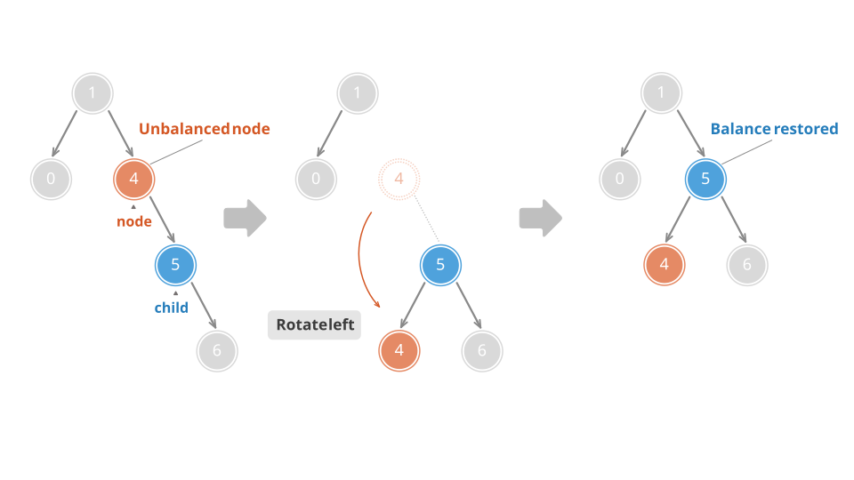
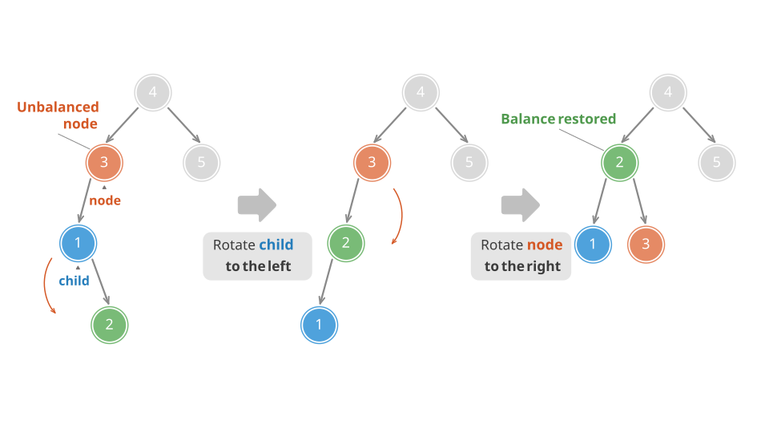

# AVL trees *

As we saw in the section on binary search trees, repeated insertions and deletions can turn a binary search tree into a linked list. When that happens, the time complexity of each operation worsens from $O(\log n)$ to $O(n)$.

In the figure below, just two deletions turn the binary search tree into a linked list.



Similarly, inserting two nodes into the perfect binary tree below makes it lean heavily to the left, worsening the time complexity of search.



In 1962, G. M. Adelson-Velsky and E. M. Landis introduced the <u>AVL tree</u> in their paper “An algorithm for the organization of information.” They described operations that prevent the tree from degenerating under repeated insertions and deletions, keeping its operations at $O(\log n)$ time. This makes AVL trees useful when data must be inserted, deleted, searched, and updated frequently.

## AVL tree terminology

An AVL tree is both a binary search tree and a balanced binary tree. It satisfies all the properties of both, making it a <u>balanced binary search tree</u>.

### Node height

AVL operations need the heights of nodes, so we add a `height` variable to the node class:

```snippet
avl_tree_node
```

A node's height is the distance to its farthest leaf, measured in edges. A leaf has height $0$, and a null node has height $-1$. We will define two helper functions, one to get a node's height and one to update it:

```src
[file]{avl_tree}-[class]{avl_tree}-[func]{update_height}
```

### Node balance factor

A node's <u>balance factor</u> is the height of its left subtree minus the height of its right subtree. We define the balance factor of a null node to be $0$. For convenience, we put this calculation in a function too:

```src
[file]{avl_tree}-[class]{avl_tree}-[func]{balance_factor}
```

!!! tip

    If $f$ denotes the balance factor, every node in an AVL tree satisfies $-1 \le f \le 1$.

## AVL tree rotations

The defining operation of an AVL tree is the rotation. It restores balance at a node without changing the inorder sequence of the tree. In other words, **rotation preserves the binary search tree property while bringing the tree back into balance**.

A node is unbalanced if the absolute value of its balance factor is $> 1$. Depending on the shape of the imbalance, we use one of four rotations: right, left, right-left, or left-right. Let's look at each in turn.

### Rotate right

In the figure below, each node's balance factor appears beneath it. Working from the bottom up, node 3 is the first unbalanced node. Focus on the subtree rooted there. Call that node `node` and its left child `child`, and perform a right rotation. The subtree regains balance and still satisfies the binary search tree property.

=== "<1>"
    

=== "<2>"
    

=== "<3>"
    

=== "<4>"
    

As shown below, if `child` has a right child (called `grand_child`), the right rotation needs one more step: make `grand_child` the left child of `node`.


“Rotate right” describes what the movement looks like. To implement it, we update node pointers as follows:

```src
[file]{avl_tree}-[class]{avl_tree}-[func]{right_rotate}
```

### Rotate left

The mirror image of the unbalanced tree above calls for a left rotation, as shown below.



Similarly, if `child` has a left child (called `grand_child`), the left rotation needs one more step: make `grand_child` the right child of `node`, as shown below.


**Right and left rotations are mirror images of each other, as are the imbalances they correct**. To obtain the code for a left rotation, replace each `left` in the right rotation code with `right` and each `right` with `left`:

```src
[file]{avl_tree}-[class]{avl_tree}-[func]{left_rotate}
```

### Rotate left, then right

For unbalanced node 3 in the figure below, neither a single left rotation nor a single right rotation will balance the subtree. First rotate `child` to the left, then rotate `node` to the right.



### Rotate right, then left

In the mirror image of the preceding case, shown below, first rotate `child` to the right, then rotate `node` to the left.


### Choosing a rotation

The four imbalances below correspond to the examples above. From left to right, they require a right rotation, a left-right rotation, a right-left rotation, and a left rotation.


As the table shows, we can identify the case by checking the balance factor of the unbalanced node and the sign of the balance factor of its child on the taller side.

<p align="center"> Table <id> &nbsp; Conditions for choosing among the four rotations </p>

| Balance factor of the unbalanced node | Balance factor of the child | Rotation to use |
| ------------------ | ---------------- | ---------------- |
| $> 1$ (left-heavy tree)   | $\geq 0$         | Rotate right             |
| $> 1$ (left-heavy tree)   | $<0$             | Rotate left, then right     |
| $< -1$ (right-heavy tree)  | $\leq 0$         | Rotate left             |
| $< -1$ (right-heavy tree)  | $>0$             | Rotate right, then left     |

For convenience, we put the rotation logic in a function. **This function handles each kind of imbalance and restores balance at the affected node**. Here is the code:

```src
[file]{avl_tree}-[class]{avl_tree}-[func]{rotate}
```

## Common AVL tree operations

### Insert a node

Inserting a node into an AVL tree works much like inserting one into a binary search tree. The difference is that after insertion, nodes along the path from the new node to the root may be unbalanced. **Starting at the new node, we work upward and apply rotations to rebalance every affected node**. Here is the code:

```src
[file]{avl_tree}-[class]{avl_tree}-[func]{insert_helper}
```

### Delete a node

Similarly, we extend binary search tree deletion by applying rotations from the bottom up to rebalance every affected node. Here is the code:

```src
[file]{avl_tree}-[class]{avl_tree}-[func]{remove_helper}
```

### Search for a node

Searching an AVL tree works exactly like searching a binary search tree.

## Typical applications of AVL trees

- Organizing and storing large amounts of data when searches are frequent and insertions and deletions are infrequent.
- Building database indexes.
- A red-black tree is another common balanced binary search tree. It has looser balance requirements than an AVL tree, needs fewer rotations for insertions and deletions, and on average performs those operations more efficiently.
