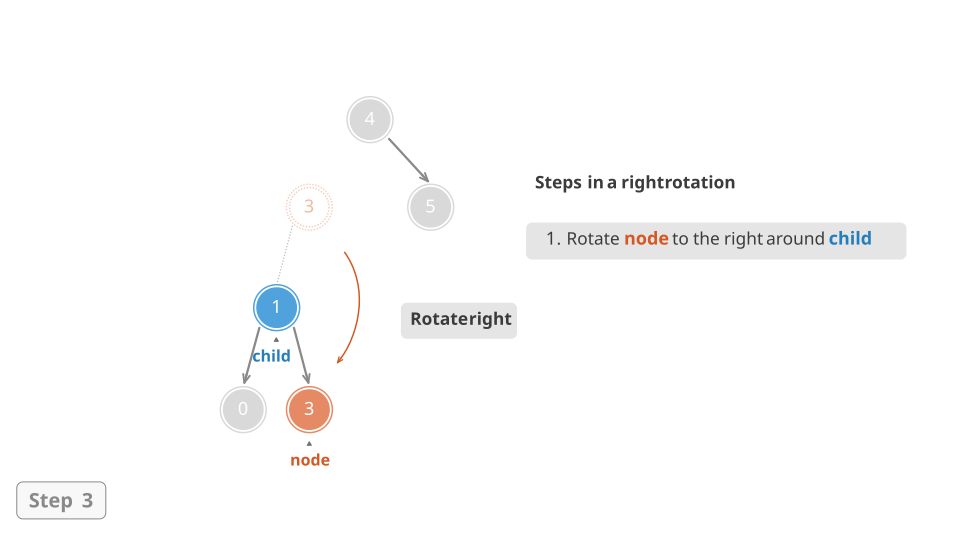
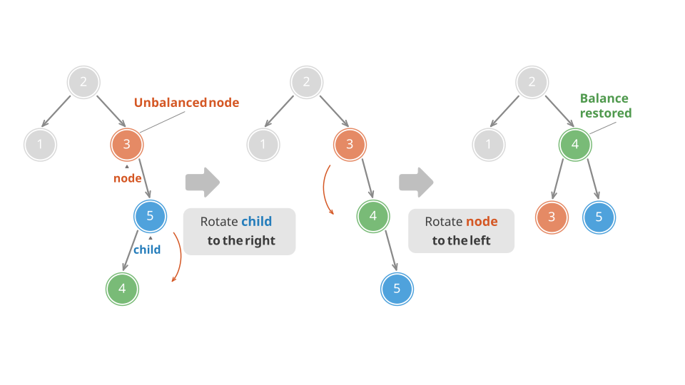
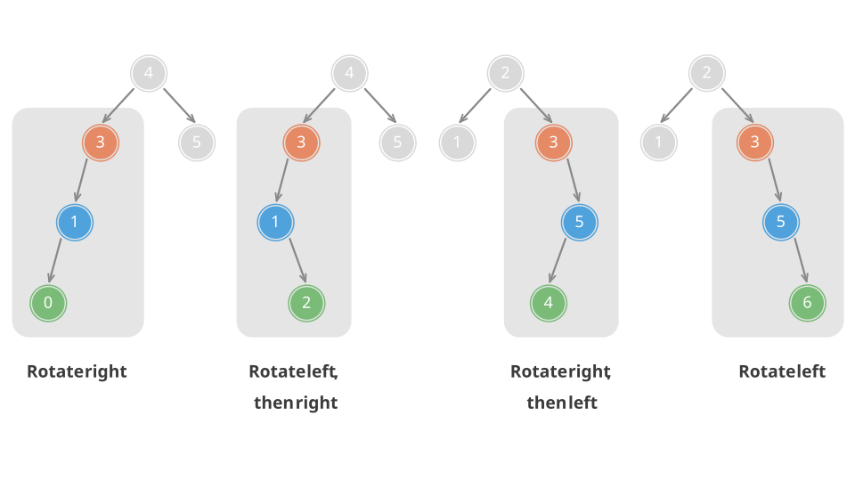

# 7.5 &nbsp; AVL trees *

As we saw in the section on binary search trees, repeated insertions and deletions can turn a binary search tree into a linked list. When that happens, the time complexity of each operation worsens from $O(\log n)$ to $O(n)$.

In Figure 7-24, just two deletions turn the binary search tree into a linked list.

{ class="animation-figure" }

<p align="center"> Figure 7-24 &nbsp; An AVL tree degenerates after node deletions </p>

Similarly, inserting two nodes into the perfect binary tree below makes it lean heavily to the left, worsening the time complexity of search.

{ class="animation-figure" }

<p align="center"> Figure 7-25 &nbsp; An AVL tree degenerates after node insertions </p>

In 1962, G. M. Adelson-Velsky and E. M. Landis introduced the <u>AVL tree</u> in their paper “An algorithm for the organization of information.” They described operations that prevent the tree from degenerating under repeated insertions and deletions, keeping its operations at $O(\log n)$ time. This makes AVL trees useful when data must be inserted, deleted, searched, and updated frequently.

## 7.5.1 &nbsp; AVL tree terminology

An AVL tree is both a binary search tree and a balanced binary tree. It satisfies all the properties of both, making it a <u>balanced binary search tree</u>.

### 1. &nbsp; Node height

AVL operations need the heights of nodes, so we add a `height` variable to the node class:

=== "Python"

    ```python title=""
    class TreeNode:
        """AVL tree node class"""
        def __init__(self, val: int):
            self.val: int = val                 # Node value
            self.height: int = 0                # Node height
            self.left: TreeNode | None = None   # Left child reference
            self.right: TreeNode | None = None  # Right child reference
    ```

=== "C++"

    ```cpp title=""
    /* AVL tree node class */
    struct TreeNode {
        int val{};          // Node value
        int height = 0;     // Node height
        TreeNode *left{};   // Left child
        TreeNode *right{};  // Right child
        TreeNode() = default;
        explicit TreeNode(int x) : val(x){}
    };
    ```

=== "Java"

    ```java title=""
    /* AVL tree node class */
    class TreeNode {
        public int val;        // Node value
        public int height;     // Node height
        public TreeNode left;  // Left child
        public TreeNode right; // Right child
        public TreeNode(int x) { val = x; }
    }
    ```

=== "C#"

    ```csharp title=""
    /* AVL tree node class */
    class TreeNode(int? x) {
        public int? val = x;    // Node value
        public int height;      // Node height
        public TreeNode? left;  // Left child reference
        public TreeNode? right; // Right child reference
    }
    ```

=== "Go"

    ```go title=""
    /* AVL tree node structure */
    type TreeNode struct {
        Val    int       // Node value
        Height int       // Node height
        Left   *TreeNode // Left child reference
        Right  *TreeNode // Right child reference
    }
    ```

=== "Swift"

    ```swift title=""
    /* AVL tree node class */
    class TreeNode {
        var val: Int // Node value
        var height: Int // Node height
        var left: TreeNode? // Left child
        var right: TreeNode? // Right child

        init(x: Int) {
            val = x
            height = 0
        }
    }
    ```

=== "JS"

    ```javascript title=""
    /* AVL tree node class */
    class TreeNode {
        val; // Node value
        height; //Node height
        left; // Left child pointer
        right; // Right child pointer
        constructor(val, left, right, height) {
            this.val = val === undefined ? 0 : val;
            this.height = height === undefined ? 0 : height;
            this.left = left === undefined ? null : left;
            this.right = right === undefined ? null : right;
        }
    }
    ```

=== "TS"

    ```typescript title=""
    /* AVL tree node class */
    class TreeNode {
        val: number;            // Node value
        height: number;         // Node height
        left: TreeNode | null;  // Left child pointer
        right: TreeNode | null; // Right child pointer
        constructor(val?: number, height?: number, left?: TreeNode | null, right?: TreeNode | null) {
            this.val = val === undefined ? 0 : val;
            this.height = height === undefined ? 0 : height;
            this.left = left === undefined ? null : left;
            this.right = right === undefined ? null : right;
        }
    }
    ```

=== "Dart"

    ```dart title=""
    /* AVL tree node class */
    class TreeNode {
      int val;         // Node value
      int height;      // Node height
      TreeNode? left;  // Left child
      TreeNode? right; // Right child
      TreeNode(this.val, [this.height = 0, this.left, this.right]);
    }
    ```

=== "Rust"

    ```rust title=""
    use std::rc::Rc;
    use std::cell::RefCell;

    /* AVL tree node structure */
    struct TreeNode {
        val: i32,                               // Node value
        height: i32,                            // Node height
        left: Option<Rc<RefCell<TreeNode>>>,    // Left child
        right: Option<Rc<RefCell<TreeNode>>>,   // Right child
    }

    impl TreeNode {
        /* Constructor */
        fn new(val: i32) -> Rc<RefCell<Self>> {
            Rc::new(RefCell::new(Self {
                val,
                height: 0,
                left: None,
                right: None
            }))
        }
    }
    ```

=== "C"

    ```c title=""
    /* AVL tree node structure */
    typedef struct TreeNode {
        int val;
        int height;
        struct TreeNode *left;
        struct TreeNode *right;
    } TreeNode;

    /* Constructor */
    TreeNode *newTreeNode(int val) {
        TreeNode *node;

        node = (TreeNode *)malloc(sizeof(TreeNode));
        node->val = val;
        node->height = 0;
        node->left = NULL;
        node->right = NULL;
        return node;
    }
    ```

=== "Kotlin"

    ```kotlin title=""
    /* AVL tree node class */
    class TreeNode(val _val: Int) {  // Node value
        var height: Int = 0          // Node height
        var left: TreeNode? = null   // Left child
        var right: TreeNode? = null  // Right child
    }
    ```

=== "Ruby"

    ```ruby title=""
    ### AVL tree node class ###
    class TreeNode
      attr_accessor :val    # Node value
      attr_accessor :height # Node height
      attr_accessor :left   # Left child reference
      attr_accessor :right  # Right child reference

      def initialize(val)
        @val = val
        @height = 0
      end
    end
    ```

A node's height is the distance to its farthest leaf, measured in edges. A leaf has height $0$, and a null node has height $-1$. We will define two helper functions, one to get a node's height and one to update it:

=== "Python"

    ```python title="avl_tree.py"
    def height(self, node: TreeNode | None) -> int:
        """Get the node height"""
        # A null node has height -1, and a leaf has height 0
        if node is not None:
            return node.height
        return -1

    def update_height(self, node: TreeNode | None):
        """Update the node height"""
        # Node height is the height of the taller subtree plus 1
        node.height = max([self.height(node.left), self.height(node.right)]) + 1
    ```

=== "C++"

    ```cpp title="avl_tree.cpp"
    /* Get the node height */
    int height(TreeNode *node) {
        // A null node has height -1, and a leaf has height 0
        return node == nullptr ? -1 : node->height;
    }

    /* Update the node height */
    void updateHeight(TreeNode *node) {
        // Node height is the height of the taller subtree plus 1
        node->height = max(height(node->left), height(node->right)) + 1;
    }
    ```

=== "Java"

    ```java title="avl_tree.java"
    /* Get the node height */
    int height(TreeNode node) {
        // A null node has height -1, and a leaf has height 0
        return node == null ? -1 : node.height;
    }

    /* Update the node height */
    void updateHeight(TreeNode node) {
        // Node height is the height of the taller subtree plus 1
        node.height = Math.max(height(node.left), height(node.right)) + 1;
    }
    ```

=== "C#"

    ```csharp title="avl_tree.cs"
    /* Get the node height */
    int Height(TreeNode? node) {
        // A null node has height -1, and a leaf has height 0
        return node == null ? -1 : node.height;
    }

    /* Update the node height */
    void UpdateHeight(TreeNode node) {
        // Node height is the height of the taller subtree plus 1
        node.height = Math.Max(Height(node.left), Height(node.right)) + 1;
    }
    ```

=== "Go"

    ```go title="avl_tree.go"
    /* Get the node height */
    func (t *aVLTree) height(node *TreeNode) int {
        // A null node has height -1, and a leaf has height 0
        if node != nil {
            return node.Height
        }
        return -1
    }

    /* Update the node height */
    func (t *aVLTree) updateHeight(node *TreeNode) {
        lh := t.height(node.Left)
        rh := t.height(node.Right)
        // Node height is the height of the taller subtree plus 1
        if lh > rh {
            node.Height = lh + 1
        } else {
            node.Height = rh + 1
        }
    }
    ```

=== "Swift"

    ```swift title="avl_tree.swift"
    /* Get the node height */
    func height(node: TreeNode?) -> Int {
        // A null node has height -1, and a leaf has height 0
        node?.height ?? -1
    }

    /* Update the node height */
    func updateHeight(node: TreeNode?) {
        // Node height is the height of the taller subtree plus 1
        node?.height = max(height(node: node?.left), height(node: node?.right)) + 1
    }
    ```

=== "JS"

    ```javascript title="avl_tree.js"
    /* Get the node height */
    height(node) {
        // A null node has height -1, and a leaf has height 0
        return node === null ? -1 : node.height;
    }

    /* Update the node height */
    #updateHeight(node) {
        // Node height is the height of the taller subtree plus 1
        node.height =
            Math.max(this.height(node.left), this.height(node.right)) + 1;
    }
    ```

=== "TS"

    ```typescript title="avl_tree.ts"
    /* Get the node height */
    height(node: TreeNode): number {
        // A null node has height -1, and a leaf has height 0
        return node === null ? -1 : node.height;
    }

    /* Update the node height */
    updateHeight(node: TreeNode): void {
        // Node height is the height of the taller subtree plus 1
        node.height =
            Math.max(this.height(node.left), this.height(node.right)) + 1;
    }
    ```

=== "Dart"

    ```dart title="avl_tree.dart"
    /* Get the node height */
    int height(TreeNode? node) {
      // A null node has height -1, and a leaf has height 0
      return node == null ? -1 : node.height;
    }

    /* Update the node height */
    void updateHeight(TreeNode? node) {
      // Node height is the height of the taller subtree plus 1
      node!.height = max(height(node.left), height(node.right)) + 1;
    }
    ```

=== "Rust"

    ```rust title="avl_tree.rs"
    /* Get the node height */
    fn height(node: OptionTreeNodeRc) -> i32 {
        // A null node has height -1, and a leaf has height 0
        match node {
            Some(node) => node.borrow().height,
            None => -1,
        }
    }

    /* Update the node height */
    fn update_height(node: OptionTreeNodeRc) {
        if let Some(node) = node {
            let left = node.borrow().left.clone();
            let right = node.borrow().right.clone();
            // Node height is the height of the taller subtree plus 1
            node.borrow_mut().height = std::cmp::max(Self::height(left), Self::height(right)) + 1;
        }
    }
    ```

=== "C"

    ```c title="avl_tree.c"
    /* Get the node height */
    int height(TreeNode *node) {
        // A null node has height -1, and a leaf has height 0
        if (node != NULL) {
            return node->height;
        }
        return -1;
    }

    /* Update the node height */
    void updateHeight(TreeNode *node) {
        int lh = height(node->left);
        int rh = height(node->right);
        // Node height is the height of the taller subtree plus 1
        if (lh > rh) {
            node->height = lh + 1;
        } else {
            node->height = rh + 1;
        }
    }
    ```

=== "Kotlin"

    ```kotlin title="avl_tree.kt"
    /* Get the node height */
    fun height(node: TreeNode?): Int {
        // A null node has height -1, and a leaf has height 0
        return node?.height ?: -1
    }

    /* Update the node height */
    fun updateHeight(node: TreeNode?) {
        // Node height is the height of the taller subtree plus 1
        node?.height = max(height(node?.left), height(node?.right)) + 1
    }
    ```

=== "Ruby"

    ```ruby title="avl_tree.rb"
    ### Get the node height ###
    def height(node)
      # A null node has height -1, and a leaf has height 0
      return node.height unless node.nil?

      -1
    end

    ### Update the node height ###
    def update_height(node)
      # Node height is the height of the taller subtree plus 1
      node.height = [height(node.left), height(node.right)].max + 1
    end
    ```

### 2. &nbsp; Node balance factor

A node's <u>balance factor</u> is the height of its left subtree minus the height of its right subtree. We define the balance factor of a null node to be $0$. For convenience, we put this calculation in a function too:

=== "Python"

    ```python title="avl_tree.py"
    def balance_factor(self, node: TreeNode | None) -> int:
        """Get the balance factor"""
        # A null node has a balance factor of 0
        if node is None:
            return 0
        # Balance factor = left subtree height - right subtree height
        return self.height(node.left) - self.height(node.right)
    ```

=== "C++"

    ```cpp title="avl_tree.cpp"
    /* Get the balance factor */
    int balanceFactor(TreeNode *node) {
        // A null node has a balance factor of 0
        if (node == nullptr)
            return 0;
        // Balance factor = left subtree height - right subtree height
        return height(node->left) - height(node->right);
    }
    ```

=== "Java"

    ```java title="avl_tree.java"
    /* Get the balance factor */
    int balanceFactor(TreeNode node) {
        // A null node has a balance factor of 0
        if (node == null)
            return 0;
        // Balance factor = left subtree height - right subtree height
        return height(node.left) - height(node.right);
    }
    ```

=== "C#"

    ```csharp title="avl_tree.cs"
    /* Get the balance factor */
    int BalanceFactor(TreeNode? node) {
        // A null node has a balance factor of 0
        if (node == null) return 0;
        // Balance factor = left subtree height - right subtree height
        return Height(node.left) - Height(node.right);
    }
    ```

=== "Go"

    ```go title="avl_tree.go"
    /* Get the balance factor */
    func (t *aVLTree) balanceFactor(node *TreeNode) int {
        // A null node has a balance factor of 0
        if node == nil {
            return 0
        }
        // Balance factor = left subtree height - right subtree height
        return t.height(node.Left) - t.height(node.Right)
    }
    ```

=== "Swift"

    ```swift title="avl_tree.swift"
    /* Get the balance factor */
    func balanceFactor(node: TreeNode?) -> Int {
        // A null node has a balance factor of 0
        guard let node = node else { return 0 }
        // Balance factor = left subtree height - right subtree height
        return height(node: node.left) - height(node: node.right)
    }
    ```

=== "JS"

    ```javascript title="avl_tree.js"
    /* Get the balance factor */
    balanceFactor(node) {
        // A null node has a balance factor of 0
        if (node === null) return 0;
        // Balance factor = left subtree height - right subtree height
        return this.height(node.left) - this.height(node.right);
    }
    ```

=== "TS"

    ```typescript title="avl_tree.ts"
    /* Get the balance factor */
    balanceFactor(node: TreeNode): number {
        // A null node has a balance factor of 0
        if (node === null) return 0;
        // Balance factor = left subtree height - right subtree height
        return this.height(node.left) - this.height(node.right);
    }
    ```

=== "Dart"

    ```dart title="avl_tree.dart"
    /* Get the balance factor */
    int balanceFactor(TreeNode? node) {
      // A null node has a balance factor of 0
      if (node == null) return 0;
      // Balance factor = left subtree height - right subtree height
      return height(node.left) - height(node.right);
    }
    ```

=== "Rust"

    ```rust title="avl_tree.rs"
    /* Get the balance factor */
    fn balance_factor(node: OptionTreeNodeRc) -> i32 {
        match node {
            // A null node has a balance factor of 0
            None => 0,
            // Balance factor = left subtree height - right subtree height
            Some(node) => {
                Self::height(node.borrow().left.clone()) - Self::height(node.borrow().right.clone())
            }
        }
    }
    ```

=== "C"

    ```c title="avl_tree.c"
    /* Get the balance factor */
    int balanceFactor(TreeNode *node) {
        // A null node has a balance factor of 0
        if (node == NULL) {
            return 0;
        }
        // Balance factor = left subtree height - right subtree height
        return height(node->left) - height(node->right);
    }
    ```

=== "Kotlin"

    ```kotlin title="avl_tree.kt"
    /* Get the balance factor */
    fun balanceFactor(node: TreeNode?): Int {
        // A null node has a balance factor of 0
        if (node == null) return 0
        // Balance factor = left subtree height - right subtree height
        return height(node.left) - height(node.right)
    }
    ```

=== "Ruby"

    ```ruby title="avl_tree.rb"
    ### Get the balance factor ###
    def balance_factor(node)
      # A null node has a balance factor of 0
      return 0 if node.nil?

      # Balance factor = left subtree height - right subtree height
      height(node.left) - height(node.right)
    end
    ```

!!! tip

    If $f$ denotes the balance factor, every node in an AVL tree satisfies $-1 \le f \le 1$.

## 7.5.2 &nbsp; AVL tree rotations

The defining operation of an AVL tree is the rotation. It restores balance at a node without changing the inorder sequence of the tree. In other words, **rotation preserves the binary search tree property while bringing the tree back into balance**.

A node is unbalanced if the absolute value of its balance factor is $> 1$. Depending on the shape of the imbalance, we use one of four rotations: right, left, right-left, or left-right. Let's look at each in turn.

### 1. &nbsp; Rotate right

In Figure 7-26, each node's balance factor appears beneath it. Working from the bottom up, node 3 is the first unbalanced node. Focus on the subtree rooted there. Call that node `node` and its left child `child`, and perform a right rotation. The subtree regains balance and still satisfies the binary search tree property.

=== "<1>"
    { class="animation-figure" }

=== "<2>"
    { class="animation-figure" }

=== "<3>"
    { class="animation-figure" }

=== "<4>"
    { class="animation-figure" }

<p align="center"> Figure 7-26 &nbsp; Steps in a right rotation </p>

As shown below, if `child` has a right child (called `grand_child`), the right rotation needs one more step: make `grand_child` the left child of `node`.

{ class="animation-figure" }

<p align="center"> Figure 7-27 &nbsp; Right rotation with grand_child </p>

“Rotate right” describes what the movement looks like. To implement it, we update node pointers as follows:

=== "Python"

    ```python title="avl_tree.py"
    def right_rotate(self, node: TreeNode | None) -> TreeNode | None:
        """Right rotation"""
        child = node.left
        grand_child = child.right
        # Rotate node to the right around child
        child.right = node
        node.left = grand_child
        # Update the node height
        self.update_height(node)
        self.update_height(child)
        # Return the root of the rotated subtree
        return child
    ```

=== "C++"

    ```cpp title="avl_tree.cpp"
    /* Right rotation */
    TreeNode *rightRotate(TreeNode *node) {
        TreeNode *child = node->left;
        TreeNode *grandChild = child->right;
        // Rotate node to the right around child
        child->right = node;
        node->left = grandChild;
        // Update the node height
        updateHeight(node);
        updateHeight(child);
        // Return the root of the rotated subtree
        return child;
    }
    ```

=== "Java"

    ```java title="avl_tree.java"
    /* Right rotation */
    TreeNode rightRotate(TreeNode node) {
        TreeNode child = node.left;
        TreeNode grandChild = child.right;
        // Rotate node to the right around child
        child.right = node;
        node.left = grandChild;
        // Update the node height
        updateHeight(node);
        updateHeight(child);
        // Return the root of the rotated subtree
        return child;
    }
    ```

=== "C#"

    ```csharp title="avl_tree.cs"
    /* Right rotation */
    TreeNode? RightRotate(TreeNode? node) {
        TreeNode? child = node?.left;
        TreeNode? grandChild = child?.right;
        // Rotate node to the right around child
        child.right = node;
        node.left = grandChild;
        // Update the node height
        UpdateHeight(node);
        UpdateHeight(child);
        // Return the root of the rotated subtree
        return child;
    }
    ```

=== "Go"

    ```go title="avl_tree.go"
    /* Right rotation */
    func (t *aVLTree) rightRotate(node *TreeNode) *TreeNode {
        child := node.Left
        grandChild := child.Right
        // Rotate node to the right around child
        child.Right = node
        node.Left = grandChild
        // Update the node height
        t.updateHeight(node)
        t.updateHeight(child)
        // Return the root of the rotated subtree
        return child
    }
    ```

=== "Swift"

    ```swift title="avl_tree.swift"
    /* Right rotation */
    func rightRotate(node: TreeNode?) -> TreeNode? {
        let child = node?.left
        let grandChild = child?.right
        // Rotate node to the right around child
        child?.right = node
        node?.left = grandChild
        // Update the node height
        updateHeight(node: node)
        updateHeight(node: child)
        // Return the root of the rotated subtree
        return child
    }
    ```

=== "JS"

    ```javascript title="avl_tree.js"
    /* Right rotation */
    #rightRotate(node) {
        const child = node.left;
        const grandChild = child.right;
        // Rotate node to the right around child
        child.right = node;
        node.left = grandChild;
        // Update the node height
        this.#updateHeight(node);
        this.#updateHeight(child);
        // Return the root of the rotated subtree
        return child;
    }
    ```

=== "TS"

    ```typescript title="avl_tree.ts"
    /* Right rotation */
    rightRotate(node: TreeNode): TreeNode {
        const child = node.left;
        const grandChild = child.right;
        // Rotate node to the right around child
        child.right = node;
        node.left = grandChild;
        // Update the node height
        this.updateHeight(node);
        this.updateHeight(child);
        // Return the root of the rotated subtree
        return child;
    }
    ```

=== "Dart"

    ```dart title="avl_tree.dart"
    /* Right rotation */
    TreeNode? rightRotate(TreeNode? node) {
      TreeNode? child = node!.left;
      TreeNode? grandChild = child!.right;
      // Rotate node to the right around child
      child.right = node;
      node.left = grandChild;
      // Update the node height
      updateHeight(node);
      updateHeight(child);
      // Return the root of the rotated subtree
      return child;
    }
    ```

=== "Rust"

    ```rust title="avl_tree.rs"
    /* Right rotation */
    fn right_rotate(node: OptionTreeNodeRc) -> OptionTreeNodeRc {
        match node {
            Some(node) => {
                let child = node.borrow().left.clone().unwrap();
                let grand_child = child.borrow().right.clone();
                // Rotate node to the right around child
                child.borrow_mut().right = Some(node.clone());
                node.borrow_mut().left = grand_child;
                // Update the node height
                Self::update_height(Some(node));
                Self::update_height(Some(child.clone()));
                // Return the root of the rotated subtree
                Some(child)
            }
            None => None,
        }
    }
    ```

=== "C"

    ```c title="avl_tree.c"
    /* Right rotation */
    TreeNode *rightRotate(TreeNode *node) {
        TreeNode *child, *grandChild;
        child = node->left;
        grandChild = child->right;
        // Rotate node to the right around child
        child->right = node;
        node->left = grandChild;
        // Update the node height
        updateHeight(node);
        updateHeight(child);
        // Return the root of the rotated subtree
        return child;
    }
    ```

=== "Kotlin"

    ```kotlin title="avl_tree.kt"
    /* Right rotation */
    fun rightRotate(node: TreeNode?): TreeNode {
        val child = node!!.left
        val grandChild = child!!.right
        // Rotate node to the right around child
        child.right = node
        node.left = grandChild
        // Update the node height
        updateHeight(node)
        updateHeight(child)
        // Return the root of the rotated subtree
        return child
    }
    ```

=== "Ruby"

    ```ruby title="avl_tree.rb"
    ### Right rotation ###
    def right_rotate(node)
      child = node.left
      grand_child = child.right
      # Rotate node to the right around child
      child.right = node
      node.left = grand_child
      # Update the node height
      update_height(node)
      update_height(child)
      # Return the root of the rotated subtree
      child
    end
    ```

### 2. &nbsp; Rotate left

The mirror image of the unbalanced tree above calls for a left rotation, as shown below.

{ class="animation-figure" }

<p align="center"> Figure 7-28 &nbsp; Left rotation </p>

Similarly, if `child` has a left child (called `grand_child`), the left rotation needs one more step: make `grand_child` the right child of `node`, as shown below.

{ class="animation-figure" }

<p align="center"> Figure 7-29 &nbsp; Left rotation with grand_child </p>

**Right and left rotations are mirror images of each other, as are the imbalances they correct**. To obtain the code for a left rotation, replace each `left` in the right rotation code with `right` and each `right` with `left`:

=== "Python"

    ```python title="avl_tree.py"
    def left_rotate(self, node: TreeNode | None) -> TreeNode | None:
        """Left rotation"""
        child = node.right
        grand_child = child.left
        # Rotate node to the left around child
        child.left = node
        node.right = grand_child
        # Update the node height
        self.update_height(node)
        self.update_height(child)
        # Return the root of the rotated subtree
        return child
    ```

=== "C++"

    ```cpp title="avl_tree.cpp"
    /* Left rotation */
    TreeNode *leftRotate(TreeNode *node) {
        TreeNode *child = node->right;
        TreeNode *grandChild = child->left;
        // Rotate node to the left around child
        child->left = node;
        node->right = grandChild;
        // Update the node height
        updateHeight(node);
        updateHeight(child);
        // Return the root of the rotated subtree
        return child;
    }
    ```

=== "Java"

    ```java title="avl_tree.java"
    /* Left rotation */
    TreeNode leftRotate(TreeNode node) {
        TreeNode child = node.right;
        TreeNode grandChild = child.left;
        // Rotate node to the left around child
        child.left = node;
        node.right = grandChild;
        // Update the node height
        updateHeight(node);
        updateHeight(child);
        // Return the root of the rotated subtree
        return child;
    }
    ```

=== "C#"

    ```csharp title="avl_tree.cs"
    /* Left rotation */
    TreeNode? LeftRotate(TreeNode? node) {
        TreeNode? child = node?.right;
        TreeNode? grandChild = child?.left;
        // Rotate node to the left around child
        child.left = node;
        node.right = grandChild;
        // Update the node height
        UpdateHeight(node);
        UpdateHeight(child);
        // Return the root of the rotated subtree
        return child;
    }
    ```

=== "Go"

    ```go title="avl_tree.go"
    /* Left rotation */
    func (t *aVLTree) leftRotate(node *TreeNode) *TreeNode {
        child := node.Right
        grandChild := child.Left
        // Rotate node to the left around child
        child.Left = node
        node.Right = grandChild
        // Update the node height
        t.updateHeight(node)
        t.updateHeight(child)
        // Return the root of the rotated subtree
        return child
    }
    ```

=== "Swift"

    ```swift title="avl_tree.swift"
    /* Left rotation */
    func leftRotate(node: TreeNode?) -> TreeNode? {
        let child = node?.right
        let grandChild = child?.left
        // Rotate node to the left around child
        child?.left = node
        node?.right = grandChild
        // Update the node height
        updateHeight(node: node)
        updateHeight(node: child)
        // Return the root of the rotated subtree
        return child
    }
    ```

=== "JS"

    ```javascript title="avl_tree.js"
    /* Left rotation */
    #leftRotate(node) {
        const child = node.right;
        const grandChild = child.left;
        // Rotate node to the left around child
        child.left = node;
        node.right = grandChild;
        // Update the node height
        this.#updateHeight(node);
        this.#updateHeight(child);
        // Return the root of the rotated subtree
        return child;
    }
    ```

=== "TS"

    ```typescript title="avl_tree.ts"
    /* Left rotation */
    leftRotate(node: TreeNode): TreeNode {
        const child = node.right;
        const grandChild = child.left;
        // Rotate node to the left around child
        child.left = node;
        node.right = grandChild;
        // Update the node height
        this.updateHeight(node);
        this.updateHeight(child);
        // Return the root of the rotated subtree
        return child;
    }
    ```

=== "Dart"

    ```dart title="avl_tree.dart"
    /* Left rotation */
    TreeNode? leftRotate(TreeNode? node) {
      TreeNode? child = node!.right;
      TreeNode? grandChild = child!.left;
      // Rotate node to the left around child
      child.left = node;
      node.right = grandChild;
      // Update the node height
      updateHeight(node);
      updateHeight(child);
      // Return the root of the rotated subtree
      return child;
    }
    ```

=== "Rust"

    ```rust title="avl_tree.rs"
    /* Left rotation */
    fn left_rotate(node: OptionTreeNodeRc) -> OptionTreeNodeRc {
        match node {
            Some(node) => {
                let child = node.borrow().right.clone().unwrap();
                let grand_child = child.borrow().left.clone();
                // Rotate node to the left around child
                child.borrow_mut().left = Some(node.clone());
                node.borrow_mut().right = grand_child;
                // Update the node height
                Self::update_height(Some(node));
                Self::update_height(Some(child.clone()));
                // Return the root of the rotated subtree
                Some(child)
            }
            None => None,
        }
    }
    ```

=== "C"

    ```c title="avl_tree.c"
    /* Left rotation */
    TreeNode *leftRotate(TreeNode *node) {
        TreeNode *child, *grandChild;
        child = node->right;
        grandChild = child->left;
        // Rotate node to the left around child
        child->left = node;
        node->right = grandChild;
        // Update the node height
        updateHeight(node);
        updateHeight(child);
        // Return the root of the rotated subtree
        return child;
    }
    ```

=== "Kotlin"

    ```kotlin title="avl_tree.kt"
    /* Left rotation */
    fun leftRotate(node: TreeNode?): TreeNode {
        val child = node!!.right
        val grandChild = child!!.left
        // Rotate node to the left around child
        child.left = node
        node.right = grandChild
        // Update the node height
        updateHeight(node)
        updateHeight(child)
        // Return the root of the rotated subtree
        return child
    }
    ```

=== "Ruby"

    ```ruby title="avl_tree.rb"
    ### Left rotation ###
    def left_rotate(node)
      child = node.right
      grand_child = child.left
      # Rotate node to the left around child
      child.left = node
      node.right = grand_child
      # Update the node height
      update_height(node)
      update_height(child)
      # Return the root of the rotated subtree
      child
    end
    ```

### 3. &nbsp; Rotate left, then right

For unbalanced node 3 in Figure 7-30, neither a single left rotation nor a single right rotation will balance the subtree. First rotate `child` to the left, then rotate `node` to the right.

{ class="animation-figure" }

<p align="center"> Figure 7-30 &nbsp; Left rotation followed by right rotation </p>

### 4. &nbsp; Rotate right, then left

In the mirror image of the preceding case, shown below, first rotate `child` to the right, then rotate `node` to the left.

{ class="animation-figure" }

<p align="center"> Figure 7-31 &nbsp; Right rotation followed by left rotation </p>

### 5. &nbsp; Choosing a rotation

The four imbalances below correspond to the examples above. From left to right, they require a right rotation, a left-right rotation, a right-left rotation, and a left rotation.

{ class="animation-figure" }

<p align="center"> Figure 7-32 &nbsp; Four rotation cases in an AVL tree </p>

As the table shows, we can identify the case by checking the balance factor of the unbalanced node and the sign of the balance factor of its child on the taller side.

<p align="center"> Table 7-3 &nbsp; Conditions for choosing among the four rotations </p>

<div class="center-table" markdown>

| Balance factor of the unbalanced node | Balance factor of the child | Rotation to use |
| ------------------ | ---------------- | ---------------- |
| $> 1$ (left-heavy tree)   | $\geq 0$         | Rotate right             |
| $> 1$ (left-heavy tree)   | $<0$             | Rotate left, then right     |
| $< -1$ (right-heavy tree)  | $\leq 0$         | Rotate left             |
| $< -1$ (right-heavy tree)  | $>0$             | Rotate right, then left     |

</div>

For convenience, we put the rotation logic in a function. **This function handles each kind of imbalance and restores balance at the affected node**. Here is the code:

=== "Python"

    ```python title="avl_tree.py"
    def rotate(self, node: TreeNode | None) -> TreeNode | None:
        """Rebalance the subtree by rotating it"""
        # Get the balance factor of node
        balance_factor = self.balance_factor(node)
        # Left-heavy tree
        if balance_factor > 1:
            if self.balance_factor(node.left) >= 0:
                # Rotate right
                return self.right_rotate(node)
            else:
                # Rotate left, then right
                node.left = self.left_rotate(node.left)
                return self.right_rotate(node)
        # Right-heavy tree
        elif balance_factor < -1:
            if self.balance_factor(node.right) <= 0:
                # Rotate left
                return self.left_rotate(node)
            else:
                # Rotate right, then left
                node.right = self.right_rotate(node.right)
                return self.left_rotate(node)
        # The tree is balanced, so return without rotating
        return node
    ```

=== "C++"

    ```cpp title="avl_tree.cpp"
    /* Rebalance the subtree by rotating it */
    TreeNode *rotate(TreeNode *node) {
        // Get the balance factor of node
        int _balanceFactor = balanceFactor(node);
        // Left-heavy tree
        if (_balanceFactor > 1) {
            if (balanceFactor(node->left) >= 0) {
                // Rotate right
                return rightRotate(node);
            } else {
                // Rotate left, then right
                node->left = leftRotate(node->left);
                return rightRotate(node);
            }
        }
        // Right-heavy tree
        if (_balanceFactor < -1) {
            if (balanceFactor(node->right) <= 0) {
                // Rotate left
                return leftRotate(node);
            } else {
                // Rotate right, then left
                node->right = rightRotate(node->right);
                return leftRotate(node);
            }
        }
        // The tree is balanced, so return without rotating
        return node;
    }
    ```

=== "Java"

    ```java title="avl_tree.java"
    /* Rebalance the subtree by rotating it */
    TreeNode rotate(TreeNode node) {
        // Get the balance factor of node
        int balanceFactor = balanceFactor(node);
        // Left-heavy tree
        if (balanceFactor > 1) {
            if (balanceFactor(node.left) >= 0) {
                // Rotate right
                return rightRotate(node);
            } else {
                // Rotate left, then right
                node.left = leftRotate(node.left);
                return rightRotate(node);
            }
        }
        // Right-heavy tree
        if (balanceFactor < -1) {
            if (balanceFactor(node.right) <= 0) {
                // Rotate left
                return leftRotate(node);
            } else {
                // Rotate right, then left
                node.right = rightRotate(node.right);
                return leftRotate(node);
            }
        }
        // The tree is balanced, so return without rotating
        return node;
    }
    ```

=== "C#"

    ```csharp title="avl_tree.cs"
    /* Rebalance the subtree by rotating it */
    TreeNode? Rotate(TreeNode? node) {
        // Get the balance factor of node
        int balanceFactorInt = BalanceFactor(node);
        // Left-heavy tree
        if (balanceFactorInt > 1) {
            if (BalanceFactor(node?.left) >= 0) {
                // Rotate right
                return RightRotate(node);
            } else {
                // Rotate left, then right
                node!.left = LeftRotate(node!.left);
                return RightRotate(node);
            }
        }
        // Right-heavy tree
        if (balanceFactorInt < -1) {
            if (BalanceFactor(node?.right) <= 0) {
                // Rotate left
                return LeftRotate(node);
            } else {
                // Rotate right, then left
                node!.right = RightRotate(node!.right);
                return LeftRotate(node);
            }
        }
        // The tree is balanced, so return without rotating
        return node;
    }
    ```

=== "Go"

    ```go title="avl_tree.go"
    /* Rebalance the subtree by rotating it */
    func (t *aVLTree) rotate(node *TreeNode) *TreeNode {
        // Get the balance factor of node
        // Go favors short variable names. Here bf stands for t.balanceFactor.
        bf := t.balanceFactor(node)
        // Left-heavy tree
        if bf > 1 {
            if t.balanceFactor(node.Left) >= 0 {
                // Rotate right
                return t.rightRotate(node)
            } else {
                // Rotate left, then right
                node.Left = t.leftRotate(node.Left)
                return t.rightRotate(node)
            }
        }
        // Right-heavy tree
        if bf < -1 {
            if t.balanceFactor(node.Right) <= 0 {
                // Rotate left
                return t.leftRotate(node)
            } else {
                // Rotate right, then left
                node.Right = t.rightRotate(node.Right)
                return t.leftRotate(node)
            }
        }
        // The tree is balanced, so return without rotating
        return node
    }
    ```

=== "Swift"

    ```swift title="avl_tree.swift"
    /* Rebalance the subtree by rotating it */
    func rotate(node: TreeNode?) -> TreeNode? {
        // Get the balance factor of node
        let balanceFactor = balanceFactor(node: node)
        // Left-heavy tree
        if balanceFactor > 1 {
            if self.balanceFactor(node: node?.left) >= 0 {
                // Rotate right
                return rightRotate(node: node)
            } else {
                // Rotate left, then right
                node?.left = leftRotate(node: node?.left)
                return rightRotate(node: node)
            }
        }
        // Right-heavy tree
        if balanceFactor < -1 {
            if self.balanceFactor(node: node?.right) <= 0 {
                // Rotate left
                return leftRotate(node: node)
            } else {
                // Rotate right, then left
                node?.right = rightRotate(node: node?.right)
                return leftRotate(node: node)
            }
        }
        // The tree is balanced, so return without rotating
        return node
    }
    ```

=== "JS"

    ```javascript title="avl_tree.js"
    /* Rebalance the subtree by rotating it */
    #rotate(node) {
        // Get the balance factor of node
        const balanceFactor = this.balanceFactor(node);
        // Left-heavy tree
        if (balanceFactor > 1) {
            if (this.balanceFactor(node.left) >= 0) {
                // Rotate right
                return this.#rightRotate(node);
            } else {
                // Rotate left, then right
                node.left = this.#leftRotate(node.left);
                return this.#rightRotate(node);
            }
        }
        // Right-heavy tree
        if (balanceFactor < -1) {
            if (this.balanceFactor(node.right) <= 0) {
                // Rotate left
                return this.#leftRotate(node);
            } else {
                // Rotate right, then left
                node.right = this.#rightRotate(node.right);
                return this.#leftRotate(node);
            }
        }
        // The tree is balanced, so return without rotating
        return node;
    }
    ```

=== "TS"

    ```typescript title="avl_tree.ts"
    /* Rebalance the subtree by rotating it */
    rotate(node: TreeNode): TreeNode {
        // Get the balance factor of node
        const balanceFactor = this.balanceFactor(node);
        // Left-heavy tree
        if (balanceFactor > 1) {
            if (this.balanceFactor(node.left) >= 0) {
                // Rotate right
                return this.rightRotate(node);
            } else {
                // Rotate left, then right
                node.left = this.leftRotate(node.left);
                return this.rightRotate(node);
            }
        }
        // Right-heavy tree
        if (balanceFactor < -1) {
            if (this.balanceFactor(node.right) <= 0) {
                // Rotate left
                return this.leftRotate(node);
            } else {
                // Rotate right, then left
                node.right = this.rightRotate(node.right);
                return this.leftRotate(node);
            }
        }
        // The tree is balanced, so return without rotating
        return node;
    }
    ```

=== "Dart"

    ```dart title="avl_tree.dart"
    /* Rebalance the subtree by rotating it */
    TreeNode? rotate(TreeNode? node) {
      // Get the balance factor of node
      int factor = balanceFactor(node);
      // Left-heavy tree
      if (factor > 1) {
        if (balanceFactor(node!.left) >= 0) {
          // Rotate right
          return rightRotate(node);
        } else {
          // Rotate left, then right
          node.left = leftRotate(node.left);
          return rightRotate(node);
        }
      }
      // Right-heavy tree
      if (factor < -1) {
        if (balanceFactor(node!.right) <= 0) {
          // Rotate left
          return leftRotate(node);
        } else {
          // Rotate right, then left
          node.right = rightRotate(node.right);
          return leftRotate(node);
        }
      }
      // The tree is balanced, so return without rotating
      return node;
    }
    ```

=== "Rust"

    ```rust title="avl_tree.rs"
    /* Rebalance the subtree by rotating it */
    fn rotate(node: OptionTreeNodeRc) -> OptionTreeNodeRc {
        // Get the balance factor of node
        let balance_factor = Self::balance_factor(node.clone());
        // Left-heavy tree
        if balance_factor > 1 {
            let node = node.unwrap();
            if Self::balance_factor(node.borrow().left.clone()) >= 0 {
                // Rotate right
                Self::right_rotate(Some(node))
            } else {
                // Rotate left, then right
                let left = node.borrow().left.clone();
                node.borrow_mut().left = Self::left_rotate(left);
                Self::right_rotate(Some(node))
            }
        }
        // Right-heavy tree
        else if balance_factor < -1 {
            let node = node.unwrap();
            if Self::balance_factor(node.borrow().right.clone()) <= 0 {
                // Rotate left
                Self::left_rotate(Some(node))
            } else {
                // Rotate right, then left
                let right = node.borrow().right.clone();
                node.borrow_mut().right = Self::right_rotate(right);
                Self::left_rotate(Some(node))
            }
        } else {
            // The tree is balanced, so return without rotating
            node
        }
    }
    ```

=== "C"

    ```c title="avl_tree.c"
    /* Rebalance the subtree by rotating it */
    TreeNode *rotate(TreeNode *node) {
        // Get the balance factor of node
        int bf = balanceFactor(node);
        // Left-heavy tree
        if (bf > 1) {
            if (balanceFactor(node->left) >= 0) {
                // Rotate right
                return rightRotate(node);
            } else {
                // Rotate left, then right
                node->left = leftRotate(node->left);
                return rightRotate(node);
            }
        }
        // Right-heavy tree
        if (bf < -1) {
            if (balanceFactor(node->right) <= 0) {
                // Rotate left
                return leftRotate(node);
            } else {
                // Rotate right, then left
                node->right = rightRotate(node->right);
                return leftRotate(node);
            }
        }
        // The tree is balanced, so return without rotating
        return node;
    }
    ```

=== "Kotlin"

    ```kotlin title="avl_tree.kt"
    /* Rebalance the subtree by rotating it */
    fun rotate(node: TreeNode): TreeNode {
        // Get the balance factor of node
        val balanceFactor = balanceFactor(node)
        // Left-heavy tree
        if (balanceFactor > 1) {
            if (balanceFactor(node.left) >= 0) {
                // Rotate right
                return rightRotate(node)
            } else {
                // Rotate left, then right
                node.left = leftRotate(node.left)
                return rightRotate(node)
            }
        }
        // Right-heavy tree
        if (balanceFactor < -1) {
            if (balanceFactor(node.right) <= 0) {
                // Rotate left
                return leftRotate(node)
            } else {
                // Rotate right, then left
                node.right = rightRotate(node.right)
                return leftRotate(node)
            }
        }
        // The tree is balanced, so return without rotating
        return node
    }
    ```

=== "Ruby"

    ```ruby title="avl_tree.rb"
    ### Rebalance the subtree by rotating it ###
    def rotate(node)
      # Get the balance factor of node
      balance_factor = balance_factor(node)
      # Left-heavy tree
      if balance_factor > 1
        if balance_factor(node.left) >= 0
          # Rotate right
          return right_rotate(node)
        else
          # Rotate left, then right
          node.left = left_rotate(node.left)
          return right_rotate(node)
        end
      # Right-heavy tree
      elsif balance_factor < -1
        if balance_factor(node.right) <= 0
          # Rotate left
          return left_rotate(node)
        else
          # Rotate right, then left
          node.right = right_rotate(node.right)
          return left_rotate(node)
        end
      end
      # The tree is balanced, so return without rotating
      node
    end
    ```

## 7.5.3 &nbsp; Common AVL tree operations

### 1. &nbsp; Insert a node

Inserting a node into an AVL tree works much like inserting one into a binary search tree. The difference is that after insertion, nodes along the path from the new node to the root may be unbalanced. **Starting at the new node, we work upward and apply rotations to rebalance every affected node**. Here is the code:

=== "Python"

    ```python title="avl_tree.py"
    def insert(self, val):
        """Insert a node"""
        self._root = self.insert_helper(self._root, val)

    def insert_helper(self, node: TreeNode | None, val: int) -> TreeNode:
        """Insert a node recursively (helper method)"""
        if node is None:
            return TreeNode(val)
        # 1. Find the insertion position and insert the node
        if val < node.val:
            node.left = self.insert_helper(node.left, val)
        elif val > node.val:
            node.right = self.insert_helper(node.right, val)
        else:
            # Return without inserting a duplicate
            return node
        # Update the node height
        self.update_height(node)
        # 2. Rebalance the subtree by rotating it
        return self.rotate(node)
    ```

=== "C++"

    ```cpp title="avl_tree.cpp"
    /* Insert a node */
    void insert(int val) {
        root = insertHelper(root, val);
    }

    /* Insert a node recursively (helper method) */
    TreeNode *insertHelper(TreeNode *node, int val) {
        if (node == nullptr)
            return new TreeNode(val);
        /* 1. Find the insertion position and insert the node */
        if (val < node->val)
            node->left = insertHelper(node->left, val);
        else if (val > node->val)
            node->right = insertHelper(node->right, val);
        else
            return node;    // Return without inserting a duplicate
        updateHeight(node); // Update the node height
        /* 2. Rebalance the subtree by rotating it */
        node = rotate(node);
        // Return the root of the subtree
        return node;
    }
    ```

=== "Java"

    ```java title="avl_tree.java"
    /* Insert a node */
    void insert(int val) {
        root = insertHelper(root, val);
    }

    /* Insert a node recursively (helper method) */
    TreeNode insertHelper(TreeNode node, int val) {
        if (node == null)
            return new TreeNode(val);
        /* 1. Find the insertion position and insert the node */
        if (val < node.val)
            node.left = insertHelper(node.left, val);
        else if (val > node.val)
            node.right = insertHelper(node.right, val);
        else
            return node; // Return without inserting a duplicate
        updateHeight(node); // Update the node height
        /* 2. Rebalance the subtree by rotating it */
        node = rotate(node);
        // Return the root of the subtree
        return node;
    }
    ```

=== "C#"

    ```csharp title="avl_tree.cs"
    /* Insert a node */
    void Insert(int val) {
        root = InsertHelper(root, val);
    }

    /* Insert a node recursively (helper method) */
    TreeNode? InsertHelper(TreeNode? node, int val) {
        if (node == null) return new TreeNode(val);
        /* 1. Find the insertion position and insert the node */
        if (val < node.val)
            node.left = InsertHelper(node.left, val);
        else if (val > node.val)
            node.right = InsertHelper(node.right, val);
        else
            return node;     // Return without inserting a duplicate
        UpdateHeight(node);  // Update the node height
        /* 2. Rebalance the subtree by rotating it */
        node = Rotate(node);
        // Return the root of the subtree
        return node;
    }
    ```

=== "Go"

    ```go title="avl_tree.go"
    /* Insert a node */
    func (t *aVLTree) insert(val int) {
        t.root = t.insertHelper(t.root, val)
    }

    /* Insert a node recursively (helper function) */
    func (t *aVLTree) insertHelper(node *TreeNode, val int) *TreeNode {
        if node == nil {
            return NewTreeNode(val)
        }
        /* 1. Find the insertion position and insert the node */
        if val < node.Val.(int) {
            node.Left = t.insertHelper(node.Left, val)
        } else if val > node.Val.(int) {
            node.Right = t.insertHelper(node.Right, val)
        } else {
            // Return without inserting a duplicate
            return node
        }
        // Update the node height
        t.updateHeight(node)
        /* 2. Rebalance the subtree by rotating it */
        node = t.rotate(node)
        // Return the root of the subtree
        return node
    }
    ```

=== "Swift"

    ```swift title="avl_tree.swift"
    /* Insert a node */
    func insert(val: Int) {
        root = insertHelper(node: root, val: val)
    }

    /* Insert a node recursively (helper method) */
    func insertHelper(node: TreeNode?, val: Int) -> TreeNode? {
        var node = node
        if node == nil {
            return TreeNode(x: val)
        }
        /* 1. Find the insertion position and insert the node */
        if val < node!.val {
            node?.left = insertHelper(node: node?.left, val: val)
        } else if val > node!.val {
            node?.right = insertHelper(node: node?.right, val: val)
        } else {
            return node // Return without inserting a duplicate
        }
        updateHeight(node: node) // Update the node height
        /* 2. Rebalance the subtree by rotating it */
        node = rotate(node: node)
        // Return the root of the subtree
        return node
    }
    ```

=== "JS"

    ```javascript title="avl_tree.js"
    /* Insert a node */
    insert(val) {
        this.root = this.#insertHelper(this.root, val);
    }

    /* Insert a node recursively (helper method) */
    #insertHelper(node, val) {
        if (node === null) return new TreeNode(val);
        /* 1. Find the insertion position and insert the node */
        if (val < node.val) node.left = this.#insertHelper(node.left, val);
        else if (val > node.val)
            node.right = this.#insertHelper(node.right, val);
        else return node; // Return without inserting a duplicate
        this.#updateHeight(node); // Update the node height
        /* 2. Rebalance the subtree by rotating it */
        node = this.#rotate(node);
        // Return the root of the subtree
        return node;
    }
    ```

=== "TS"

    ```typescript title="avl_tree.ts"
    /* Insert a node */
    insert(val: number): void {
        this.root = this.insertHelper(this.root, val);
    }

    /* Insert a node recursively (helper method) */
    insertHelper(node: TreeNode, val: number): TreeNode {
        if (node === null) return new TreeNode(val);
        /* 1. Find the insertion position and insert the node */
        if (val < node.val) {
            node.left = this.insertHelper(node.left, val);
        } else if (val > node.val) {
            node.right = this.insertHelper(node.right, val);
        } else {
            return node; // Return without inserting a duplicate
        }
        this.updateHeight(node); // Update the node height
        /* 2. Rebalance the subtree by rotating it */
        node = this.rotate(node);
        // Return the root of the subtree
        return node;
    }
    ```

=== "Dart"

    ```dart title="avl_tree.dart"
    /* Insert a node */
    void insert(int val) {
      root = insertHelper(root, val);
    }

    /* Insert a node recursively (helper method) */
    TreeNode? insertHelper(TreeNode? node, int val) {
      if (node == null) return TreeNode(val);
      /* 1. Find the insertion position and insert the node */
      if (val < node.val)
        node.left = insertHelper(node.left, val);
      else if (val > node.val)
        node.right = insertHelper(node.right, val);
      else
        return node; // Return without inserting a duplicate
      updateHeight(node); // Update the node height
      /* 2. Rebalance the subtree by rotating it */
      node = rotate(node);
      // Return the root of the subtree
      return node;
    }
    ```

=== "Rust"

    ```rust title="avl_tree.rs"
    /* Insert a node */
    fn insert(&mut self, val: i32) {
        self.root = Self::insert_helper(self.root.clone(), val);
    }

    /* Insert a node recursively (helper method) */
    fn insert_helper(node: OptionTreeNodeRc, val: i32) -> OptionTreeNodeRc {
        match node {
            Some(mut node) => {
                /* 1. Find the insertion position and insert the node */
                match {
                    let node_val = node.borrow().val;
                    node_val
                }
                .cmp(&val)
                {
                    Ordering::Greater => {
                        let left = node.borrow().left.clone();
                        node.borrow_mut().left = Self::insert_helper(left, val);
                    }
                    Ordering::Less => {
                        let right = node.borrow().right.clone();
                        node.borrow_mut().right = Self::insert_helper(right, val);
                    }
                    Ordering::Equal => {
                        return Some(node); // Return without inserting a duplicate
                    }
                }
                Self::update_height(Some(node.clone())); // Update the node height

                /* 2. Rebalance the subtree by rotating it */
                node = Self::rotate(Some(node)).unwrap();
                // Return the root of the subtree
                Some(node)
            }
            None => Some(TreeNode::new(val)),
        }
    }
    ```

=== "C"

    ```c title="avl_tree.c"
    /* Insert a node */
    void insert(AVLTree *tree, int val) {
        tree->root = insertHelper(tree->root, val);
    }

    /* Insert a node recursively (helper function) */
    TreeNode *insertHelper(TreeNode *node, int val) {
        if (node == NULL) {
            return newTreeNode(val);
        }
        /* 1. Find the insertion position and insert the node */
        if (val < node->val) {
            node->left = insertHelper(node->left, val);
        } else if (val > node->val) {
            node->right = insertHelper(node->right, val);
        } else {
            // Return without inserting a duplicate
            return node;
        }
        // Update the node height
        updateHeight(node);
        /* 2. Rebalance the subtree by rotating it */
        node = rotate(node);
        // Return the root of the subtree
        return node;
    }
    ```

=== "Kotlin"

    ```kotlin title="avl_tree.kt"
    /* Insert a node */
    fun insert(_val: Int) {
        root = insertHelper(root, _val)
    }

    /* Insert a node recursively (helper method) */
    fun insertHelper(n: TreeNode?, _val: Int): TreeNode {
        if (n == null)
            return TreeNode(_val)
        var node = n
        /* 1. Find the insertion position and insert the node */
        if (_val < node._val)
            node.left = insertHelper(node.left, _val)
        else if (_val > node._val)
            node.right = insertHelper(node.right, _val)
        else
            return node // Return without inserting a duplicate
        updateHeight(node) // Update the node height
        /* 2. Rebalance the subtree by rotating it */
        node = rotate(node)
        // Return the root of the subtree
        return node
    }
    ```

=== "Ruby"

    ```ruby title="avl_tree.rb"
    ### Insert a node ###
    def insert(val)
      @root = insert_helper(@root, val)
    end

    ### Insert a node recursively (helper method)###
    def insert_helper(node, val)
      return TreeNode.new(val) if node.nil?
      # 1. Find the insertion position and insert the node
      if val < node.val
        node.left = insert_helper(node.left, val)
      elsif val > node.val
        node.right = insert_helper(node.right, val)
      else
        # Return without inserting a duplicate
        return node
      end
      # Update the node height
      update_height(node)
      # 2. Rebalance the subtree by rotating it
      rotate(node)
    end
    ```

### 2. &nbsp; Delete a node

Similarly, we extend binary search tree deletion by applying rotations from the bottom up to rebalance every affected node. Here is the code:

=== "Python"

    ```python title="avl_tree.py"
    def remove(self, val: int):
        """Delete a node"""
        self._root = self.remove_helper(self._root, val)

    def remove_helper(self, node: TreeNode | None, val: int) -> TreeNode | None:
        """Delete a node recursively (helper method)"""
        if node is None:
            return None
        # 1. Find the node and delete it
        if val < node.val:
            node.left = self.remove_helper(node.left, val)
        elif val > node.val:
            node.right = self.remove_helper(node.right, val)
        else:
            if node.left is None or node.right is None:
                child = node.left or node.right
                # No children: delete node and return
                if child is None:
                    return None
                # One child: delete node
                else:
                    node = child
            else:
                # Two children: delete the inorder successor and use it to replace the current node
                temp = node.right
                while temp.left is not None:
                    temp = temp.left
                node.right = self.remove_helper(node.right, temp.val)
                node.val = temp.val
        # Update the node height
        self.update_height(node)
        # 2. Rebalance the subtree by rotating it
        return self.rotate(node)
    ```

=== "C++"

    ```cpp title="avl_tree.cpp"
    /* Delete a node */
    void remove(int val) {
        root = removeHelper(root, val);
    }

    /* Delete a node recursively (helper method) */
    TreeNode *removeHelper(TreeNode *node, int val) {
        if (node == nullptr)
            return nullptr;
        /* 1. Find the node and delete it */
        if (val < node->val)
            node->left = removeHelper(node->left, val);
        else if (val > node->val)
            node->right = removeHelper(node->right, val);
        else {
            if (node->left == nullptr || node->right == nullptr) {
                TreeNode *child = node->left != nullptr ? node->left : node->right;
                // No children: delete node and return
                if (child == nullptr) {
                    delete node;
                    return nullptr;
                }
                // One child: delete node
                else {
                    delete node;
                    node = child;
                }
            } else {
                // Two children: delete the inorder successor and use it to replace the current node
                TreeNode *temp = node->right;
                while (temp->left != nullptr) {
                    temp = temp->left;
                }
                int tempVal = temp->val;
                node->right = removeHelper(node->right, temp->val);
                node->val = tempVal;
            }
        }
        updateHeight(node); // Update the node height
        /* 2. Rebalance the subtree by rotating it */
        node = rotate(node);
        // Return the root of the subtree
        return node;
    }
    ```

=== "Java"

    ```java title="avl_tree.java"
    /* Delete a node */
    void remove(int val) {
        root = removeHelper(root, val);
    }

    /* Delete a node recursively (helper method) */
    TreeNode removeHelper(TreeNode node, int val) {
        if (node == null)
            return null;
        /* 1. Find the node and delete it */
        if (val < node.val)
            node.left = removeHelper(node.left, val);
        else if (val > node.val)
            node.right = removeHelper(node.right, val);
        else {
            if (node.left == null || node.right == null) {
                TreeNode child = node.left != null ? node.left : node.right;
                // No children: delete node and return
                if (child == null)
                    return null;
                // One child: delete node
                else
                    node = child;
            } else {
                // Two children: delete the inorder successor and use it to replace the current node
                TreeNode temp = node.right;
                while (temp.left != null) {
                    temp = temp.left;
                }
                node.right = removeHelper(node.right, temp.val);
                node.val = temp.val;
            }
        }
        updateHeight(node); // Update the node height
        /* 2. Rebalance the subtree by rotating it */
        node = rotate(node);
        // Return the root of the subtree
        return node;
    }
    ```

=== "C#"

    ```csharp title="avl_tree.cs"
    /* Delete a node */
    void Remove(int val) {
        root = RemoveHelper(root, val);
    }

    /* Delete a node recursively (helper method) */
    TreeNode? RemoveHelper(TreeNode? node, int val) {
        if (node == null) return null;
        /* 1. Find the node and delete it */
        if (val < node.val)
            node.left = RemoveHelper(node.left, val);
        else if (val > node.val)
            node.right = RemoveHelper(node.right, val);
        else {
            if (node.left == null || node.right == null) {
                TreeNode? child = node.left ?? node.right;
                // No children: delete node and return
                if (child == null)
                    return null;
                // One child: delete node
                else
                    node = child;
            } else {
                // Two children: delete the inorder successor and use it to replace the current node
                TreeNode? temp = node.right;
                while (temp.left != null) {
                    temp = temp.left;
                }
                node.right = RemoveHelper(node.right, temp.val!.Value);
                node.val = temp.val;
            }
        }
        UpdateHeight(node);  // Update the node height
        /* 2. Rebalance the subtree by rotating it */
        node = Rotate(node);
        // Return the root of the subtree
        return node;
    }
    ```

=== "Go"

    ```go title="avl_tree.go"
    /* Delete a node */
    func (t *aVLTree) remove(val int) {
        t.root = t.removeHelper(t.root, val)
    }

    /* Delete a node recursively (helper function) */
    func (t *aVLTree) removeHelper(node *TreeNode, val int) *TreeNode {
        if node == nil {
            return nil
        }
        /* 1. Find the node and delete it */
        if val < node.Val.(int) {
            node.Left = t.removeHelper(node.Left, val)
        } else if val > node.Val.(int) {
            node.Right = t.removeHelper(node.Right, val)
        } else {
            if node.Left == nil || node.Right == nil {
                child := node.Left
                if node.Right != nil {
                    child = node.Right
                }
                if child == nil {
                    // No children: delete node and return
                    return nil
                } else {
                    // One child: delete node
                    node = child
                }
            } else {
                // Two children: delete the inorder successor and use it to replace the current node
                temp := node.Right
                for temp.Left != nil {
                    temp = temp.Left
                }
                node.Right = t.removeHelper(node.Right, temp.Val.(int))
                node.Val = temp.Val
            }
        }
        // Update the node height
        t.updateHeight(node)
        /* 2. Rebalance the subtree by rotating it */
        node = t.rotate(node)
        // Return the root of the subtree
        return node
    }
    ```

=== "Swift"

    ```swift title="avl_tree.swift"
    /* Delete a node */
    func remove(val: Int) {
        root = removeHelper(node: root, val: val)
    }

    /* Delete a node recursively (helper method) */
    func removeHelper(node: TreeNode?, val: Int) -> TreeNode? {
        var node = node
        if node == nil {
            return nil
        }
        /* 1. Find the node and delete it */
        if val < node!.val {
            node?.left = removeHelper(node: node?.left, val: val)
        } else if val > node!.val {
            node?.right = removeHelper(node: node?.right, val: val)
        } else {
            if node?.left == nil || node?.right == nil {
                let child = node?.left ?? node?.right
                // No children: delete node and return
                if child == nil {
                    return nil
                }
                // One child: delete node
                else {
                    node = child
                }
            } else {
                // Two children: delete the inorder successor and use it to replace the current node
                var temp = node?.right
                while temp?.left != nil {
                    temp = temp?.left
                }
                node?.right = removeHelper(node: node?.right, val: temp!.val)
                node?.val = temp!.val
            }
        }
        updateHeight(node: node) // Update the node height
        /* 2. Rebalance the subtree by rotating it */
        node = rotate(node: node)
        // Return the root of the subtree
        return node
    }
    ```

=== "JS"

    ```javascript title="avl_tree.js"
    /* Delete a node */
    remove(val) {
        this.root = this.#removeHelper(this.root, val);
    }

    /* Delete a node recursively (helper method) */
    #removeHelper(node, val) {
        if (node === null) return null;
        /* 1. Find the node and delete it */
        if (val < node.val) node.left = this.#removeHelper(node.left, val);
        else if (val > node.val)
            node.right = this.#removeHelper(node.right, val);
        else {
            if (node.left === null || node.right === null) {
                const child = node.left !== null ? node.left : node.right;
                // No children: delete node and return
                if (child === null) return null;
                // One child: delete node
                else node = child;
            } else {
                // Two children: delete the inorder successor and use it to replace the current node
                let temp = node.right;
                while (temp.left !== null) {
                    temp = temp.left;
                }
                node.right = this.#removeHelper(node.right, temp.val);
                node.val = temp.val;
            }
        }
        this.#updateHeight(node); // Update the node height
        /* 2. Rebalance the subtree by rotating it */
        node = this.#rotate(node);
        // Return the root of the subtree
        return node;
    }
    ```

=== "TS"

    ```typescript title="avl_tree.ts"
    /* Delete a node */
    remove(val: number): void {
        this.root = this.removeHelper(this.root, val);
    }

    /* Delete a node recursively (helper method) */
    removeHelper(node: TreeNode, val: number): TreeNode {
        if (node === null) return null;
        /* 1. Find the node and delete it */
        if (val < node.val) {
            node.left = this.removeHelper(node.left, val);
        } else if (val > node.val) {
            node.right = this.removeHelper(node.right, val);
        } else {
            if (node.left === null || node.right === null) {
                const child = node.left !== null ? node.left : node.right;
                // No children: delete node and return
                if (child === null) {
                    return null;
                } else {
                    // One child: delete node
                    node = child;
                }
            } else {
                // Two children: delete the inorder successor and use it to replace the current node
                let temp = node.right;
                while (temp.left !== null) {
                    temp = temp.left;
                }
                node.right = this.removeHelper(node.right, temp.val);
                node.val = temp.val;
            }
        }
        this.updateHeight(node); // Update the node height
        /* 2. Rebalance the subtree by rotating it */
        node = this.rotate(node);
        // Return the root of the subtree
        return node;
    }
    ```

=== "Dart"

    ```dart title="avl_tree.dart"
    /* Delete a node */
    void remove(int val) {
      root = removeHelper(root, val);
    }

    /* Delete a node recursively (helper method) */
    TreeNode? removeHelper(TreeNode? node, int val) {
      if (node == null) return null;
      /* 1. Find the node and delete it */
      if (val < node.val)
        node.left = removeHelper(node.left, val);
      else if (val > node.val)
        node.right = removeHelper(node.right, val);
      else {
        if (node.left == null || node.right == null) {
          TreeNode? child = node.left ?? node.right;
          // No children: delete node and return
          if (child == null)
            return null;
          // One child: delete node
          else
            node = child;
        } else {
          // Two children: delete the inorder successor and use it to replace the current node
          TreeNode? temp = node.right;
          while (temp!.left != null) {
            temp = temp.left;
          }
          node.right = removeHelper(node.right, temp.val);
          node.val = temp.val;
        }
      }
      updateHeight(node); // Update the node height
      /* 2. Rebalance the subtree by rotating it */
      node = rotate(node);
      // Return the root of the subtree
      return node;
    }
    ```

=== "Rust"

    ```rust title="avl_tree.rs"
    /* Delete a node */
    fn remove(&self, val: i32) {
        Self::remove_helper(self.root.clone(), val);
    }

    /* Delete a node recursively (helper method) */
    fn remove_helper(node: OptionTreeNodeRc, val: i32) -> OptionTreeNodeRc {
        match node {
            Some(mut node) => {
                /* 1. Find the node and delete it */
                if val < node.borrow().val {
                    let left = node.borrow().left.clone();
                    node.borrow_mut().left = Self::remove_helper(left, val);
                } else if val > node.borrow().val {
                    let right = node.borrow().right.clone();
                    node.borrow_mut().right = Self::remove_helper(right, val);
                } else if node.borrow().left.is_none() || node.borrow().right.is_none() {
                    let child = if node.borrow().left.is_some() {
                        node.borrow().left.clone()
                    } else {
                        node.borrow().right.clone()
                    };
                    match child {
                        // No children: delete node and return
                        None => {
                            return None;
                        }
                        // One child: delete node
                        Some(child) => node = child,
                    }
                } else {
                    // Two children: delete the inorder successor and use it to replace the current node
                    let mut temp = node.borrow().right.clone().unwrap();
                    loop {
                        let temp_left = temp.borrow().left.clone();
                        if temp_left.is_none() {
                            break;
                        }
                        temp = temp_left.unwrap();
                    }
                    let right = node.borrow().right.clone();
                    node.borrow_mut().right = Self::remove_helper(right, temp.borrow().val);
                    node.borrow_mut().val = temp.borrow().val;
                }
                Self::update_height(Some(node.clone())); // Update the node height

                /* 2. Rebalance the subtree by rotating it */
                node = Self::rotate(Some(node)).unwrap();
                // Return the root of the subtree
                Some(node)
            }
            None => None,
        }
    }
    ```

=== "C"

    ```c title="avl_tree.c"
    /* Delete a node */
    // Including stdio.h prevents us from using the name remove here
    void removeItem(AVLTree *tree, int val) {
        TreeNode *root = removeHelper(tree->root, val);
    }

    /* Delete a node recursively (helper function) */
    TreeNode *removeHelper(TreeNode *node, int val) {
        TreeNode *child, *grandChild;
        if (node == NULL) {
            return NULL;
        }
        /* 1. Find the node and delete it */
        if (val < node->val) {
            node->left = removeHelper(node->left, val);
        } else if (val > node->val) {
            node->right = removeHelper(node->right, val);
        } else {
            if (node->left == NULL || node->right == NULL) {
                child = node->left;
                if (node->right != NULL) {
                    child = node->right;
                }
                // No children: delete node and return
                if (child == NULL) {
                    return NULL;
                } else {
                    // One child: delete node
                    node = child;
                }
            } else {
                // Two children: delete the inorder successor and use it to replace the current node
                TreeNode *temp = node->right;
                while (temp->left != NULL) {
                    temp = temp->left;
                }
                int tempVal = temp->val;
                node->right = removeHelper(node->right, temp->val);
                node->val = tempVal;
            }
        }
        // Update the node height
        updateHeight(node);
        /* 2. Rebalance the subtree by rotating it */
        node = rotate(node);
        // Return the root of the subtree
        return node;
    }
    ```

=== "Kotlin"

    ```kotlin title="avl_tree.kt"
    /* Delete a node */
    fun remove(_val: Int) {
        root = removeHelper(root, _val)
    }

    /* Delete a node recursively (helper method) */
    fun removeHelper(n: TreeNode?, _val: Int): TreeNode? {
        var node = n ?: return null
        /* 1. Find the node and delete it */
        if (_val < node._val)
            node.left = removeHelper(node.left, _val)
        else if (_val > node._val)
            node.right = removeHelper(node.right, _val)
        else {
            if (node.left == null || node.right == null) {
                val child = if (node.left != null)
                    node.left
                else
                    node.right
                // No children: delete node and return
                if (child == null)
                    return null
                // One child: delete node
                else
                    node = child
            } else {
                // Two children: delete the inorder successor and use it to replace the current node
                var temp = node.right
                while (temp!!.left != null) {
                    temp = temp.left
                }
                node.right = removeHelper(node.right, temp._val)
                node._val = temp._val
            }
        }
        updateHeight(node) // Update the node height
        /* 2. Rebalance the subtree by rotating it */
        node = rotate(node)
        // Return the root of the subtree
        return node
    }
    ```

=== "Ruby"

    ```ruby title="avl_tree.rb"
    ### Delete a node ###
    def remove(val)
      @root = remove_helper(@root, val)
    end

    ### Delete a node recursively (helper method)###
    def remove_helper(node, val)
      return if node.nil?
      # 1. Find the node and delete it
      if val < node.val
        node.left = remove_helper(node.left, val)
      elsif val > node.val
        node.right = remove_helper(node.right, val)
      else
        if node.left.nil? || node.right.nil?
          child = node.left || node.right
          # No children: delete node and return
          return if child.nil?
          # One child: delete node
          node = child
        else
          # Two children: delete the inorder successor and use it to replace the current node
          temp = node.right
          while !temp.left.nil?
            temp = temp.left
          end
          node.right = remove_helper(node.right, temp.val)
          node.val = temp.val
        end
      end
      # Update the node height
      update_height(node)
      # 2. Rebalance the subtree by rotating it
      rotate(node)
    end
    ```

### 3. &nbsp; Search for a node

Searching an AVL tree works exactly like searching a binary search tree.

## 7.5.4 &nbsp; Typical applications of AVL trees

- Organizing and storing large amounts of data when searches are frequent and insertions and deletions are infrequent.
- Building database indexes.
- A red-black tree is another common balanced binary search tree. It has looser balance requirements than an AVL tree, needs fewer rotations for insertions and deletions, and on average performs those operations more efficiently.
