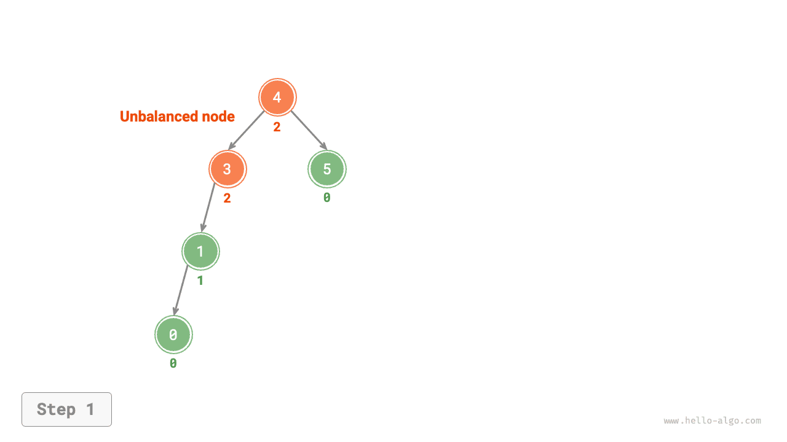
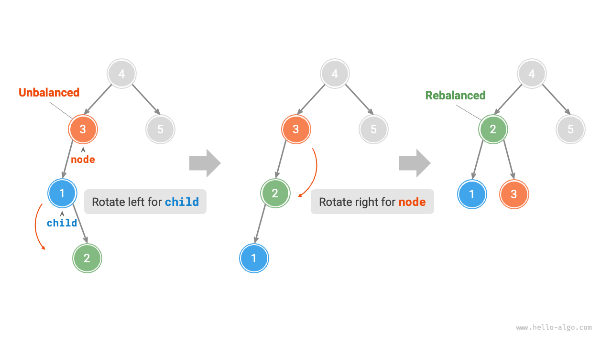

# AVL trees *

The binary-search-tree section explained that repeated insertions and deletions can make a tree degenerate into a linked list. All operations then degrade from $O(\log n)$ to $O(n)$ time.

In the example below, just two deletions turn the binary search tree into a linked list.


Likewise, inserting two nodes into the perfect binary tree below makes it heavily skewed to the left, degrading lookup performance.


In 1962, G. M. Adelson-Velsky and E. M. Landis introduced the <u>AVL tree</u> in their paper “An algorithm for the organization of information.” They described operations that prevent degeneration through repeated insertions and deletions, keeping the time complexity of operations at $O(\log n)$. AVL trees therefore maintain efficient data operations when insertions, deletions, lookups, and updates are frequent, making them valuable in practice.

## AVL tree terminology

An AVL tree is both a binary search tree and a balanced binary tree, satisfying the properties of both. It is therefore a <u>balanced binary search tree</u>.

### Node height

AVL operations need node heights, so add a `height` variable to the node class:

=== "Python"

    ```python title=""
    class TreeNode:
        """AVL tree node class"""
        def __init__(self, val: int):
            self.val: int = val                 # Node value
            self.height: int = 0                # Node height
            self.left: TreeNode | None = None   # Left child reference
            self.right: TreeNode | None = None  # Right child reference
    ```

=== "C++"

    ```cpp title=""
    /* AVL tree node class */
    struct TreeNode {
        int val{};          // Node value
        int height = 0;     // Node height
        TreeNode *left{};   // Left child
        TreeNode *right{};  // Right child
        TreeNode() = default;
        explicit TreeNode(int x) : val(x){}
    };
    ```

=== "Java"

    ```java title=""
    /* AVL tree node class */
    class TreeNode {
        public int val;        // Node value
        public int height;     // Node height
        public TreeNode left;  // Left child
        public TreeNode right; // Right child
        public TreeNode(int x) { val = x; }
    }
    ```

=== "C#"

    ```csharp title=""
    /* AVL tree node class */
    class TreeNode(int? x) {
        public int? val = x;    // Node value
        public int height;      // Node height
        public TreeNode? left;  // Left child reference
        public TreeNode? right; // Right child reference
    }
    ```

=== "Go"

    ```go title=""
    /* AVL tree node struct */
    type TreeNode struct {
        Val    int       // Node value
        Height int       // Node height
        Left   *TreeNode // Left child reference
        Right  *TreeNode // Right child reference
    }
    ```

=== "Swift"

    ```swift title=""
    /* AVL tree node class */
    class TreeNode {
        var val: Int // Node value
        var height: Int // Node height
        var left: TreeNode? // Left child
        var right: TreeNode? // Right child

        init(x: Int) {
            val = x
            height = 0
        }
    }
    ```

=== "JS"

    ```javascript title=""
    /* AVL tree node class */
    class TreeNode {
        val; // Node value
        height; //Node height
        left; // Left child pointer
        right; // Right child pointer
        constructor(val, left, right, height) {
            this.val = val === undefined ? 0 : val;
            this.height = height === undefined ? 0 : height;
            this.left = left === undefined ? null : left;
            this.right = right === undefined ? null : right;
        }
    }
    ```

=== "TS"

    ```typescript title=""
    /* AVL tree node class */
    class TreeNode {
        val: number;            // Node value
        height: number;         // Node height
        left: TreeNode | null;  // Left child pointer
        right: TreeNode | null; // Right child pointer
        constructor(val?: number, height?: number, left?: TreeNode | null, right?: TreeNode | null) {
            this.val = val === undefined ? 0 : val;
            this.height = height === undefined ? 0 : height;
            this.left = left === undefined ? null : left;
            this.right = right === undefined ? null : right;
        }
    }
    ```

=== "Dart"

    ```dart title=""
    /* AVL tree node class */
    class TreeNode {
      int val;         // Node value
      int height;      // Node height
      TreeNode? left;  // Left child
      TreeNode? right; // Right child
      TreeNode(this.val, [this.height = 0, this.left, this.right]);
    }
    ```

=== "Rust"

    ```rust title=""
    use std::rc::Rc;
    use std::cell::RefCell;

    /* AVL tree node struct */
    struct TreeNode {
        val: i32,                               // Node value
        height: i32,                            // Node height
        left: Option<Rc<RefCell<TreeNode>>>,    // Left child
        right: Option<Rc<RefCell<TreeNode>>>,   // Right child
    }

    impl TreeNode {
        /* Constructor */
        fn new(val: i32) -> Rc<RefCell<Self>> {
            Rc::new(RefCell::new(Self {
                val,
                height: 0,
                left: None,
                right: None
            }))
        }
    }
    ```

=== "C"

    ```c title=""
    /* AVL tree node struct */
    typedef struct TreeNode {
        int val;
        int height;
        struct TreeNode *left;
        struct TreeNode *right;
    } TreeNode;

    /* Constructor */
    TreeNode *newTreeNode(int val) {
        TreeNode *node;

        node = (TreeNode *)malloc(sizeof(TreeNode));
        node->val = val;
        node->height = 0;
        node->left = NULL;
        node->right = NULL;
        return node;
    }
    ```

=== "Kotlin"

    ```kotlin title=""
    /* AVL tree node class */
    class TreeNode(val _val: Int) {  // Node value
        var height: Int = 0          // Node height
        var left: TreeNode? = null   // Left child
        var right: TreeNode? = null  // Right child
    }
    ```

=== "Ruby"

    ```ruby title=""
    ### AVL tree node class ###
    class TreeNode
      attr_accessor :val    # Node value
      attr_accessor :height # Node height
      attr_accessor :left   # Left child reference
      attr_accessor :right  # Right child reference

      def initialize(val)
        @val = val
        @height = 0
      end
    end
    ```

A node's height is the distance to its farthest leaf, measured in edges. A leaf has height $0$, while a missing node has height $-1$. We create two helper functions to retrieve and update a node's height:

```src
[file]{avl_tree}-[class]{avl_tree}-[func]{update_height}
```

### Balance factor

A node's <u>balance factor</u> is its left subtree's height minus its right subtree's height. A missing node has balance factor $0$. Wrap this calculation in a function for convenient use:

```src
[file]{avl_tree}-[class]{avl_tree}-[func]{balance_factor}
```

!!! tip

    If a node's balance factor is $f$, every node in an AVL tree satisfies $-1 \le f \le 1$.

## AVL tree rotations

The defining operation of an AVL tree is rotation, which restores balance without changing the inorder traversal sequence. **A rotation preserves the binary-search-tree property while restoring the balanced-tree property**.

A node whose balance factor has absolute value $> 1$ is “unbalanced.” Depending on the imbalance, we use one of four rotations: right, left, right-then-left, or left-then-right. Let us examine them in detail.

### Right rotation

In the figure below, balance factors appear beneath the nodes. Viewed from the bottom up, node 3 is the first unbalanced node. Focus on the subtree rooted there, naming its root `node` and its left child `child`. A right rotation restores balance while preserving the binary-search-tree property.

=== "<1>"
    

=== "<2>"
    

=== "<3>"
    

=== "<4>"
    

If `child` has a right child, denoted by `grand_child`, add one step to the rotation: make `grand_child` the left child of `node`, as shown below.


“Rotating right” is a visual description; the implementation updates node pointers:

```src
[file]{avl_tree}-[class]{avl_tree}-[func]{right_rotate}
```

### Left rotation

For the mirror image of the unbalanced tree above, perform a left rotation, as shown below.


Similarly, if `child` has a left child, denoted by `grand_child`, make it the right child of `node` during the rotation.


**Right and left rotations are mirror images, as are the imbalances they resolve**. To obtain left-rotation code, exchange every `left` and `right` in the right-rotation implementation:

```src
[file]{avl_tree}-[class]{avl_tree}-[func]{left_rotate}
```

### Left-then-right rotation

For unbalanced node 3 below, neither a left nor a right rotation alone restores balance. First rotate `child` to the left, then rotate `node` to the right.



### Right-then-left rotation

For the mirror-image case below, first rotate `child` to the right, then rotate `node` to the left.


### Choosing a rotation

The four cases below correspond to the examples above and require, respectively, right, left-then-right, right-then-left, and left rotations.


As the table below shows, the signs of the unbalanced node's balance factor and that of the child on its taller side determine the case.

<p align="center"> Table <id> &nbsp; Conditions for choosing a rotation </p>

| Unbalanced node's balance factor | Child's balance factor | Rotation |
| ------------------ | ---------------- | ---------------- |
| $> 1$ (left-heavy)   | $\geq 0$         | Right             |
| $> 1$ (left-heavy)   | $<0$             | Left, then right     |
| $< -1$ (right-heavy)  | $\leq 0$         | Left             |
| $< -1$ (right-heavy)  | $>0$             | Right, then left     |

Wrap the rotation logic in one function. **It can then handle every imbalance and restore the affected node's balance**. The code is as follows:

```src
[file]{avl_tree}-[class]{avl_tree}-[func]{rotate}
```

## Common AVL tree operations

### Inserting a node

Insertion largely follows the binary-search-tree procedure. The difference is that inserting a node may unbalance nodes along the path to the root. **Starting at the inserted node, work upward and perform rotations to restore balance at every affected node**:

```src
[file]{avl_tree}-[class]{avl_tree}-[func]{insert_helper}
```

### Deleting a node

Similarly, extend binary-search-tree deletion with rotations from the bottom up to restore balance at every affected node:

```src
[file]{avl_tree}-[class]{avl_tree}-[func]{remove_helper}
```

### Finding a node

Lookup is identical to binary-search-tree lookup, so we will not repeat it here.

## Typical applications

- Organizing and storing large datasets, particularly when lookups are frequent and insertions and deletions are less frequent.
- Building database indexing systems.
- Red-black trees are another common kind of balanced binary search tree. Their balance requirements are looser than those of AVL trees, so insertion and deletion need fewer rotations and are more efficient on average.
