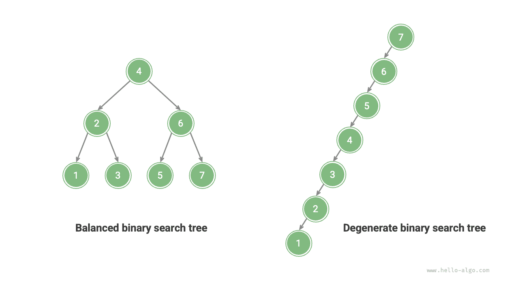

# Binary search trees

A <u>binary search tree</u> satisfies the following conditions, as shown below.

1. Every value in the left subtree is $<$ the root value, which is $<$ every value in the right subtree.
2. The left and right subtrees of every node are also binary search trees and satisfy condition `1.`.


## Binary search tree operations

We encapsulate the tree in a `BinarySearchTree` class with a member variable `root` pointing to its root node.

### Finding a node

To find a target value `num`, use the tree's ordering property. As shown below, initialize a node reference `cur` at `root` and repeatedly compare `cur.val` with `num`.

- If `cur.val < num`, the target lies in the right subtree, so set `cur = cur.right`.
- If `cur.val > num`, the target lies in the left subtree, so set `cur = cur.left`.
- If `cur.val = num`, the target has been found; exit the loop and return the node.

=== "<1>"
    

=== "<2>"
    

=== "<3>"
    

=== "<4>"
    

Searching a binary search tree follows the same principle as binary search: each round eliminates half the possibilities. The number of iterations is at most the tree's height, giving $O(\log n)$ time when the tree is balanced. An implementation follows:

```src
[file]{binary_search_tree}-[class]{binary_search_tree}-[func]{search}
```

### Inserting a node

To insert `num` while preserving the ordering “left subtree < root < right subtree,” follow the process below.

1. **Find the insertion position**: as in a search, start at the root and move down according to comparisons with `num`. Stop when the traversal passes a leaf and reaches `None`.
2. **Insert at that position**: create a node containing `num` and place it at the `None` position.


Keep two details in mind when implementing this.

- Duplicate values are not allowed under this definition. If the value already exists, return without inserting it.
- Keep a reference `pre` to the node from the previous iteration. When the traversal reaches `None`, `pre` gives its parent so that the new node can be attached.

```src
[file]{binary_search_tree}-[class]{binary_search_tree}-[func]{insert}
```

Like lookup, insertion takes $O(\log n)$ time.

### Deleting a node

First locate the target node, then remove it while preserving “left subtree < root < right subtree.” The procedure depends on whether the target has 0, 1, or 2 children.

As shown below, a node of degree $0$ is a leaf and can be removed directly.


As shown below, replace a node of degree $1$ with its only child.


A node of degree $2$ cannot simply be removed; another node must replace it. To preserve “left subtree $<$ root $<$ right subtree,” **use either the smallest node in the right subtree or the largest node in the left subtree**.

Suppose we choose the smallest node in the right subtree, the next node in inorder traversal. The process is shown below.

1. Find the target node's successor in inorder traversal and call it `tmp`.
2. Replace the target node's value with `tmp`'s value, then recursively delete `tmp` from the tree.

=== "<1>"
    

=== "<2>"
    

=== "<3>"
    

=== "<4>"
    

Deletion also takes $O(\log n)$ time: locating the target takes $O(\log n)$, and finding its inorder successor takes $O(\log n)$. An implementation follows:

```src
[file]{binary_search_tree}-[class]{binary_search_tree}-[func]{remove}
```

### Inorder traversal produces sorted data

As shown below, inorder traversal visits “left $\rightarrow$ root $\rightarrow$ right,” while a binary search tree obeys “left child $<$ root $<$ right child.”

Thus, inorder traversal always visits the next smallest node, giving an important property: **the inorder traversal of a binary search tree is in ascending order**.

This lets us retrieve sorted data from the tree in just $O(n)$ time, with no additional sorting.


## Efficiency

Suppose we want to store a dataset in an array or a binary search tree. As the table below shows, the tree's operations take logarithmic time, offering consistent and efficient performance. An array is faster only when insertions are frequent but lookups and deletions are infrequent.

<p align="center"> Table <id> &nbsp; Efficiency of arrays and search trees </p>

|          | Unsorted array | Binary search tree  |
| -------- | -------- | ----------- |
| Find an element | $O(n)$   | $O(\log n)$ |
| Insert an element | $O(1)$   | $O(\log n)$ |
| Delete an element | $O(n)$   | $O(\log n)$ |

Ideally, the tree is balanced, allowing any node to be found within $\log n$ iterations.

However, repeated insertions and deletions may cause it to degenerate into a linked list, as shown below. The time complexity of its operations then degrades to $O(n)$.



## Common applications

- Multilevel indexes in systems, supporting efficient lookup, insertion, and deletion.
- The underlying data structure for certain search algorithms.
- Storing a data stream while maintaining its order.
